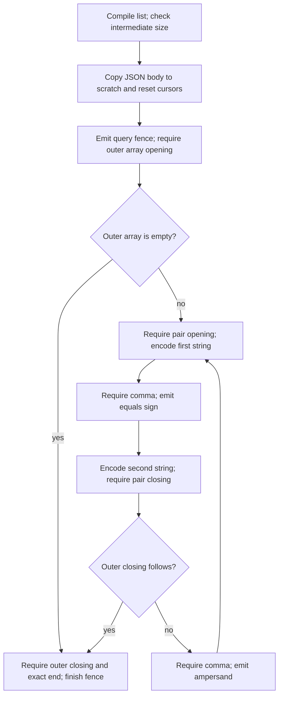
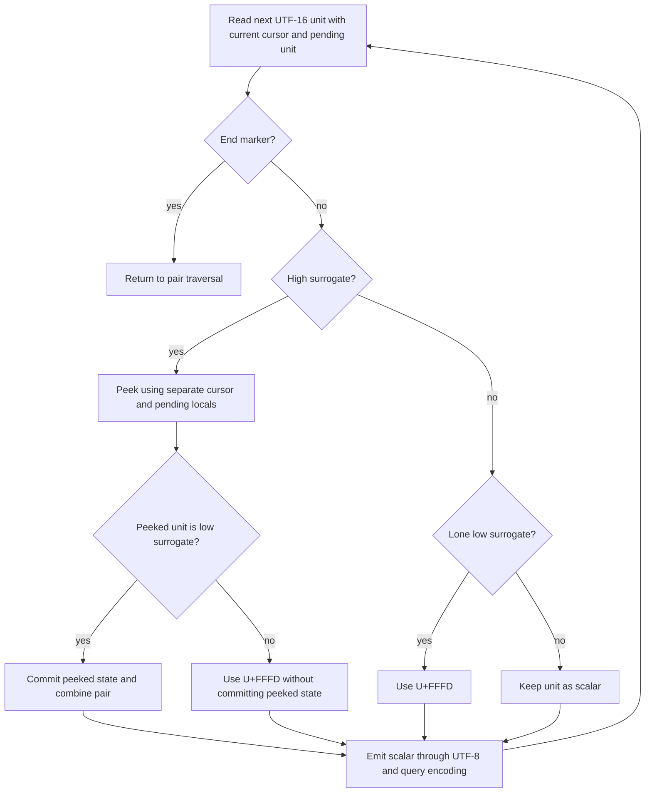
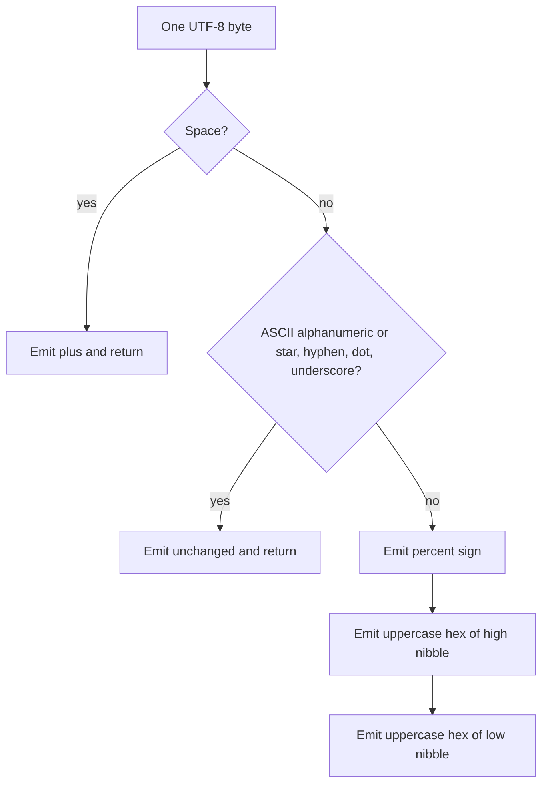

# Ordered Markdown pairs to a URL query string

Tool 25 reverses the [query reader](24-query-to-list.md). Its input is an array
of pairs, each an array containing exactly two strings: name, then value.
Repeated names and empty names are intentional, not duplicate-key errors.

```text
- []
  - []
    - name
    - Ben Atkin
  - []
    - tag
    - wasm
  - []
    - tag
    - Markdown
  - []
    - flag
    - ""
```

becomes:

```query
name=Ben+Atkin&tag=wasm&tag=Markdown&flag=
```

## A query, not a URL or a request

This uses the [URL Standard's form-url-encoded serializer](https://url.spec.whatwg.org/#concept-urlencoded-serializer)
with UTF-8. ASCII letters, digits, `*`, `-`, `.`, and `_` pass unchanged;
space becomes `+`. Every other UTF-8 byte becomes an uppercase `%HH` triplet.
In particular, literal plus, percent, ampersand, equals and backtick characters
are encoded. A field therefore cannot introduce a separator or Markdown fence.
Names and values are joined with `=`, and pairs with `&`, without a leading `?`.
An empty array produces an empty fenced query. No network operation occurs.

Escaped surrogate pairs become their Unicode scalar. Lone surrogates become
U+FFFD, matching `URLSearchParams`' conversion to scalar-value strings. This
is deliberate replacement, not preservation of invalid Unicode; every valid
scalar, including NUL, line breaks and BOM, is preserved through encoding.
Malformed input UTF-8 is rejected by the shared list compiler/string iterator.
Neither numeric coercion nor a nested-object naming convention is invented:
typed numbers, booleans, nulls, objects and pairs of any other size are errors.

Reading then writing canonicalizes query spelling: bare flags acquire `=`,
spaces use `+`, percent hex is uppercase, redundant encoding of safe bytes
disappears and malformed UTF-8 has already become replacement characters.
Writing then reading preserves the ordered scalar-value string pairs.

## Pattern: one traversal, one pending code unit

The list compiler validates the tree and emits compact JSON. Its body is
copied to the final memory page after compilation, replacing the compiler's
now-unused stack. The writer traverses only two array levels. A small string
scanner locates each closing quote in that validated JSON, skipping escapes.
The shared iterator decodes JSON escapes and UTF-8 without host strings.

```text
compile the list and copy its JSON body to scratch
require an array root
for each child:
  require an array of exactly two strings
  decode and encode the name; emit '='; decode and encode the value
  emit '&' only between pairs

for each decoded UTF-16 unit in a string:
  high surrogate: peek at the next unit
    low surrogate: consume it and combine the pair
    otherwise: emit replacement without consuming the peeked unit
  lone low surrogate: emit replacement
  ordinary unit: emit it
  encode each resulting scalar to UTF-8, then encode each byte for the query
```

Keeping the peeked cursor separate avoids losing the character after an
unpaired high surrogate. A pending low surrogate from raw astral UTF-8 uses
the same path as an escaped pair. All work is linear in the input/output
size; there is no key table, duplicate search or heap allocation.

Input and intermediate JSON each have a 64 KiB limit; output has a 128 KiB
limit. Shared memory is fixed at four pages. Bounds are checked before stores,
and source bytes are unchanged. Percent encoding may exhaust output before
input. The UI keeps its previous successful result after a trap; a subsequent
run rebuilds the list stack and resets the writer cursors.

## Inside the writer

### `run`: validate shape while streaming each pair



The byte labels `lq-pair-name`, `-value`, `-end`, and `-next` correspond to
the loop above. `take` checks each expected bracket or comma, including bounds,
before moving the global source cursor. `string` checks its own opening quote.
Together they reject an empty pair, a third item, a non-string item, or a
non-array child without constructing another tree.

The list compiler has already validated JSON syntax. This traversal checks
the destination's narrower shape, rather than trusting any JSON array as a
pair list. After the outer closing bracket, the source cursor must equal the
saved end. The final newline and fence are written only after that check.

### `string`: scan once, then decode with a non-consuming peek

The first loop (`lq-string-scan`) locates the closing quote. Backslash skips
one following byte, so an escaped quote does not terminate the scan. The JSON
has already been validated; the loop is finding a boundary, not interpreting
escapes. It saves that boundary as local 1 and advances the global source
cursor past the quote. Locals then decode within that bounded string span.



| State | Locals | When it changes |
| --- | --- | --- |
| Current decoder cursor and pending unit | 0 and 2 | After a normal iterator call, or a successful surrogate-pair peek. |
| String end | 1 | Set by the quote scanner; never advances during decoding. |
| Current unit or combined scalar | 3 | Replaced with a combined scalar or U+FFFD when needed. |
| Peeked unit, cursor and pending unit | 4, 5 and 6 | Speculative until the peek completes a valid pair. |

For `high-surrogate, A`, the replacement is emitted and `A` is read again on
the next iteration. For `high-surrogate, high-surrogate, low-surrogate`, the
first is replaced, while the second and third still form a pair. Committing
every peek would incorrectly lose those following characters. At string end,
the iterator's `-1` is distinct from a valid NUL character.

### `UTF-8`, `encoded-byte`, and `emit`: keep three responsibilities separate

`UTF-8` chooses one, two, three or four bytes based on scalar magnitude. Its
multibyte branches share the final continuation byte, and its three/four-byte
branches share the final two. Every resulting byte goes through `encoded-byte`,
not directly to memory.



`encoded-byte` knows the query's escaping policy. `hex-digit` merely maps a
nibble to 0–9 or A–F. `emit` alone owns the bounds check and memory store.
Because the Unicode iterator never emits raw invalid scalars to `UTF-8`, the
UTF-8 routine needs no second surrogate validator.

## Module

Imports: list-run 0, next-unit 1, shared memory. Definitions: run 2, emit 3,
take 4, string 5, UTF-8 6, encoded-byte 7, hex-digit 8. Globals: output 0,
source cursor 1, source end 2. `take` consumes an expected structural byte.

`[microwasm]`

- lq-header: `0061736d 01000000`
- lq-type-section: `01 {{size:lq-types}}`
  - lq-types: `04 60 01 7f 01 7f 60 03 7f 7f 7f 03 7f 7f 7f 60 01 7f 00 60 00 00`
- lq-import-section: `02 {{size:lq-imports}}`
  - lq-imports: `03 01 6c 03 72756e 00 00 01 6b 04 6e657874 00 01 01 6c 06 6d656d6f7279 02 01 04 04`
- lq-function-section: `03 {{size:lq-functions}}`
  - lq-functions: `07 00 02 02 03 02 02 02`
- lq-global-section: `06 {{size:lq-globals}}`
  - lq-globals: `03 7f 01 41 00 0b 7f 01 41 00 0b 7f 01 41 00 0b`
- lq-export-section: `07 {{size:lq-exports}}`
  - lq-exports: `02 03 72756e 00 02 06 6d656d6f7279 02 00`
- lq-code-section: `0a {{size:lq-code}}`
  - lq-code: `07`
    - lq-run-record: `{{size:lq-run-body}}`
      - lq-run-body: `01 01 7f`
        - lq-compile: `20 00 10 00 41 0d 6b 21 01`
        - lq-source-bound: `20 01 45 20 01 41 808004 4b 72 04 40 00 0b`
        - lq-source-copy: `41 80800c 41 888004 20 01 fc 0a 00 00` — Move only the compact JSON body, after the list compiler has finished using its stack.
        - lq-reset: `41 808004 24 00 41 80800c 24 01 41 80800c 20 01 6a 24 02`
        - lq-fence: `41 e000 10 03 41 e000 10 03 41 e000 10 03 41 f100 10 03 41 f500 10 03 41 e500 10 03 41 f200 10 03 41 f900 10 03 41 0a 10 03`
        - lq-root: `41 db00 10 04 23 01 2d 00 00 41 dd00 47 04 40 03 40`
          - lq-pair-name: `41 db00 10 04 10 05 41 2c 10 04 41 3d 10 03`
          - lq-pair-value: `10 05 41 dd00 10 04`
          - lq-pair-end: `23 01 2d 00 00 41 dd00 46 0d 01`
          - lq-pair-next: `41 2c 10 04 41 26 10 03 0c 00 0b 0b`
        - lq-root-end: `41 dd00 10 04 23 01 23 02 47 04 40 00 0b`
        - lq-close: `41 0a 10 03 41 e000 10 03 41 e000 10 03 41 e000 10 03 41 0a 10 03 23 00 41 808004 6b 0b`
    - lq-emit-record: `{{size:lq-emit-body}}`
      - lq-emit-body: `00 23 00 41 80800c 4f 04 40 00 0b 23 00 20 00 3a 00 00 23 00 41 01 6a 24 00 0b`
    - lq-take-record: `{{size:lq-take-body}}`
      - lq-take-body: `00 23 01 23 02 4f 04 40 00 0b 23 01 2d 00 00 20 00 47 04 40 00 0b 23 01 41 01 6a 24 01 0b`
    - lq-string-record: `{{size:lq-string-body}}`
      - lq-string-body: `01 07 7f`
        - lq-string-open: `41 22 10 04 23 01 21 00 23 01 21 01`
        - lq-string-scan: `02 40 03 40`
          - lq-string-scan-bound: `20 01 23 02 4f 04 40 00 0b` — A quote must be found inside the validated JSON body.
          - lq-string-scan-close: `20 01 2d 00 00 41 22 46 0d 01` — Keep the closing quote's position as the exclusive decoder end.
          - lq-string-scan-escape: `20 01 2d 00 00 41 dc00 46 04 40 20 01 41 01 6a 21 01 0b` — Skip an escaped byte so an escaped quote cannot end the scan.
          - lq-string-scan-next: `20 01 41 01 6a 21 01 0c 00 0b 0b` — Advance and repeat, then retain the bounded span.
        - lq-string-source-next: `20 01 41 01 6a 24 01`
        - lq-string-loop: `02 40 03 40 20 00 20 01 20 02 10 01 21 02 21 00 21 03 20 03 41 7f 46 0d 01`
          - lq-string-high: `20 03 41 80b003 6b 41 ff07 4d 04 40`
            - lq-string-peek: `20 00 20 01 20 02 10 01 21 06 21 05 21 04` — Decode speculatively into locals 4–6; do not change cursor 0 or pending 2 yet.
            - lq-string-pair: `20 04 41 80b803 6b 41 ff07 4d 04 40 20 05 21 00 20 06 21 02 20 03 41 80b003 6b 41 0a 74 20 04 41 80b803 6b 6a 41 808004 6a 21 03`
            - lq-string-replacement: `05 41 fdff03 21 03 0b` — Leave the failed peek unconsumed and replace only the current high surrogate.
          - lq-string-lone-low: `05 20 03 41 80b803 6b 41 ff07 4d 04 40 41 fdff03 21 03 0b 0b`
          - lq-string-emit: `20 03 10 06 0c 00 0b 0b 0b`
    - lq-utf8-record: `{{size:lq-utf8-body}}`
      - lq-utf8-body: `00`
        - lq-utf8-ascii: `20 00 41 8001 49 04 40 20 00 10 07 0f 0b`
        - lq-utf8-two: `20 00 41 8010 49 04 40 20 00 41 06 76 41 c001 72 10 07`
          - lq-utf8-more: `05 20 00 41 808004 49 04 40 20 00 41 0c 76 41 e001 72 10 07`
            - lq-utf8-four: `05 20 00 41 12 76 41 f001 72 10 07 20 00 41 0c 76 41 3f 71 41 8001 72 10 07 0b`
          - lq-utf8-middle: `20 00 41 06 76 41 3f 71 41 8001 72 10 07 0b`
        - lq-utf8-last: `20 00 41 3f 71 41 8001 72 10 07 0b`
    - lq-byte-record: `{{size:lq-byte-body}}`
      - lq-byte-body: `00`
        - lq-byte-space: `20 00 41 20 46 04 40 41 2b 10 03 0f 0b`
        - lq-byte-safe: `20 00 41 30 6b 41 09 4d 20 00 41 c100 6b 41 19 4d 72 20 00 41 e100 6b 41 19 4d 72 20 00 41 2a 46 72 20 00 41 2d 46 72 20 00 41 2e 46 72 20 00 41 df00 46 72 04 40 20 00 10 03 0f 0b`
        - lq-byte-percent: `41 25 10 03 20 00 41 04 76 10 08 20 00 41 0f 71 10 08 0b`
    - lq-hex-record: `{{size:lq-hex-body}}`
      - lq-hex-body: `00 20 00 20 00 41 0a 49 04 7f 41 30 05 41 37 0b 6a 10 03 0b`

String locals: decoded cursor/end 0/1, pending surrogate 2, unit/scalar 3,
peeked unit 4, peeked cursor 5, peeked pending unit 6. The peek does not mutate
the caller's cursor unless it completes a surrogate pair.
