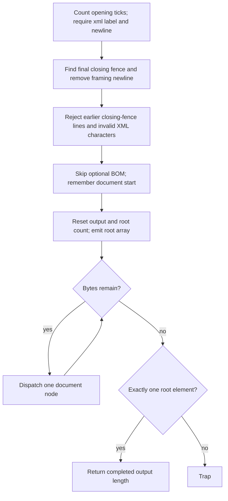
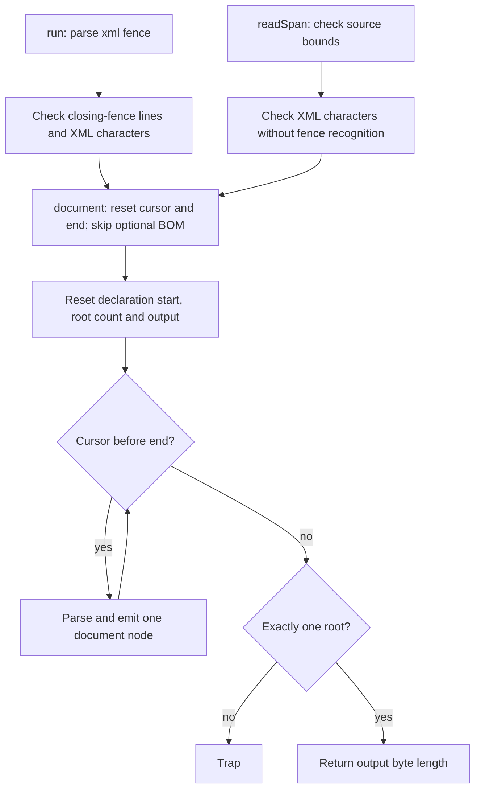
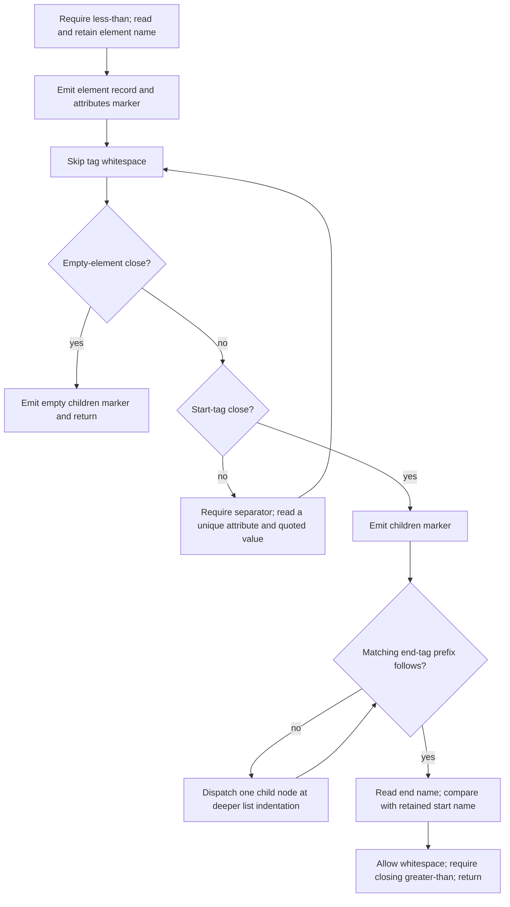
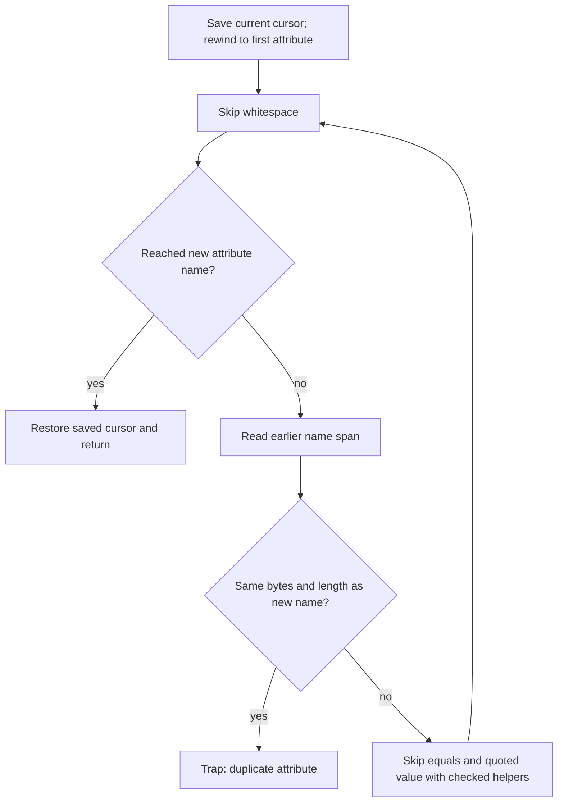
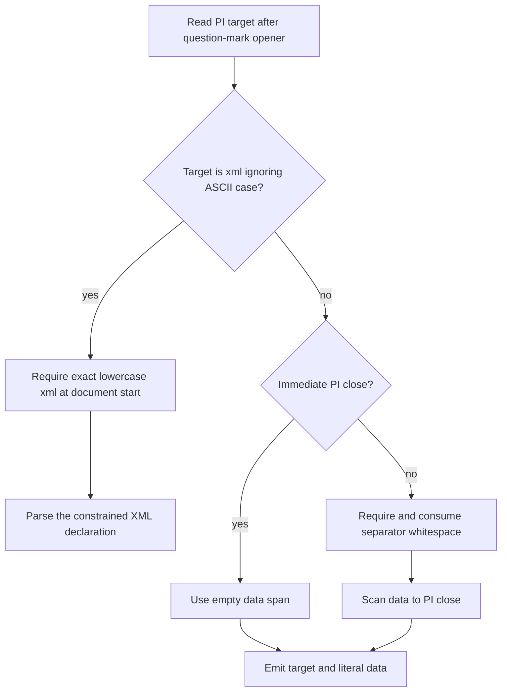

# XML to an ordered Markdown tree

Tool 26 reads one UTF-8 XML document inside an `xml` fence. Its result is an
array of nodes, using the ordinary hierarchical Markdown data notation.
Element objects contain `element`, `attributes` and `children`. Text,
comments and CDATA use single-property objects; processing instructions use
`pi` and `data`. This keeps mixed content and repeated siblings in order.

```xml
<note priority="high">Hello <b>Ben</b> &amp; friends.</note>
```

becomes:

```text
- []
  - {}
    - "element" "note"
    - "attributes" {}
      - "priority" "high"
    - "children" []
      - {}
        - "text" "Hello "
      - {}
        - "element" "b"
        - "attributes" {}
        - "children" []
          - {}
            - "text" "Ben"
      - {}
        - "text" " & friends."
```

## Contract and limits

The reader implements XML 1.0 lexical names, one root element, matching
case-sensitive tags, unique attributes, quoted values, predefined/numeric
references, comments, CDATA and processing instructions. DTDs and undeclared
entities are rejected. There is no resource loading, validation against a
schema, namespace expansion or namespace-binding inference. Colons and
`xmlns` attributes are preserved as lexical names and ordinary attributes.

The optional initial declaration is represented by a `declaration` object
whose string properties are `version`, optional `encoding`, and optional
`standalone`. Version must be `1.0`; encoding, if present, must spell `UTF-8`
case-insensitively; standalone is `yes` or `no`. Their order is checked.
Only an initial UTF-8 BOM may precede the declaration. XML 1.1 and other
declared encodings require a different reader, not silent interpretation.

Text whitespace is retained, including whitespace outside the root. Literal
CRLF/CR becomes LF; literal attribute whitespace becomes spaces while numeric
references retain their characters. Empty-element syntax and separate empty
start/end tags have the same tree. Entity spellings and quote choices are not
retained, but comments and CDATA boundaries are. PI separator whitespace is
not part of its `data`; trailing data whitespace is retained.

The opening fence has at least three backticks, immediately followed by `xml`
and LF or CRLF. The closing fence uses at least as many backticks on its own
line. A closing-fence line inside XML content is rejected: use a longer outer
fence. The single framing newline before the closing fence is not XML data.

Input is at most 64 KiB. Output occupies the next 128 KiB of fixed four-page
memory; the final page contains only short, u8-length-prefixed literals.
Every store is bounded. Element nesting is limited to 32 levels, while the
tree explicitly adds attribute/children containers. Source bytes do not
change. A trap may leave partial output, which the UI must not publish.
The next call resets all parsing state. This is a document reader, not an
HTML parser or an error-recovering XML editor.

`readSpan(start, end)` reads an unfenced XML document from a half-open span
within the first 64 KiB and returns the same output length. It is for other
format converters that have already removed their own Markdown framing.
It still checks UTF-8, XML syntax, one root, nesting and output capacity;
it does not accept an XML fragment or skip validation. It writes the ordinary
ordered tree at `65536`, just as `run` does. Callers may discard that tree
after validation, but its output-capacity limit still applies.

## Function walkthroughs

### `run`: framing, validation and the one-root condition



`fence-lines` validates scalar encoding before any tree output. It considers
only up to three leading spaces for a Markdown closing fence, not arbitrary
backticks embedded in text. `node` increments the root count only when an
element is encountered at document depth. Comments and PIs do not count as
roots; top-level text must contain only XML whitespace.

Both entry points join at `document(start, end)`. That function resets the
cursor/end globals, skips an optional leading BOM, records the declaration's
only allowed start position, and resets the root count and output cursor.
It then dispatches nodes until the cursor reaches end and requires one root.
No parser state is carried from a preceding successful or failed call.



The raw-span entry reuses the character-validation scan with a fence threshold
of 65,537, greater than any possible backtick run in its input. Backticks are
therefore just XML data in this entry. It does not rewrite a caller's language
label to `xml`, move their source, or mistake a literal fence for framing.

### `element`: attributes finish before child recursion begins



The start-name offsets remain in this call's locals while recursive child
calls use their own locals. Duplicate-attribute checks rescan only the already
validated portion of the same start tag. That is quadratic for a very wide
attribute list but needs no name table, heap or shared recursion stack.
The helper temporarily changes the global cursor, then restores it before
the current attribute is read. Attribute order is kept in the output.

| `element` state | Local | Lifetime |
| --- | --- | --- |
| Output list depth | 0 | Fixed for this element; a child element receives depth + 2. |
| Start-tag name span | 1, 2 | Retained until the end tag has been compared. |
| First possible attribute position | 3 | Retained for each duplicate-name rescan. |
| Current attribute or end-tag name | 4, 5 | Reused after the attribute loop finishes. |
| Current attribute value span | 6, 7 | Needed only while decoding/emitting that attribute. |
| Cursor before whitespace | 8 | Proves an attribute was separated from the preceding name/value. |

For `<a><b/></a>`, `a` retains its name span while `b` advances the shared
cursor past `/>`. Returning does not restore that cursor: `a` must continue
at `</a>`. In contrast, `unique` deliberately restores the cursor, because
its scan is only a look back at attributes already consumed.

### `unique`: scan earlier names without consuming the new attribute



Names need byte equality, not entity decoding: XML names cannot contain
entity references, and equivalent-looking Unicode spellings remain distinct
names. The caller invokes `unique` just after reading the new name, before
its equals sign. The stop position is the new name's **start**, so the new
name is never compared against itself. On success, the saved cursor points
after that new name, ready for its value.

### `node`, `text`, `special`, and `instruction`

Dispatch checks comment, CDATA and PI prefixes before treating `<` as an
element start. Unsupported declarations therefore fail at the name check;
they are not skipped. CDATA is allowed only inside an element.

`text` scans to the next raw `<`, then delegates reference decoding and JSON
quoting to the shared XML string helper. `special` scans to `-->` or `]]>`;
the comment path rejects any earlier `--`. Both paths use literal string mode,
so entity-looking content stays literal. Scans require their terminator.



`declaration` tracks the next allowed field position. Version is mandatory
first; encoding may follow it; standalone may follow either. Advancing that
position also rejects repeats. Declaration values are checked literally,
without interpreting entity references as declaration syntax.

| Next field position | Allowed next name | New position |
| --- | --- | --- |
| 0 | `version` only | 1 |
| 1 | `encoding` or `standalone` | 2 or 3 |
| 2 | `standalone` only | 3 |
| 3 | No further fields | — |

At any position except 0, `?>` finishes the declaration. Before any field,
the cursor must advance through at least one whitespace byte. This rejects
both a missing version and adjacent fields such as `version='1.0'encoding=...`.
Value checks run before the field is emitted. The encoding comparison folds
only the ASCII `UTF` letters; it still requires exactly the five-byte `UTF-8`
spelling. It does not route through a locale or general case-conversion table.

### Small shared operations

- `read-name` returns the original start and the helper's exclusive end,
  committing the global cursor only after the name scan succeeds.
- `attribute-value` consumes matching single/double quote delimiters, returning
  the interior span. The XML string helper validates and decodes that span.
- `match` compares a short length-prefixed literal without consuming input.
  `take` consumes exactly one required byte; `spaces` consumes only XML spaces.
- `quote` writes through the XML string helper, then advances the main output
  cursor by the returned length. `emit` and the helper both enforce the same
  output boundary. `prefix` emits indentation and `- `; `literal` emits a
  trusted static fragment whose length is stored as one byte, not a terminator.

## Module

The nine reader tests cover generated documents against Saxes, single-byte
edits, malformed markup, Unicode/character errors in every node context,
fence boundaries, 32-level nesting, 500 attributes, and exact memory limits.
Successful and failed runs preserve the source and literal-data regions.
Browser tests independently compare the mixed-content tree with `DOMParser`.
Raw-span tests also compare both entry points at varied offsets, preserve
surrounding source bytes and literal storage, and alternate calls after traps.

Oracle differences are explicit: Saxes drops initial whitespace before markup,
while this tree retains it. Saxes 6 also accepts `<?p?data?>`; this reader and
Chromium reject it because the [PI production](https://www.w3.org/TR/xml/#sec-pi)
requires whitespace before nonempty data. Neither difference is silently
normalized away by the tests.

Imports: name-end 0, string 1, scalar 2, shared memory. Definitions: run 3,
emit 4, literal 5, prefix 6, quote 7, spaces 8, take 9, match 10, same 11,
unique 12, node 13, element 14, text 15, special 16, instruction 17,
declaration 18, attribute-value 19, read-name 20, whitespace 21,
span-literal 22, fence-lines 23, read-span 24, document 25.
Globals: output 0, cursor 1, end 2,
root count 3, document start 4, opening-fence length 5.

`[microwasm]`

- xl-header: `0061736d 01000000`
- xl-type-section: `01 {{size:xl-types}}`
  - xl-types: `0a 60 02 7f 7f 01 7f 60 04 7f 7f 7f 7f 01 7f 60 02 7f 7f 02 7f 7f 60 01 7f 01 7f 60 01 7f 00 60 03 7f 7f 7f 00 60 00 00 60 02 7f 7f 00 60 00 02 7f 7f 60 03 7f 7f 7f 01 7f`
- xl-import-section: `02 {{size:xl-imports}}`
  - xl-imports: `04 01 78 07 6e616d65456e64 00 00 01 78 06 737472696e67 00 01 01 78 06 7363616c6172 00 02 01 78 06 6d656d6f7279 02 01 04 04`
- xl-function-section: `03 {{size:xl-functions}}`
  - xl-functions: `17 03 04 04 04 05 06 04 03 01 05 04 04 04 07 04 04 08 08 03 09 05 00 00`
- xl-global-section: `06 {{size:xl-globals}}`
  - xl-globals: `06 7f 01 41 00 0b 7f 01 41 00 0b 7f 01 41 00 0b 7f 01 41 00 0b 7f 01 41 00 0b 7f 01 41 00 0b`
- xl-export-section: `07 {{size:xl-exports}}`
  - xl-exports: `03 03 72756e 00 03 06 6d656d6f7279 02 00 08 726561645370616e 00 18`
- xl-code-section: `0a {{size:xl-code}}`
  - xl-code: `17`
    - xl-run-record: `{{size:xl-run-body}}`
      - xl-run-body: `01 03 7f`
        - xl-run-bound: `20 00 41 0a 49 20 00 41 808004 4b 72 04 40 00 0b`
        - xl-run-ticks: `02 40 03 40 20 01 20 00 4f 0d 01 20 01 2d 00 00 41 e000 47 0d 01 20 01 41 01 6a 21 01 0c 00 0b 0b 20 01 41 03 49 04 40 00 0b 20 01 24 05 20 01 24 01 20 00 24 02`
        - xl-run-label: `41 b9810c 10 0a 45 04 40 00 0b 23 01 41 03 6a 24 01`
        - xl-run-opening: `23 01 23 02 49 04 40 23 01 2d 00 00 41 0d 46 04 40 23 01 41 01 6a 24 01 0b 0b 41 0a 10 09 23 01 21 02`
        - xl-run-trim: `02 40 03 40 23 02 20 02 4d 0d 01 23 02 41 01 6b 2d 00 00 10 15 45 0d 01 23 02 41 01 6b 24 02 0c 00 0b 0b`
        - xl-run-closing-ticks: `02 40 03 40 23 02 20 02 4d 0d 01 23 02 41 01 6b 2d 00 00 41 e000 47 0d 01 23 02 41 01 6b 24 02 20 03 41 01 6a 21 03 0c 00 0b 0b 20 03 23 05 49 04 40 00 0b`
        - xl-run-framing: `23 02 20 02 4b 04 40 23 02 41 01 6b 24 02 23 02 2d 00 00 41 0a 47 04 40 00 0b 23 02 20 02 4b 04 40 23 02 41 01 6b 2d 00 00 41 0d 46 04 40 23 02 41 01 6b 24 02 0b 0b 0b`
        - xl-run-validate: `20 02 23 02 23 05 10 17`
        - xl-run-document: `23 01 23 02 10 19 0b` — Framing is finished; join the unfenced document path.
    - xl-emit-record: `{{size:xl-emit-body}}`
      - xl-emit-body: `00 23 00 41 80800c 4f 04 40 00 0b 23 00 20 00 3a 00 00 23 00 41 01 6a 24 00 0b`
    - xl-literal-record: `{{size:xl-literal-body}}`
      - xl-literal-body: `01 01 7f 20 00 2d 00 00 20 00 6a 41 01 6a 21 01 20 00 41 01 6a 21 00 02 40 03 40 20 00 20 01 4f 0d 01 20 00 2d 00 00 10 04 20 00 41 01 6a 21 00 0c 00 0b 0b 0b`
    - xl-prefix-record: `{{size:xl-prefix-body}}`
      - xl-prefix-body: `00 02 40 03 40 20 00 45 0d 01 41 20 10 04 41 20 10 04 20 00 41 01 6b 21 00 0c 00 0b 0b 41 2d 10 04 41 20 10 04 0b`
    - xl-quote-record: `{{size:xl-quote-body}}`
      - xl-quote-body: `00 23 00 20 00 20 01 23 00 20 02 10 01 6a 24 00 0b`
    - xl-spaces-record: `{{size:xl-spaces-body}}`
      - xl-spaces-body: `00 02 40 03 40 23 01 23 02 4f 0d 01 23 01 2d 00 00 10 15 45 0d 01 23 01 41 01 6a 24 01 0c 00 0b 0b 0b`
    - xl-take-record: `{{size:xl-take-body}}`
      - xl-take-body: `00 23 01 23 02 4f 04 40 00 0b 23 01 2d 00 00 20 00 47 04 40 00 0b 23 01 41 01 6a 24 01 0b`
    - xl-match-record: `{{size:xl-match-body}}`
      - xl-match-body: `01 01 7f 20 00 2d 00 00 21 01 23 01 20 01 6a 23 02 4b 04 40 41 00 0f 0b 23 01 23 01 20 01 6a 20 00 41 01 6a 20 00 41 01 6a 20 01 6a 10 0b 0b`
    - xl-same-record: `{{size:xl-same-body}}`
      - xl-same-body: `00 20 01 20 00 6b 20 03 20 02 6b 47 04 40 41 00 0f 0b 02 40 03 40 20 00 20 01 4f 0d 01 20 00 2d 00 00 20 02 2d 00 00 47 04 40 41 00 0f 0b 20 00 41 01 6a 21 00 20 02 41 01 6a 21 02 0c 00 0b 0b 41 01 0b`
    - xl-unique-record: `{{size:xl-unique-body}}`
      - xl-unique-body: `01 03 7f`
        - xl-unique-save: `23 01 21 05 20 00 24 01` — Save cursor in local 5, then rewind.
        - xl-unique-exit: `02 40`
          - xl-unique-loop: `03 40`
            - xl-unique-stop: `10 08 23 01 20 01 4f 0d 01` — Stop before comparing the current name with itself.
            - xl-unique-name: `10 14 21 04 21 03` — Earlier name span in locals 3 and 4.
            - xl-unique-compare: `20 03 20 04 20 01 20 02 10 0b 04 40 00 0b` — Exact equality traps.
            - xl-unique-value: `10 08 41 3d 10 09 10 08 10 13 1a 1a` — Consume the earlier value; discard its returned span.
            - xl-unique-next: `0c 00 0b`
          - xl-unique-end: `0b`
        - xl-unique-restore: `20 05 24 01 0b` — Only this look-back operation restores the input cursor.
    - xl-node-record: `{{size:xl-node-body}}`
      - xl-node-body: `00`
        - xl-node-bound: `23 01 23 02 4f 04 40 00 0b`
        - xl-node-text: `23 01 2d 00 00 41 3c 47 04 40 20 00 10 0f 0f 0b`
        - xl-node-comment: `41 ef800c 10 0a 04 40 20 00 41 00 10 10 0f 0b`
        - xl-node-cdata: `41 f8800c 10 0a 04 40 20 00 41 01 46 04 40 00 0b 20 00 41 01 10 10 0f 0b`
        - xl-node-pi: `41 86810c 10 0a 04 40 20 00 10 11 0f 0b`
        - xl-node-root: `20 00 41 01 46 04 40 23 03 04 40 00 0b 41 01 24 03 0b`
        - xl-node-element: `20 00 10 0e 0b`
    - xl-element-record: `{{size:xl-element-body}}`
      - xl-element-body: `01 08 7f`
        - xl-element-depth: `20 00 41 3f 4b 04 40 00 0b`
        - xl-element-name: `41 3c 10 09 10 14 21 02 21 01 23 01 21 03`
        - xl-element-record-start: `20 00 10 06 41 80800c 10 05 20 00 41 01 6a 10 06 41 88800c 10 05 20 01 20 02 41 02 10 07 41 0a 10 04 20 00 41 01 6a 10 06 41 93800c 10 05`
        - xl-element-attributes: `02 40 03 40 23 01 21 08 10 08`
          - xl-element-empty: `41 8f810c 10 0a 04 40 23 01 41 02 6a 24 01 20 00 41 01 6a 10 06 41 a4800c 10 05 0f 0b`
          - xl-element-start-close: `23 01 23 02 4f 04 40 00 0b 23 01 2d 00 00 41 3e 46 04 40 23 01 41 01 6a 24 01 0c 02 0b`
          - xl-element-attribute-name: `23 01 20 08 46 04 40 00 0b 10 14 21 05 21 04 20 03 20 04 20 05 10 0c`
          - xl-element-attribute-value: `10 08 41 3d 10 09 10 08 10 13 21 07 21 06`
          - xl-element-attribute-output: `20 00 41 02 6a 10 06 20 04 20 05 41 02 10 07 41 20 10 04 20 06 20 07 41 01 10 07 41 0a 10 04 0c 00 0b 0b`
        - xl-element-children: `20 00 41 01 6a 10 06 41 a4800c 10 05 02 40 03 40 41 8c810c 10 0a 0d 01 20 00 41 02 6a 10 0d 0c 00 0b 0b`
        - xl-element-end-name: `23 01 41 02 6a 24 01 10 14 21 05 21 04 20 01 20 02 20 04 20 05 10 0b 45 04 40 00 0b 10 08 41 3e 10 09 0b`
    - xl-text-record: `{{size:xl-text-body}}`
      - xl-text-body: `01 01 7f 23 01 21 01 02 40 03 40 23 01 23 02 4f 0d 01 23 01 2d 00 00 41 3c 46 0d 01 20 00 41 01 46 04 40 23 01 2d 00 00 10 15 45 04 40 00 0b 0b 23 01 41 01 6a 24 01 0c 00 0b 0b 20 00 10 06 41 80800c 10 05 20 00 41 01 6a 10 06 41 b3800c 10 05 20 01 23 01 41 00 10 07 41 0a 10 04 0b`
    - xl-special-record: `{{size:xl-special-body}}`
      - xl-special-body: `01 01 7f`
        - xl-special-open: `23 01 20 01 04 7f 41 09 05 41 04 0b 6a 24 01 23 01 21 02`
        - xl-special-loop: `02 40 03 40 20 01 04 7f 41 82810c 05 41 f4800c 0b 10 0a 0d 01 23 01 23 02 4f 04 40 00 0b`
          - xl-special-comment-dashes: `20 01 45 23 01 41 01 6a 23 02 49 71 04 40 23 01 2d 00 00 41 2d 46 23 01 41 01 6a 2d 00 00 41 2d 46 71 04 40 00 0b 0b`
          - xl-special-next: `23 01 41 01 6a 24 01 0c 00 0b 0b`
        - xl-special-output: `20 00 10 06 41 80800c 10 05 20 00 41 01 6a 10 06 20 01 04 7f 41 c6800c 05 41 bb800c 0b 10 05 20 02 23 01 41 02 10 07 41 0a 10 04 23 01 41 03 6a 24 01 0b`
    - xl-instruction-record: `{{size:xl-instruction-body}}`
      - xl-instruction-body: `01 04 7f`
        - xl-instruction-target: `23 01 21 01 23 01 41 02 6a 24 01 10 14 21 03 21 02`
        - xl-instruction-reserved: `20 03 20 02 6b 41 03 46 04 40 20 02 2d 00 00 41 20 72 41 f800 46 20 02 41 01 6a 2d 00 00 41 20 72 41 ed00 46 71 20 02 41 02 6a 2d 00 00 41 20 72 41 ec00 46 71 04 40`
          - xl-instruction-declaration: `20 01 23 04 47 20 02 20 03 41 b9810c 10 16 45 72 04 40 00 0b 20 00 10 12 0f 0b 0b`
        - xl-instruction-separator: `41 89810c 10 0a 45 04 40 23 01 21 04 10 08 23 01 20 04 46 04 40 00 0b 0b 23 01 21 04`
        - xl-instruction-data: `02 40 03 40 41 89810c 10 0a 0d 01 23 01 23 02 4f 04 40 00 0b 23 01 41 01 6a 24 01 0c 00 0b 0b`
        - xl-instruction-output: `20 00 10 06 41 80800c 10 05 20 00 41 01 6a 10 06 41 cf800c 10 05 20 02 20 03 41 02 10 07 41 0a 10 04 20 00 41 01 6a 10 06 41 d5800c 10 05 20 04 23 01 41 02 10 07 41 0a 10 04 23 01 41 02 6a 24 01 0b`
    - xl-declaration-record: `{{size:xl-declaration-body}}`
      - xl-declaration-body: `01 07 7f`
        - xl-declaration-output: `20 00 10 06 41 80800c 10 05 20 00 41 01 6a 10 06 41 dd800c 10 05`
        - xl-declaration-loop: `03 40 23 01 21 06 10 08`
          - xl-declaration-end: `41 89810c 10 0a 04 40 20 01 45 04 40 00 0b 23 01 41 02 6a 24 01 0f 0b`
          - xl-declaration-name: `23 01 20 06 46 04 40 00 0b 10 14 21 03 21 02`
          - xl-declaration-version: `20 01 45 04 40 20 02 20 03 41 92810c 10 16 45 04 40 00 0b 41 00 21 07`
          - xl-declaration-encoding: `05 20 01 41 01 46 20 02 20 03 41 9a810c 10 16 71 04 40 41 01 21 07`
          - xl-declaration-standalone: `05 20 01 41 02 4b 20 02 20 03 41 a3810c 10 16 45 72 04 40 00 0b 41 02 21 07 0b 0b`
          - xl-declaration-value: `10 08 41 3d 10 09 10 08 10 13 21 05 21 04`
          - xl-declaration-check-version: `20 07 45 04 40 20 04 20 05 41 ae810c 10 16 45 04 40 00 0b`
          - xl-declaration-check-encoding: `05 20 07 41 01 46 04 40 20 05 20 04 6b 41 05 47 04 40 00 0b`
            - xl-declaration-utf8: `20 04 2d 00 00 41 20 72 41 f500 47 20 04 41 01 6a 2d 00 00 41 20 72 41 f400 47 72 20 04 41 02 6a 2d 00 00 41 20 72 41 e600 47 72 20 04 41 03 6a 2d 00 00 41 2d 47 72 20 04 41 04 6a 2d 00 00 41 38 47 72 04 40 00 0b`
          - xl-declaration-check-standalone: `05 20 04 20 05 41 b2810c 10 16 20 04 20 05 41 b6810c 10 16 72 45 04 40 00 0b 0b 0b`
          - xl-declaration-field: `20 00 41 02 6a 10 06 20 02 20 03 41 02 10 07 41 20 10 04 20 04 20 05 41 02 10 07 41 0a 10 04 20 07 41 01 6a 21 01 0c 00 0b 0b`
    - xl-attribute-value-record: `{{size:xl-attribute-value-body}}`
      - xl-attribute-value-body: `01 03 7f 23 01 23 02 4f 04 40 00 0b 23 01 2d 00 00 22 00 41 22 47 20 00 41 27 47 71 04 40 00 0b 23 01 41 01 6a 24 01 23 01 21 01 02 40 03 40 23 01 23 02 4f 04 40 00 0b 23 01 2d 00 00 20 00 46 0d 01 23 01 41 01 6a 24 01 0c 00 0b 0b 23 01 21 02 23 01 41 01 6a 24 01 20 01 20 02 0b`
    - xl-read-name-record: `{{size:xl-read-name-body}}`
      - xl-read-name-body: `00 23 01 23 01 23 02 10 00 24 01 23 01 0b`
    - xl-whitespace-record: `{{size:xl-whitespace-body}}`
      - xl-whitespace-body: `00 20 00 41 20 46 20 00 41 09 46 72 20 00 41 0a 46 72 20 00 41 0d 46 72 0b`
    - xl-span-literal-record: `{{size:xl-span-literal-body}}`
      - xl-span-literal-body: `00 20 00 20 01 20 02 41 01 6a 20 02 41 01 6a 20 02 2d 00 00 6a 10 0b 0b`
    - xl-fence-lines-record: `{{size:xl-fence-lines-body}}`
      - xl-fence-lines-body: `01 02 7f 02 40 03 40 20 00 20 01 4f 0d 01 20 00 21 03`
        - xl-fence-line-indent: `02 40 03 40 20 00 20 01 4f 0d 01 20 00 20 03 6b 41 03 4f 0d 01 20 00 2d 00 00 41 20 47 0d 01 20 00 41 01 6a 21 00 0c 00 0b 0b 41 00 21 04`
        - xl-fence-line-ticks: `02 40 03 40 20 00 20 01 4f 0d 01 20 00 2d 00 00 41 e000 47 0d 01 20 00 41 01 6a 21 00 20 04 41 01 6a 21 04 0c 00 0b 0b`
        - xl-fence-line-tail: `20 04 20 02 4f 04 40 02 40 03 40 20 00 20 01 4f 0d 01 20 00 2d 00 00 41 20 46 20 00 2d 00 00 41 09 46 72 45 0d 01 20 00 41 01 6a 21 00 0c 00 0b 0b 20 00 20 01 46 04 40 00 0b 20 00 2d 00 00 41 0a 46 20 00 2d 00 00 41 0d 46 72 04 40 00 0b 0b`
        - xl-fence-line-scan: `02 40 03 40 20 00 20 01 4f 0d 01 20 00 2d 00 00 41 0a 46 20 00 2d 00 00 41 0d 46 72 0d 01 20 00 20 01 10 02 21 00 1a 0c 00 0b 0b 20 00 41 01 6a 21 00 0c 00 0b 0b 0b`
    - xl-span-record: `{{size:xl-span-body}}`
      - xl-span-body: `00`
        - xl-span-bounds: `20 00 20 01 4b 20 01 41 808004 4b 72 04 40 00 0b` — Reject reversed and out-of-input spans before scanning.
        - xl-span-characters: `20 00 20 01 41 818004 10 17` — Validate XML characters; the fence threshold is larger than the whole input region.
        - xl-span-document: `20 00 20 01 10 19 0b`
    - xl-document-record: `{{size:xl-document-body}}`
      - xl-document-body: `00 20 00 24 01 20 01 24 02`
        - xl-run-bom: `23 01 41 02 6a 23 02 49 04 40 23 01 2d 00 00 41 ef01 46 23 01 41 01 6a 2d 00 00 41 bb01 46 71 23 01 41 02 6a 2d 00 00 41 bf01 46 71 04 40 23 01 41 03 6a 24 01 0b 0b` — A BOM belongs only at this span's start.
        - xl-run-reset: `23 01 24 04 41 00 24 03 41 808004 24 00 41 00 10 06 41 84800c 10 05`
        - xl-run-nodes: `02 40 03 40 23 01 23 02 4f 0d 01 41 01 10 0d 0c 00 0b 0b`
        - xl-run-result: `23 03 41 01 47 04 40 00 0b 23 00 41 808004 6b 0b`
- xl-data-section: `0b {{size:xl-data}}`
  - xl-data: `01 00 41 80800c 0b {{size:xl-literals}}`
    - xl-literals:
      - xl-object-text: `037b7d0a` — Offset 0: object marker and newline.
      - xl-array-text: `035b5d0a` — Offset 4: array marker and newline.
      - xl-element-text: `0a22656c656d656e742220` — Offset 8.
      - xl-attributes-text: `10226174747269627574657322207b7d0a` — Offset 19.
      - xl-children-text: `0e226368696c6472656e22205b5d0a` — Offset 36.
      - xl-text-text: `0722746578742220` — Offset 51.
      - xl-comment-text: `0a22636f6d6d656e742220` — Offset 59.
      - xl-cdata-text: `082263646174612220` — Offset 70.
      - xl-pi-text: `052270692220` — Offset 79.
      - xl-pi-data-text: `0722646174612220` — Offset 85.
      - xl-declaration-text: `11226465636c61726174696f6e22207b7d0a` — Offset 93.
      - xl-comment-open-text: `043c212d2d` — Offset 111.
      - xl-comment-close-text: `032d2d3e` — Offset 116.
      - xl-cdata-open-text: `093c215b43444154415b` — Offset 120.
      - xl-cdata-close-text: `035d5d3e` — Offset 130.
      - xl-pi-open-text: `023c3f` — Offset 134.
      - xl-pi-close-text: `023f3e` — Offset 137.
      - xl-end-open-text: `023c2f` — Offset 140.
      - xl-empty-close-text: `022f3e` — Offset 143.
      - xl-version-name: `0776657273696f6e` — Offset 146.
      - xl-encoding-name: `08656e636f64696e67` — Offset 154.
      - xl-standalone-name: `0a7374616e64616c6f6e65` — Offset 163.
      - xl-version-value: `03312e30` — Offset 174.
      - xl-yes-value: `03796573` — Offset 178.
      - xl-no-value: `026e6f` — Offset 182.
      - xl-xml-name: `03786d6c` — Offset 185.

Run locals: input length 0, opening tick count 1, XML start 2, closing tick
count 3. Element locals: list depth 0, start-name span 1/2, first attribute
position 3, current attribute name 4/5, value 6/7, pre-whitespace cursor 8.
The saved attribute/name spans refer to source, not copied strings.
