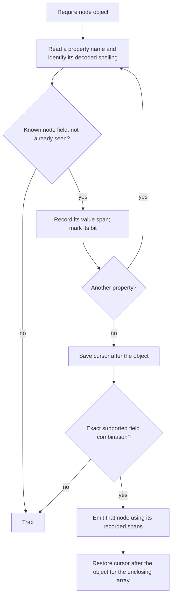
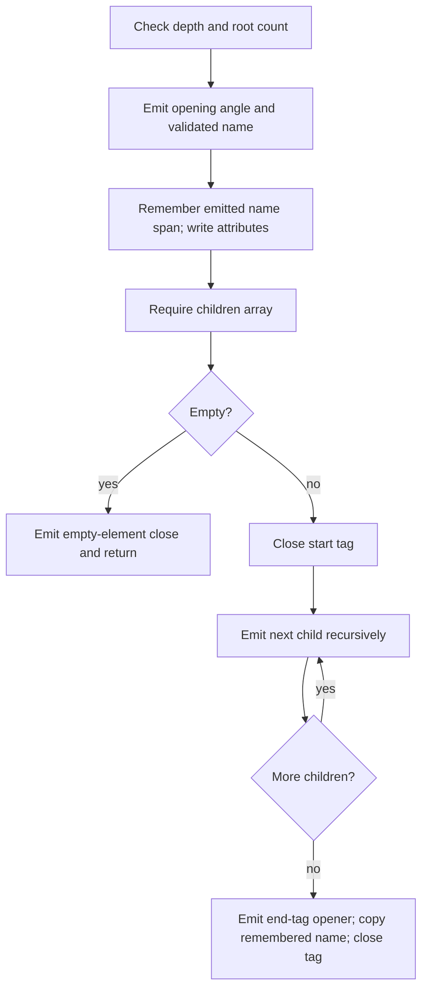
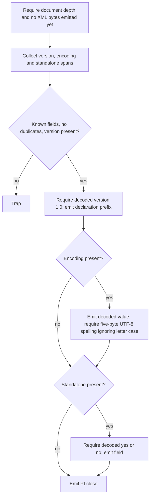

# An ordered Markdown tree to XML

Tool 27 writes the node representation produced by the
[XML reader](26-xml-to-list.md). The root is an array. Element nodes have
`element`, `attributes` and `children`; other nodes use `text`, `comment`,
`cdata`, `pi` with `data`, or `declaration`. Property order within a node is
irrelevant. Array order, attribute order and mixed content are preserved.

```text
- []
  - {}
    - element note
    - attributes {}
      - priority high
    - children []
      - {}
        - text "Hello & welcome."
```

becomes:

```xml
<note priority="high">Hello &amp; welcome.</note>
```

## Validation and normalization

Exactly one root element is required. Comments, PIs and whitespace may
surround it. CDATA is only allowed inside elements. An XML declaration may
appear only at the start of the emitted XML; version is `1.0`, optional
encoding is case-insensitive `UTF-8`, and optional standalone is `yes` or `no`.
Declarations are emitted in their required field order regardless of input
property order. Unknown, duplicate or missing fields are errors, as are mixed
node kinds and non-string attributes. Attribute names are compared after JSON
decoding; escape spelling cannot disguise a duplicate.

Names are lexical XML names, without namespace-binding inference. No DTD,
schema, resource fetching or host XML serializer is involved. The shared
[output helper](00-xml-output.md) handles Unicode validation, name checks,
context-specific escaping and unrepresentable literal values. Top-level text
can contain only space, TAB or LF; CR outside the root cannot be preserved by
a character reference, and would be normalized if emitted literally.

Empty elements use `/>`. Adjacent text nodes merge, and empty text nodes
disappear when XML is parsed again: XML has no delimiter between them.
Comments and CDATA retain their node boundaries. The writer adds no pretty
printing whitespace to the XML. Its Markdown fence is longer than every run
of backticks in the emitted document, so literal data cannot close it early.

## Memory and traversal

The list compiler first validates Markdown and creates compact JSON. Once
that succeeds, this writer **reuses the input page** for the compact JSON:
the original Markdown is no longer needed by Wasm. The browser's editable
input remains in its textarea; no modified input is copied back to it.
This allows the final page to hold the small literal table without another
memory allocation. Input and intermediate JSON are each at most 64 KiB;
output is at most 128 KiB. Element nesting is limited to 32 levels.

The final-page literals start at `0x30800`, above the list compiler's stack
and escape table. They are never overwritten. A failed run may leave partial
output, which must not be published. Each new run recompiles the supplied
input and resets all traversal state.

### `node`: collect spans, then dispatch an exact field combination



`skip` finds a value's end in already-validated JSON. It does not build another
object tree. Strings skip escaped bytes; nested containers use a depth counter.
Field bits distinguish an element's three required properties from each
single-field node and the two-field PI. A property can appear in any order,
but an unrelated extra field cannot be ignored.

| Node kind | Field mask | Recorded spans used |
| --- | --- | --- |
| Element | 7 | Name, attributes, children |
| Text | 8 | Payload |
| Comment | 16 | Payload |
| CDATA | 32 | Payload |
| PI | 192 | Target payload and data |
| Declaration | 256 | Declaration object payload |

The input cursor is shared, but each recursive `node` call keeps its own span
locals and saved continuation. Attribute and child traversal may temporarily
move the cursor to earlier properties. Restoring the saved continuation makes
the parent's comma/closing bracket checks independent of property order.

| `node` local | Meaning |
| --- | --- |
| 0 | Element depth, not the Markdown indentation level. |
| 1 | Seen-field mask; each new field must have a previously clear bit. |
| 2, 3 | Full JSON string span for the element name. |
| 4, 5 | Starts of the attributes object and children array. |
| 6, 7 | Full payload span for text/comment/CDATA/PI target/declaration. |
| 8, 9 | PI data span. |
| 10, 11, 12 | Current key span and its decoded field identifier. |
| 13, 14 | Current value span before assigning it to a node-specific slot. |
| 15 | Cursor immediately after this node object. |

`key-id` walks twelve short, length-prefixed, JSON-quoted names. Its equality
call decodes both spellings, so `"element"` and `"\u0065lement"` select the
same bit. The node parser allows identifiers 0–8; the declaration parser allows
9–11 instead. The attribute parser does not use this list: attribute names
are arbitrary valid XML names, not fields in the tree format.

### `element`: emit the name once and reuse its output bytes



The end tag copies the earlier emitted name rather than decoding it a second
time. That source span precedes the current output cursor, so appending it
does not overwrite it. Each attribute validates its name and string value;
`unique` rescans earlier attributes to compare decoded keys. It is quadratic
for very wide attribute objects, but needs no allocated key table.

### `declaration`: collect freely, emit in a fixed order



The field mask here is local to the declaration: version is bit 1, encoding
bit 2 and standalone bit 4. Collecting spans first avoids imposing object
property order on Markdown authors. `same-literal` validates decoded version
and standalone values with the same JSON equality helper as field names.
Encoding is checked after decoding to the output: its byte length and five
ASCII bytes must match. A failure leaves partial unpublished output, not a
malformed successful result.

The starting-output check is about XML position, not array index. An empty
text node before a declaration emits nothing and is harmless. A space,
comment, PI or element before it makes the declaration invalid at that point.

### `frame`: make room after the XML has succeeded

The XML starts at `0x10000` during traversal. `frame` scans it once for the
longest consecutive backtick run, choosing at least three fence ticks and
otherwise one more than that maximum. It checks the **whole framed size**,
then uses overlapping-safe `memory.copy` to move the XML forward. Only then
does it write the opening and closing fences. Counting all runs is simpler
than checking only possible Markdown closing lines, and remains safe.

| Region or size | Before traversal | After framing |
| --- | --- | --- |
| `0..65536` | Compact JSON, copied over no-longer-needed Markdown | Unchanged compact JSON |
| `65536..196608` | XML being appended | Opening fence, XML, closing fence |
| `198656` onward | Length-prefixed literals | Unchanged literals |
| Opening size | `ticks + 4` | Ticks followed by `xml` and LF |
| Closing size | `ticks + 2` | LF, ticks, LF |
| Total size | `xmlLength + 2 * ticks + 6` | Must fit before the overlapping move |

## Module

Imports: list-run 0, key-equal 1, XML string-output 2, XML scalar 3, shared
memory. Definitions: run 4, emit 5, literal 6, take 7, string-span 8, skip 9,
key-id 10, write 11, node 12, element 13, attributes 14, unique 15, text 16,
PI 17, declaration 18, copy 19, frame 20, same-literal 21.
Globals are output cursor 0, input cursor 1, JSON end 2 and root count 3.

`[microwasm]`

- lx-header: `0061736d 01000000`
- lx-type-section: `01 {{size:lx-types}}`
  - lx-types: `0c 60 01 7f 01 7f 60 04 7f 7f 7f 7f 01 7f 60 02 7f 7f 02 7f 7f 60 01 7f 00 60 00 02 7f 7f 60 00 00 60 02 7f 7f 01 7f 60 03 7f 7f 7f 00 60 05 7f 7f 7f 7f 7f 00 60 04 7f 7f 7f 7f 00 60 02 7f 7f 00 60 03 7f 7f 7f 01 7f`
- lx-import-section: `02 {{size:lx-imports}}`
  - lx-imports: `05 01 6c 03 72756e 00 00 01 6b 05 657175616c 00 01 01 6f 06 737472696e67 00 01 01 6f 06 7363616c6172 00 02 01 6c 06 6d656d6f7279 02 01 04 04`
- lx-function-section: `03 {{size:lx-functions}}`
  - lx-functions: `12 00 03 03 03 04 05 06 07 03 08 03 07 07 09 07 0a 05 0b`
- lx-global-section: `06 {{size:lx-globals}}`
  - lx-globals: `04 7f 01 41 00 0b 7f 01 41 00 0b 7f 01 41 00 0b 7f 01 41 00 0b`
- lx-export-section: `07 {{size:lx-exports}}`
  - lx-exports: `02 03 72756e 00 04 06 6d656d6f7279 02 00`
- lx-code-section: `0a {{size:lx-code}}`
  - lx-code: `12`
    - lx-run-record: `{{size:lx-run-body}}`
      - lx-run-body: `01 01 7f`
        - lx-run-compile: `20 00 10 00 41 0d 6b 21 01`
        - lx-run-bound: `20 01 45 20 01 41 808004 4b 72 04 40 00 0b`
        - lx-run-copy: `41 00 41 888004 20 01 fc 0a 00 00`
        - lx-run-reset: `20 01 24 02 41 00 24 01 41 00 24 03 41 808004 24 00`
        - lx-run-root: `41 db00 10 07 23 01 2d 00 00 41 dd00 47 04 40 03 40 41 00 10 0c 23 01 2d 00 00 41 dd00 46 0d 01 41 2c 10 07 0c 00 0b 0b`
        - lx-run-finish: `41 dd00 10 07 23 01 23 02 47 23 03 41 01 47 72 04 40 00 0b 10 14 23 00 41 808004 6b 0b`
    - lx-emit-record: `{{size:lx-emit-body}}`
      - lx-emit-body: `00 23 00 41 80800c 4f 04 40 00 0b 23 00 20 00 3a 00 00 23 00 41 01 6a 24 00 0b`
    - lx-literal-record: `{{size:lx-literal-body}}`
      - lx-literal-body: `00 20 00 41 01 6a 20 00 41 01 6a 20 00 2d 00 00 6a 10 13 0b`
    - lx-take-record: `{{size:lx-take-body}}`
      - lx-take-body: `00 23 01 23 02 4f 04 40 00 0b 23 01 2d 00 00 20 00 47 04 40 00 0b 23 01 41 01 6a 24 01 0b`
    - lx-span-record: `{{size:lx-span-body}}`
      - lx-span-body: `01 02 7f 23 01 21 00 41 22 10 07 03 40 23 01 23 02 4f 04 40 00 0b 23 01 2d 00 00 21 01 23 01 41 01 6a 24 01 20 01 41 22 46 04 40 20 00 23 01 0f 0b 20 01 41 dc00 46 04 40 23 01 41 01 6a 24 01 0b 0c 00 0b 00 0b`
    - lx-skip-record: `{{size:lx-skip-body}}`
      - lx-skip-body: `01 02 7f`
        - lx-skip-first: `23 01 23 02 4f 04 40 00 0b 23 01 2d 00 00 21 00 20 00 41 22 46 04 40 10 08 1a 1a 0f 0b`
        - lx-skip-container: `20 00 41 db00 46 20 00 41 fb00 46 72 04 40 41 01 21 01 23 01 41 01 6a 24 01 03 40`
          - lx-skip-bound: `23 01 23 02 4f 04 40 00 0b 23 01 2d 00 00 21 00`
          - lx-skip-string: `20 00 41 22 46 04 40 10 08 1a 1a 0c 01 0b`
          - lx-skip-open: `20 00 41 db00 46 20 00 41 fb00 46 72 04 40 20 01 41 01 6a 21 01 0b`
          - lx-skip-close: `20 00 41 dd00 46 20 00 41 fd00 46 72 04 40 20 01 41 01 6b 21 01 0b`
          - lx-skip-next: `23 01 41 01 6a 24 01 20 01 45 04 40 0f 0b 0c 00 0b 0b`
        - lx-skip-scalar: `02 40 03 40 23 01 23 02 4f 0d 01 23 01 2d 00 00 21 00 20 00 41 2c 46 20 00 41 dd00 46 72 20 00 41 fd00 46 72 0d 01 23 01 41 01 6a 24 01 0c 00 0b 0b 0b`
    - lx-key-record: `{{size:lx-key-body}}`
      - lx-key-body: `01 02 7f 41 80900c 21 02 03 40 20 00 20 01 20 02 10 15 04 40 20 03 0f 0b 20 02 20 02 2d 00 00 6a 41 01 6a 21 02 20 03 41 01 6a 22 03 41 0c 49 0d 00 0b 00 0b`
    - lx-write-record: `{{size:lx-write-body}}`
      - lx-write-body: `00 20 01 20 00 6b 41 02 49 04 40 00 0b 20 00 2d 00 00 41 22 47 20 01 41 01 6b 2d 00 00 41 22 47 72 04 40 00 0b 23 00 20 00 41 01 6a 20 01 41 01 6b 23 00 20 02 10 02 6a 24 00 0b`
    - lx-node-record: `{{size:lx-node-body}}`
      - lx-node-body: `01 0f 7f`
        - lx-node-open: `41 fb00 10 07 23 01 2d 00 00 41 fd00 47 04 40 03 40`
          - lx-node-key: `10 08 21 0b 21 0a 20 0a 20 0b 10 0a 21 0c 20 0c 41 08 4b 04 40 00 0b`
          - lx-node-duplicate: `20 01 41 01 20 0c 74 71 04 40 00 0b 20 01 41 01 20 0c 74 72 21 01`
          - lx-node-value: `41 3a 10 07 23 01 21 0d 10 09 23 01 21 0e`
          - lx-node-name-span: `20 0c 45 04 40 20 0d 21 02 20 0e 21 03`
          - lx-node-attribute-span: `05 20 0c 41 01 46 04 40 20 0d 21 04`
          - lx-node-children-span: `05 20 0c 41 02 46 04 40 20 0d 21 05`
          - lx-node-data-span: `05 20 0c 41 07 46 04 40 20 0d 21 08 20 0e 21 09`
          - lx-node-payload-span: `05 20 0d 21 06 20 0e 21 07 0b 0b 0b 0b`
          - lx-node-next: `23 01 2d 00 00 41 fd00 46 0d 01 41 2c 10 07 0c 00 0b 0b`
        - lx-node-save: `41 fd00 10 07 23 01 21 0f 02 40`
          - lx-node-element: `20 01 41 07 46 04 40 20 00 20 02 20 03 20 04 20 05 10 0d 0c 01 0b`
          - lx-node-text: `20 01 41 08 46 04 40 20 00 20 06 20 07 10 10 0c 01 0b`
          - lx-node-comment: `20 01 41 10 46 04 40 41 b9910c 10 06 20 06 20 07 41 04 10 0b 41 be910c 10 06 0c 01 0b`
          - lx-node-cdata: `20 01 41 20 46 04 40 20 00 45 04 40 00 0b 41 c2910c 10 06 20 06 20 07 41 05 10 0b 41 cc910c 10 06 0c 01 0b`
          - lx-node-pi: `20 01 41 c001 46 04 40 20 06 20 07 20 08 20 09 10 11 0c 01 0b`
          - lx-node-declaration: `20 01 41 8002 46 04 40 20 00 20 06 20 07 10 12 0c 01 0b`
          - lx-node-invalid: `00 0b`
        - lx-node-restore: `20 0f 24 01 0b`
    - lx-element-record: `{{size:lx-element-body}}`
      - lx-element-body: `01 02 7f`
        - lx-element-depth: `20 00 41 20 4f 04 40 00 0b`
        - lx-element-root: `20 00 45 04 40 23 03 04 40 00 0b 41 01 24 03 0b`
        - lx-element-name: `41 3c 10 05 23 00 21 05 20 01 20 02 41 03 10 0b 23 00 20 05 6b 21 06`
        - lx-element-attributes: `20 03 10 0e 20 04 24 01 41 db00 10 07`
        - lx-element-empty: `23 01 2d 00 00 41 dd00 46 04 40 41 dd00 10 07 41 d3910c 10 06 0f 0b`
        - lx-element-children: `41 3e 10 05 02 40 03 40 20 00 41 01 6a 10 0c 23 01 2d 00 00 41 dd00 46 0d 01 41 2c 10 07 0c 00 0b 0b 41 dd00 10 07`
        - lx-element-close: `41 d6910c 10 06 20 05 20 05 20 06 6a 10 13 41 3e 10 05 0b`
    - lx-attributes-record: `{{size:lx-attributes-body}}`
      - lx-attributes-body: `01 05 7f 20 00 24 01 41 fb00 10 07 23 01 21 01 23 01 2d 00 00 41 fd00 47 04 40 03 40`
        - lx-attributes-key: `10 08 21 03 21 02 20 01 20 02 20 03 10 0f 41 3a 10 07 10 08 21 05 21 04`
        - lx-attributes-emit: `41 20 10 05 20 02 20 03 41 03 10 0b 41 3d 10 05 41 22 10 05 20 04 20 05 41 01 10 0b 41 22 10 05`
        - lx-attributes-next: `23 01 2d 00 00 41 fd00 46 0d 01 41 2c 10 07 0c 00 0b 0b 41 fd00 10 07 0b`
    - lx-unique-record: `{{size:lx-unique-body}}`
      - lx-unique-body: `01 03 7f 23 01 21 03 20 00 24 01 02 40 03 40 23 01 20 01 4f 0d 01 10 08 21 05 21 04 20 04 20 05 20 01 20 02 10 01 04 40 00 0b 41 3a 10 07 10 08 1a 1a 23 01 20 01 49 04 40 41 2c 10 07 0b 0c 00 0b 0b 20 03 24 01 0b`
    - lx-text-record: `{{size:lx-text-body}}`
      - lx-text-body: `01 02 7f 20 00 45 04 40 20 01 41 01 6a 21 03 02 40 03 40 20 03 20 02 41 01 6b 10 03 21 03 21 04 20 04 41 7f 46 0d 01 20 04 41 20 46 20 04 41 09 46 72 20 04 41 0a 46 72 45 04 40 00 0b 0c 00 0b 0b 0b 20 01 20 02 41 00 10 0b 0b`
    - lx-pi-record: `{{size:lx-pi-body}}`
      - lx-pi-body: `01 02 7f 41 d0910c 10 06 23 00 21 04 20 00 20 01 41 03 10 0b 23 00 20 04 6b 21 05`
        - lx-pi-reserved: `20 05 41 03 46 04 40 20 04 2d 00 00 41 20 72 41 f800 46 20 04 2d 00 01 41 20 72 41 ed00 46 71 20 04 2d 00 02 41 20 72 41 ec00 46 71 04 40 00 0b 0b`
        - lx-pi-data: `20 03 20 02 6b 41 02 4b 04 40 41 20 10 05 0b 20 02 20 03 41 06 10 0b 41 b6910c 10 06 0b`
    - lx-declaration-record: `{{size:lx-declaration-body}}`
      - lx-declaration-body: `01 0e 7f`
        - lx-declaration-position: `20 00 23 00 41 808004 47 72 04 40 00 0b 20 01 24 01 41 fb00 10 07 23 01 2d 00 00 41 fd00 47 04 40 03 40`
          - lx-declaration-key: `10 08 21 10 21 0f 20 0f 20 10 10 0a 41 09 6b 21 0a 20 0a 41 02 4b 04 40 00 0b`
          - lx-declaration-duplicate: `20 03 41 01 20 0a 74 71 04 40 00 0b 20 03 41 01 20 0a 74 72 21 03`
          - lx-declaration-value: `41 3a 10 07 23 01 21 0b 10 09 23 01 21 0c`
          - lx-declaration-version-span: `20 0a 45 04 40 20 0b 21 04 20 0c 21 05`
          - lx-declaration-encoding-span: `05 20 0a 41 01 46 04 40 20 0b 21 06 20 0c 21 07`
          - lx-declaration-standalone-span: `05 20 0b 21 08 20 0c 21 09 0b 0b`
          - lx-declaration-next: `23 01 2d 00 00 41 fd00 46 0d 01 41 2c 10 07 0c 00 0b 0b 41 fd00 10 07`
        - lx-declaration-version: `23 01 20 02 47 20 03 41 01 71 45 72 04 40 00 0b 20 04 20 05 41 f7900c 10 15 45 04 40 00 0b 41 88910c 10 06`
        - lx-declaration-encoding: `20 03 41 02 71 04 40 41 9c910c 10 06 23 00 21 0d 20 06 20 07 41 02 10 0b 23 00 20 0d 6b 41 05 47 04 40 00 0b`
          - lx-declaration-utf8: `20 0d 2d 00 00 41 20 72 41 f500 47 20 0d 2d 00 01 41 20 72 41 f400 47 72 20 0d 2d 00 02 41 20 72 41 e600 47 72 20 0d 2d 00 03 41 2d 47 72 20 0d 2d 00 04 41 38 47 72 04 40 00 0b 41 22 10 05 0b`
        - lx-declaration-standalone: `20 03 41 04 71 04 40 20 08 20 09 41 fd900c 10 15 20 08 20 09 41 83910c 10 15 72 45 04 40 00 0b 41 a8910c 10 06 20 08 20 09 41 02 10 0b 41 22 10 05 0b 41 b6910c 10 06 0b`
    - lx-copy-record: `{{size:lx-copy-body}}`
      - lx-copy-body: `00 02 40 03 40 20 00 20 01 4f 0d 01 20 00 2d 00 00 10 05 20 00 41 01 6a 21 00 0c 00 0b 0b 0b`
    - lx-frame-record: `{{size:lx-frame-body}}`
      - lx-frame-body: `01 05 7f 23 00 41 808004 6b 21 03 41 808004 21 00 02 40 03 40 20 00 23 00 4f 0d 01`
        - lx-frame-ticks: `20 00 2d 00 00 41 e000 46 04 40 20 01 41 01 6a 21 01 20 01 20 02 4b 04 40 20 01 21 02 0b 05 41 00 21 01 0b 20 00 41 01 6a 21 00 0c 00 0b 0b`
        - lx-frame-count: `20 02 41 01 6a 21 02 20 02 41 03 49 04 40 41 03 21 02 0b`
        - lx-frame-bound: `20 03 20 02 41 01 74 6a 41 06 6a 41 808008 4b 04 40 00 0b`
        - lx-frame-move: `41 808004 20 02 6a 41 04 6a 41 808004 20 03 fc 0a 00 00 41 808004 24 00`
        - lx-frame-open: `03 40 41 e000 10 05 20 04 41 01 6a 22 04 20 02 49 0d 00 0b 41 d9910c 10 06`
        - lx-frame-suffix: `41 808004 20 02 6a 41 04 6a 20 03 6a 24 00 41 0a 10 05 41 00 21 04 03 40 41 e000 10 05 20 04 41 01 6a 22 04 20 02 49 0d 00 0b 41 0a 10 05 0b`
    - lx-same-record: `{{size:lx-same-body}}`
      - lx-same-body: `00 20 00 20 01 20 02 41 01 6a 20 02 41 01 6a 20 02 2d 00 00 6a 10 01 0b`
- lx-data-section: `0b {{size:lx-data}}`
  - lx-data: `01 00 41 80900c 0b {{size:lx-literals}}`
    - lx-literals:
      - lx-key-element: `0922656c656d656e7422` — Offset 0: quoted element.
      - lx-key-attributes: `0c226174747269627574657322` — Offset 10.
      - lx-key-children: `0a226368696c6472656e22` — Offset 23.
      - lx-key-text: `06227465787422` — Offset 34.
      - lx-key-comment: `0922636f6d6d656e7422` — Offset 41.
      - lx-key-cdata: `0722636461746122` — Offset 51.
      - lx-key-pi: `0422706922` — Offset 59.
      - lx-key-data: `06226461746122` — Offset 64.
      - lx-key-declaration: `0d226465636c61726174696f6e22` — Offset 71.
      - lx-key-version: `092276657273696f6e22` — Offset 85.
      - lx-key-encoding: `0a22656e636f64696e6722` — Offset 95.
      - lx-key-standalone: `0c227374616e64616c6f6e6522` — Offset 106.
      - lx-value-version: `0522312e3022` — Offset 119.
      - lx-value-yes: `052279657322` — Offset 125.
      - lx-value-no: `04226e6f22` — Offset 131.
      - lx-xml-declaration: `133c3f786d6c2076657273696f6e3d22312e3022` — Offset 136.
      - lx-xml-encoding: `0b20656e636f64696e673d22` — Offset 156.
      - lx-xml-standalone: `0d207374616e64616c6f6e653d22` — Offset 168.
      - lx-xml-pi-close: `023f3e` — Offset 182.
      - lx-xml-comment-open: `043c212d2d` — Offset 185.
      - lx-xml-comment-close: `032d2d3e` — Offset 190.
      - lx-xml-cdata-open: `093c215b43444154415b` — Offset 194.
      - lx-xml-cdata-close: `035d5d3e` — Offset 204.
      - lx-xml-pi-open: `023c3f` — Offset 208.
      - lx-xml-empty: `022f3e` — Offset 211.
      - lx-xml-end-tag: `023c2f` — Offset 214.
      - lx-xml-fence-label: `04786d6c0a` — Offset 217.
