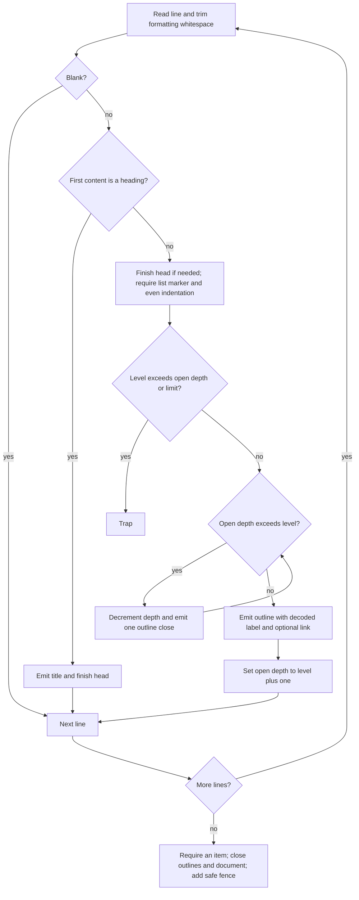
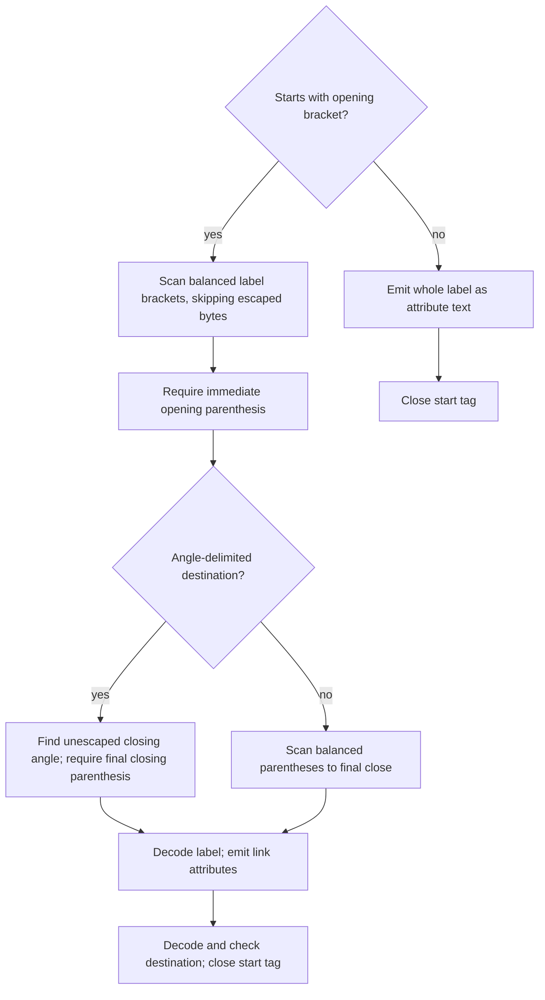
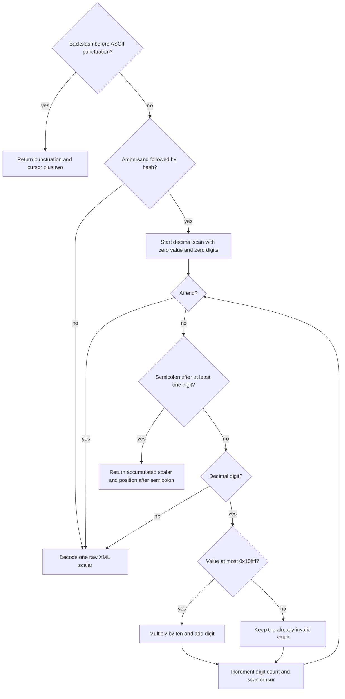

# A Markdown link outline to OPML

Tool 28 converts nested Markdown list items into OPML outline elements.
A leading level-one heading becomes the document title. Ordinary labels
become `text` attributes; inline links also receive `type="link"` and `url`.
The [OPML specification](https://opml.org/spec2.opml) defines the document's
head/body structure and these link attributes. This converter never follows
links or includes another outline from the network.

```text
# Reading

- Web
  - [WebAssembly](https://webassembly.org/)
  - [SQLite](<https://sqlite.org/docs.html>)
- Books & notes
```

becomes:

```opml
<opml version="2.0">
<head><title>Reading</title></head>
<body>
  <outline text="Web">
    <outline text="WebAssembly" type="link" url="https://webassembly.org/">
    </outline>
    <outline text="SQLite" type="link" url="https://sqlite.org/docs.html">
    </outline>
  </outline>
  <outline text="Books &amp; notes">
  </outline>
</body>
</opml>
```

## Input contract

- One optional `# Title` heading before the first item; `#` is an empty title.
- One or more `- ` items. Two spaces add one nesting level. Levels cannot be
  skipped; there are at most 128 open outline levels. Blank lines are ignored.
- Each item occupies one physical line. Trailing spaces and tabs are formatting.
  Decimal references such as `&#32;`, `&#10;` and `&#13;` preserve significant
  whitespace in a label or title. The referenced value must be an XML character.
- Backslash escapes of ASCII punctuation are decoded. Other backslashes,
  named/hexadecimal entities, emphasis and other inline syntax remain literal
  text, rather than being interpreted as rich HTML. Malformed decimal
  references remain literal; a complete reference to a forbidden scalar traps.
- An item beginning with `[` must be a complete inline link. Escape a literal
  initial bracket as `\[`. Link labels can have balanced brackets and escaped
  punctuation. Destinations may be bare with balanced parentheses, or enclosed
  in angle brackets. Link titles, references and multiline links are not part
  of this outline notation.
- A decoded destination must begin with HTTP(S), case-insensitively, and have
  something after `://`. ASCII whitespace, DEL, double quotes, angle brackets
  and backslashes are rejected. No URL normalization or host/network lookup occurs;
  this is a lexical destination check, not full URL validation.

LF and CRLF are accepted. Source UTF-8 and XML characters are validated while
decoding title, label and destination spans. No implicit numeric types, sorting
or duplicate-label rejection is introduced. A linked item can also have children.

## Inside `run`: indentation replaces a node stack



Every outline uses the same closing tag, so no per-node name stack is needed.
The open-depth counter suffices. A child at level 1 follows a parent that left
depth 1 open. A sibling at level 0 first closes that parent. Opening a child
increments depth only after its label and destination have been validated.

| State | Storage | Purpose |
| --- | --- | --- |
| Output cursor | Global 0 | All stores and imported character writes share the same bounded region. |
| Open depth | Global 1 | Number of outline start tags still needing a close. |
| Item seen | Global 2 | Empty documents and title-only input fail. |
| Head finished | Global 3 | A heading cannot reappear after an item. |
| Physical LF position | Run local 3 | Preserved when CR and trailing formatting spaces are excluded. |
| Indentation and level | Run locals 5 and 6 | Spaces are counted before dividing by two. |

## Inside `outline`: find delimiters before decoding text



Scanning uses source punctuation, not decoded references. Thus `&#93;` can
represent label data without ending its bracket span. A backslash skips the
following byte during scanning; the decoding pass later determines whether
that byte is escapable punctuation. Returned span ends exclude the delimiters.
The outer closing parenthesis must be the final non-formatting byte on the line.

`next` either consumes a punctuation escape, a complete decimal reference, or
one raw UTF-8 XML scalar. Decimal scanning is speculative: if it finds no
terminating semicolon, it returns the original ampersand through the raw path.
The accumulator stops growing once it exceeds the Unicode limit, preventing
wraparound from turning an oversized reference into a valid character.

### Inside `next`: speculative references without integer wraparound



The raw fallback still uses the original start, not the speculative cursor.
An incomplete `&#123x` therefore consumes only its ampersand on this call;
later iterations emit the remaining literal bytes. A complete reference is
different: its scalar must pass the XML character check in `o.character`.
An out-of-range complete value cannot fall back to literal text.

Only values at most `0x10ffff` are multiplied. One additional decimal digit
can make the value too large, but cannot overflow i32; every later digit
leaves that invalid value unchanged. This also permits arbitrarily many
leading zeros within the input bound. The signed LEB128 spelling of the
positive limit is `ff ff c3 00`: the final zero prevents the high sign bit
of the preceding group from turning it into a negative constant.

`text` sends each decoded scalar to the shared XML output helper. Title text
and attribute text therefore use exactly the same escaping policy as the XML
tree writer, without constructing JSON strings between these two parsers.
Destination checking happens both per character and on its emitted scheme.

## Memory and framing

Input is unchanged at `0..65536`. Output occupies `65536..196608`, and a small
length-prefixed literal table starts at `196608`. There is no heap allocation.
The final pass chooses a fence longer than every backtick run, checks the
complete size, and moves the XML once using overlapping-safe `memory.copy`.
Errors may leave partial unpublished output; every call resets the state.

Imports: raw XML scalar 0, XML character output 1, shared memory.
Definitions: run 2, emit 3, literal 4, text 5, next 6, punctuation 7,
outline 8, frame 9, URL 10, indentation 11, close-outline 12.

`[microwasm]`

- op-header: `0061736d 01000000`
- op-type-section: `01 {{size:op-types}}`
  - op-types: `07 60 02 7f 7f 02 7f 7f 60 03 7f 7f 7f 01 7f 60 01 7f 01 7f 60 01 7f 00 60 03 7f 7f 7f 00 60 02 7f 7f 00 60 00 00`
- op-import-section: `02 {{size:op-imports}}`
  - op-imports: `03 01 78 06 7363616c6172 00 00 01 6f 09 636861726163746572 00 01 01 78 06 6d656d6f7279 02 01 04 04`
- op-function-section: `03 {{size:op-functions}}`
  - op-functions: `0b 02 03 03 04 00 02 05 06 05 03 06`
- op-global-section: `06 {{size:op-globals}}`
  - op-globals: `04 7f 01 41 00 0b 7f 01 41 00 0b 7f 01 41 00 0b 7f 01 41 00 0b`
- op-export-section: `07 {{size:op-exports}}`
  - op-exports: `02 03 72756e 00 02 06 6d656d6f7279 02 00`
- op-code-section: `0a {{size:op-code}}`
  - op-code: `0b`
    - op-run-record: `{{size:op-run-body}}`
      - op-run-body: `01 07 7f`
        - op-run-bound: `20 00 41 808004 4b 04 40 00 0b`
        - op-run-reset: `41 808004 24 00 41 00 24 01 41 00 24 02 41 00 24 03 41 80800c 10 04`
        - op-lines-exit: `02 40 03 40 20 01 20 00 4f 0d 01 20 01 21 03`
          - op-line-find: `02 40 03 40 20 03 20 00 4f 0d 01 20 03 2d 00 00 41 0a 46 0d 01 20 03 41 01 6a 21 03 0c 00 0b 0b 20 03 21 02`
          - op-line-cr: `20 02 20 01 4b 04 40 20 02 41 01 6b 2d 00 00 41 0d 46 04 40 20 02 41 01 6b 21 02 0b 0b`
          - op-line-trim: `02 40 03 40 20 02 20 01 4d 0d 01 20 02 41 01 6b 2d 00 00 22 07 41 20 46 20 07 41 09 46 72 45 0d 01 20 02 41 01 6b 21 02 0c 00 0b 0b`
          - op-line-blank: `20 02 20 01 46 04 40 20 03 41 01 6a 21 01 0c 01 0b`
          - op-line-indent: `20 01 21 04 41 00 21 05 02 40 03 40 20 04 20 02 4f 0d 01 20 04 2d 00 00 41 20 47 0d 01 20 04 41 01 6a 21 04 20 05 41 01 6a 21 05 0c 00 0b 0b`
          - op-head: `23 03 45 04 40 20 05 45 20 04 2d 00 00 41 23 46 71 04 40`
            - op-head-label: `20 04 41 01 6a 21 07 20 07 20 02 49 04 40 20 07 2d 00 00 41 20 47 04 40 00 0b 20 07 41 01 6a 21 07 0b`
            - op-head-title: `41 ac800c 10 04 20 07 20 02 41 00 10 05 41 b4800c 10 04 41 9c800c 10 04 41 01 24 03 20 03 41 01 6a 21 01 0c 02 0b 41 9c800c 10 04 41 01 24 03 0b`
          - op-item-marker: `20 04 2d 00 00 41 2d 47 04 40 00 0b 20 04 41 01 6a 21 07 20 07 20 02 49 04 40 20 07 2d 00 00 41 20 47 04 40 00 0b 20 07 41 01 6a 21 07 0b`
          - op-item-level: `20 05 41 01 71 04 40 00 0b 20 05 41 01 76 21 06 20 06 23 01 4b 20 06 41 8001 4f 72 04 40 00 0b`
          - op-item-pop: `02 40 03 40 23 01 20 06 4d 0d 01 10 0c 0c 00 0b 0b`
          - op-item-open: `20 06 41 01 6a 10 0b 41 bd800c 10 04 20 07 20 02 10 08 20 06 41 01 6a 24 01 41 01 24 02`
          - op-line-next: `20 03 41 01 6a 21 01 0c 00 0b 0b`
        - op-run-finish: `23 02 45 04 40 00 0b 02 40 03 40 23 01 45 0d 01 10 0c 0c 00 0b 0b 41 f1800c 10 04 10 09 23 00 41 808004 6b 0b`
    - op-emit-record: `{{size:op-emit-body}}`
      - op-emit-body: `00 23 00 41 80800c 4f 04 40 00 0b 23 00 20 00 3a 00 00 23 00 41 01 6a 24 00 0b`
    - op-literal-record: `{{size:op-literal-body}}`
      - op-literal-body: `01 01 7f 20 00 20 00 2d 00 00 6a 41 01 6a 21 01 20 00 41 01 6a 21 00 02 40 03 40 20 00 20 01 4f 0d 01 20 00 2d 00 00 10 03 20 00 41 01 6a 21 00 0c 00 0b 0b 0b`
    - op-text-record: `{{size:op-text-body}}`
      - op-text-body: `01 01 7f 02 40 03 40 20 00 20 01 4f 0d 01 20 00 20 01 10 06 21 00 21 03`
        - op-text-url: `20 02 41 02 46 04 40 20 03 41 20 4d 20 03 41 ff00 46 72 20 03 41 22 46 72 20 03 41 3c 46 72 20 03 41 3e 46 72 20 03 41 dc00 46 72 04 40 00 0b 0b`
        - op-text-emit: `23 00 20 03 23 00 20 02 45 45 10 01 6a 24 00 0c 00 0b 0b 0b`
    - op-next-record: `{{size:op-next-body}}`
      - op-next-body: `01 04 7f`
        - op-next-backslash: `20 00 2d 00 00 41 dc00 46 20 00 41 01 6a 20 01 49 71 04 40 20 00 41 01 6a 2d 00 00 22 05 10 07 04 40 20 05 20 00 41 02 6a 0f 0b 0b`
        - op-next-reference: `20 00 2d 00 00 41 26 46 20 00 41 02 6a 20 01 49 71 04 40 20 00 2d 00 01 41 23 46 04 40 20 00 41 02 6a 21 02 02 40 03 40`
          - op-next-digit-bound: `20 02 20 01 4f 0d 01 20 02 2d 00 00 21 05`
          - op-next-semicolon: `20 05 41 3b 46 20 04 41 00 4b 71 04 40 20 03 20 02 41 01 6a 0f 0b`
          - op-next-digit: `20 05 41 30 6b 41 09 4b 0d 01` — A non-digit aborts speculation without moving the original cursor.
          - op-next-accumulate: `20 03 41 ffffc300 4d 04 40 20 03 41 0a 6c 20 05 41 30 6b 6a 21 03 0b` — Grow only while the old value is within Unicode; retain an invalid value thereafter.
          - op-next-advance: `20 04 41 01 6a 21 04 20 02 41 01 6a 21 02 0c 00 0b 0b 0b 0b` — Count the digit and continue, even after overflow has been prevented.
        - op-next-raw: `20 00 20 01 10 00 0b`
    - op-punctuation-record: `{{size:op-punctuation-body}}`
      - op-punctuation-body: `00 20 00 41 21 6b 41 0e 4d 20 00 41 3a 6b 41 06 4d 72 20 00 41 db00 6b 41 05 4d 72 20 00 41 fb00 6b 41 03 4d 72 0b`
    - op-outline-record: `{{size:op-outline-body}}`
      - op-outline-body: `01 06 7f 20 00 20 01 49 04 40 20 00 2d 00 00 41 db00 46 04 40 20 00 41 01 6a 21 02 41 01 21 06 02 40 03 40`
        - op-label-bound: `20 02 20 01 4f 04 40 00 0b 20 02 2d 00 00 21 07`
        - op-label-escape: `20 07 41 dc00 46 04 40 20 02 41 02 6a 21 02 0c 01 0b`
        - op-label-open: `20 07 41 db00 46 04 40 20 06 41 01 6a 21 06 0b`
        - op-label-close: `20 07 41 dd00 46 04 40 20 06 41 01 6b 22 06 45 0d 02 0b 20 02 41 01 6a 21 02 0c 00 0b 0b`
        - op-link-open: `20 02 21 03 20 02 41 01 6a 21 02 20 02 20 01 4f 04 40 00 0b 20 02 2d 00 00 41 28 47 04 40 00 0b 20 02 41 01 6a 21 02 20 02 20 01 4f 04 40 00 0b`
        - op-link-angle: `20 02 2d 00 00 41 3c 46 04 40 20 02 41 01 6a 22 02 21 04 02 40 03 40`
          - op-angle-bound: `20 02 20 01 4f 04 40 00 0b 20 02 2d 00 00 21 07`
          - op-angle-escape: `20 07 41 dc00 46 04 40 20 02 41 02 6a 21 02 0c 01 0b`
          - op-angle-close: `20 07 41 3e 46 0d 01 20 02 41 01 6a 21 02 0c 00 0b 0b 20 02 21 05 20 02 41 01 6a 21 02`
        - op-link-bare: `05 20 02 21 04 41 01 21 06 02 40 03 40`
          - op-bare-bound: `20 02 20 01 4f 04 40 00 0b 20 02 2d 00 00 21 07`
          - op-bare-escape: `20 07 41 dc00 46 04 40 20 02 41 02 6a 21 02 0c 01 0b`
          - op-bare-open: `20 07 41 28 46 04 40 20 06 41 01 6a 21 06 0b`
          - op-bare-close: `20 07 41 29 46 04 40 20 06 41 01 6b 22 06 45 0d 02 0b 20 02 41 01 6a 21 02 0c 00 0b 0b 20 02 21 05 0b`
        - op-link-final: `20 02 41 01 6a 20 01 47 04 40 00 0b 20 02 2d 00 00 41 29 47 04 40 00 0b`
        - op-link-output: `20 00 41 01 6a 20 03 41 01 10 05 41 cd800c 10 04 20 04 20 05 10 0a 41 e1800c 10 04 0f 0b 0b`
        - op-outline-plain: `20 00 20 01 41 01 10 05 41 e1800c 10 04 0b`
    - op-frame-record: `{{size:op-frame-body}}`
      - op-frame-body: `01 05 7f 23 00 41 808004 6b 21 03 41 808004 21 00 02 40 03 40 20 00 23 00 4f 0d 01`
        - op-frame-scan: `20 00 2d 00 00 41 e000 46 04 40 20 01 41 01 6a 21 01 20 01 20 02 4b 04 40 20 01 21 02 0b 05 41 00 21 01 0b 20 00 41 01 6a 21 00 0c 00 0b 0b`
        - op-frame-count: `20 02 41 01 6a 21 02 20 02 41 03 49 04 40 41 03 21 02 0b`
        - op-frame-bound: `20 03 20 02 41 01 74 6a 41 07 6a 41 808008 4b 04 40 00 0b`
        - op-frame-move: `41 808004 20 02 6a 41 05 6a 41 808004 20 03 fc 0a 00 00 41 808004 24 00`
        - op-frame-open: `03 40 41 e000 10 03 20 04 41 01 6a 22 04 20 02 49 0d 00 0b 41 81810c 10 04`
        - op-frame-close: `41 808004 20 02 6a 41 05 6a 20 03 6a 24 00 41 0a 10 03 41 00 21 04 03 40 41 e000 10 03 20 04 41 01 6a 22 04 20 02 49 0d 00 0b 41 0a 10 03 0b`
    - op-url-record: `{{size:op-url-body}}`
      - op-url-body: `01 03 7f 23 00 21 02 20 00 20 01 41 02 10 05 23 00 20 02 6b 21 03 20 03 41 07 4d 04 40 00 0b`
        - op-url-http: `20 02 2d 00 00 41 20 72 41 e800 47 20 02 2d 00 01 41 20 72 41 f400 47 72 20 02 2d 00 02 41 20 72 41 f400 47 72 20 02 2d 00 03 41 20 72 41 f000 47 72 04 40 00 0b`
        - op-url-scheme: `20 02 2d 00 04 41 20 72 41 f300 46 04 7f 41 08 05 41 07 0b 21 04`
        - op-url-separators: `20 03 20 04 4d 20 02 20 04 6a 41 03 6b 2d 00 00 41 3a 47 72 20 02 20 04 6a 41 02 6b 2d 00 00 41 2f 47 72 20 02 20 04 6a 41 01 6b 2d 00 00 41 2f 47 72 04 40 00 0b 0b`
    - op-indent-record: `{{size:op-indent-body}}`
      - op-indent-body: `00 02 40 03 40 20 00 45 0d 01 41 20 10 03 41 20 10 03 20 00 41 01 6b 21 00 0c 00 0b 0b 0b`
    - op-close-record: `{{size:op-close-body}}`
      - op-close-body: `00 23 01 41 01 6b 24 01 23 01 41 01 6a 10 0b 41 e5800c 10 04 0b`
- op-data-section: `0b {{size:op-data}}`
  - op-data: `01 00 41 80800c 0b {{size:op-literals}}`
    - op-literals:
      - op-xml-open: `1b3c6f706d6c2076657273696f6e3d22322e30223e0a3c686561643e` — Offset 0.
      - op-xml-head-close: `0f3c2f686561643e0a3c626f64793e0a` — Offset 28.
      - op-xml-title-open: `073c7469746c653e` — Offset 44.
      - op-xml-title-close: `083c2f7469746c653e` — Offset 52.
      - op-xml-outline-open: `0f3c6f75746c696e6520746578743d22` — Offset 61.
      - op-xml-link: `132220747970653d226c696e6b222075726c3d22` — Offset 77.
      - op-xml-start-close: `03223e0a` — Offset 97.
      - op-xml-outline-close: `0b3c2f6f75746c696e653e0a` — Offset 101.
      - op-xml-close: `0f3c2f626f64793e0a3c2f6f706d6c3e` — Offset 113.
      - op-xml-fence: `056f706d6c0a` — Offset 129.
