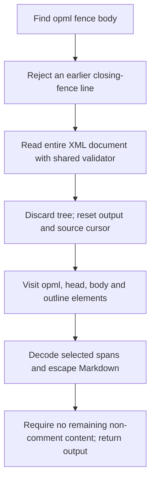
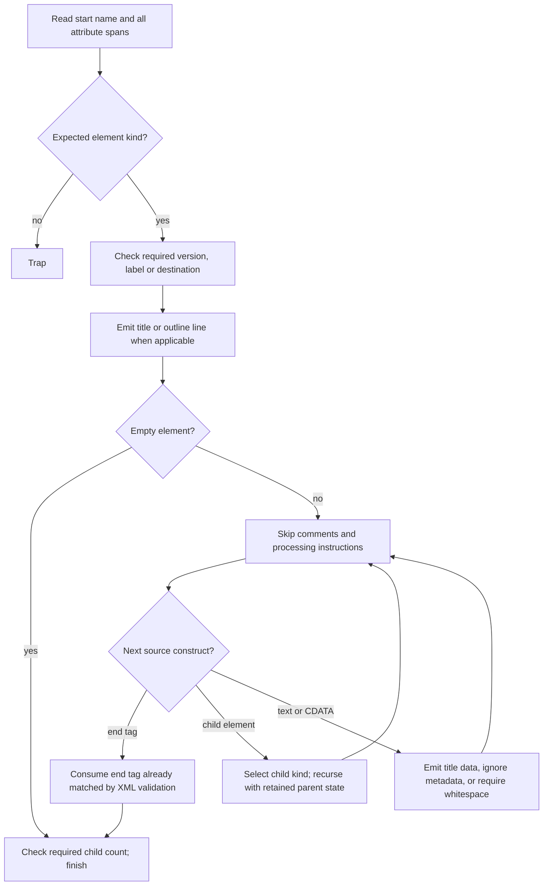

# OPML to a Markdown link outline

Unpublished implementation draft. The module assembles and a nested linked
outline runs successfully, but the malformed-input, round-trip and boundary
suite is not complete. It is not yet included in the tool catalogue.

Tool 29 reads an `opml` fence and produces the nested labels and links consumed
by [the OPML writer](28-outline-to-opml.md). A head title becomes a level-one
heading. Empty labels and ordered, repeated siblings survive. Link/include
outlines use `url`; RSS outlines use `xmlUrl`. Type values are compared without
ASCII case sensitivity, as described by the
[OPML specification](https://opml.org/spec2.opml).

```opml
<opml version="2.0">
  <head><title>Reading</title></head>
  <body>
    <outline text="Web">
      <outline text="WebAssembly" type="link" url="https://webassembly.org/"/>
      <outline text="SQLite" type="link" url="https://sqlite.org/docs.html"/>
    </outline>
  </body>
</opml>
```

becomes:

```text
# Reading

- Web
  - [WebAssembly](<https://webassembly.org/>)
  - [SQLite](<https://sqlite.org/docs.html>)
```

## Selected data, not an OPML archive

The conversion preserves the title, outline hierarchy, labels and selected
destinations. Other head metadata and attributes are not represented.
Unknown outline types become plain labels; known link/include/RSS types must
provide their required destination. Comments and processing instructions do
not become list items. Encoded HTML in labels remains literal text.

The root must be `opml`, with version `1.0`, `1.1` or `2.0`, followed by one
head and one nonempty body, in that order. Only outline elements occur beneath
body/outlines. Head children other than title are ignored; title cannot repeat
or contain element markup. Text/CDATA between structural elements must be XML
whitespace. This is not complete OPML metadata/schema validation: ignored head
fields are not checked for their date syntax, uniqueness or extension semantics.

XML names, matching tags, attributes, entities, declarations and character
encoding are first checked by the shared XML document reader. DTDs are not
accepted and nothing is fetched. Namespace processing remains lexical, as in
that reader. Its 32-element depth and 128 KiB intermediate-tree bound apply;
OPML's root and body use two of those levels. Source is at most 64 KiB.
The intermediate tree is discarded before bounded Markdown output is written
over the same output region. Input and the literal table remain unchanged.

HTTP(S) destinations use the same lexical check as the writer: a nonempty
suffix after the scheme, without ASCII whitespace, DEL, quotes, angle brackets
or backslashes. They are emitted as angle-delimited Markdown destinations.
Ampersands are backslash-escaped there to prevent Markdown entity decoding.
Labels and titles escape ASCII punctuation and encode spaces/TAB/LF/CR as
decimal references. This keeps each record on one physical line without
dropping significant whitespace. The reader does not infer rich text.

## Inside the two passes



The first pass validates even fields that the second pass ignores. The second
pass can therefore retain name/value spans rather than duplicate XML grammar
checks or build another tree. Its scans still have explicit bounds. Before
output is published, the selected OPML structure must also be valid.

## Inside `element`: attributes before recursive children



Kinds 0–5 are root, head, body, title, outline, ignored metadata. The root's
child counter selects head then body. The head's title flag rejects a second
title. A body's counter rejects an empty outline collection. An outline's
child call increases indentation; body itself does not add a Markdown level.
These counters are locals of the current recursive call, not shared globals.

All attributes are consumed before emitting an outline. Thus `type` and `url`
may precede `text`, and a linked parent can still have children. The selected
text/url spans belong to the source; recursive calls cannot overwrite them.
Unknown attributes are ignored only after the first pass validated their XML.

`text` calls the shared normalized-character iterator. It sends each scalar
to `character`, which separates Markdown punctuation escaping from UTF-8
encoding. `url` first checks a decoded HTTP(S) prefix, then uses that same
iteration with destination-specific character checks. A returned prefix cursor
must be strictly before the value's end; the scheme alone is not a destination.

## Module

Imports: XML read-span 0, decoded character 1, name-end 2, fence check 3.
Definitions: run 4, emit 5, literal 6, take 7, spaces 8, name 9, value 10,
same 11, prefix 12, text 13, character 14, element 15, misc 16, match 17,
find 18, whitespace-text 19, url 20, indent 21, outer-noise 22, value-is 23.
Globals: output 0, input cursor 1, input end 2. The XML reader's literals
remain at `196608`; this module's u8-length-prefixed table is at `197632`.

`[microwasm]`

- po-header: `0061736d 01000000`
- po-type-section: `01 {{size:po-types}}`
  - po-types: `0b 60 02 7f 7f 01 7f 60 03 7f 7f 7f 02 7f 7f 60 01 7f 01 7f 60 01 7f 00 60 00 00 60 00 02 7f 7f 60 03 7f 7f 7f 01 7f 60 04 7f 7f 7f 7f 00 60 02 7f 7f 00 60 01 7f 02 7f 7f 60 03 7f 7f 7f 00`
- po-import-section: `02 {{size:po-imports}}`
  - po-imports: `05 01 76 08 726561645370616e 00 00 01 78 04 6e657874 00 01 01 78 07 6e616d65456e64 00 00 01 76 0f 636865636b46656e63654c696e6573 00 0a 01 78 06 6d656d6f7279 02 01 04 04`
- po-function-section: `03 {{size:po-functions}}`
  - po-functions: `14 02 03 03 03 04 05 05 06 06 07 08 08 04 02 09 0a 08 03 04 06`
- po-global-section: `06 {{size:po-globals}}`
  - po-globals: `03 7f 01 41 00 0b 7f 01 41 00 0b 7f 01 41 00 0b`
- po-export-section: `07 {{size:po-exports}}`
  - po-exports: `02 03 72756e 00 04 06 6d656d6f7279 02 00`
- po-code-section: `0a {{size:po-code}}`
  - po-code: `14`
    - po-run-record: `{{size:po-run-body}}`
      - po-run-body: `01 07 7f`
        - po-run-bound: `20 00 41 0b 49 20 00 41 808004 4b 72 04 40 00 0b 20 00 24 02`
        - po-run-ticks: `02 40 03 40 20 01 20 00 4f 0d 01 20 01 2d 00 00 41 e000 47 0d 01 20 01 41 01 6a 21 01 0c 00 0b 0b 20 01 41 03 49 04 40 00 0b 20 01 24 01`
        - po-run-label: `41 80880c 10 11 45 04 40 00 0b 23 01 41 04 6a 24 01 23 01 23 02 49 04 40 23 01 2d 00 00 41 0d 46 04 40 23 01 41 01 6a 24 01 0b 0b 41 0a 10 07 23 01 21 02 20 00 21 03`
        - po-run-trim: `02 40 03 40 20 03 20 02 4d 0d 01 20 03 41 01 6b 2d 00 00 21 06 20 06 41 20 46 20 06 41 09 46 72 20 06 41 0a 46 72 20 06 41 0d 46 72 45 0d 01 20 03 41 01 6b 21 03 0c 00 0b 0b`
        - po-run-close-ticks: `02 40 03 40 20 03 20 02 4d 0d 01 20 03 41 01 6b 2d 00 00 41 e000 47 0d 01 20 03 41 01 6b 21 03 20 04 41 01 6a 21 04 0c 00 0b 0b 20 04 20 01 49 04 40 00 0b`
        - po-run-close-line: `20 03 20 02 4d 04 40 00 0b 20 03 41 01 6b 22 03 2d 00 00 41 0a 47 04 40 00 0b 20 03 20 02 4b 04 40 20 03 41 01 6b 2d 00 00 41 0d 46 04 40 20 03 41 01 6b 21 03 0b 0b`
        - po-run-validate: `20 02 20 03 20 01 10 03 20 02 20 03 10 00 1a`
        - po-run-reset: `41 808004 24 00 20 02 24 01 20 03 24 02`
        - po-run-bom: `23 01 41 02 6a 23 02 49 04 40 23 01 2d 00 00 41 ef01 46 23 01 2d 00 01 41 bb01 46 71 23 01 2d 00 02 41 bf01 46 71 04 40 23 01 41 03 6a 24 01 0b 0b`
        - po-run-document: `10 16 41 00 41 00 10 0f 10 16 23 01 23 02 47 04 40 00 0b 23 00 41 808004 6b 0b`
    - po-emit-record: `{{size:po-emit-body}}`
      - po-emit-body: `00 23 00 41 80800c 4f 04 40 00 0b 23 00 20 00 3a 00 00 23 00 41 01 6a 24 00 0b`
    - po-literal-record: `{{size:po-literal-body}}`
      - po-literal-body: `01 01 7f 20 00 20 00 2d 00 00 6a 41 01 6a 21 01 20 00 41 01 6a 21 00 02 40 03 40 20 00 20 01 4f 0d 01 20 00 2d 00 00 10 05 20 00 41 01 6a 21 00 0c 00 0b 0b 0b`
    - po-take-record: `{{size:po-take-body}}`
      - po-take-body: `00 23 01 23 02 4f 04 40 00 0b 23 01 2d 00 00 20 00 47 04 40 00 0b 23 01 41 01 6a 24 01 0b`
    - po-spaces-record: `{{size:po-spaces-body}}`
      - po-spaces-body: `01 01 7f 02 40 03 40 23 01 23 02 4f 0d 01 23 01 2d 00 00 21 00 20 00 41 20 46 20 00 41 09 46 72 20 00 41 0a 46 72 20 00 41 0d 46 72 45 0d 01 23 01 41 01 6a 24 01 0c 00 0b 0b 0b`
    - po-name-record: `{{size:po-name-body}}`
      - po-name-body: `00 23 01 23 01 23 02 10 02 24 01 23 01 0b`
    - po-value-record: `{{size:po-value-body}}`
      - po-value-body: `01 03 7f 23 01 23 02 4f 04 40 00 0b 23 01 2d 00 00 22 00 41 22 47 20 00 41 27 47 71 04 40 00 0b 20 00 10 07 23 01 21 01 02 40 03 40 23 01 23 02 4f 04 40 00 0b 23 01 2d 00 00 20 00 46 0d 01 23 01 41 01 6a 24 01 0c 00 0b 0b 23 01 21 02 20 00 10 07 20 01 20 02 0b`
    - po-same-record: `{{size:po-same-body}}`
      - po-same-body: `00 20 01 20 00 6b 20 02 2d 00 00 47 04 40 41 00 0f 0b 20 02 41 01 6a 21 02 02 40 03 40 20 00 20 01 4f 0d 01 20 00 2d 00 00 20 02 2d 00 00 47 04 40 41 00 0f 0b 20 00 41 01 6a 21 00 20 02 41 01 6a 21 02 0c 00 0b 0b 41 01 0b`
    - po-prefix-record: `{{size:po-prefix-body}}`
      - po-prefix-body: `01 02 7f 20 02 20 02 2d 00 00 6a 41 01 6a 21 03 20 02 41 01 6a 21 02 02 40 03 40 20 02 20 03 4f 0d 01 20 00 20 01 4f 04 40 41 00 0f 0b 20 00 20 01 41 01 10 01 21 00 21 04 20 04 41 20 72 20 02 2d 00 00 41 20 72 47 04 40 41 00 0f 0b 20 02 41 01 6a 21 02 0c 00 0b 0b 20 00 0b`
    - po-text-record: `{{size:po-text-body}}`
      - po-text-body: `01 01 7f 02 40 03 40 20 00 20 01 4f 0d 01 20 00 20 01 20 02 10 01 21 00 21 04`
        - po-text-url: `20 03 04 40 20 04 41 20 4d 20 04 41 ff00 46 72 20 04 41 22 46 72 20 04 41 3c 46 72 20 04 41 3e 46 72 20 04 41 dc00 46 72 04 40 00 0b 0b`
        - po-text-character: `20 04 20 03 10 0e 0c 00 0b 0b 0b`
    - po-character-record: `{{size:po-character-body}}`
      - po-character-body: `00`
        - po-character-space: `20 00 41 20 4d 04 40 41 26 10 05 41 23 10 05 20 00 41 0a 4f 04 40 20 00 41 0a 6e 41 30 6a 10 05 0b 20 00 41 0a 70 41 30 6a 10 05 41 3b 10 05 0f 0b`
        - po-character-escape: `20 01 04 7f 20 00 41 26 46 05 20 00 41 21 6b 41 0e 4d 20 00 41 3a 6b 41 06 4d 72 20 00 41 db00 6b 41 05 4d 72 20 00 41 fb00 6b 41 03 4d 72 0b 04 40 41 dc00 10 05 0b`
        - po-character-ascii: `20 00 41 8001 49 04 40 20 00 10 05 0f 0b`
        - po-character-utf8: `20 00 41 8010 49 04 40 20 00 41 06 76 41 c001 72 10 05 05 20 00 41 808004 49 04 40 20 00 41 0c 76 41 e001 72 10 05 05 20 00 41 12 76 41 f001 72 10 05 20 00 41 0c 76 41 3f 71 41 8001 72 10 05 0b 20 00 41 06 76 41 3f 71 41 8001 72 10 05 0b 20 00 41 3f 71 41 8001 72 10 05 0b`
    - po-element-record: `{{size:po-element-body}}`
      - po-element-body: `01 16 7f 41 3c 10 07 10 09 21 03 21 02`
        - po-element-kind: `20 00 41 05 49 04 40 20 02 20 03 41 80880c 41 98890c 20 00 6a 2d 00 00 6a 10 0b 45 04 40 00 0b 0b`
        - po-attributes: `02 40 03 40 10 08 41 88890c 10 11 04 40 23 01 41 02 6a 24 01 41 01 21 12 0c 02 0b 23 01 23 02 4f 04 40 00 0b 23 01 2d 00 00 41 3e 46 04 40 23 01 41 01 6a 24 01 0c 02 0b 10 09 21 05 21 04 10 08 41 3d 10 07 10 08 10 0a 21 07 21 06`
          - po-attribute-text: `20 04 20 05 41 9d880c 10 0b 04 40 20 06 21 08 20 07 21 09 0b`
          - po-attribute-url: `20 04 20 05 41 a7880c 10 0b 04 40 20 06 21 0a 20 07 21 0b 0b`
          - po-attribute-type: `20 04 20 05 41 a2880c 10 0b 04 40 20 06 21 0c 20 07 21 0d 0b`
          - po-attribute-version: `20 04 20 05 41 b2880c 10 0b 04 40 20 06 21 0e 20 07 21 0f 0b`
          - po-attribute-feed: `20 04 20 05 41 ab880c 10 0b 04 40 20 06 21 10 20 07 21 11 0b 0c 00 0b 0b`
        - po-root-version: `20 00 45 04 40 20 0e 45 04 40 00 0b 20 0e 20 0f 41 ba880c 10 17 20 0e 20 0f 41 be880c 10 17 72 20 0e 20 0f 41 c2880c 10 17 72 45 04 40 00 0b 0b`
        - po-title-open: `20 00 41 03 46 04 40 41 8b890c 10 06 0b`
        - po-outline-required: `20 00 41 04 46 04 40 20 08 45 04 40 00 0b`
          - po-outline-linked: `20 0c 04 40 20 0c 20 0d 41 c6880c 10 17 20 0c 20 0d 41 cb880c 10 17 72 04 40 20 0a 45 04 40 00 0b 20 0a 21 16 20 0b 21 17 05 20 0c 20 0d 41 d3880c 10 17 04 40 20 10 45 04 40 00 0b 20 10 21 16 20 11 21 17 0b 0b 0b`
          - po-outline-prefix: `20 01 10 15 41 8e890c 10 06 20 16 04 40 41 db00 10 05 0b 20 08 20 09 41 01 41 00 10 0d`
          - po-outline-destination: `20 16 04 40 41 91890c 10 06 20 16 20 17 10 14 41 95890c 10 06 0b 41 0a 10 05 0b`
        - po-children-open: `20 12 45 04 40 02 40 03 40 10 10 41 85890c 10 11 0d 01`
          - po-child-cdata: `41 f7880c 10 11 04 40 23 01 41 09 6a 24 01 41 81890c 10 12 21 07 21 06 23 01 41 03 6a 24 01 20 00 41 03 46 04 40 20 06 20 07 41 02 41 00 10 0d 05 20 00 41 05 47 04 40 20 06 20 07 41 02 10 13 0b 0b 0c 01 0b`
          - po-child-bound: `23 01 23 02 4f 04 40 00 0b`
          - po-child-element: `23 01 2d 00 00 41 3c 46 04 40`
            - po-child-root: `20 00 45 04 40 20 13 41 02 4f 04 40 00 0b 20 13 41 01 6a 41 00 10 0f 20 13 41 01 6a 21 13`
            - po-child-head: `05 20 00 41 01 46 04 40 23 01 41 01 6a 22 06 23 02 10 02 21 07 20 06 20 07 41 8f880c 10 0b 04 40 20 14 04 40 00 0b 41 01 21 14 41 03 41 00 10 0f 05 41 05 41 00 10 0f 0b`
            - po-child-outlines: `05 20 00 41 02 46 20 00 41 04 46 72 04 40 41 04 20 01 20 00 41 04 46 6a 10 0f 20 13 41 01 6a 21 13`
            - po-child-ignored: `05 20 00 41 05 47 04 40 00 0b 41 05 20 01 10 0f 0b 0b 0b`
          - po-child-text: `05 41 9d890c 10 12 21 07 21 06 20 00 41 03 46 04 40 20 06 20 07 41 00 41 00 10 0d 05 20 00 41 05 47 04 40 20 06 20 07 41 00 10 13 0b 0b 0b 0c 00 0b 0b`
        - po-child-close: `41 3c 10 07 41 2f 10 07 10 09 1a 1a 10 08 41 3e 10 07 0b`
        - po-child-count: `20 00 45 20 13 41 02 47 71 20 00 41 02 46 20 13 45 71 72 04 40 00 0b`
        - po-title-close: `20 00 41 03 46 04 40 41 0a 10 05 41 0a 10 05 0b 0b`
    - po-misc-record: `{{size:po-misc-body}}`
      - po-misc-body: `00 03 40 41 e8880c 10 11 04 40 23 01 41 04 6a 24 01 41 ed880c 10 12 1a 1a 23 01 41 03 6a 24 01 0c 01 0b 41 f1880c 10 11 04 40 23 01 41 02 6a 24 01 41 f4880c 10 12 1a 1a 23 01 41 02 6a 24 01 0c 01 0b 0b 0b`
    - po-match-record: `{{size:po-match-body}}`
      - po-match-body: `01 01 7f 20 00 2d 00 00 21 01 23 01 20 01 6a 23 02 4b 04 40 41 00 0f 0b 23 01 23 01 20 01 6a 20 00 10 0b 0b`
    - po-find-record: `{{size:po-find-body}}`
      - po-find-body: `01 01 7f 23 01 21 01 02 40 03 40 20 00 10 11 0d 01 23 01 23 02 4f 04 40 00 0b 23 01 41 01 6a 24 01 0c 00 0b 0b 20 01 23 01 0b`
    - po-space-text-record: `{{size:po-space-text-body}}`
      - po-space-text-body: `01 01 7f 02 40 03 40 20 00 20 01 4f 0d 01 20 00 20 01 20 02 10 01 21 00 21 03 20 03 41 20 46 20 03 41 09 46 72 20 03 41 0a 46 72 20 03 41 0d 46 72 45 04 40 00 0b 0c 00 0b 0b 0b`
    - po-url-record: `{{size:po-url-body}}`
      - po-url-body: `01 01 7f 20 00 20 01 41 d7880c 10 0c 21 02 20 02 45 04 40 20 00 20 01 41 e0880c 10 0c 21 02 0b 20 02 45 20 02 20 01 4f 72 04 40 00 0b 20 00 20 01 41 01 41 01 10 0d 0b`
    - po-indent-record: `{{size:po-indent-body}}`
      - po-indent-body: `00 02 40 03 40 20 00 45 0d 01 41 20 10 05 41 20 10 05 20 00 41 01 6b 21 00 0c 00 0b 0b 0b`
    - po-noise-record: `{{size:po-noise-body}}`
      - po-noise-body: `01 01 7f 03 40 23 01 21 00 10 08 10 10 23 01 20 00 47 0d 00 0b 0b`
    - po-value-is-record: `{{size:po-value-is-body}}`
      - po-value-is-body: `00 20 00 20 01 20 02 10 0c 20 01 46 0b`
- po-data-section: `0b {{size:po-data}}`
  - po-data: `01 00 41 80880c 0b {{size:po-literals}}`
    - po-literals:
      - po-opml: `046f706d6c` — Offset 0.
      - po-head: `0468656164` — Offset 5.
      - po-body: `04626f6479` — Offset 10.
      - po-title: `057469746c65` — Offset 15.
      - po-outline: `076f75746c696e65` — Offset 21.
      - po-text: `0474657874` — Offset 29.
      - po-type: `0474797065` — Offset 34.
      - po-url: `0375726c` — Offset 39.
      - po-feed: `06786d6c55726c` — Offset 43.
      - po-version: `0776657273696f6e` — Offset 50.
      - po-v1: `03312e30` — Offset 58.
      - po-v11: `03312e31` — Offset 62.
      - po-v2: `03322e30` — Offset 66.
      - po-link: `046c696e6b` — Offset 70.
      - po-include: `07696e636c756465` — Offset 75.
      - po-rss: `03727373` — Offset 83.
      - po-https: `0868747470733a2f2f` — Offset 87.
      - po-http: `07687474703a2f2f` — Offset 96.
      - po-comment: `043c212d2d` — Offset 104.
      - po-comment-end: `032d2d3e` — Offset 109.
      - po-pi: `023c3f` — Offset 113.
      - po-pi-end: `023f3e` — Offset 116.
      - po-cdata: `093c215b43444154415b` — Offset 119.
      - po-cdata-end: `035d5d3e` — Offset 129.
      - po-end: `023c2f` — Offset 133.
      - po-empty: `022f3e` — Offset 136.
      - po-heading: `022320` — Offset 139.
      - po-item: `022d20` — Offset 142.
      - po-link-mid: `035d283c` — Offset 145.
      - po-link-end: `023e29` — Offset 149.
      - po-kind-offsets: `00050a0f15` — Offset 152: five u8 offsets, not strings.
      - po-less: `013c` — Offset 157.
