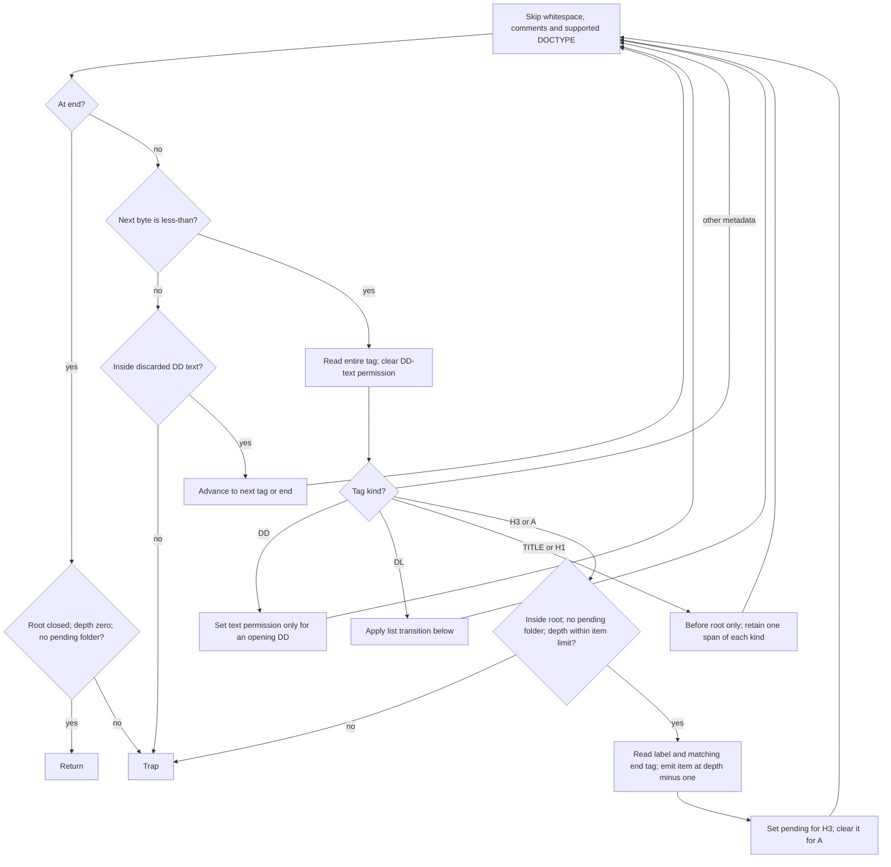
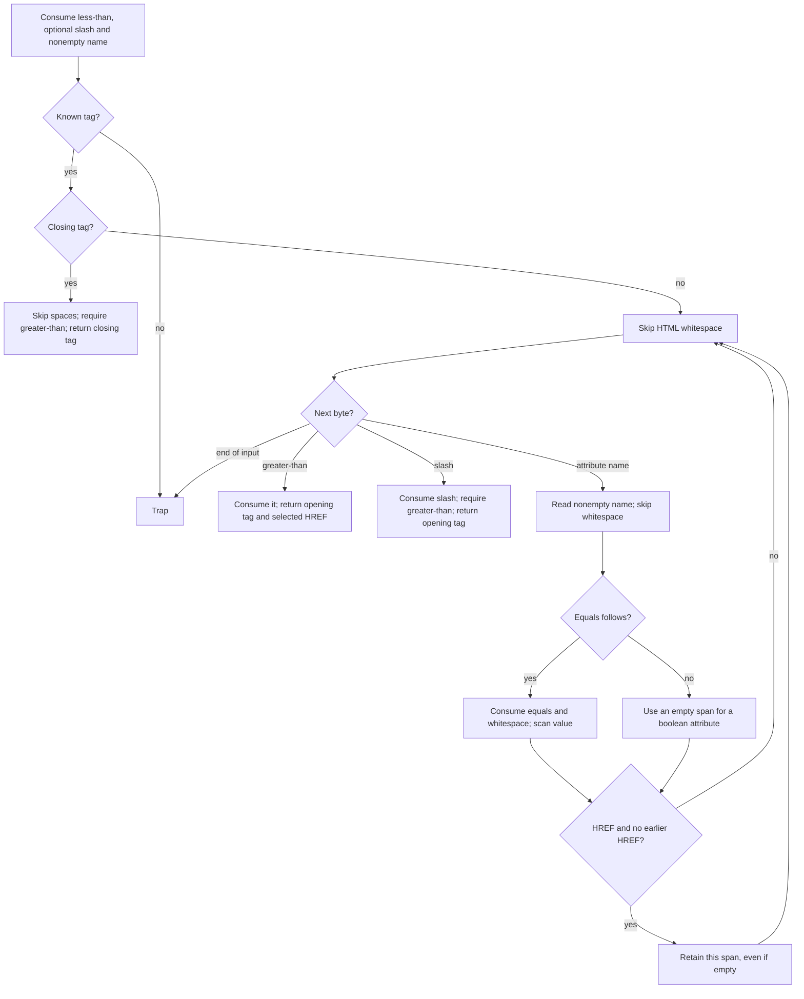
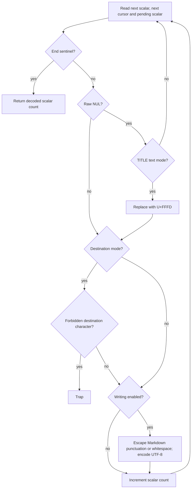

# Browser bookmark HTML to a Markdown outline

Tool 30 reads a fenced browser bookmark HTML export and produces the outline
accepted by [the bookmark writer](31-outline-to-bookmarks.md). Its HTML
character decoding is shared with [the named-reference reader](00-html-characters.md).
This is a bookmark projection, not a general HTML-to-Markdown converter.

The reader retains titles, folder hierarchy, bookmark labels and destinations.
It never loads icons, linked pages or resources. Dates, toolbar flags, icons,
descriptions and separators have no representation in this outline and are
ignored. UTF-8 is checked even in ignored attributes and comments.

## Structure and retained values

Tag and attribute names are ASCII case-insensitive. The supported vocabulary
is DL, H3, A, H1, TITLE, DT, P, DD, META, HTML, HEAD, BODY and HR.
DT and P end tags may be omitted. Folders require an H3 followed by a DL;
lists must balance, and a link cannot acquire children by an unlabelled DL.
There is exactly one root DL. Optional wrappers do not add outline levels.

The H1 title takes precedence over TITLE. A title and a heading may each
appear once, before the root list. Labels are character data with a matching
closing tag, not arbitrary nested markup. Encoded markup remains label text.
Descriptions beginning with DD are discarded through the following tag.

Attribute values may be single-quoted, double-quoted or unquoted. Boolean
metadata attributes are allowed. The first HREF wins if duplicated, following
HTML's duplicate-attribute behavior. A bookmark requires a nonempty decoded
destination. The same lexical restrictions as the writer apply, with no
scheme filtering or URL activation. Unknown attributes are consumed, not fetched.

The supported optional DOCTYPE names are html and NETSCAPE-Bookmark-file-1.
External identifiers, DTD subsets, processing instructions and arbitrary tags
are rejected. This is the browser-export vocabulary, not browser-style repair
of every malformed HTML document.

## State ownership

The outer scanner owns the input cursor and balanced DL depth. A pending
folder means H3 has supplied a name but the following DL has not opened yet.
Sibling items and list closes cannot silently discard that pending folder.

The tag reader consumes the full start tag before returning its kind,
closing flag and selected HREF span. Quoted values scan to their matching
quote even when they contain a greater-than sign; unquoted values stop at
HTML whitespace or greater-than. A slash inside an unquoted URL is data.
A slash before greater-than between attributes is treated as HTML's
self-closing marker, which does not close a non-void element.

The source spans remain in the first 64 KiB; no DOM tree is allocated. Before
the structural pass, character iteration validates UTF-8 across the entire
body. This does not interpret its tags. Output is bounded to the next 128 KiB.
The HTML reference tables occupy the fourth page above 0x31000; this module's
literal records use only the beginning of that page.

## Inside document: a folder name is not a list opening

`document` is function 21. Its loop is `bh-document-loop`; each successful
branch either consumes input and returns there or reaches the final balance
check. The scanner does not recurse when opening a folder. It needs only a
depth and one pending-folder flag because the output is written in preorder:
the folder's label is already finished before its children arrive.

The persistent state has distinct owners:

- Global 1 is the next unread byte, bounded by global 2. Helpers advance it;
  they do not advance list depth.
- Global 3 counts open DL elements, including the root. A root-level item
  therefore emits at indentation level `depth - 1`.
- Local 4 is the root state: 0 before the root, 1 inside, 2 after it.
  Depth alone cannot distinguish before from after an empty root list.
- Local 5 says an H3 has been emitted and still needs its DL. Whitespace,
  comments and metadata can intervene; another item or a list close cannot.
- Local 6 permits discarded description text after DD. Reading another tag
  ends that permission, unless the new tag is another opening DD.
- Locals 7–10 retain TITLE and H1 spans. Neither is copied into scratch
  storage. On opening the root, H1 wins and the chosen span is decoded once.

The diagram groups tag kinds; the byte code additionally rejects a stray
closing H3/A/H1/TITLE at `bh-document-endtag`. Their legal end tags are
consumed by `label`, not left for the outer loop. An A also needs an HREF;
an H3's HREF metadata is deliberately erased before calling `item`.

| DL transition | Required state | Change |
| --- | --- | --- |
| First opening DL | Root 0 | Select title, set root 1, increase depth to 1 |
| Child opening DL | Root 1 and pending folder | Increase depth, clear pending |
| Closing DL | Positive depth and no pending folder | Decrease depth; at zero set root 2 |
| A second root, an unlabelled child, or closing before a folder's DL | Not a permitted transition | Trap |

Opening checks the depth limit before incrementing. An empty folder at item
level 128 still needs its own DL, so a depth of 129 is allowed for that empty
list. Emitting an item inside it would exceed the item limit and is rejected.
This is why list-opening and item-emission have different bound checks.

### Trace: a folder, a bookmark and an empty sibling

Starting after an optional title, the meaningful events are:

| Consumed input | Depth afterward | Pending afterward | Output added |
| --- | --- | --- | --- |
| Root `<DL>` | 1 | No | Optional title heading |
| `<H3>Work</H3>` | 1 | Yes | `- Work` |
| Child `<DL>` | 2 | No | Nothing |
| `<A HREF="https://a.test/">A</A>` | 2 | No | Two spaces, then `- [A](<https://a.test/>)` |
| Child `</DL>` | 1 | No | Nothing |
| `<H3></H3>` | 1 | Yes | A separating blank line, then `- ` |
| Empty child's `<DL></DL>` | 1 | No | Nothing |
| Root `</DL>` | 0 | No | Nothing; root becomes closed |

The blank line is not a folder delimiter in HTML. It prevents the empty
Markdown item from being absorbed into the preceding item's block structure.
`item` tests the decoded label length, not its source span length: a label
containing only raw NUL bytes is also empty after HTML body-text handling.

## Inside tag and value: delimiter ownership

`tag` returns four values: kind, closing flag, HREF start and HREF end. It
does not decode attribute values. `value` returns a span within the original
input, and the chosen HREF is decoded later with attribute-context rules.

Inside `value`, the two loops have different exits:

- For a quoted value, consume the opening quote, remember the start, and
  advance until that same quote. A `>` or `/` is ordinary data here. Save
  the end before consuming the closing quote. End-of-input instead traps.
- For an unquoted value, remember the current cursor and advance to HTML
  whitespace or `>`. Leave that terminator unread for `tag`. The span must
  be nonempty. A slash, ampersand or equals sign remains part of the value.

For `HREF=https://a.test/?x=1&y=2`, all of the URL belongs to one span.
For `ICON="data:image/png;base64,...>..."`, the greater-than does not end
the tag. Neither value is loaded. The latter is consumed and discarded.
For `HREF="" HREF="https://a.test/"`, the first span wins and the later
nonempty value cannot repair it: `item` rejects the empty destination.

The single-byte literal length and input spans have different roles. The
former advances between this module's fixed tag-name records; the latter
delimit arbitrary source values. Nothing relies on a NUL terminator.

## Inside text: source movement and decoded movement differ

`text` calls the shared `h.next` function with the current source span and
one pending scalar. A named HTML reference can return two scalars: the first
advances past the entire reference, while the second is returned on the next
call without moving the source cursor. Testing only cursor movement would
incorrectly discard that second scalar, especially at the end of a label.

`item` first uses counting mode on the label to decide whether it needs the
empty-item separator. Its second pass writes that same label. A destination
uses attribute mode and is written between angle delimiters. Thus this
small, bounded double pass avoids both a temporary decoded string and a
rollback of already-written Markdown. Work is linear in the span length;
the source is not rescanned from the beginning for each character.

The helper already changes an attribute's raw NUL to U+FFFD. Ordinary body
text drops raw NUL; TITLE text replaces it. Numeric `&#0;` produces U+FFFD
in all contexts. Other decoded control characters can survive this reader;
the writer's stricter XML-scalar input contract may reject them. Round-trip
claims therefore apply to their documented common vocabulary, not every
possible HTML token stream.

## Byte module

Function imports: HTML next 0. Definitions: run 1, emit 2, literal 3, take 4,
spaces 5, name 6, value 7, same 8, match 9, find 10, tag 11, label 12,
classify 13, character 14, text 15, indent 16, noise 17, fence-check 18,
item 19, validate 20, document 21. Globals: output 0, cursor 1, end 2,
DL depth 3, previous-nonempty-item 4.

`[microwasm]`

- bh-header: `0061736d 01000000`
- bh-types-section: `01 {{size:bh-types}}`
  - bh-types: `0d 60 04 7f 7f 7f 7f 03 7f 7f 7f 60 01 7f 01 7f 60 01 7f 00 60 00 00 60 00 02 7f 7f 60 03 7f 7f 7f 01 7f 60 01 7f 02 7f 7f 60 00 04 7f 7f 7f 7f 60 02 7f 7f 01 7f 60 02 7f 7f 00 60 05 7f 7f 7f 7f 7f 01 7f 60 03 7f 7f 7f 00 60 05 7f 7f 7f 7f 7f 00`
- bh-import-section: `02 {{size:bh-imports}}`
  - bh-imports: `02 01 68 04 6e657874 00 00 01 68 06 6d656d6f7279 02 01 04 04`
- bh-function-section: `03 {{size:bh-functions}}`
  - bh-functions: `15 01 02 02 02 03 04 04 05 01 06 07 06 08 09 0a 02 03 0b 0c 09 03`
- bh-global-section: `06 {{size:bh-globals}}`
  - bh-globals: `05 7f 01 41 00 0b 7f 01 41 00 0b 7f 01 41 00 0b 7f 01 41 00 0b 7f 01 41 00 0b`
- bh-export-section: `07 {{size:bh-exports}}`
  - bh-exports: `02 03 72756e 00 01 06 6d656d6f7279 02 00`
- bh-code-section: `0a {{size:bh-code}}`
  - bh-code: `15`
    - bh-run-record: `{{size:bh-run-body}}`
      - bh-run-body: `01 07 7f`
        - bh-run-bound: `20 00 41 0b 49 20 00 41 808004 4b 72 04 40 00 0b 20 00 24 02`
        - bh-run-ticks: `02 40 03 40 20 01 20 00 4f 0d 01 20 01 2d 00 00 41 e000 47 0d 01 20 01 41 01 6a 21 01 0c 00 0b 0b 20 01 41 03 49 04 40 00 0b 20 01 24 01`
        - bh-run-label: `41 b5800c 10 09 45 04 40 00 0b 23 01 41 04 6a 24 01 23 01 23 02 49 04 40 23 01 2d 00 00 41 0d 46 04 40 23 01 41 01 6a 24 01 0b 0b 41 0a 10 04 23 01 21 02 20 00 21 03`
        - bh-run-trim: `02 40 03 40 20 03 20 02 4d 0d 01 20 03 41 01 6b 2d 00 00 21 06 20 06 41 20 46 20 06 41 09 46 72 20 06 41 0a 46 72 20 06 41 0d 46 72 45 0d 01 20 03 41 01 6b 21 03 0c 00 0b 0b`
        - bh-run-close-ticks: `02 40 03 40 20 03 20 02 4d 0d 01 20 03 41 01 6b 2d 00 00 41 e000 47 0d 01 20 03 41 01 6b 21 03 20 04 41 01 6a 21 04 0c 00 0b 0b 20 04 20 01 49 04 40 00 0b`
        - bh-run-close-line: `20 03 20 02 4d 04 40 00 0b 20 03 41 01 6b 22 03 2d 00 00 41 0a 47 04 40 00 0b 20 03 20 02 4b 04 40 20 03 41 01 6b 2d 00 00 41 0d 46 04 40 20 03 41 01 6b 21 03 0b 0b`
        - bh-run-validate: `20 02 20 03 20 01 10 12 20 02 20 03 10 14`
        - bh-run-reset: `41 808004 24 00 20 02 24 01 20 03 24 02 41 00 24 03 41 00 24 04`
        - bh-run-bom: `23 01 41 02 6a 23 02 49 04 40 23 01 2d 00 00 41 ef01 46 23 01 2d 00 01 41 bb01 46 71 23 01 2d 00 02 41 bf01 46 71 04 40 23 01 41 03 6a 24 01 0b 0b`
        - bh-run-document: `10 15 23 00 41 808004 6b 0b`
    - bh-emit-record: `{{size:bh-emit-body}}`
      - bh-emit-body: `00 23 00 41 80800c 4f 04 40 00 0b 23 00 20 00 3a 00 00 23 00 41 01 6a 24 00 0b`
    - bh-literal-record: `{{size:bh-literal-body}}`
      - bh-literal-body: `01 01 7f 20 00 20 00 2d 00 00 6a 41 01 6a 21 01 20 00 41 01 6a 21 00 02 40 03 40 20 00 20 01 4f 0d 01 20 00 2d 00 00 10 02 20 00 41 01 6a 21 00 0c 00 0b 0b 0b`
    - bh-take-record: `{{size:bh-take-body}}`
      - bh-take-body: `00 23 01 23 02 4f 04 40 00 0b 23 01 2d 00 00 20 00 47 04 40 00 0b 23 01 41 01 6a 24 01 0b`
    - bh-spaces-record: `{{size:bh-spaces-body}}`
      - bh-spaces-body: `01 01 7f 02 40 03 40 23 01 23 02 4f 0d 01 23 01 2d 00 00 21 00 20 00 41 20 46 20 00 41 09 46 72 20 00 41 0a 46 72 20 00 41 0c 46 72 20 00 41 0d 46 72 45 0d 01 23 01 41 01 6a 24 01 0c 00 0b 0b 0b`
    - bh-name-record: `{{size:bh-name-body}}`
      - bh-name-body: `01 02 7f 23 01 21 00 02 40 03 40 23 01 23 02 4f 0d 01 23 01 2d 00 00 21 01`
        - bh-name-byte: `20 01 41 20 72 41 e100 6b 41 19 4d 20 01 41 30 6b 41 09 4d 72 20 01 41 2d 46 72 20 01 41 df00 46 72 20 01 41 3a 46 72 20 01 41 2e 46 72 45 0d 01 23 01 41 01 6a 24 01 0c 00 0b 0b`
        - bh-name-end: `23 01 20 00 46 04 40 00 0b 20 00 23 01 0b`
    - bh-value-record: `{{size:bh-value-body}}`
      - bh-value-body: `01 03 7f 23 01 23 02 4f 04 40 00 0b 23 01 2d 00 00 21 00`
        - bh-value-quoted: `20 00 41 22 46 20 00 41 27 46 72 04 40 23 01 41 01 6a 24 01 23 01 21 01 02 40 03 40 23 01 23 02 4f 04 40 00 0b 23 01 2d 00 00 20 00 46 0d 01 23 01 41 01 6a 24 01 0c 00 0b 0b 23 01 21 02 23 01 41 01 6a 24 01 20 01 20 02 0f 0b`
        - bh-value-unquoted: `23 01 21 01 02 40 03 40 23 01 23 02 4f 0d 01 23 01 2d 00 00 21 00`
          - bh-value-stop: `20 00 41 3e 46 20 00 41 20 46 72 20 00 41 09 46 72 20 00 41 0a 46 72 20 00 41 0c 46 72 20 00 41 0d 46 72 0d 01`
          - bh-value-advance: `23 01 41 01 6a 24 01 0c 00 0b 0b 23 01 20 01 46 04 40 00 0b 20 01 23 01 0b`
    - bh-same-record: `{{size:bh-same-body}}`
      - bh-same-body: `01 01 7f 20 01 20 00 6b 20 02 2d 00 00 47 04 40 41 00 0f 0b 20 02 41 01 6a 21 02 02 40 03 40 20 00 20 01 4f 0d 01 20 00 2d 00 00 21 03`
        - bh-same-fold: `20 03 41 c100 6b 41 19 4d 04 40 20 03 41 20 72 21 03 0b`
        - bh-same-compare: `20 03 20 02 2d 00 00 47 04 40 41 00 0f 0b 20 00 41 01 6a 21 00 20 02 41 01 6a 21 02 0c 00 0b 0b 41 01 0b`
    - bh-match-record: `{{size:bh-match-body}}`
      - bh-match-body: `01 01 7f 20 00 2d 00 00 21 01 23 01 20 01 6a 23 02 4b 04 40 41 00 0f 0b 23 01 23 01 20 01 6a 20 00 10 08 0b`
    - bh-find-record: `{{size:bh-find-body}}`
      - bh-find-body: `01 01 7f 23 01 21 01 02 40 03 40 20 00 10 09 0d 01 23 01 23 02 4f 04 40 00 0b 23 01 41 01 6a 24 01 0c 00 0b 0b 20 01 23 01 0b`
    - bh-tag-record: `{{size:bh-tag-body}}`
      - bh-tag-body: `01 0b 7f 41 3c 10 04 23 01 23 02 4f 04 40 00 0b 23 01 2d 00 00 41 2f 46 04 40 41 01 21 02 23 01 41 01 6a 24 01 0b 10 06 21 01 21 00 20 00 20 01 10 0d 22 0a 45 04 40 00 0b`
        - bh-tag-closing: `20 02 04 40 10 05 41 3e 10 04 20 0a 41 01 41 00 41 00 0f 0b`
        - bh-tag-attributes: `02 40 03 40 10 05 23 01 23 02 4f 04 40 00 0b 23 01 2d 00 00 21 09`
          - bh-tag-end: `20 09 41 3e 46 04 40 23 01 41 01 6a 24 01 0c 02 0b`
          - bh-tag-slash: `20 09 41 2f 46 04 40 23 01 41 01 6a 24 01 41 3e 10 04 0c 02 0b`
          - bh-tag-name: `10 06 21 06 21 05 10 05 23 01 21 07 23 01 21 08`
          - bh-tag-equals: `23 01 23 02 49 04 40 23 01 2d 00 00 41 3d 46 04 40 23 01 41 01 6a 24 01 10 05 10 07 21 08 21 07 0b 0b`
          - bh-tag-href: `20 05 20 06 41 b0800c 10 08 20 03 45 71 04 40 20 07 21 03 20 08 21 04 0b 0c 00 0b 0b 20 0a 41 00 20 03 20 04 0b`
    - bh-label-record: `{{size:bh-label-body}}`
      - bh-label-body: `01 04 7f 41 e8800c 10 0a 21 02 21 01 10 0b 1a 1a 21 04 21 03 20 03 20 00 47 20 04 41 01 47 72 04 40 00 0b 20 01 20 02 0b`
    - bh-classify-record: `{{size:bh-classify-body}}`
      - bh-classify-body: `01 02 7f 41 80800c 21 02 41 01 21 03 02 40 03 40 20 03 41 0d 4b 0d 01 20 00 20 01 20 02 10 08 04 40 20 03 0f 0b 20 02 20 02 2d 00 00 6a 41 01 6a 21 02 20 03 41 01 6a 21 03 0c 00 0b 0b 41 00 0b`
    - bh-character-record: `{{size:bh-character-body}}`
      - bh-character-body: `00`
        - bh-character-space: `20 00 41 20 4d 04 40 41 26 10 02 41 23 10 02 20 00 41 0a 4f 04 40 20 00 41 0a 6e 41 30 6a 10 02 0b 20 00 41 0a 70 41 30 6a 10 02 41 3b 10 02 0f 0b`
        - bh-character-escape: `20 01 04 7f 20 00 41 26 46 05 20 00 41 21 6b 41 0e 4d 20 00 41 3a 6b 41 06 4d 72 20 00 41 db00 6b 41 05 4d 72 20 00 41 fb00 6b 41 03 4d 72 0b 04 40 41 dc00 10 02 0b`
        - bh-character-ascii: `20 00 41 8001 49 04 40 20 00 10 02 0f 0b`
        - bh-character-utf8: `20 00 41 8010 49 04 40 20 00 41 06 76 41 c001 72 10 02 05 20 00 41 808004 49 04 40 20 00 41 0c 76 41 e001 72 10 02 05 20 00 41 12 76 41 f001 72 10 02 20 00 41 0c 76 41 3f 71 41 8001 72 10 02 0b 20 00 41 06 76 41 3f 71 41 8001 72 10 02 0b 20 00 41 3f 71 41 8001 72 10 02 0b`
    - bh-text-record: `{{size:bh-text-body}}`
      - bh-text-body: `01 03 7f 02 40 03 40 20 00 20 01 20 02 41 01 46 20 06 10 00 21 06 21 00 21 05 20 05 41 7f 46 0d 01`
        - bh-text-nul: `20 05 45 04 40 20 02 41 02 46 04 40 41 fdff03 21 05 05 0c 02 0b 0b`
        - bh-text-url: `20 03 04 40 20 05 41 20 4d 20 05 41 ff00 46 72 20 05 41 22 46 72 20 05 41 3c 46 72 20 05 41 3e 46 72 20 05 41 dc00 46 72 04 40 00 0b 0b`
        - bh-text-output: `20 04 04 40 20 05 20 03 10 0e 0b 20 07 41 01 6a 21 07 0c 00 0b 0b 20 07 0b`
    - bh-indent-record: `{{size:bh-indent-body}}`
      - bh-indent-body: `00 02 40 03 40 20 00 45 0d 01 41 20 10 02 41 20 10 02 20 00 41 01 6b 21 00 0c 00 0b 0b 0b`
    - bh-noise-record: `{{size:bh-noise-body}}`
      - bh-noise-body: `01 02 7f 03 40 10 05 41 ba800c 10 09 04 40 23 01 41 04 6a 24 01 41 bf800c 10 0a 1a 1a 23 01 41 03 6a 24 01 0c 01 0b`
        - bh-noise-doctype: `41 c3800c 10 09 04 40 23 01 41 09 6a 24 01 23 01 21 00 10 05 23 01 20 00 46 04 40 00 0b 10 06 21 01 21 00 20 00 20 01 41 cd800c 10 08 20 00 20 01 41 b5800c 10 08 72 45 04 40 00 0b 10 05 41 3e 10 04 0c 01 0b 0b 0b`
    - bh-fence-record: `{{size:bh-fence-body}}`
      - bh-fence-body: `01 02 7f 02 40 03 40 20 00 20 01 4f 0d 01 20 00 21 03`
        - bh-fence-indent: `02 40 03 40 20 00 20 01 4f 0d 01 20 00 20 03 6b 41 03 4f 0d 01 20 00 2d 00 00 41 20 47 0d 01 20 00 41 01 6a 21 00 0c 00 0b 0b 41 00 21 04`
        - bh-fence-ticks: `02 40 03 40 20 00 20 01 4f 0d 01 20 00 2d 00 00 41 e000 47 0d 01 20 00 41 01 6a 21 00 20 04 41 01 6a 21 04 0c 00 0b 0b`
        - bh-fence-tail: `20 04 20 02 4f 04 40 02 40 03 40 20 00 20 01 4f 0d 01 20 00 2d 00 00 41 20 46 20 00 2d 00 00 41 09 46 72 45 0d 01 20 00 41 01 6a 21 00 0c 00 0b 0b 20 00 20 01 46 04 40 00 0b 20 00 2d 00 00 41 0a 46 20 00 2d 00 00 41 0d 46 72 04 40 00 0b 0b`
        - bh-fence-next: `02 40 03 40 20 00 20 01 4f 0d 01 20 00 2d 00 00 41 0a 46 20 00 2d 00 00 41 0d 46 72 0d 01 20 00 41 01 6a 21 00 0c 00 0b 0b 20 00 41 01 6a 21 00 0c 00 0b 0b 0b`
    - bh-item-record: `{{size:bh-item-body}}`
      - bh-item-body: `01 01 7f 20 00 20 01 41 00 41 00 41 00 10 0f 21 05`
        - bh-item-empty: `20 05 45 20 02 45 71 23 04 71 04 40 41 0a 10 02 0b 20 04 10 10 41 ed800c 10 03`
        - bh-item-label: `20 02 04 40 41 db00 10 02 0b 20 00 20 01 41 00 41 00 41 01 10 0f 1a`
        - bh-item-url: `20 02 04 40 41 f0800c 10 03 20 02 20 03 41 01 41 01 41 01 10 0f 45 04 40 00 0b 41 f4800c 10 03 0b`
        - bh-item-end: `41 0a 10 02 20 05 45 45 20 02 45 45 72 24 04 0b`
    - bh-validate-record: `{{size:bh-validate-body}}`
      - bh-validate-body: `01 01 7f 02 40 03 40 20 00 20 01 41 00 20 02 10 00 21 02 21 00 41 7f 46 0d 01 0c 00 0b 0b 0b`
    - bh-document-record: `{{size:bh-document-body}}`
      - bh-document-body: `01 0e 7f`
        - bh-document-loop: `02 40 03 40 10 11 23 01 23 02 4f 0d 01`
          - bh-document-text: `23 01 2d 00 00 41 3c 47 04 40 20 06 45 04 40 00 0b 02 40 03 40 23 01 23 02 4f 0d 01 23 01 2d 00 00 41 3c 46 0d 01 23 01 41 01 6a 24 01 0c 00 0b 0b 0c 01 0b`
          - bh-document-tag: `10 0b 21 03 21 02 21 01 21 00 41 00 21 06`
          - bh-document-dd: `20 00 41 08 46 04 40 20 01 45 21 06 0c 01 0b`
          - bh-document-noise: `20 00 41 06 4f 04 40 0c 01 0b`
          - bh-document-list: `20 00 41 01 46 04 40 20 01 04 40`
            - bh-document-list-close: `23 03 45 20 05 72 04 40 00 0b 23 03 41 01 6b 24 03 23 03 45 04 40 41 02 21 04 0b`
            - bh-document-list-open: `05 20 04 45 04 40 41 01 21 04`
              - bh-document-title-choice: `20 09 04 40 20 09 21 0b 20 0a 21 0c 41 00 21 0d 05 20 07 21 0b 20 08 21 0c 41 02 21 0d 0b`
              - bh-document-title-output: `20 0b 04 40 41 ea800c 10 03 20 0b 20 0c 20 0d 41 00 41 01 10 0f 1a 41 0a 10 02 41 0a 10 02 0b`
              - bh-document-child-list: `05 20 04 41 01 47 20 05 45 72 04 40 00 0b 0b 23 03 41 8101 4f 04 40 00 0b 23 03 41 01 6a 24 03 41 00 21 05 0b 0c 01 0b`
          - bh-document-endtag: `20 01 04 40 00 0b`
          - bh-document-title: `20 00 41 04 4f 04 40 20 04 04 40 00 0b 20 00 10 0c 21 0c 21 0b 20 00 41 04 46 04 40 20 09 04 40 00 0b 20 0b 21 09 20 0c 21 0a 05 20 07 04 40 00 0b 20 0b 21 07 20 0c 21 08 0b 0c 01 0b`
          - bh-document-item-check: `20 04 41 01 47 20 05 72 23 03 45 72 23 03 41 8001 4b 72 04 40 00 0b 20 00 41 03 46 20 02 45 71 04 40 00 0b`
          - bh-document-folder-attributes: `20 00 41 02 46 04 40 41 00 21 02 41 00 21 03 0b` — HREF metadata on a folder is not a bookmark destination.
          - bh-document-item: `20 00 10 0c 21 0c 21 0b 20 0b 20 0c 20 02 20 03 23 03 41 01 6b 10 13 20 00 41 02 46 21 05 0c 00 0b 0b`
        - bh-document-done: `20 04 41 02 47 23 03 72 20 05 72 04 40 00 0b 0b`
- bh-data-section: `0b {{size:bh-data}}`
  - bh-data: `01 00 41 80800c 0b {{size:bh-literals}}`
    - bh-literals:
      - bh-literal-0: `02646c` — "dl", offset 0.
      - bh-literal-1: `026833` — "h3", offset 3.
      - bh-literal-2: `0161` — "a", offset 6.
      - bh-literal-3: `026831` — "h1", offset 8.
      - bh-literal-4: `057469746c65` — "title", offset 11.
      - bh-literal-5: `026474` — "dt", offset 17.
      - bh-literal-6: `0170` — "p", offset 20.
      - bh-literal-7: `026464` — "dd", offset 22.
      - bh-literal-8: `046d657461` — "meta", offset 25.
      - bh-literal-9: `0468746d6c` — "html", offset 30.
      - bh-literal-10: `0468656164` — "head", offset 35.
      - bh-literal-11: `04626f6479` — "body", offset 40.
      - bh-literal-12: `026872` — "hr", offset 45.
      - bh-literal-13: `0468726566` — "href", offset 48.
      - bh-literal-14: `0468746d6c` — "html", offset 53.
      - bh-literal-15: `043c212d2d` — "<!--", offset 58.
      - bh-literal-16: `032d2d3e` — "-->", offset 63.
      - bh-literal-17: `093c21646f6374797065` — "<!doctype", offset 67.
      - bh-literal-18: `186e657473636170652d626f6f6b6d61726b2d66696c652d31` — "netscape-bookmark-file-1", offset 77.
      - bh-literal-19: `013e` — ">", offset 102.
      - bh-literal-20: `013c` — "<", offset 104.
      - bh-literal-21: `022320` — "# ", offset 106.
      - bh-literal-22: `022d20` — "- ", offset 109.
      - bh-literal-23: `035d283c` — "](<", offset 112.
      - bh-literal-24: `023e29` — ">)", offset 116.
