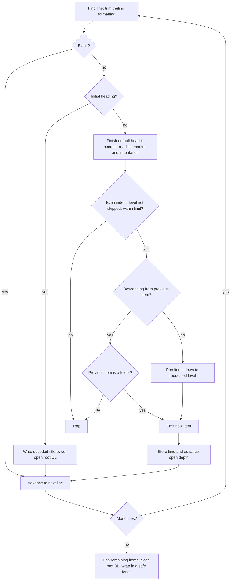

# A Markdown bookmark outline to browser bookmark HTML

Tool 31 writes the Netscape bookmark interchange format used by browser
exports. Plain list items become folders; inline links become bookmarks.
It preserves their order, nesting and empty labels, with an optional heading
for the document title. It does not manufacture dates, icons, tags or
browser-specific toolbar flags.

```text
# Reading

- Web
  - [WebAssembly](https://webassembly.org/)
  - [SQLite](<https://sqlite.org/docs.html>)
- Empty folder
- [Email](mailto:hello@example.com)
```

The result is a fenced HTML file, beginning with the bookmark DOCTYPE and
UTF-8 metadata. Folder headings use H3 followed by a DL; links use A with an
escaped HREF. DT and P end tags are omitted, as in browser exports. This is
HTML, not the XML vocabulary used by the OPML converter.

The format follows [Chromium's bookmark writer](https://chromium.googlesource.com/chromium/src/+/refs/heads/main/chrome/browser/bookmarks/bookmark_html_writer.cc).
The generated file is data in the transformation viewer: its HTML is never
inserted as active document markup.

## Outline input and loss boundaries

- An optional initial `# Title` supplies both TITLE and H1; `#` gives an
  empty title. Without one, the title is Bookmarks. An empty outline is valid.
- Two spaces indent one level; at most 128 item levels, without skipped
  levels or odd indentation. Blank lines are ignored.
- An unlinked item is always a folder, even if no child follows. A linked
  item is always a leaf. A child below a link is an error, not a sibling
  silently moved elsewhere.
- Each label or link is one physical line. Trailing spaces and tabs are
  formatting. Decimal character references preserve significant whitespace.
- Punctuation escapes and complete decimal references are decoded as in the
  [OPML outline parser](28-outline-to-opml.md). Other inline formatting is
  literal. Labels may have balanced brackets and destinations may have
  balanced parentheses or angle delimiters. An initial literal bracket must
  be escaped. Link titles and reference-link definitions are not accepted.
- Destinations must be nonempty. ASCII whitespace, DEL, double quotes,
  angle brackets and backslashes are rejected after decoding. Other URL
  text is preserved without scheme filtering or normalization: browser
  bookmarks can include mailto, file and browser-internal addresses.
- UTF-8 and XML-valid scalars are required by the shared character writer.
  This excludes raw NUL and forbidden controls rather than repairing them.
  It is a documented input restriction, not a general HTML parser.

URLs are not activated by this tool. Importing the generated file into a
browser is a separate user action, and this is not a URL-sanitization service.
The outline cannot represent browser metadata; neither direction should claim
to be a lossless backup of a browser profile.

## Inside run: one item stack, two closing behaviors

The line scanner and link-delimiter scans reuse the handwritten algorithms
from tool 28. The different structure is here: each stack entry records whether
an item is a folder, because only folders leave an open DL behind.



A folder stores 1 at its level and emits H3 plus an opening DL. A link stores
0 and emits a complete A element. Both increment item depth so the next
line can distinguish a sibling from an attempted child. The kind check
occurs before emitting the next item, not after a child has been misnested.

| Input item | Depth before | Operation |
| --- | --- | --- |
| `- Folder` | 0 | Store folder at level 0; open its DL; depth 1 |
| `  - [A](https://a.test/)` | 1 | Store link at level 1; emit complete A; depth 2 |
| `  - Empty` | 2 | Pop link without markup; open sibling folder; depth 2 |
| `- [B](https://b.test/)` | 2 | Close Empty's DL, then Folder's DL; emit root-level link |

On each pop, `bk-close-body` decrements depth first, then reads that entry.
A zero emits nothing; a one emits an indented DL close. Entries above depth
can remain stale because each new item overwrites its own slot. There is no
heap or retained node tree.

## Inside item: determine source spans before writing either value

An opening bracket starts the balanced label scan. The following parenthesis
is required; then an angle-delimited or balanced bare destination is scanned.
Escaped punctuation is skipped during delimiter search. The final closing
parenthesis must be the final non-formatting byte on that line.

Only after those spans are known does output begin. HREF appears before the
label in HTML, so the source destination is decoded first, then the earlier
label span. This changes output order without copying the label to another
buffer. Plain folders decode once into element text, followed by the child DL.

`bk-text-url` applies the destination character restrictions before the shared
XML escaping function writes them into an HTML attribute. That escaping is
also valid here: ampersands and quotes cannot create new attributes or tags.
Named references in the outline remain literal data; only its documented
decimal references are interpreted.

## Framing, memory and error recovery

Input stays unchanged in the first 64 KiB. Output occupies
`[65536, 196608)`; literal records start at 196608. The 128-byte item-kind
stack starts at 197632. Only its active prefix matters. The four-page shared
memory is the same size as the OPML chain, but this writer needs no JSON tree.

The fence pass finds the longest backtick run in the completed HTML and
chooses a longer fence, with a minimum of three. It checks the total size
before moving output once with overlap-safe memory.copy. A failure can leave
partial bytes, but callers publish only a successful run's returned length.
Every new run resets all live state.

Imports are raw XML scalar 0, XML character output 1, and shared memory.
Definitions are run 2, emit 3, literal 4, text 5, next 6, punctuation 7,
item 8, frame 9, URL 10, indentation 11, close-item 12.

`[microwasm]`

- bk-header: `0061736d 01000000`
- bk-type-section: `01 {{size:bk-types}}`
  - bk-types: `07 60 02 7f 7f 02 7f 7f 60 03 7f 7f 7f 01 7f 60 01 7f 01 7f 60 01 7f 00 60 03 7f 7f 7f 00 60 02 7f 7f 00 60 00 00`
- bk-import-section: `02 {{size:bk-imports}}`
  - bk-imports: `03 01 78 06 7363616c6172 00 00 01 6f 09 636861726163746572 00 01 01 78 06 6d656d6f7279 02 01 04 04`
- bk-function-section: `03 {{size:bk-functions}}`
  - bk-functions: `0b 02 03 03 04 00 02 05 06 05 03 06`
- bk-global-section: `06 {{size:bk-globals}}`
  - bk-globals: `03 7f 01 41 00 0b 7f 01 41 00 0b 7f 01 41 00 0b`
- bk-export-section: `07 {{size:bk-exports}}`
  - bk-exports: `02 03 72756e 00 02 06 6d656d6f7279 02 00`
- bk-code-section: `0a {{size:bk-code}}`
  - bk-code: `0b`
    - bk-run-record: `{{size:bk-run-body}}`
      - bk-run-body: `01 07 7f`
        - bk-run-bound: `20 00 41 808004 4b 04 40 00 0b`
        - bk-run-reset: `41 808004 24 00 41 00 24 01 41 00 24 02 41 80800c 10 04`
        - bk-lines-exit: `02 40 03 40 20 01 20 00 4f 0d 01 20 01 21 03`
          - bk-line-find: `02 40 03 40 20 03 20 00 4f 0d 01 20 03 2d 00 00 41 0a 46 0d 01 20 03 41 01 6a 21 03 0c 00 0b 0b 20 03 21 02`
          - bk-line-cr: `20 02 20 01 4b 04 40 20 02 41 01 6b 2d 00 00 41 0d 46 04 40 20 02 41 01 6b 21 02 0b 0b`
          - bk-line-trim: `02 40 03 40 20 02 20 01 4d 0d 01 20 02 41 01 6b 2d 00 00 22 07 41 20 46 20 07 41 09 46 72 45 0d 01 20 02 41 01 6b 21 02 0c 00 0b 0b`
          - bk-line-blank: `20 02 20 01 46 04 40 20 03 41 01 6a 21 01 0c 01 0b`
          - bk-line-indent: `20 01 21 04 41 00 21 05 02 40 03 40 20 04 20 02 4f 0d 01 20 04 2d 00 00 41 20 47 0d 01 20 04 41 01 6a 21 04 20 05 41 01 6a 21 05 0c 00 0b 0b`
          - bk-head: `23 02 45 04 40 20 05 45 20 04 2d 00 00 41 23 46 71 04 40`
            - bk-head-label: `20 04 41 01 6a 21 07 20 07 20 02 49 04 40 20 07 2d 00 00 41 20 47 04 40 00 0b 20 07 41 01 6a 21 07 0b`
            - bk-head-title: `41 9e810c 10 04 20 07 20 02 41 00 10 05 41 a6810c 10 04 20 07 20 02 41 00 10 05 41 b4810c 10 04 41 01 24 02 20 03 41 01 6a 21 01 0c 02 0b 41 e9800c 10 04 41 01 24 02 0b`
          - bk-item-marker: `20 04 2d 00 00 41 2d 47 04 40 00 0b 20 04 41 01 6a 21 07 20 07 20 02 49 04 40 20 07 2d 00 00 41 20 47 04 40 00 0b 20 07 41 01 6a 21 07 0b`
          - bk-item-level: `20 05 41 01 71 04 40 00 0b 20 05 41 01 76 21 06 20 06 23 01 4b 20 06 41 8001 4f 72 04 40 00 0b`
          - bk-item-parent: `20 06 23 01 46 20 06 41 00 4b 71 04 40 41 80880c 20 06 6a 41 01 6b 2d 00 00 45 04 40 00 0b 0b` — Descent requires a folder, not a link.
          - bk-item-pop: `02 40 03 40 23 01 20 06 4d 0d 01 10 0c 0c 00 0b 0b`
          - bk-item-open: `20 06 41 01 6a 10 0b 20 07 20 02 10 08 20 06 41 01 6a 24 01`
          - bk-line-next: `20 03 41 01 6a 21 01 0c 00 0b 0b`
        - bk-run-finish: `23 02 45 04 40 41 e9800c 10 04 0b 02 40 03 40 23 01 45 0d 01 10 0c 0c 00 0b 0b 41 fd810c 10 04 10 09 23 00 41 808004 6b 0b`
    - bk-emit-record: `{{size:bk-emit-body}}`
      - bk-emit-body: `00 23 00 41 80800c 4f 04 40 00 0b 23 00 20 00 3a 00 00 23 00 41 01 6a 24 00 0b`
    - bk-literal-record: `{{size:bk-literal-body}}`
      - bk-literal-body: `01 01 7f 20 00 20 00 2d 00 00 6a 41 01 6a 21 01 20 00 41 01 6a 21 00 02 40 03 40 20 00 20 01 4f 0d 01 20 00 2d 00 00 10 03 20 00 41 01 6a 21 00 0c 00 0b 0b 0b`
    - bk-text-record: `{{size:bk-text-body}}`
      - bk-text-body: `01 01 7f 02 40 03 40 20 00 20 01 4f 0d 01 20 00 20 01 10 06 21 00 21 03`
        - bk-text-url: `20 02 41 02 46 04 40 20 03 41 20 4d 20 03 41 ff00 46 72 20 03 41 22 46 72 20 03 41 3c 46 72 20 03 41 3e 46 72 20 03 41 dc00 46 72 04 40 00 0b 0b`
        - bk-text-emit: `23 00 20 03 23 00 20 02 45 45 10 01 6a 24 00 0c 00 0b 0b 0b`
    - bk-next-record: `{{size:bk-next-body}}`
      - bk-next-body: `01 04 7f`
        - bk-next-backslash: `20 00 2d 00 00 41 dc00 46 20 00 41 01 6a 20 01 49 71 04 40 20 00 41 01 6a 2d 00 00 22 05 10 07 04 40 20 05 20 00 41 02 6a 0f 0b 0b`
        - bk-next-reference: `20 00 2d 00 00 41 26 46 20 00 41 02 6a 20 01 49 71 04 40 20 00 2d 00 01 41 23 46 04 40 20 00 41 02 6a 21 02 02 40 03 40`
          - bk-next-digit-bound: `20 02 20 01 4f 0d 01 20 02 2d 00 00 21 05`
          - bk-next-semicolon: `20 05 41 3b 46 20 04 41 00 4b 71 04 40 20 03 20 02 41 01 6a 0f 0b`
          - bk-next-digit: `20 05 41 30 6b 41 09 4b 0d 01` — A non-digit aborts speculation without moving the original cursor.
          - bk-next-accumulate: `20 03 41 ffffc300 4d 04 40 20 03 41 0a 6c 20 05 41 30 6b 6a 21 03 0b` — Grow only while the old value is within Unicode; retain an invalid value thereafter.
          - bk-next-advance: `20 04 41 01 6a 21 04 20 02 41 01 6a 21 02 0c 00 0b 0b 0b 0b` — Count the digit and continue, even after overflow has been prevented.
        - bk-next-raw: `20 00 20 01 10 00 0b`
    - bk-punctuation-record: `{{size:bk-punctuation-body}}`
      - bk-punctuation-body: `00 20 00 41 21 6b 41 0e 4d 20 00 41 3a 6b 41 06 4d 72 20 00 41 db00 6b 41 05 4d 72 20 00 41 fb00 6b 41 03 4d 72 0b`
    - bk-outline-record: `{{size:bk-outline-body}}`
      - bk-outline-body: `01 06 7f 20 00 20 01 49 04 40 20 00 2d 00 00 41 db00 46 04 40 20 00 41 01 6a 21 02 41 01 21 06 02 40 03 40`
        - bk-label-bound: `20 02 20 01 4f 04 40 00 0b 20 02 2d 00 00 21 07`
        - bk-label-escape: `20 07 41 dc00 46 04 40 20 02 41 02 6a 21 02 0c 01 0b`
        - bk-label-open: `20 07 41 db00 46 04 40 20 06 41 01 6a 21 06 0b`
        - bk-label-close: `20 07 41 dd00 46 04 40 20 06 41 01 6b 22 06 45 0d 02 0b 20 02 41 01 6a 21 02 0c 00 0b 0b`
        - bk-link-open: `20 02 21 03 20 02 41 01 6a 21 02 20 02 20 01 4f 04 40 00 0b 20 02 2d 00 00 41 28 47 04 40 00 0b 20 02 41 01 6a 21 02 20 02 20 01 4f 04 40 00 0b`
        - bk-link-angle: `20 02 2d 00 00 41 3c 46 04 40 20 02 41 01 6a 22 02 21 04 02 40 03 40`
          - bk-angle-bound: `20 02 20 01 4f 04 40 00 0b 20 02 2d 00 00 21 07`
          - bk-angle-escape: `20 07 41 dc00 46 04 40 20 02 41 02 6a 21 02 0c 01 0b`
          - bk-angle-close: `20 07 41 3e 46 0d 01 20 02 41 01 6a 21 02 0c 00 0b 0b 20 02 21 05 20 02 41 01 6a 21 02`
        - bk-link-bare: `05 20 02 21 04 41 01 21 06 02 40 03 40`
          - bk-bare-bound: `20 02 20 01 4f 04 40 00 0b 20 02 2d 00 00 21 07`
          - bk-bare-escape: `20 07 41 dc00 46 04 40 20 02 41 02 6a 21 02 0c 01 0b`
          - bk-bare-open: `20 07 41 28 46 04 40 20 06 41 01 6a 21 06 0b`
          - bk-bare-close: `20 07 41 29 46 04 40 20 06 41 01 6b 22 06 45 0d 02 0b 20 02 41 01 6a 21 02 0c 00 0b 0b 20 02 21 05 0b`
        - bk-link-final: `20 02 41 01 6a 20 01 47 04 40 00 0b 20 02 2d 00 00 41 29 47 04 40 00 0b`
        - bk-link-output: `41 80880c 23 01 6a 41 00 3a 00 00 41 dc810c 10 04 20 04 20 05 10 0a 41 ea810c 10 04 20 00 41 01 6a 20 03 41 00 10 05 41 ed810c 10 04 0f 0b 0b`
        - bk-outline-plain: `41 80880c 23 01 6a 41 01 3a 00 00 41 c3810c 10 04 20 00 20 01 41 00 10 05 41 cc810c 10 04 23 01 41 01 6a 10 0b 41 d3810c 10 04 0b`
    - bk-frame-record: `{{size:bk-frame-body}}`
      - bk-frame-body: `01 05 7f 23 00 41 808004 6b 21 03 41 808004 21 00 02 40 03 40 20 00 23 00 4f 0d 01`
        - bk-frame-scan: `20 00 2d 00 00 41 e000 46 04 40 20 01 41 01 6a 21 01 20 01 20 02 4b 04 40 20 01 21 02 0b 05 41 00 21 01 0b 20 00 41 01 6a 21 00 0c 00 0b 0b`
        - bk-frame-count: `20 02 41 01 6a 21 02 20 02 41 03 49 04 40 41 03 21 02 0b`
        - bk-frame-bound: `20 03 20 02 41 01 74 6a 41 07 6a 41 808008 4b 04 40 00 0b`
        - bk-frame-move: `41 808004 20 02 6a 41 05 6a 41 808004 20 03 fc 0a 00 00 41 808004 24 00`
        - bk-frame-open: `03 40 41 e000 10 03 20 04 41 01 6a 22 04 20 02 49 0d 00 0b 41 86820c 10 04`
        - bk-frame-close: `41 808004 20 02 6a 41 05 6a 20 03 6a 24 00 41 0a 10 03 41 00 21 04 03 40 41 e000 10 03 20 04 41 01 6a 22 04 20 02 49 0d 00 0b 41 0a 10 03 0b`
    - bk-url-record: `{{size:bk-url-body}}`
      - bk-url-body: `00 20 00 20 01 46 04 40 00 0b 20 00 20 01 41 02 10 05 0b`
    - bk-indent-record: `{{size:bk-indent-body}}`
      - bk-indent-body: `00 02 40 03 40 20 00 45 0d 01 41 20 10 03 41 20 10 03 20 00 41 01 6b 21 00 0c 00 0b 0b 0b`
    - bk-close-record: `{{size:bk-close-body}}`
      - bk-close-body: `00 23 01 41 01 6b 24 01 41 80880c 23 01 6a 2d 00 00 04 40 23 01 41 01 6a 10 0b 41 f3810c 10 04 0b 0b`
- bk-data-section: `0b {{size:bk-data}}`
  - bk-data: `01 00 41 80800c 0b {{size:bk-literals}}`
    - bk-literals:
      - bk-html-header: `683c21444f4354595045204e455453434150452d426f6f6b6d61726b2d66696c652d313e0a3c4d45544120485454502d45515549563d22436f6e74656e742d547970652220434f4e54454e543d22746578742f68746d6c3b20636861727365743d5554462d38223e0a` — Offset 0.
      - bk-html-default: `343c5449544c453e426f6f6b6d61726b733c2f5449544c453e0a3c48313e426f6f6b6d61726b733c2f48313e0a3c444c3e3c703e0a` — Offset 105.
      - bk-html-title-open: `073c5449544c453e` — Offset 158.
      - bk-html-title-middle: `0d3c2f5449544c453e0a3c48313e` — Offset 166.
      - bk-html-title-close: `0e3c2f48313e0a3c444c3e3c703e0a` — Offset 180.
      - bk-html-folder-open: `083c44543e3c48333e` — Offset 195.
      - bk-html-folder-close: `063c2f48333e0a` — Offset 204.
      - bk-html-list-open: `083c444c3e3c703e0a` — Offset 211.
      - bk-html-link-open: `0d3c44543e3c4120485245463d22` — Offset 220.
      - bk-html-link-middle: `02223e` — Offset 234.
      - bk-html-link-close: `053c2f413e0a` — Offset 237.
      - bk-html-list-close: `093c2f444c3e3c703e0a` — Offset 243.
      - bk-html-document-close: `083c2f444c3e3c703e` — Offset 253.
      - bk-html-fence: `0568746d6c0a` — Offset 262.
