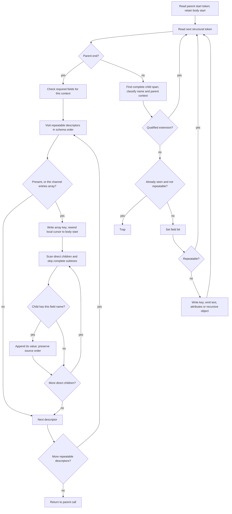

# RSS 2.0 to Markdown feed metadata and entries

Tool 32 uses the existing hierarchical data notation:
one feed object with metadata and an ordered `entries` array. Each entry is
an object. Categories and enclosures are arrays, not overwritten properties.
Descriptions remain strings even when they contain escaped HTML or CDATA.

The vocabulary follows the [RSS 2.0 specification](https://www.rssboard.org/rss-specification).
The converter preserves values rather than interpreting dates, fetching URLs,
or turning descriptions into active markup. The complete XML document is
validated before the cursor reads selected spans.

## Shape table

Simple fields become JSON-quoted strings. A GUID, source or category becomes
an object containing its attributes and a `value` string. Enclosure and
cloud elements become attribute objects. Image, textInput, skipHours and
skipDays retain their nested fields. Numeric/date-looking values remain
strings; this is a structure converter, not a complete RSS semantic validator.

Singleton fields cannot repeat. Repeated categories, enclosures, hours, days
and items retain their relative order within arrays. Metadata fields retain
their input order; arrays follow singleton fields. Interleaving between those
groups is not preserved. Prefix-qualified extension elements are ignored
after XML validation, not fetched or interpreted. Namespace binding semantics
are not inferred by this lexical reader.

```rss
<rss version="2.0">
  <channel>
    <title>News</title>
    <link>https://example.com/</link>
    <description>Updates</description>
    <item>
      <title>First post</title>
      <guid isPermaLink="false">post:1</guid>
      <category>Wasm</category>
      <category domain="topics">Compilers</category>
    </item>
  </channel>
</rss>
```

becomes:

```text
- {}
  - "title" "News"
  - "link" "https://example.com/"
  - "description" "Updates"
  - "entries" []
    - {}
      - "title" "First post"
      - "guid" {}
        - "isPermaLink" "false"
        - "value" "post:1"
      - "category" []
        - {}
          - "value" "Wasm"
        - {}
          - "domain" "topics"
          - "value" "Compilers"
```

## Input contract and loss boundaries

The root's lexical name must be `rss`, with a decoded version of `2.0`, and
exactly one `channel`. Channel title, link and description must be present;
each item needs title or description. Presence is distinct from nonempty text.
An image requires url/title/link; textInput requires title/description/name/link.
Enclosure, source and cloud require their standard attributes. An explicitly
provided isPermaLink must decode to `true` or `false`; an omitted value remains
omitted, rather than materializing the RSS default in the output.

Text fields may combine XML text, character references and CDATA, separated
by ignored comments or processing instructions. Actual child markup inside a
text field is rejected; encoded markup is retained as text. Structural text
must be XML whitespace. Unknown unqualified fields and fields in the wrong
standard parent are errors. Qualified extensions and unrepresented attributes
are omitted after the complete XML pass validates them. This includes
extension content such as `content:encoded`; the result is a selected RSS
projection, not a backup of all extension data or namespace declarations.

No date grammar, URI registration, enclosure length, image dimensions, TTL,
or skip-schedule ranges are validated here. Values are preserved as strings,
including leading zeros. Multiple enclosures are retained, not reduced to
one. These choices are intentional conversion behavior, not a claim to be an
RSS validator. The XML helper's lexical namespace model applies: prefixes and
default namespace bindings are not resolved.

The single `rss` fence follows the other converters: at least three backticks,
LF or CRLF, and a matching closing-fence line. An earlier closing-fence line
inside the source is rejected; use a longer fence. The first pass validates
the entire XML document, including discarded extension subtrees. Its 32-level
nesting and 128 KiB intermediate-tree limits apply. Source is at most 64 KiB.
Final output reuses the intermediate region and is bounded to 128 KiB too.
The input and the fourth-page literal/schema tables are never modified.

## Inside object: singletons now, arrays in source order afterward

Each recursive call owns its context, source interval, indentation and seen
bitset. It does not share that bitset with an item or nested image. The schema
assigns field IDs 0–30; a field contributes `1 << id`. A descriptor says which
parent contexts permit it, how to write its value, and whether it repeats.



`rf-object-seen` normalizes `seen & bit` to a Boolean before combining it
with the repeatability check. Merely ANDing a nonzero bit mask with 1 would
only detect duplicates of field zero. The tests include duplicates across
low and high field IDs, not only duplicate titles.

For a channel whose children are title, item A, link, category X,
description, item B, category Y:

| Pass | Output | What remains in locals |
| --- | --- | --- |
| First scan | title, link, description | Seen bits for those fields, category and item; original body start |
| Category scan | category array containing X then Y | No category nodes or value copies retained |
| Item scan | entries array containing A then B | Each item's independent recursive field state exists only during its call |

The entry array is emitted even for an empty feed. Other arrays appear only
when present. The scheme therefore needs no linked list, sorting step or
temporary output fragments. A context has only a fixed handful of repeated
field kinds. Rescanning for each such kind adds a fixed factor, not a scan
per item, so sibling count does not create quadratic work.

## Inside field: delimiters and value ownership

The caller has already written either a named field prefix or an array-item
prefix. `field` only writes the value after that prefix:

- Shape 0 calls `content` to write one quoted string.
- Shape 1 opens an object, emits permitted attributes as string fields,
  then emits a `value` field containing the joined character data.
- Shape 2 opens an attribute-only object. It still visits the content and
  requires whitespace; it cannot silently discard a nested element.
- Shape 3 opens an object and recursively calls `object` with the descriptor's
  child context and one additional indentation level.

`content` opens a quote once, then loops over token spans. Text uses XML
decoding mode 0; CDATA uses literal mode 2. Both send scalars through the same
JSON-string character emitter. Comments and processing instructions contribute
nothing; a nested element traps. Only after the matching parent end does it
close the quote and add a newline. This joins `before`, CDATA `<b>x</b>`, and
`after` into one string without copying a temporary concatenation buffer.

`attributes` has a separate seen mask and allowed mask. It decodes values in
attribute mode, so literal whitespace normalization differs from numeric
references. Required-attribute checks happen after the full attribute span
has been consumed; their order in the start tag is irrelevant. The raw
attribute iterator owns quote scanning, so `>` inside a quoted URL cannot
end the start tag early.

## Reading a descriptor

Each descriptor is eight bytes. The names remain short length-prefixed
strings in another region so table scans need not step over variable records.

| Byte offset | Meaning |
| --- | --- |
| 0–1 | Little-endian offset of the name within the field-name table |
| 2 | Parent-context mask: channel 1, item 2, image 4, textInput 8, skipHours 16, skipDays 32 |
| 3 | Value shape 0–3, described above |
| 4 | Repeatable flag |
| 5 | Child context for an object value |
| 6–7 | Allowed attribute mask, little-endian |

The item descriptor's XML name is still `item`; only its emitted key becomes
`entries`. XML names are compared case-sensitively. No case folding or locale
logic is involved in descriptor lookup.

## Module

Imports: XML validation 0, token 1, attribute 2, subtree skip 3, decoded scalar
4, fence check 5. Definitions: run 6, emit 7, literal 8, same 9, character 10,
text 11, indent 12, line 13, field 14, object 15, classify 16, descriptor 17,
whitespace 18, structural token 19, version 20, attributes 21, value-is 22,
attribute-name 23, content 24, table-name 25, field-name 26.
Globals are output cursor 0, framing cursor 1, and source end 2.

`[microwasm]`

- rf-header: `0061736d 01000000`
- rf-types-section: `01 {{size:rf-types}}`
  - rf-types: `0a 60 02 7f 7f 01 7f 60 02 7f 7f 06 7f 7f 7f 7f 7f 7f 60 02 7f 7f 05 7f 7f 7f 7f 7f 60 03 7f 7f 7f 02 7f 7f 60 03 7f 7f 7f 00 60 01 7f 01 7f 60 01 7f 00 60 03 7f 7f 7f 01 7f 60 02 7f 7f 00 60 04 7f 7f 7f 7f 00`
- rf-import-section: `02 {{size:rf-imports}}`
  - rf-imports: `07 01 76 08 726561645370616e 00 00 01 77 04 6e657874 00 01 01 77 09 617474726962757465 00 02 01 77 04 736b6970 00 00 01 78 04 6e657874 00 03 01 76 0f 636865636b46656e63654c696e6573 00 04 01 78 06 6d656d6f7279 02 01 04 04`
- rf-functions-section: `03 {{size:rf-functions}}`
  - rf-functions: `15 05 06 06 07 06 04 06 08 09 09 07 05 04 01 08 09 07 00 04 00 05`
- rf-globals-section: `06 {{size:rf-globals}}`
  - rf-globals: `03 7f 01 41 00 0b 7f 01 41 00 0b 7f 01 41 00 0b`
- rf-exports-section: `07 {{size:rf-exports}}`
  - rf-exports: `02 03 72756e 00 06 06 6d656d6f7279 02 00`
- rf-code-section: `0a {{size:rf-code}}`
  - rf-code: `15`
    - rf-run-record: `{{size:rf-run-body}}`
      - rf-run-body: `01 0f 7f`
        - rf-run-bound: `20 00 41 0a 49 20 00 41 808004 4b 72 04 40 00 0b 20 00 24 02`
        - rf-run-ticks: `02 40 03 40 20 01 20 00 4f 0d 01 20 01 2d 00 00 41 e000 47 0d 01 20 01 41 01 6a 21 01 0c 00 0b 0b 20 01 41 03 49 04 40 00 0b 20 01 24 01`
        - rf-run-label: `23 01 23 01 41 03 6a 41 80a80c 10 09 45 04 40 00 0b 23 01 41 03 6a 24 01 23 01 23 02 49 04 40 23 01 2d 00 00 41 0d 46 04 40 23 01 41 01 6a 24 01 0b 0b 23 01 23 02 4f 04 40 00 0b 23 01 2d 00 00 41 0a 47 04 40 00 0b 23 01 41 01 6a 24 01 23 01 21 02 20 00 21 03`
        - rf-run-trim: `02 40 03 40 20 03 20 02 4d 0d 01 20 03 41 01 6b 2d 00 00 21 06 20 06 41 20 46 20 06 41 09 46 72 20 06 41 0a 46 72 20 06 41 0d 46 72 45 0d 01 20 03 41 01 6b 21 03 0c 00 0b 0b`
        - rf-run-close-ticks: `02 40 03 40 20 03 20 02 4d 0d 01 20 03 41 01 6b 2d 00 00 41 e000 47 0d 01 20 03 41 01 6b 21 03 20 04 41 01 6a 21 04 0c 00 0b 0b 20 04 20 01 49 04 40 00 0b`
        - rf-run-close-line: `20 03 20 02 4d 04 40 00 0b 20 03 41 01 6b 22 03 2d 00 00 41 0a 47 04 40 00 0b 20 03 20 02 4b 04 40 20 03 41 01 6b 2d 00 00 41 0d 46 04 40 20 03 41 01 6b 21 03 0b 0b`
        - rf-run-validate: `20 02 20 03 20 01 10 05 20 02 20 03 10 00 1a`
        - rf-run-reset: `41 808004 24 00 20 02 24 01 20 03 24 02`
        - rf-run-bom: `23 01 41 02 6a 23 02 49 04 40 23 01 2d 00 00 41 ef01 46 23 01 2d 00 01 41 bb01 46 71 23 01 2d 00 02 41 bf01 46 71 04 40 23 01 41 03 6a 24 01 0b 0b`
        - rf-run-root: `23 01 20 03 10 13 21 0d 21 0c 21 0b 21 0a 21 09 21 08 20 08 41 01 47 04 40 00 0b 20 09 20 0a 41 80a80c 10 09 45 04 40 00 0b 20 0b 20 0c 10 14`
        - rf-run-channel: `20 0d 20 03 10 13 21 0d 21 0c 21 0b 21 0a 21 09 21 08 20 08 41 01 46 20 08 41 03 46 72 45 04 40 00 0b 20 09 20 0a 41 88a80c 10 09 45 04 40 00 0b 20 09 41 01 6b 22 0e 20 03 10 03 21 0f`
        - rf-run-output: `41 98a80c 10 08 41 9ba80c 10 08 20 0e 20 0f 41 01 41 00 10 0f`
        - rf-run-root-end: `20 0f 20 03 10 13 21 0d 1a 1a 1a 1a 41 02 47 04 40 00 0b 20 0d 20 03 10 13 1a 1a 1a 1a 1a 04 40 00 0b 23 00 41 808004 6b 0b`
    - rf-emit-record: `{{size:rf-emit-body}}`
      - rf-emit-body: `00 23 00 41 80800c 4f 04 40 00 0b 23 00 20 00 3a 00 00 23 00 41 01 6a 24 00 0b`
    - rf-literal-record: `{{size:rf-literal-body}}`
      - rf-literal-body: `01 01 7f 20 00 20 00 2d 00 00 6a 41 01 6a 21 01 20 00 41 01 6a 21 00 02 40 03 40 20 00 20 01 4f 0d 01 20 00 2d 00 00 10 07 20 00 41 01 6a 21 00 0c 00 0b 0b 0b`
    - rf-same-record: `{{size:rf-same-body}}`
      - rf-same-body: `00 20 01 20 00 6b 20 02 2d 00 00 47 04 40 41 00 0f 0b 20 02 41 01 6a 21 02 02 40 03 40 20 00 20 01 4f 0d 01 20 00 2d 00 00 20 02 2d 00 00 47 04 40 41 00 0f 0b 20 00 41 01 6a 21 00 20 02 41 01 6a 21 02 0c 00 0b 0b 41 01 0b`
    - rf-character-record: `{{size:rf-character-body}}`
      - rf-character-body: `01 01 7f`
        - rf-character-short: `20 00 41 09 46 04 40 41 f400 21 01 0b 20 00 41 0a 46 04 40 41 ee00 21 01 0b 20 00 41 0d 46 04 40 41 f200 21 01 0b 20 01 04 40 41 dc00 10 07 20 01 10 07 0f 0b`
        - rf-character-escape: `20 00 41 22 46 20 00 41 dc00 46 72 04 40 41 dc00 10 07 0b`
        - rf-character-ascii: `20 00 41 8001 49 04 40 20 00 10 07 0f 0b`
        - rf-character-two: `20 00 41 8010 49 04 40 20 00 41 06 76 41 c001 72 10 07`
          - rf-character-more: `05 20 00 41 808004 49 04 40 20 00 41 0c 76 41 e001 72 10 07`
            - rf-character-four: `05 20 00 41 12 76 41 f001 72 10 07 20 00 41 0c 76 41 3f 71 41 8001 72 10 07 0b`
          - rf-character-middle: `20 00 41 06 76 41 3f 71 41 8001 72 10 07 0b`
        - rf-character-last: `20 00 41 3f 71 41 8001 72 10 07 0b`
    - rf-text-record: `{{size:rf-text-body}}`
      - rf-text-body: `00 02 40 03 40 20 00 20 01 4f 0d 01 20 00 20 01 20 02 10 04 21 00 10 0a 0c 00 0b 0b 0b`
    - rf-indent-record: `{{size:rf-indent-body}}`
      - rf-indent-body: `00 02 40 03 40 20 00 45 0d 01 41 20 10 07 41 20 10 07 20 00 41 01 6b 21 00 0c 00 0b 0b 0b`
    - rf-line-record: `{{size:rf-line-body}}`
      - rf-line-body: `00 20 00 10 0c 41 98a80c 10 08 41 22 10 07 20 01 10 08 41 22 10 07 41 20 10 07 0b`
    - rf-field-record: `{{size:rf-field-body}}`
      - rf-field-body: `01 07 7f 20 03 10 11 22 04 2d 00 03 21 05`
        - rf-field-object: `20 05 41 03 46 04 40 41 9ba80c 10 08 20 00 20 01 20 02 41 01 6a 20 04 2d 00 05 10 0f 0f 0b`
        - rf-field-attributes: `20 05 04 40 41 9ba80c 10 08 20 00 20 01 10 01 1a 21 07 21 06 1a 1a 1a 20 06 20 07 20 02 41 01 6a 20 03 10 15`
          - rf-field-no-value: `20 05 41 02 46 04 40 20 00 20 01 41 00 10 18 0f 0b`
          - rf-field-value-key: `20 02 41 01 6a 41 a3a80c 10 0d 0b`
        - rf-field-text: `20 00 20 01 41 01 10 18 0b`
    - rf-object-record: `{{size:rf-object-body}}`
      - rf-object-body: `01 11 7f 20 00 20 01 10 01 21 05 1a 1a 1a 1a 21 06 20 05 21 04`
        - rf-object-open: `20 06 41 03 47 04 40 02 40 03 40 20 05 20 01 10 13 21 0b 21 0a 21 09 21 08 21 07 21 06`
          - rf-object-close: `20 06 41 02 46 04 40 20 0b 21 05 0c 02 0b 20 06 41 01 46 20 06 41 03 46 72 45 04 40 00 0b`
          - rf-object-child: `20 07 41 01 6b 22 0c 20 01 10 03 22 0d 21 05 20 07 20 08 20 03 10 10 22 0e 41 7f 46 0d 00`
          - rf-object-seen: `20 0e 10 11 21 0f 41 01 20 0e 74 21 11 20 10 20 11 71 45 45 20 0f 2d 00 04 45 71 04 40 00 0b 20 10 20 11 72 21 10`
          - rf-object-singleton: `20 0f 2d 00 04 45 04 40 20 02 20 0e 10 1a 10 0d 20 0c 20 0d 20 02 20 0e 10 0e 0b 0c 00 0b 0b 0b`
        - rf-object-end: `20 05 20 01 47 04 40 00 0b`
        - rf-object-channel-required: `20 03 45 04 40 20 10 41 07 71 41 07 47 04 40 00 0b 0b`
        - rf-object-item-required: `20 03 41 01 46 04 40 20 10 41 05 71 45 04 40 00 0b 0b`
        - rf-object-image-required: `20 03 41 02 46 04 40 41 01 41 18 74 41 03 72 21 13 0b`
        - rf-object-input-required: `20 03 41 03 46 04 40 41 01 41 1b 74 41 07 72 21 13 0b 20 10 20 13 71 20 13 47 04 40 00 0b`
        - rf-object-arrays: `02 40 03 40 20 12 41 1f 4f 0d 01 20 12 10 11 21 0f`
          - rf-object-array-eligible: `20 0f 2d 00 04 20 0f 2d 00 02 41 01 20 03 74 71 45 45 71 04 40`
            - rf-object-array-present: `20 10 41 01 20 12 74 71 45 45 20 12 41 1e 46 72 04 40`
              - rf-object-array-key: `20 12 41 1e 46 04 7f 41 a9a80c 05 20 12 10 1a 0b 21 14 20 02 20 14 10 0d 41 9fa80c 10 08 20 04 21 05`
              - rf-object-array-loop: `02 40 03 40 20 05 20 01 4f 0d 01 20 05 20 01 10 13 21 0b 21 0a 21 09 21 08 21 07 21 06 20 06 41 02 46 0d 01`
                - rf-object-array-child: `20 07 41 01 6b 22 0c 20 01 10 03 22 0d 21 05 20 07 20 08 20 12 10 1a 10 09 04 40`
                  - rf-object-array-value: `20 02 41 01 6a 10 0c 41 98a80c 10 08 20 0c 20 0d 20 02 41 01 6a 20 12 10 0e 0b 0c 00 0b 0b 0b 0b`
          - rf-object-array-next: `20 12 41 01 6a 21 12 0c 00 0b 0b 0b`
    - rf-classify-record: `{{size:rf-classify-body}}`
      - rf-classify-body: `01 02 7f 02 40 03 40 20 03 41 1f 4f 0d 01 20 00 20 01 20 03 10 1a 10 09 04 40 20 03 10 11 2d 00 02 41 01 20 02 74 71 45 04 40 00 0b 20 03 0f 0b 20 03 41 01 6a 21 03 0c 00 0b 0b`
        - rf-classify-extension: `02 40 03 40 20 00 20 01 4f 0d 01 20 00 2d 00 00 41 3a 46 04 40 41 7f 0f 0b 20 00 41 01 6a 21 00 0c 00 0b 0b 00 0b`
    - rf-descriptor-record: `{{size:rf-descriptor-body}}`
      - rf-descriptor-body: `00 20 00 41 1f 4f 04 40 00 0b 41 80980c 20 00 41 03 74 6a 0b`
    - rf-whitespace-record: `{{size:rf-whitespace-body}}`
      - rf-whitespace-body: `01 01 7f 02 40 03 40 20 00 20 01 4f 0d 01 20 00 20 01 20 02 10 04 21 00 21 03 20 03 41 20 46 20 03 41 09 46 72 20 03 41 0a 46 72 20 03 41 0d 46 72 45 04 40 00 0b 0c 00 0b 0b 0b`
    - rf-structural-record: `{{size:rf-structural-body}}`
      - rf-structural-body: `01 06 7f 03 40 20 00 20 01 10 01 21 07 21 06 21 05 21 04 21 03 21 02`
        - rf-structural-text: `20 02 41 04 46 20 02 41 05 46 72 04 40 20 05 20 06 20 02 41 05 46 41 01 74 10 12 20 07 21 00 0c 01 0b`
        - rf-structural-noise: `20 02 41 06 46 20 02 41 07 46 72 04 40 20 07 21 00 0c 01 0b`
        - rf-structural-result: `20 02 20 03 20 04 20 05 20 06 20 07 0f 0b 00 0b`
    - rf-version-record: `{{size:rf-version-body}}`
      - rf-version-body: `01 06 7f 02 40 03 40 20 00 20 01 4f 0d 01 20 00 20 01 10 02 21 06 21 05 21 04 21 03 21 02 20 06 21 00 20 02 20 03 72 45 0d 01`
        - rf-version-match: `20 02 20 03 41 90a80c 10 09 04 40 20 04 20 05 41 84a80c 10 16 45 04 40 00 0b 41 01 21 07 0b 0c 00 0b 0b 20 07 45 04 40 00 0b 0b`
    - rf-attributes-record: `{{size:rf-attributes-body}}`
      - rf-attributes-body: `01 0a 7f 20 03 10 11 2f 01 06 21 0c 02 40 03 40 20 00 20 01 4f 0d 01 20 00 20 01 10 02 21 08 21 07 21 06 21 05 21 04 20 08 21 00 20 04 20 05 72 45 0d 01`
        - rf-attributes-classify: `20 04 20 05 10 17 22 09 41 7f 46 0d 00 41 01 20 09 74 21 0a 20 0a 20 0c 71 45 04 40 00 0b 20 0b 20 0a 72 21 0b`
        - rf-attributes-permalink: `20 09 41 04 46 04 40 20 06 20 07 41 b1a80c 10 16 20 06 20 07 41 b6a80c 10 16 72 45 04 40 00 0b 0b`
        - rf-attributes-output: `20 02 20 09 41 80a40c 10 19 10 0d 41 22 10 07 20 06 20 07 41 01 10 0b 41 22 10 07 41 0a 10 07 0c 00 0b 0b`
        - rf-attributes-required: `20 03 41 10 46 20 03 41 11 46 72 20 03 41 14 46 72 04 40 20 0b 20 0c 71 20 0c 47 04 40 00 0b 0b 0b`
    - rf-value-is-record: `{{size:rf-value-is-body}}`
      - rf-value-is-body: `01 02 7f 20 02 20 02 2d 00 00 6a 41 01 6a 21 03 20 02 41 01 6a 21 02 02 40 03 40 20 02 20 03 4f 0d 01 20 00 20 01 4f 04 40 41 00 0f 0b 20 00 20 01 41 01 10 04 21 00 20 02 2d 00 00 47 04 40 41 00 0f 0b 20 02 41 01 6a 21 02 0c 00 0b 0b 20 00 20 01 46 0b`
    - rf-attribute-name-record: `{{size:rf-attribute-name-body}}`
      - rf-attribute-name-body: `01 01 7f 02 40 03 40 20 02 41 09 4f 0d 01 20 00 20 01 20 02 41 80a40c 10 19 10 09 04 40 20 02 0f 0b 20 02 41 01 6a 21 02 0c 00 0b 0b 41 7f 0b`
    - rf-content-record: `{{size:rf-content-body}}`
      - rf-content-body: `01 07 7f 20 02 04 40 41 22 10 07 0b 20 00 20 01 10 01 21 00 1a 1a 1a 1a 21 03`
        - rf-content-open: `20 03 41 03 47 04 40 02 40 03 40 20 00 20 01 10 01 21 08 21 07 21 06 21 05 21 04 21 03 20 08 21 00 20 03 41 02 46 0d 01`
          - rf-content-data: `20 03 41 04 46 20 03 41 05 46 72 04 40 20 02 04 40 20 06 20 07 20 03 41 05 46 41 01 74 10 0b 05 20 06 20 07 20 03 41 05 46 41 01 74 10 12 0b`
          - rf-content-other: `05 20 03 41 06 46 20 03 41 07 46 72 45 04 40 00 0b 0b 0c 00 0b 0b 0b`
        - rf-content-close: `20 00 20 01 47 04 40 00 0b 20 02 04 40 41 22 10 07 41 0a 10 07 0b 0b`
    - rf-table-name-record: `{{size:rf-table-name-body}}`
      - rf-table-name-body: `00 02 40 03 40 20 00 45 0d 01 20 01 20 01 2d 00 00 6a 41 01 6a 21 01 20 00 41 01 6b 21 00 0c 00 0b 0b 20 01 0b`
    - rf-field-name-record: `{{size:rf-field-name-body}}`
      - rf-field-name-body: `00 20 00 10 11 2f 01 00 41 80a00c 6a 0b`
- rf-data-section: `0b {{size:rf-data}}`
  - rf-data: `04`
    - rf-schema-segment: `00 41 80980c 0b {{size:rf-schema}}`
      - rf-schema:
        - rf-schema-title: `00000f0000000000` — Field 0: title.
        - rf-schema-link: `06000f0000000000` — Field 1: link.
        - rf-schema-description: `0b000f0000000000` — Field 2: description.
        - rf-schema-language: `1700010000000000` — Field 3: language.
        - rf-schema-copyright: `2000010000000000` — Field 4: copyright.
        - rf-schema-managingeditor: `2a00010000000000` — Field 5: managingEditor.
        - rf-schema-webmaster: `3900010000000000` — Field 6: webMaster.
        - rf-schema-pubdate: `4300030000000000` — Field 7: pubDate.
        - rf-schema-lastbuilddate: `4b00010000000000` — Field 8: lastBuildDate.
        - rf-schema-generator: `5900010000000000` — Field 9: generator.
        - rf-schema-docs: `6300010000000000` — Field 10: docs.
        - rf-schema-ttl: `6800010000000000` — Field 11: ttl.
        - rf-schema-rating: `6c00010000000000` — Field 12: rating.
        - rf-schema-author: `7300020000000000` — Field 13: author.
        - rf-schema-comments: `7a00020000000000` — Field 14: comments.
        - rf-schema-guid: `8300020100001000` — Field 15: guid.
        - rf-schema-source: `8800020100000200` — Field 16: source.
        - rf-schema-enclosure: `8f00020201000e00` — Field 17: enclosure.
        - rf-schema-category: `9900030101000100` — Field 18: category.
        - rf-schema-image: `a200010300020000` — Field 19: image.
        - rf-schema-cloud: `a80001020000e101` — Field 20: cloud.
        - rf-schema-textinput: `ae00010300030000` — Field 21: textInput.
        - rf-schema-skiphours: `b800010300040000` — Field 22: skipHours.
        - rf-schema-skipdays: `c200010300050000` — Field 23: skipDays.
        - rf-schema-url: `cb00040000000000` — Field 24: url.
        - rf-schema-width: `cf00040000000000` — Field 25: width.
        - rf-schema-height: `d500040000000000` — Field 26: height.
        - rf-schema-name: `dc00080000000000` — Field 27: name.
        - rf-schema-hour: `e100100001000000` — Field 28: hour.
        - rf-schema-day: `e600200001000000` — Field 29: day.
        - rf-schema-item: `ea00010301010000` — Field 30: item.
    - rf-names-segment: `00 41 80a00c 0b {{size:rf-names}}`
      - rf-names:
        - rf-name-title: `057469746c65` — Offset 0.
        - rf-name-link: `046c696e6b` — Offset 6.
        - rf-name-description: `0b6465736372697074696f6e` — Offset 11.
        - rf-name-language: `086c616e6775616765` — Offset 23.
        - rf-name-copyright: `09636f70797269676874` — Offset 32.
        - rf-name-managingeditor: `0e6d616e6167696e67456469746f72` — Offset 42.
        - rf-name-webmaster: `097765624d6173746572` — Offset 57.
        - rf-name-pubdate: `0770756244617465` — Offset 67.
        - rf-name-lastbuilddate: `0d6c6173744275696c6444617465` — Offset 75.
        - rf-name-generator: `0967656e657261746f72` — Offset 89.
        - rf-name-docs: `04646f6373` — Offset 99.
        - rf-name-ttl: `0374746c` — Offset 104.
        - rf-name-rating: `06726174696e67` — Offset 108.
        - rf-name-author: `06617574686f72` — Offset 115.
        - rf-name-comments: `08636f6d6d656e7473` — Offset 122.
        - rf-name-guid: `0467756964` — Offset 131.
        - rf-name-source: `06736f75726365` — Offset 136.
        - rf-name-enclosure: `09656e636c6f73757265` — Offset 143.
        - rf-name-category: `0863617465676f7279` — Offset 153.
        - rf-name-image: `05696d616765` — Offset 162.
        - rf-name-cloud: `05636c6f7564` — Offset 168.
        - rf-name-textinput: `0974657874496e707574` — Offset 174.
        - rf-name-skiphours: `09736b6970486f757273` — Offset 184.
        - rf-name-skipdays: `08736b697044617973` — Offset 194.
        - rf-name-url: `0375726c` — Offset 203.
        - rf-name-width: `057769647468` — Offset 207.
        - rf-name-height: `06686569676874` — Offset 213.
        - rf-name-name: `046e616d65` — Offset 220.
        - rf-name-hour: `04686f7572` — Offset 225.
        - rf-name-day: `03646179` — Offset 230.
        - rf-name-item: `046974656d` — Offset 234.
    - rf-attribute-names-segment: `00 41 80a40c 0b {{size:rf-attribute-names}}`
      - rf-attribute-names: `06646f6d61696e 0375726c 066c656e677468 0474797065 0b69735065726d614c696e6b 04706f7274 0470617468 11726567697374657250726f636564757265 0870726f746f636f6c`
    - rf-literals-segment: `00 41 80a80c 0b {{size:rf-literals}}`
      - rf-literals:
        - rf-rss: `03727373`
        - rf-v2: `03322e30`
        - rf-channel: `076368616e6e656c`
        - rf-version: `0776657273696f6e`
        - rf-marker: `022d20`
        - rf-empty-object: `037b7d0a`
        - rf-empty-array: `035b5d0a`
        - rf-value: `0576616c7565`
        - rf-entries: `07656e7472696573`
        - rf-true: `0474727565`
        - rf-false: `0566616c7365`
