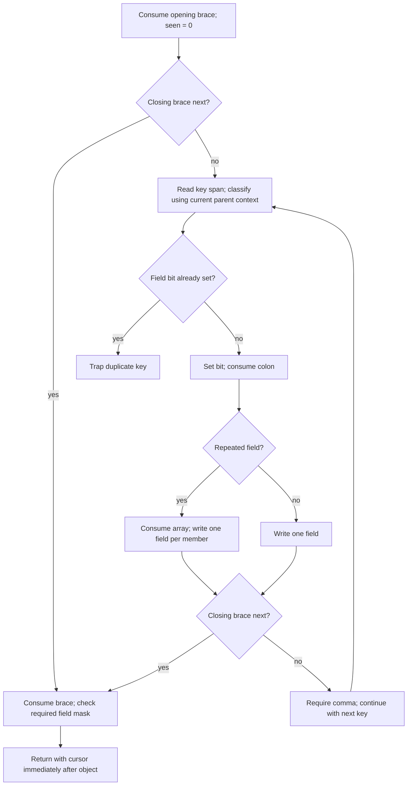
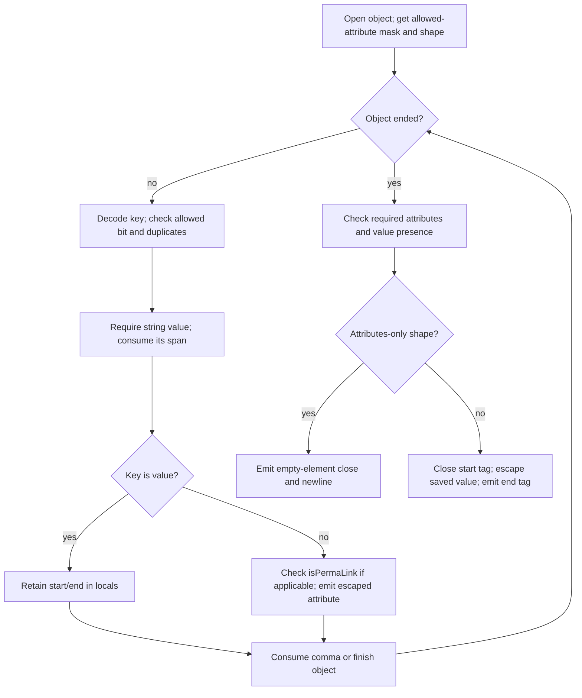

# Markdown feed metadata and entries to RSS 2.0

Tool 33 reverses the selected data model of the
[RSS reader](32-rss-to-entries.md). The root is a channel object; `entries`
is an array of item objects. The output is one `rss` fence containing an
XML declaration, RSS root, channel and the supplied fields.

The shared list compiler first validates the hierarchical Markdown and emits
compact JSON. This module consumes that JSON in Wasm; there is no host RSS
serializer. All field names come from a fixed schema, never from unchecked
input. XML strings use the shared [output helper](00-xml-output.md).

## Accepted shapes

Simple fields are strings, including numbers, dates and URLs. GUID, source
and category are objects with selected attributes and a `value` string.
Enclosure and cloud are attributes-only objects. Image, textInput, skipHours
and skipDays are nested objects. Category, enclosure, hour and day are arrays;
`entries` is the only accepted spelling of the item array.

The required fields match the reader: channel title/link/description;
item title or description; image url/title/link; textInput
title/link/description/name. Source requires url, enclosure requires
url/length/type, and cloud requires domain/port/path/registerProcedure/protocol.
When provided, isPermaLink is the string `true` or `false`, not a Boolean.
No date, URI or numeric-range interpretation is performed.

Missing entries means an empty feed. An empty repeated-field array emits no
elements. On reading back, entries is always present; other empty arrays
disappear. This is the same model normalization as the reader, not a promise
to preserve arbitrary Markdown property ordering or absent/empty distinctions.
Unknown fields, wrong contexts, duplicate decoded keys and wrong value types
trap. Qualified extension keys are rejected too: the writer does not silently
discard newly authored extension data.

## Memory and cursor ownership

Input and compact JSON must each fit in 64 KiB. The compact JSON replaces the
input at address zero, freeing `0x10000..0x30000` for at most 128 KiB of RSS
output including its fence. The browser's input textarea remains unchanged.
The first 1024 bytes of the fourth page are the list compiler's container
stack. The remainder contains immutable helper literals and the RSS schema.
Failures may leave partial memory output; the UI publishes only successful runs.

Global 0 is the output pointer; globals 1/2 are the JSON cursor/end. Each
recursive `object` call keeps its own seen bitset, context and depth in locals.
The schema permits only finite structural nesting; values cannot invent a
recursive field shape. The input compiler also checks its own nesting limit.

### Inside object: consume each key exactly once

`span` consumes a validated JSON string and returns its full quoted interval.
`classify` compares its decoded scalars against the schema, so escaped and
unescaped spellings of the same key use the same field bit.

`rw-object-field` delegates exactly one value. The field writer may recurse,
but it returns with the shared cursor after that value. The parent's seen
mask is untouched. Array members likewise advance the same cursor; no member
is rescanned. Required masks are checked after the closing brace because
field order is arbitrary. The image and textInput masks include high bits,
not just the first few fields.

### Inside attributed: keep a span, not a second string

The caller has written `<guid` (or another known name) before entering
`attributed`. Attributes may occur before or after `value` in the object.
Each attribute can be emitted immediately. The value span is retained until
the start tag closes; otherwise an early value would put text inside the tag.

For `{value: "A&B", domain: "topics"}` in a category, the first property
only saves offsets. Domain writes ` domain="topics"`. At object end,
`rw-attributed-text` emits `>A&amp;B</category>`. Neither the saved interval
nor another object's offsets are invalidated: JSON input stays fixed for the
entire output pass. Attribute TAB/LF/CR are referenced rather than normalized
away by the next XML parse; text CR is referenced as well.

The final framing pass finds the longest consecutive backtick run in the
XML, chooses a longer fence (minimum three), checks total capacity and moves
the output once. Thus a description containing a backtick fence cannot end
the enclosing Markdown block.

## Module

Imports: list run 0, XML string 1, XML scalar 2. Definitions: run 3, emit 4,
literal 5, take 6, span 7, same 8, write 9, fieldName 10, descriptor 11,
classify 12, indent 13, field 14, object 15, array 16, attributed 17,
attributeName 18, tableName 19, frame 20, copy 21.

`[microwasm]`

- rw-header: `0061736d 01000000`
- rw-type-section: `01 {{size:rw-types}}`
  - rw-types: `0a 60 01 7f 01 7f 60 04 7f 7f 7f 7f 01 7f 60 02 7f 7f 02 7f 7f 60 01 7f 00 60 00 02 7f 7f 60 00 00 60 03 7f 7f 7f 01 7f 60 03 7f 7f 7f 00 60 02 7f 7f 00 60 02 7f 7f 01 7f`
- rw-import-section: `02 {{size:rw-imports}}`
  - rw-imports: `04`
    - rw-import-memory: `01 6c 06 6d656d6f7279 02 01 04 04`
    - rw-import-list: `01 6c 03 72756e 00 00`
    - rw-import-string: `01 6f 06 737472696e67 00 01`
    - rw-import-scalar: `01 6f 06 7363616c6172 00 02`
- rw-function-section: `03 {{size:rw-functions}}`
  - rw-functions: `13 00 03 03 03 04 06 07 00 00 06 03 08 08 08 08 09 09 05 08`
- rw-global-section: `06 {{size:rw-globals}}`
  - rw-globals: `03 7f 01 41 00 0b 7f 01 41 00 0b 7f 01 41 00 0b`
- rw-export-section: `07 {{size:rw-exports}}`
  - rw-exports: `02 03 72756e 00 03 06 6d656d6f7279 02 00`
- rw-code-section: `0a {{size:rw-code}}`
  - rw-code: `13`
    - rw-run-record: `{{size:rw-run-body}}`
      - rw-run-body: `01 01 7f`
        - rw-run-compile: `20 00 10 00 41 0d 6b 21 01 20 01 45 20 01 41 808004 4b 72 04 40 00 0b`
        - rw-run-copy-input: `41 00 41 888004 20 01 fc 0a 00 00 20 01 24 02 41 00 24 01 41 808004 24 00`
        - rw-run-channel: `41 93a80c 10 05 41 00 41 02 10 0f 23 01 23 02 47 04 40 00 0b 41 dba80c 10 05`
        - rw-run-frame: `10 14 23 00 41 808004 6b 0b`
    - rw-emit-record: `{{size:rw-emit-body}}`
      - rw-emit-body: `00 23 00 41 80800c 4f 04 40 00 0b 23 00 20 00 3a 00 00 23 00 41 01 6a 24 00 0b`
    - rw-literal-record: `{{size:rw-literal-body}}`
      - rw-literal-body: `00 20 00 41 01 6a 20 00 41 01 6a 20 00 2d 00 00 6a 10 15 0b`
    - rw-take-record: `{{size:rw-take-body}}`
      - rw-take-body: `00 23 01 23 02 4f 04 40 00 0b 23 01 2d 00 00 20 00 47 04 40 00 0b 23 01 41 01 6a 24 01 0b`
    - rw-span-record: `{{size:rw-span-body}}`
      - rw-span-body: `01 02 7f 23 01 21 00 41 22 10 06`
        - rw-span-loop: `03 40 23 01 23 02 4f 04 40 00 0b 23 01 2d 00 00 21 01 23 01 41 01 6a 24 01`
          - rw-span-end: `20 01 41 22 46 04 40 20 00 23 01 0f 0b`
          - rw-span-escape: `20 01 41 dc00 46 04 40 23 01 41 01 6a 24 01 0b 0c 00 0b 00 0b`
    - rw-same-record: `{{size:rw-same-body}}`
      - rw-same-body: `01 03 7f 20 00 41 01 6a 21 00 20 01 41 01 6b 21 01 20 02 41 01 6a 21 03 20 03 20 02 2d 00 00 6a 21 04`
        - rw-same-loop: `03 40 20 00 20 01 10 02 21 00 21 05 20 05 41 7f 46 04 40 20 03 20 04 46 0f 0b`
          - rw-same-byte: `20 03 20 04 4f 04 40 41 00 0f 0b 20 05 20 03 2d 00 00 47 04 40 41 00 0f 0b`
          - rw-same-next: `20 03 41 01 6a 21 03 0c 00 0b 00 0b`
    - rw-write-record: `{{size:rw-write-body}}`
      - rw-write-body: `00 20 01 20 00 6b 41 02 49 04 40 00 0b 20 00 2d 00 00 41 22 47 20 01 41 01 6b 2d 00 00 41 22 47 72 04 40 00 0b 23 00 20 00 41 01 6a 20 01 41 01 6b 23 00 20 02 10 01 6a 24 00 0b`
    - rw-field-name-record: `{{size:rw-field-name-body}}`
      - rw-field-name-body: `00 20 00 10 0b 2f 01 00 41 80a00c 6a 0b`
    - rw-descriptor-record: `{{size:rw-descriptor-body}}`
      - rw-descriptor-body: `00 20 00 41 1f 4f 04 40 00 0b 41 80980c 20 00 41 03 74 6a 0b`
    - rw-classify-record: `{{size:rw-classify-body}}`
      - rw-classify-body: `01 01 7f 02 40 03 40 20 03 41 1f 4f 0d 01`
        - rw-classify-name: `20 00 20 01 20 03 41 1e 46 04 7f 41 80a80c 05 20 03 10 0a 0b 10 08 04 40`
          - rw-classify-context: `20 03 10 0b 2d 00 02 41 01 20 02 74 71 45 04 40 00 0b 20 03 0f 0b`
        - rw-classify-next: `20 03 41 01 6a 21 03 0c 00 0b 0b 00 0b`
    - rw-indent-record: `{{size:rw-indent-body}}`
      - rw-indent-body: `00 02 40 03 40 20 00 45 0d 01 41 20 10 04 41 20 10 04 20 00 41 01 6b 21 00 0c 00 0b 0b 0b`
    - rw-field-record: `{{size:rw-field-body}}`
      - rw-field-body: `01 02 7f 20 00 10 0b 21 02 20 02 2d 00 03 21 03 20 01 10 0d 41 3c 10 04 20 00 10 0a 10 05`
        - rw-field-attributed: `20 03 41 01 46 20 03 41 02 46 72 04 40 20 00 20 01 10 11 0f 0b`
        - rw-field-content: `41 3e 10 04 20 03 45 04 40 10 07 41 00 10 09`
          - rw-field-object: `05 41 0a 10 04 20 02 2d 00 05 20 01 41 01 6a 10 0f 20 01 10 0d 0b`
        - rw-field-close: `41 3c 10 04 41 2f 10 04 20 00 10 0a 10 05 41 3e 10 04 41 0a 10 04 0b`
    - rw-object-record: `{{size:rw-object-body}}`
      - rw-object-body: `01 07 7f 41 fb00 10 06 02 40 23 01 2d 00 00 41 fd00 46 0d 00 03 40`
        - rw-object-key: `10 07 21 03 21 02 20 02 20 03 20 00 10 0c 21 04 20 04 10 0b 21 05 41 01 20 04 74 21 07`
        - rw-object-seen: `20 06 20 07 71 04 40 00 0b 20 06 20 07 72 21 06 41 3a 10 06`
        - rw-object-field: `20 05 2d 00 04 04 40 20 04 20 01 10 10 05 20 04 20 01 10 0e 0b`
        - rw-object-next: `23 01 2d 00 00 41 fd00 46 0d 01 41 2c 10 06 0c 00 0b 0b 41 fd00 10 06`
        - rw-object-channel-required: `20 00 45 04 40 41 07 21 08 0b`
        - rw-object-item-required: `20 00 41 01 46 04 40 20 06 41 05 71 45 04 40 00 0b 0b`
        - rw-object-image-required: `20 00 41 02 46 04 40 41 01 41 18 74 41 03 72 21 08 0b`
        - rw-object-input-required: `20 00 41 03 46 04 40 41 01 41 1b 74 41 07 72 21 08 0b`
        - rw-object-required: `20 06 20 08 71 20 08 47 04 40 00 0b 0b`
    - rw-array-record: `{{size:rw-array-body}}`
      - rw-array-body: `00 41 db00 10 06 02 40 23 01 2d 00 00 41 dd00 46 0d 00 03 40 20 00 20 01 10 0e 23 01 2d 00 00 41 dd00 46 0d 01 41 2c 10 06 0c 00 0b 0b 41 dd00 10 06 0b`
    - rw-attributed-record: `{{size:rw-attributed-body}}`
      - rw-attributed-body: `01 0a 7f 20 00 10 0b 22 0b 2f 01 06 21 06 20 0b 2d 00 03 21 09 41 fb00 10 06 02 40 23 01 2d 00 00 41 fd00 46 0d 00 03 40`
        - rw-attributed-key: `10 07 10 12 21 04 20 04 41 00 48 04 40 00 0b 41 01 20 04 74 21 0a`
        - rw-attributed-permitted: `20 04 41 09 46 04 40 20 09 41 01 47 04 40 00 0b 05 20 06 20 0a 71 45 04 40 00 0b 0b`
        - rw-attributed-seen: `20 05 20 0a 71 04 40 00 0b 20 05 20 0a 72 21 05 41 3a 10 06 10 07 21 03 21 02`
        - rw-attributed-value: `20 04 41 09 46 04 40 20 02 21 07 20 03 21 08`
          - rw-attributed-permalink: `05 20 04 41 04 46 04 40 20 02 20 03 41 88a80c 10 08 20 02 20 03 41 8da80c 10 08 72 45 04 40 00 0b 0b`
          - rw-attributed-emit: `41 20 10 04 20 04 41 80a40c 10 13 10 05 41 3d 10 04 41 22 10 04 20 02 20 03 41 01 10 09 41 22 10 04 0b`
        - rw-attributed-next: `23 01 2d 00 00 41 fd00 46 0d 01 41 2c 10 06 0c 00 0b 0b 41 fd00 10 06`
        - rw-attributed-required: `20 00 41 10 46 20 00 41 11 46 72 20 00 41 14 46 72 04 40 20 05 20 06 71 20 06 47 04 40 00 0b 0b`
        - rw-attributed-empty: `20 09 41 02 46 04 40 41 2f 10 04 41 3e 10 04`
          - rw-attributed-text: `05 20 05 41 8004 71 45 04 40 00 0b 41 3e 10 04 20 07 20 08 41 00 10 09 41 3c 10 04 41 2f 10 04 20 00 10 0a 10 05 41 3e 10 04 0b 41 0a 10 04 0b`
    - rw-attribute-name-record: `{{size:rw-attribute-name-body}}`
      - rw-attribute-name-body: `01 01 7f 02 40 03 40 20 02 41 0a 4f 0d 01 20 00 20 01 20 02 41 80a40c 10 13 10 08 04 40 20 02 0f 0b 20 02 41 01 6a 21 02 0c 00 0b 0b 41 7f 0b`
    - rw-table-name-record: `{{size:rw-table-name-body}}`
      - rw-table-name-body: `00 02 40 03 40 20 00 45 0d 01 20 01 20 01 2d 00 00 6a 41 01 6a 21 01 20 00 41 01 6b 21 00 0c 00 0b 0b 20 01 0b`
    - rw-frame-record: `{{size:rw-frame-body}}`
      - rw-frame-body: `01 05 7f 23 00 41 808004 6b 21 03 41 808004 21 00 02 40 03 40 20 00 23 00 4f 0d 01`
        - rw-frame-ticks: `20 00 2d 00 00 41 e000 46 04 40 20 01 41 01 6a 21 01 20 01 20 02 4b 04 40 20 01 21 02 0b 05 41 00 21 01 0b 20 00 41 01 6a 21 00 0c 00 0b 0b`
        - rw-frame-count: `20 02 41 01 6a 21 02 20 02 41 03 49 04 40 41 03 21 02 0b`
        - rw-frame-bound: `20 03 20 02 41 01 74 6a 41 06 6a 41 808008 4b 04 40 00 0b`
        - rw-frame-move: `41 808004 20 02 6a 41 04 6a 41 808004 20 03 fc 0a 00 00 41 808004 24 00`
        - rw-frame-open: `03 40 41 e000 10 04 20 04 41 01 6a 22 04 20 02 49 0d 00 0b 41 f0a80c 10 05`
        - rw-frame-suffix: `41 808004 20 02 6a 41 04 6a 20 03 6a 24 00 41 0a 10 04 41 00 21 04 03 40 41 e000 10 04 20 04 41 01 6a 22 04 20 02 49 0d 00 0b 41 0a 10 04 0b`
    - rw-copy-record: `{{size:rw-copy-body}}`
      - rw-copy-body: `00 02 40 03 40 20 00 20 01 4f 0d 01 20 00 2d 00 00 10 04 20 00 41 01 6a 21 00 0c 00 0b 0b 0b`
- rw-data-section: `0b {{size:rw-data}}`
  - rw-data: `04`
    - rw-schema-segment: `00 41 80980c 0b {{size:rw-schema}}`
      - rw-schema:
        - rw-schema-title: `00000f0000000000` — Field 0: title.
        - rw-schema-link: `06000f0000000000` — Field 1: link.
        - rw-schema-description: `0b000f0000000000` — Field 2: description.
        - rw-schema-language: `1700010000000000` — Field 3: language.
        - rw-schema-copyright: `2000010000000000` — Field 4: copyright.
        - rw-schema-managingeditor: `2a00010000000000` — Field 5: managingEditor.
        - rw-schema-webmaster: `3900010000000000` — Field 6: webMaster.
        - rw-schema-pubdate: `4300030000000000` — Field 7: pubDate.
        - rw-schema-lastbuilddate: `4b00010000000000` — Field 8: lastBuildDate.
        - rw-schema-generator: `5900010000000000` — Field 9: generator.
        - rw-schema-docs: `6300010000000000` — Field 10: docs.
        - rw-schema-ttl: `6800010000000000` — Field 11: ttl.
        - rw-schema-rating: `6c00010000000000` — Field 12: rating.
        - rw-schema-author: `7300020000000000` — Field 13: author.
        - rw-schema-comments: `7a00020000000000` — Field 14: comments.
        - rw-schema-guid: `8300020100001000` — Field 15: guid.
        - rw-schema-source: `8800020100000200` — Field 16: source.
        - rw-schema-enclosure: `8f00020201000e00` — Field 17: enclosure.
        - rw-schema-category: `9900030101000100` — Field 18: category.
        - rw-schema-image: `a200010300020000` — Field 19: image.
        - rw-schema-cloud: `a80001020000e101` — Field 20: cloud.
        - rw-schema-textinput: `ae00010300030000` — Field 21: textInput.
        - rw-schema-skiphours: `b800010300040000` — Field 22: skipHours.
        - rw-schema-skipdays: `c200010300050000` — Field 23: skipDays.
        - rw-schema-url: `cb00040000000000` — Field 24: url.
        - rw-schema-width: `cf00040000000000` — Field 25: width.
        - rw-schema-height: `d500040000000000` — Field 26: height.
        - rw-schema-name: `dc00080000000000` — Field 27: name.
        - rw-schema-hour: `e100100001000000` — Field 28: hour.
        - rw-schema-day: `e600200001000000` — Field 29: day.
        - rw-schema-item: `ea00010301010000` — Field 30: item.
    - rw-names-segment: `00 41 80a00c 0b {{size:rw-names}}`
      - rw-names:
        - rw-name-title: `057469746c65` — Offset 0.
        - rw-name-link: `046c696e6b` — Offset 6.
        - rw-name-description: `0b6465736372697074696f6e` — Offset 11.
        - rw-name-language: `086c616e6775616765` — Offset 23.
        - rw-name-copyright: `09636f70797269676874` — Offset 32.
        - rw-name-managingeditor: `0e6d616e6167696e67456469746f72` — Offset 42.
        - rw-name-webmaster: `097765624d6173746572` — Offset 57.
        - rw-name-pubdate: `0770756244617465` — Offset 67.
        - rw-name-lastbuilddate: `0d6c6173744275696c6444617465` — Offset 75.
        - rw-name-generator: `0967656e657261746f72` — Offset 89.
        - rw-name-docs: `04646f6373` — Offset 99.
        - rw-name-ttl: `0374746c` — Offset 104.
        - rw-name-rating: `06726174696e67` — Offset 108.
        - rw-name-author: `06617574686f72` — Offset 115.
        - rw-name-comments: `08636f6d6d656e7473` — Offset 122.
        - rw-name-guid: `0467756964` — Offset 131.
        - rw-name-source: `06736f75726365` — Offset 136.
        - rw-name-enclosure: `09656e636c6f73757265` — Offset 143.
        - rw-name-category: `0863617465676f7279` — Offset 153.
        - rw-name-image: `05696d616765` — Offset 162.
        - rw-name-cloud: `05636c6f7564` — Offset 168.
        - rw-name-textinput: `0974657874496e707574` — Offset 174.
        - rw-name-skiphours: `09736b6970486f757273` — Offset 184.
        - rw-name-skipdays: `08736b697044617973` — Offset 194.
        - rw-name-url: `0375726c` — Offset 203.
        - rw-name-width: `057769647468` — Offset 207.
        - rw-name-height: `06686569676874` — Offset 213.
        - rw-name-name: `046e616d65` — Offset 220.
        - rw-name-hour: `04686f7572` — Offset 225.
        - rw-name-day: `03646179` — Offset 230.
        - rw-name-item: `046974656d` — Offset 234.
    - rw-attribute-names-segment: `00 41 80a40c 0b {{size:rw-attribute-names}}`
      - rw-attribute-names: `06646f6d61696e 0375726c 066c656e677468 0474797065 0b69735065726d614c696e6b 04706f7274 0470617468 11726567697374657250726f636564757265 0870726f746f636f6c 0576616c7565`
    - rw-literals-segment: `00 41 80a80c 0b {{size:rw-literals}}`
      - rw-literals:
        - rw-literal-entries: `07656e7472696573` — Address 201728.
        - rw-literal-true: `0474727565` — Address 201736.
        - rw-literal-false: `0566616c7365` — Address 201741.
        - rw-literal-opening: `473c3f786d6c2076657273696f6e3d22312e302220656e636f64696e673d225554462d38223f3e0a3c7273732076657273696f6e3d22322e30223e0a20203c6368616e6e656c3e0a` — Address 201747.
        - rw-literal-closing: `1420203c2f6368616e6e656c3e0a3c2f7273733e0a` — Address 201819.
        - rw-literal-fence: `047273730a` — Address 201840.
