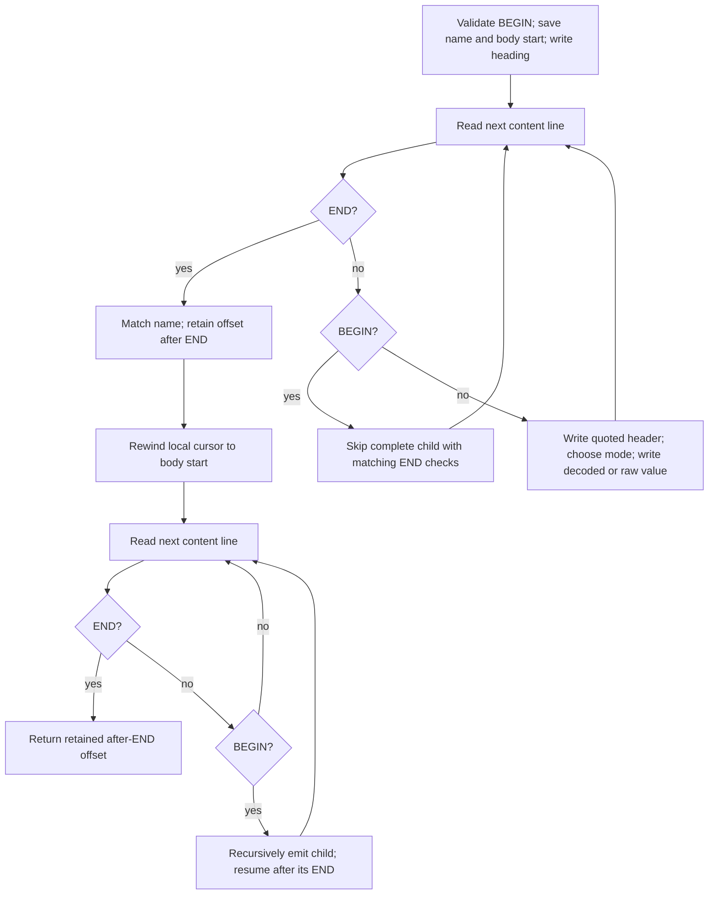
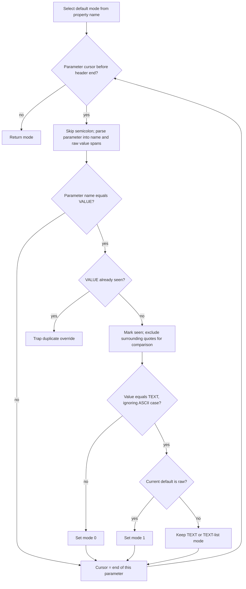
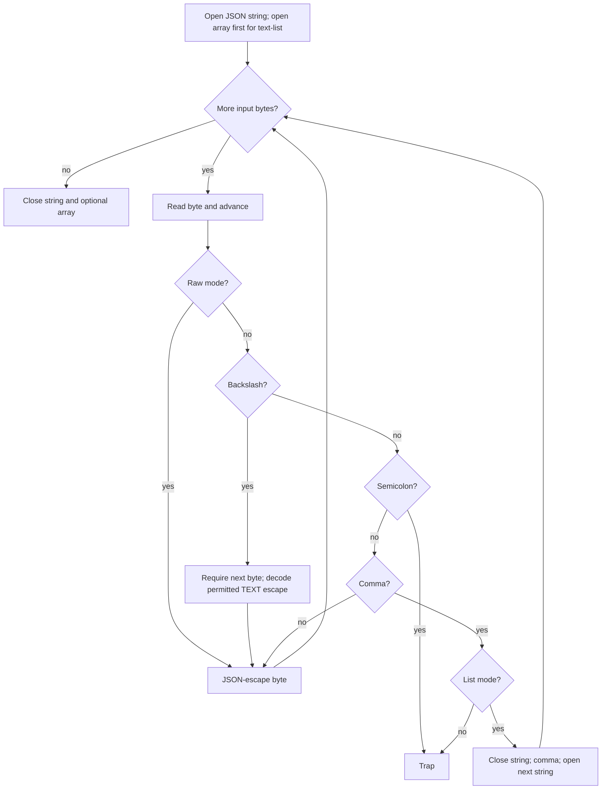

# iCalendar to a Markdown agenda outline

Tool 34 turns one `ics` fence into a component outline headed `# Agenda`.
Calendar, event, alarm and time-zone components become nested headings.
Property rows retain their complete header as a JSON string, including
parameters, followed by a value mode and JSON value.

```text
# Agenda

## VCALENDAR

- "VERSION" raw "2.0"
- "PRODID" text "-//Example//Calendar//EN"

### VEVENT

- "UID" text "meeting-1"
- "DTSTART;TZID=America/Phoenix" raw "20260915T090000"
- "SUMMARY" text "Planning"
- "CATEGORIES" text-list ["Work","Research, reading"]
```

This is an editable agenda outline, not a sorted schedule or recurrence
expansion. UTC, floating dates/times and TZID parameters retain their spelling.
Unknown properties and components remain present. No URL is fetched, alarm
executed, or host time zone consulted. The matching writer can reconstruct
the component structure and escape each value according to its explicit mode.

## Values, preservation and validation

Default TEXT handling covers PRODID, UID, SUMMARY, DESCRIPTION, LOCATION,
COMMENT, CONTACT, RELATED-TO, TZID and TZNAME. CATEGORIES and RESOURCES use
TEXT lists. A VALUE parameter overrides that default: TEXT enables decoding,
and another value type selects raw preservation. An explicit TEXT type on
CATEGORIES/RESOURCES still uses a list. Other properties default to raw;
this avoids guessing unknown or structured extension formats.

TEXT escapes follow
[RFC 5545 section 3.3.11](https://www.rfc-editor.org/rfc/rfc5545.html#section-3.3.11).
Backslash, escaped comma/semicolon and escaped newlines become their actual
string values. List commas remain distinct from escaped commas. Invalid
TEXT escapes and unescaped semicolons trap; an unescaped comma in a scalar
TEXT field traps too.

Headers keep parameter spelling, quoting and caret escapes intact, rather
than decoding and then trying to reconstruct those lexical choices. Their
content-line syntax is checked by the [shared reader](00-calendar-lines.md).
A duplicate VALUE parameter is rejected because it would make mode selection
ambiguous. Other repeated parameters/properties are preserved; this is not
a complete property-cardinality or iCalendar semantic validator.

BEGIN/END names must match case-insensitively. The one outer component must
be VCALENDAR. Component headings use uppercase names. Nesting is capped at
five components, so the deepest heading is Markdown level six. The complete
input is checked, including components that do not represent events.
Required event properties, date validity, recurrence rules and registry-specific
parameter restrictions are not validated here.

Properties are emitted before their component's children, retaining order
within each group. This normalization also handles properties found after a
child component. Duplicate properties and sibling component order survive.
Physical line folding and line-ending choices are normalized; no claim of
byte-for-byte archival is made.

## Memory and passes

The input fence fits in 64 KiB. A byte-only fence scan runs before unfolding,
so it does not reject a UTF-8 sequence split by a physical fold. Unfolding
validates the restored encoding and writes a separate page. The result is
then copied over the input page; output uses `0x10000..0x30000`, capped at
128 KiB. Browser input text is not changed by this memory reuse.

The closing fence must be on its own line and have at least the opening
backtick count. An earlier closing-fence line, including one indented by up
to three spaces, traps. Use a longer outer fence when needed. LF and CRLF
follow the shared reader's rules; a BOM at the start of the calendar is accepted.

### Inside component: properties first, children second

Each call retains its BEGIN value span and body start in locals. The first
pass writes properties and structurally skips children. The second returns
to body start and recursively writes those children. No event list or tree
is allocated. Repeated scans are bounded by the five-level depth cap.



The next cursor belongs to the complete child, not its opening line.
`ca-component-child-skip` and `ca-component-child-emit` both replace the
parent's cursor with that returned offset. A child's properties therefore
cannot leak into its parent's rows. The read-only skip still validates
nesting and matching names; the emitting pass later checks value modes.

#### Which state survives a child call?

| Local in component | Meaning | Lifetime |
| --- | --- | --- |
| 0–2 | BEGIN line start, complete input end, zero-based depth | Arguments of this invocation |
| 3–4 | Opening component name's half-open value span | Retained until this component's END matches |
| 5 | First line after BEGIN | Retained for the second pass |
| 6 | Next line to visit | Replaced by line-next or the complete child's returned offset |
| 7–11 | Current line's name end, parameter end, value start/end, next line | Replaced on every line read |
| 13 | Property value mode | Used only when emitting that property's row |
| 14 | Offset immediately after this component's matching END | Saved at the first-pass exit, returned at the second-pass exit |

The five values returned by `line` arrive on the operand stack in the order
name end, parameter end, value start, value end, next. The successive
`local.set` instructions in `ca-component-read` pop them in reverse order.
This is not five independent reads from a hidden parser cursor. The child
receives the same immutable input bound and its own depth; its locals cannot
overwrite the parent's name or saved body start.

`skip` uses the same BEGIN and END checks, but has no output writes. An
ordinary property advances its cursor to line-next; a nested BEGIN replaces
it with another `skip` result. Missing END reaches the input-bound trap.
Thus skipping is still a structural walk, not searching for the next END
substring. An END belonging to an alarm cannot close its enclosing event.

#### Trace: an event with a property after its alarm

Use line identities here so the cursor changes remain readable even when
UTF-8 text changes the byte offsets:

```ics
BEGIN:VCALENDAR
VERSION:2.0
BEGIN:VEVENT
UID:first
BEGIN:VALARM
ACTION:DISPLAY
DESCRIPTION:Wake up
END:VALARM
SUMMARY:After alarm
END:VEVENT
PRODID:After event
END:VCALENDAR
```

| Invocation and pass | Current line | Action | Resume at |
| --- | --- | --- | --- |
| Calendar, first | VERSION | Emit calendar property | Event BEGIN |
| Calendar, first | Event BEGIN | Skip event, including nested alarm | PRODID |
| Calendar, first | PRODID | Emit calendar property | Calendar END |
| Calendar, second | VERSION | Advance without writing | Event BEGIN |
| Calendar, second | Event BEGIN | Enter emitting event call | Parent waits for its returned offset |
| Event, first | UID | Emit event property | Alarm BEGIN |
| Event, first | Alarm BEGIN | Skip alarm | SUMMARY |
| Event, first | SUMMARY | Emit event property | Event END |
| Event, second | Alarm BEGIN | Emit alarm heading and properties | SUMMARY, then Event END |
| Calendar, second resumes | PRODID | Advance without writing | Calendar END; return |

The output contains VERSION and PRODID under the calendar, UID and SUMMARY
under the event, then the alarm's properties under the alarm. The first pass
must not set the cursor merely to the line after a child's BEGIN: that would
misattribute UID to the calendar and stop at the child's END.
The test named “parent/child cursor trace” checks this complete arrangement,
including a later sibling VTODO.

The loops are not simply “linear because cursors advance”: the second pass
rewinds deliberately, and ancestors also skip descendants. With maximum
component depth D, line visits are O(D × input lines); D is capped at five.
Each active call keeps fixed-size locals, not a list of every component.
Malformed deeply nested input traps before growing the call depth past that cap.

### Inside kind: defaults first, one explicit override afterward

Mode 0 is raw, 1 is TEXT, and 2 is a TEXT list. A zero-initialized local starts
in raw mode. The first loop compares the property name against ten
length-prefixed TEXT names. A match selects mode 1 and leaves that loop;
otherwise `table += 1 + memory[table]` advances over one entire record.
A zero length ends this name table; it is not a string terminator.

The two list names are checked next and select mode 2. Parameter scanning
then begins at the property name's end, where a semicolon introduces each
parameter. The quote-aware helper returns spans rather than interpreting them.



`ca-kind-next` uses the raw parameter end, not the comparison end after
unquoting. Otherwise a quoted VALUE could leave the cursor on its closing
quote and misread the next parameter. Unknown VALUE spellings are preserved
as raw, as are syntactically accepted value lists not equal to a single TEXT.
This is a mode choice, not registry validation.
No override copies or rewrites the original header bytes.

### Inside value: one comma has two possible meanings

Raw mode only JSON-quotes the bytes. TEXT mode consumes backslash and its
following byte together. A comma reached through that escape path is string
data; a comma read directly closes one list string and opens the next.
Scalar TEXT cannot take the latter path.



For `Work,Research\, reading`, the first comma creates the second array
entry; the second is consumed with its backslash and remains in that entry.
An empty TEXT list value becomes `[""]`, not an absent property.

At the beginning of a value-loop iteration, local 0 identifies the first
unconsumed byte. The ordinary path increments it once. The escape path
requires another byte and increments it a second time. The comma-delimiter
path therefore must return to the loop without passing the comma to
`jsonByte` as well.

`ca-value-delimiters` uses `br 3` for that return: the labels inside-out are
the comma `if`, backslash `if/else`, TEXT-mode `if`, and value `loop`.
The escaped-comma path never enters that delimiter branch. For an input
value `A\,B,C` in list mode, bytes 1–2 become one comma inside the first
string; byte 4 closes that string. The resulting JSON is `["A,B","C"]`.
In scalar TEXT mode, only the raw comma at byte 4 traps.

JSON quoting is a second, separate operation. A decoded TEXT newline becomes
the two JSON source bytes backslash and n, not a physical newline in a row.
Quote and backslash are prefixed with a JSON backslash; TAB/LF/CR have short
escapes. Already-validated UTF-8 bytes otherwise pass through unchanged.
The helper does not treat a byte above ASCII as a Unicode scalar or re-encode
it; validation occurred after unfolding, before this output pass.

## Module

Imports: unfold 0, line 1, parameter 2, nameEnd 3.
Definitions: run 4, emit 5, literal 6, same 7, equalSpans 8, value 9,
JSON byte 10, kind 11, heading 12, component 13, fence 14,
fenceLines 15, skip 16, begin 17. Only the output pointer is global.
The reverse writer also imports `same` and `kind` directly. These read-only
helpers share ASCII name comparison and the property/VALUE mode decision;
they do not run the reader or change its output pointer.
`same` compares a span with a one-byte-length-prefixed literal. Its underlying
`equalSpans` first rejects unequal lengths, then loads one byte from each
span. Only bytes in A–Z gain `0x20`. A mismatch returns zero immediately;
otherwise both pointers advance until the common length is exhausted.
An unconditional OR would also equate CR with hyphen or NUL with space,
which is wrong for the punctuation-bearing literals used by the writer.

`[microwasm]`

- ca-header: `0061736d 01000000`
- ca-type-section: `01 {{size:ca-types}}`
  - ca-types: `0a 60 02 7f 7f 01 7f 60 02 7f 7f 05 7f 7f 7f 7f 7f 60 02 7f 7f 03 7f 7f 7f 60 01 7f 01 7f 60 01 7f 00 60 03 7f 7f 7f 01 7f 60 04 7f 7f 7f 7f 01 7f 60 03 7f 7f 7f 00 60 01 7f 02 7f 7f 60 03 7f 7f 7f 03 7f 7f 7f`
- ca-import-section: `02 {{size:ca-imports}}`
  - ca-imports: `05 01 63 06 756e666f6c64 00 00 01 63 04 6c696e65 00 01 01 63 09 706172616d65746572 00 02 01 63 07 6e616d65456e64 00 00 01 63 06 6d656d6f7279 02 01 04 04`
- ca-function-section: `03 {{size:ca-functions}}`
  - ca-functions: `0e 03 04 04 05 06 07 04 05 07 05 08 07 05 09`
- ca-global-section: `06 {{size:ca-globals}}`
  - ca-globals: `01 7f 01 41 00 0b`
- ca-export-section: `07 {{size:ca-exports}}`
  - ca-exports: `04 03 72756e 00 04 06 6d656d6f7279 02 00 04 73616d65 00 07 04 6b696e64 00 0b`
- ca-code-section: `0a {{size:ca-code}}`
  - ca-code: `0e`
    - ca-run-record: `{{size:ca-run-body}}`
      - ca-run-body: `01 02 7f 20 00 10 0e 10 00 21 01 41 00 41 808004 20 01 fc 0a 00 00 41 808004 24 00 41 84880c 10 06`
        - ca-run-bom: `20 01 41 03 4f 04 40 41 00 2d 00 00 41 ef01 46 41 01 2d 00 00 41 bb01 46 71 41 02 2d 00 00 41 bf01 46 71 04 40 41 03 21 02 0b 0b`
        - ca-run-component: `20 02 20 01 41 00 10 0d 20 01 47 04 40 00 0b 23 00 41 808004 6b 0b`
    - ca-emit-record: `{{size:ca-emit-body}}`
      - ca-emit-body: `00 23 00 41 80800c 4f 04 40 00 0b 23 00 20 00 3a 00 00 23 00 41 01 6a 24 00 0b`
    - ca-literal-record: `{{size:ca-literal-body}}`
      - ca-literal-body: `01 01 7f 20 00 20 00 2d 00 00 6a 41 01 6a 21 01 20 00 41 01 6a 21 00 02 40 03 40 20 00 20 01 4f 0d 01 20 00 2d 00 00 10 05 20 00 41 01 6a 21 00 0c 00 0b 0b 0b`
    - ca-same-record: `{{size:ca-same-body}}`
      - ca-same-body: `00 20 00 20 01 20 02 41 01 6a 20 02 41 01 6a 20 02 2d 00 00 6a 10 08 0b`
    - ca-equal-record: `{{size:ca-equal-body}}`
      - ca-equal-body: `01 02 7f 20 01 20 00 6b 20 03 20 02 6b 47 04 40 41 00 0f 0b 02 40 03 40 20 00 20 01 4f 0d 01`
        - ca-equal-bytes: `20 00 2d 00 00 21 04 20 02 2d 00 00 21 05`
        - ca-equal-left-case: `20 04 41 c100 6b 41 19 4d 04 40 20 04 41 20 6a 21 04 0b`
        - ca-equal-right-case: `20 05 41 c100 6b 41 19 4d 04 40 20 05 41 20 6a 21 05 0b`
        - ca-equal-compare: `20 04 20 05 47 04 40 41 00 0f 0b`
        - ca-equal-next: `20 00 41 01 6a 21 00 20 02 41 01 6a 21 02 0c 00 0b 0b 41 01 0b`
    - ca-value-record: `{{size:ca-value-body}}`
      - ca-value-body: `01 01 7f 20 02 41 02 46 04 40 41 db00 10 05 0b 41 22 10 05 02 40 03 40 20 00 20 01 4f 0d 01 20 00 2d 00 00 21 03 20 00 41 01 6a 21 00`
        - ca-value-text: `20 02 04 40 20 03 41 dc00 46 04 40 20 00 20 01 4f 04 40 00 0b 20 00 2d 00 00 21 03 20 00 41 01 6a 21 00`
          - ca-value-newline: `20 03 41 20 72 41 ee00 46 04 40 41 0a 21 03`
          - ca-value-escape: `05 20 03 41 dc00 46 20 03 41 3b 46 72 20 03 41 2c 46 72 45 04 40 00 0b 0b`
          - ca-value-delimiters: `05 20 03 41 3b 46 04 40 00 0b 20 03 41 2c 46 04 40 20 02 41 02 47 04 40 00 0b 41 22 10 05 41 2c 10 05 41 22 10 05 0c 03 0b 0b 0b`
        - ca-value-byte: `20 03 10 0a 0c 00 0b 0b 41 22 10 05 20 02 41 02 46 04 40 41 dd00 10 05 0b 0b`
    - ca-json-byte-record: `{{size:ca-json-byte-body}}`
      - ca-json-byte-body: `01 01 7f 20 00 41 09 46 04 40 41 f400 21 01 0b 20 00 41 0a 46 04 40 41 ee00 21 01 0b 20 00 41 0d 46 04 40 41 f200 21 01 0b 20 01 04 40 41 dc00 10 05 20 01 10 05 0f 0b 20 00 41 22 46 20 00 41 dc00 46 72 04 40 41 dc00 10 05 0b 20 00 10 05 0b`
    - ca-kind-record: `{{size:ca-kind-body}}`
      - ca-kind-body: `01 08 7f 41 db880c 21 04 02 40 03 40 20 04 2d 00 00 45 0d 01 20 00 20 01 20 04 10 07 04 40 41 01 21 03 0c 02 0b 20 04 20 04 2d 00 00 6a 41 01 6a 21 04 0c 00 0b 0b`
        - ca-kind-list: `20 00 20 01 41 c6880c 10 07 20 00 20 01 41 d1880c 10 07 72 04 40 41 02 21 03 0b 20 01 21 05`
        - ca-kind-parameters: `02 40 03 40 20 05 20 02 4f 0d 01 20 05 41 01 6a 21 05 20 05 20 02 10 02 21 08 21 07 21 06`
          - ca-kind-value: `20 05 20 06 41 bb880c 10 07 04 40 20 09 04 40 00 0b 41 01 21 09`
            - ca-kind-unquote: `20 07 20 08 49 04 40 20 07 2d 00 00 41 22 46 04 40 20 07 41 01 6a 21 07 20 08 41 01 6b 21 0a 05 20 08 21 0a 0b 05 20 08 21 0a 0b`
            - ca-kind-override: `20 07 20 0a 41 c1880c 10 07 04 40 20 03 45 04 40 41 01 21 03 0b 05 41 00 21 03 0b 0b`
          - ca-kind-next: `20 08 21 05 0c 00 0b 0b 20 03 0b`
    - ca-heading-record: `{{size:ca-heading-body}}`
      - ca-heading-body: `01 01 7f 41 0a 10 05 20 02 41 02 6a 21 02 03 40 41 23 10 05 20 02 41 01 6b 22 02 0d 00 0b 41 20 10 05 02 40 03 40 20 00 20 01 4f 0d 01 20 00 2d 00 00 21 03 20 03 41 e100 4f 20 03 41 fa00 4d 71 04 40 20 03 41 20 6b 21 03 0b 20 03 10 05 20 00 41 01 6a 21 00 0c 00 0b 0b 41 0a 10 05 41 0a 10 05 0b`
    - ca-component-record: `{{size:ca-component-body}}`
      - ca-component-body: `01 0c 7f 20 00 20 01 20 02 10 11 21 05 21 04 21 03 20 03 20 04 20 02 10 0c 20 05 21 06 02 40 03 40`
        - ca-component-read: `20 06 20 01 4f 04 40 00 0b 20 06 20 01 10 01 21 0b 21 0a 21 09 21 08 21 07`
        - ca-component-end: `20 06 20 07 41 94880c 10 07 04 40 20 07 20 08 47 20 03 20 04 20 09 20 0a 10 08 45 72 04 40 00 0b 20 0b 21 0e 0c 02 0b`
        - ca-component-child-skip: `20 06 20 07 41 8e880c 10 07 04 40 20 06 20 01 20 02 41 01 6a 10 10 21 06 0c 01 0b`
        - ca-component-property: `41 2d 10 05 41 20 10 05 20 06 20 08 41 00 10 09 20 06 20 07 20 08 10 0b 21 0d`
          - ca-component-mode: `20 0d 45 04 7f 41 a2880c 05 20 0d 41 01 46 04 7f 41 a8880c 05 41 af880c 0b 0b 10 06`
          - ca-component-value: `20 09 20 0a 20 0d 10 09 41 0a 10 05 20 0b 21 06 0c 00 0b 0b`
        - ca-component-rewind: `20 05 21 06 03 40 20 06 20 01 10 01 21 0b 21 0a 21 09 21 08 21 07`
          - ca-component-second-end: `20 06 20 07 41 94880c 10 07 04 40 20 0e 0f 0b`
          - ca-component-child-emit: `20 06 20 07 41 8e880c 10 07 04 40 20 06 20 01 20 02 41 01 6a 10 0d 21 06 05 20 0b 21 06 0b 0c 00 0b 00 0b`
    - ca-fence-record: `{{size:ca-fence-body}}`
      - ca-fence-body: `01 06 7f 20 00 41 0a 49 20 00 41 808004 4b 72 04 40 00 0b 02 40 03 40 20 01 20 00 4f 0d 01 20 01 2d 00 00 41 e000 47 0d 01 20 01 41 01 6a 21 01 0c 00 0b 0b 20 01 41 03 49 04 40 00 0b`
        - ca-fence-label: `20 01 20 01 41 03 6a 41 80880c 10 07 45 04 40 00 0b 20 01 41 03 6a 21 06 20 06 20 00 49 04 40 20 06 2d 00 00 41 0d 46 04 40 20 06 41 01 6a 21 06 0b 0b 20 06 20 00 4f 04 40 00 0b 20 06 2d 00 00 41 0a 47 04 40 00 0b 20 06 41 01 6a 21 02 20 00 21 03`
        - ca-fence-trim: `02 40 03 40 20 03 20 02 4d 0d 01 20 03 41 01 6b 2d 00 00 21 05 20 05 41 20 46 20 05 41 09 46 72 20 05 41 0a 46 72 20 05 41 0d 46 72 45 0d 01 20 03 41 01 6b 21 03 0c 00 0b 0b`
        - ca-fence-close: `02 40 03 40 20 03 20 02 4d 0d 01 20 03 41 01 6b 2d 00 00 41 e000 47 0d 01 20 03 41 01 6b 21 03 20 04 41 01 6a 21 04 0c 00 0b 0b 20 04 20 01 49 04 40 00 0b`
        - ca-fence-newline: `20 03 20 02 4d 04 40 00 0b 20 03 41 01 6b 22 03 2d 00 00 41 0a 47 04 40 00 0b 20 03 20 02 4b 04 40 20 03 41 01 6b 2d 00 00 41 0d 46 04 40 20 03 41 01 6b 21 03 0b 0b`
        - ca-fence-checked: `20 02 20 03 20 01 10 0f 20 02 20 03 0b`
    - ca-fence-lines-record: `{{size:ca-fence-lines-body}}`
      - ca-fence-lines-body: `01 04 7f 02 40 03 40 20 00 20 01 4f 0d 01 20 00 21 03 41 00 21 04 02 40 03 40 20 03 20 01 4f 0d 01 20 04 41 03 4f 0d 01 20 03 2d 00 00 41 20 47 0d 01 20 03 41 01 6a 21 03 20 04 41 01 6a 21 04 0c 00 0b 0b 41 00 21 05`
        - ca-fence-lines-ticks: `02 40 03 40 20 03 20 01 4f 0d 01 20 03 2d 00 00 41 e000 47 0d 01 20 03 41 01 6a 21 03 20 05 41 01 6a 21 05 0c 00 0b 0b`
        - ca-fence-lines-tail: `20 05 20 02 4f 04 40 02 40 03 40 20 03 20 01 4f 04 40 00 0b 20 03 2d 00 00 21 06 20 06 41 0a 46 04 40 00 0b 20 06 41 20 46 20 06 41 09 46 72 20 06 41 0d 46 72 45 0d 01 20 03 41 01 6a 21 03 0c 00 0b 0b 0b`
        - ca-fence-lines-next: `02 40 03 40 20 00 20 01 4f 0d 01 20 00 2d 00 00 21 06 20 00 41 01 6a 21 00 20 06 41 0a 46 0d 01 0c 00 0b 0b 0c 00 0b 0b 0b`
    - ca-skip-record: `{{size:ca-skip-body}}`
      - ca-skip-body: `01 08 7f 20 00 20 01 20 02 10 11 21 05 21 04 21 03 03 40 20 05 20 01 4f 04 40 00 0b 20 05 20 01 10 01 21 0a 21 09 21 08 21 07 21 06`
        - ca-skip-end: `20 05 20 06 41 94880c 10 07 04 40 20 06 20 07 47 20 03 20 04 20 08 20 09 10 08 45 72 04 40 00 0b 20 0a 0f 0b`
        - ca-skip-child: `20 05 20 06 41 8e880c 10 07 04 40 20 05 20 01 20 02 41 01 6a 10 10 21 05 05 20 0a 21 05 0b 0c 00 0b 00 0b`
    - ca-begin-record: `{{size:ca-begin-body}}`
      - ca-begin-body: `01 05 7f 20 02 41 05 4f 04 40 00 0b 20 00 20 01 10 01 21 07 21 06 21 05 21 04 21 03`
        - ca-begin-name: `20 03 20 04 47 20 00 20 03 41 8e880c 10 07 45 72 04 40 00 0b 20 05 20 06 10 03 20 06 47 04 40 00 0b`
        - ca-begin-root: `20 05 20 06 41 98880c 10 07 20 02 45 47 04 40 00 0b 20 05 20 06 20 07 0b`
- ca-data-section: `0b {{size:ca-data}}`
  - ca-data: `01 00 41 80880c 0b {{size:ca-literals}}`
    - ca-literals:
      - ca-literal-ics: `03696373`
      - ca-literal-agenda: `0923204167656e64610a`
      - ca-literal-begin: `05424547494e`
      - ca-literal-end: `03454e44`
      - ca-literal-calendar: `095643414c454e444152`
      - ca-literal-raw: `052072617720`
      - ca-literal-text: `06207465787420`
      - ca-literal-list: `0b20746578742d6c69737420`
      - ca-literal-value: `0556414c5545`
      - ca-literal-text-type: `0454455854`
      - ca-literal-categories: `0a43415445474f52494553`
      - ca-literal-resources: `095245534f5552434553`
      - ca-default-text-names:
        - ca-text-name-prodid: `0650524f444944`
        - ca-text-name-uid: `03554944`
        - ca-text-name-summary: `0753554d4d415259`
        - ca-text-name-description: `0b4445534352495054494f4e`
        - ca-text-name-location: `084c4f434154494f4e`
        - ca-text-name-comment: `07434f4d4d454e54`
        - ca-text-name-contact: `07434f4e54414354`
        - ca-text-name-related-to: `0a52454c415445442d544f`
        - ca-text-name-tzid: `04545a4944`
        - ca-text-name-tzname: `06545a4e414d45`
        - ca-text-name-end: `00`
