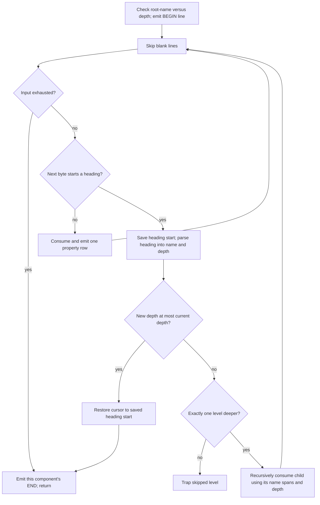
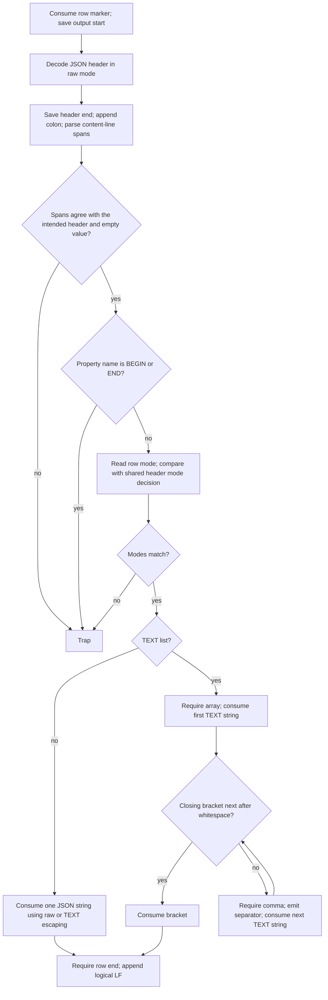
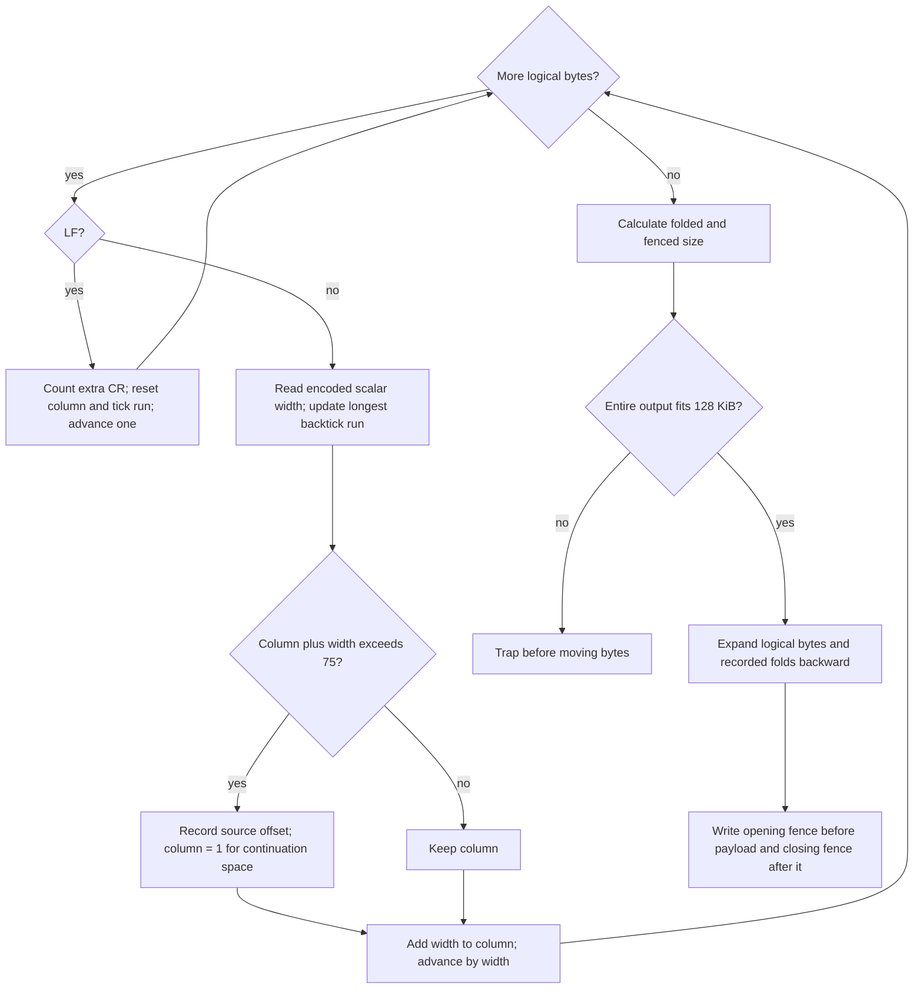

# Markdown agenda outline to iCalendar

Tool 35 writes the [agenda reader's](34-ical-to-agenda.md) component outline
back to one `ics` fence. This is a structural calendar editor, not a scheduler:
dates, time-zone identifiers, recurrence rules and unknown values remain text.
No network, host clock or alarm service is used.

The first line is `# Agenda`. Headings at levels two through six name
components; the single root is VCALENDAR. Each property row has a JSON-quoted
header, a mode, and a JSON string or nonempty array of JSON strings:

```text
# Agenda

## VCALENDAR

- "VERSION" raw "2.0"
- "PRODID" text "-//Microwasm//Agenda//EN"

### VEVENT

- "UID" text "planning-1"
- "SUMMARY" text "Planning, then lunch"
- "CATEGORIES" text-list ["Work","Research, reading"]
```

Blank lines are allowed. Headings must not skip levels. Each row belongs to
the nearest preceding heading at its level of nesting. Component names are
ASCII tokens and are written uppercase. Header spelling, including parameter
quotes and caret escapes, is preserved. BEGIN and END cannot be property rows.

Mode must agree with the header's default property type or explicit VALUE
parameter, using the reader's same decision routine. To author an extension
as TEXT, for example, use `"X-NOTE;VALUE=TEXT" text "..."`. Unknown types default
to raw. A raw SUMMARY cannot bypass TEXT rules by merely changing its row mode.
The modes are case-insensitive, as are component names and `# Agenda`.

Raw strings cannot contain physical newlines. TEXT strings escape backslash,
comma and semicolon, and encode LF as `\n`. CR and other forbidden controls
are rejected rather than silently normalized; TAB is allowed. JSON escapes
and UTF-8 are decoded in Wasm, with escaped surrogate pairs combined and lone
surrogates rejected. TEXT lists put literal commas between individually
escaped values. An empty list is rejected: iCalendar cannot distinguish it
from one empty TEXT value, so use `[""]` explicitly.

Output uses CRLF content lines and folds at no more than 75 octets per physical
line, including the leading continuation space. It never splits a UTF-8
character. The limit follows
[RFC 5545 section 3.1](https://www.rfc-editor.org/rfc/rfc5545.html#section-3.1).
Folding may split an escape pair: unfolding restores it before TEXT decoding.
The outer Markdown fence is longer than every backtick run in the output.

## Memory and helper reuse

Input stays immutable at `0..0x10000`. Logical lines are first written to
`0x10000..0x30000`; the complete folded, fenced output must fit the same
128 KiB region. The fourth page holds the reader's small mode/name table,
this writer's literals at `0x30800`, and fold offsets at `0x31000`. No AST or
decoded-value buffer is allocated. Recursive component calls retain name
spans into the input; five heading levels bound the active call depth.

Imports from the reader use only its read-only `same` and `kind` functions;
they do not invoke its conversion or overwrite input. The calendar line
helper validates each decoded header followed by a colon, before its value
is appended. This catches injected separators and malformed parameters.
The JSON code-unit iterator is shared; scalar combination and iCalendar
escaping belong to this writer, not to an XML-specific sanitizer.

## Inside component: look ahead without stealing a sibling

`heading` consumes one heading line and returns its name start, name end and
zero-based depth. `component` writes BEGIN, then handles rows until EOF or a
heading at the same or an outer depth. Its shared input cursor is the only
position from which the next component or property is read.



The restore in `cw-component-return` is essential: a child has identified
its sibling's heading, but the parent must be the one to consume that heading.
No copied line or pending-token object is needed. If the heading belongs to
an ancestor, each returning call leaves the cursor at that same start.
Only the matching parent finally accepts it.

For headings VCALENDAR → A → B → C → D → E, where E is a sibling of A:

| Current call | Reads E's heading at depth 1 | Output before returning | Cursor handed back |
| --- | --- | --- | --- |
| D, depth 4 | New depth is smaller | END:D | E's heading start |
| C, depth 3 | Reads that same heading again | END:C | E's heading start |
| B, depth 2 | Reads it again | END:B | E's heading start |
| A, depth 1 | New depth is equal | END:A | E's heading start |
| VCALENDAR, depth 0 | Exactly one level deeper | Calls E, which writes BEGIN:E | E consumes its own body |

Each call retains only its own two name offsets and depth. The parsed
look-ahead values use locals 4–6; local 3 holds the cursor to restore.
The input bytes never move, so these name spans remain valid across child calls.
At EOF no heading needs to be restored: END lines simply unwind the remaining
active calls. The root wrapper rejects a second root left unconsumed.

## Inside property: decode, validate the header, then emit its value

`cw-property-header` checks the decoded header, not the JSON source spelling.
It temporarily appends the separating colon and asks the shared line reader
to parse this incomplete-but-valid content line with an empty value.
The returned parameter end must equal the saved header end, and value start
and next must both equal the current output pointer.

For a header containing an injected colon, the reader would report an earlier
parameter end. For a newline injection, JSON raw-mode decoding already traps.
Quoted parameter colons are different: the line helper skips them and finds
the writer's final colon. BEGIN/END are explicitly rejected as property names
because component structure is expressed by headings.



The list loop consumes a string before checking for the end, so it cannot
silently turn `[]` into an empty string. Each JSON string escapes its commas;
only `cw-property-list-next` emits an unescaped separator. This is the
inverse of the reader's distinction between an escaped comma and a list comma.
Malformed rows may have written a prefix in memory, but `run` does not return
success and the UI keeps the previous result.

### JSON decoding: the cursor moves before escaping

`cw-json-close` sees an unescaped closing quote before calling the iterator,
consumes it, and returns. Otherwise `scalar` combines one or two UTF-16
units from the shared iterator, returns a Unicode scalar and a new source
cursor. The caller assigns that cursor before any output decision.
This handles both a raw supplementary character and two escaped surrogates.

`cw-json-controls` rejects controls other than TAB/LF and rejects DEL.
LF is then allowed only in TEXT mode, where it emits backslash plus n and
branches back to the input loop. Other TEXT escapes add a backslash before
the ordinary UTF-8 encoder. A decoded backslash never starts another JSON
escape: output bytes are not fed back to the source iterator.

## Inside frame: count bytes, record folds, expand backward

The first pass sees valid UTF-8 logical lines. It advances by one scalar's
encoded width: 1 for ASCII, 2 for a two-byte lead, 3 for a three-byte lead,
and 4 for a four-byte lead. It does not need to validate those continuations
again: the header/name/value paths established that invariant.

| State | Changes during measuring | Purpose afterward |
| --- | --- | --- |
| Local 0, scan position | Advances by width, or one on LF | Reused as the backward source cursor |
| Local 1, physical column | Adds width; resets to 0 on LF or 1 at a fold | Counts the continuation space too |
| Locals 2–3, current/longest backtick run | Run resets on non-backtick; maximum only grows | Chooses the Markdown fence |
| Local 4, logical LF count | Increments on each LF | One extra CR byte per logical line |
| Local 5, fold count | Increments and stores each source offset | Three inserted bytes per fold; later consumed in reverse |
| Local 6, logical byte length | Saved once before the scan | Original end remains available after pointer changes |
| Local 10, folded payload end | Computed after all counts | Destination start for reverse expansion, then suffix position |



At column 70, a four-byte emoji fits and moves the column to 74. A following
three-byte character does not fit: a fold is recorded before that character,
and its continuation line ends up at column 4 (one space plus three bytes).
Folding at a fixed source index of 75 instead would split that character.
At most one fold is needed before a scalar because its width is at most four.

The folded payload length is `logicalLength + newlineCount + 3 * foldCount`.
Framing adds twice the fence length plus six bytes (`ics` and three LFs).
`cw-frame-size` checks their sum before the backward pass writes anything.
The scratch array holds only fold offsets, not ordinary newline offsets:
newlines are directly recognizable when scanning backward.

During reverse expansion, source and destination initially point just after
their respective spans. A recorded fold at the current source position means
the character after that fold has already been copied. The writer inserts
space, LF, then CR while decrementing the destination, yielding CRLF-space
in forward order. It then copies the preceding source byte. Copying LF also
inserts its preceding CR. Each source byte is copied once; folds are consumed
from the end of their ascending offset array.

The destination stays ahead of unread source because it includes the opening
fence and all remaining expansion. This makes overlap safe without a second
output buffer. The final pointer check requires it to land exactly after the
future opening fence, with every recorded fold consumed. Only then are the
fences written. All movement stays below the literal and scratch page.

## Module

Imports: JSON next 0, calendar line 1, calendar nameEnd 2,
agenda same 3, agenda kind 4. Definitions: run 5, emit 6, literal 7,
scalar 8, UTF-8 9, JSON string 10, take 11, spaces 12, lineEnd 13,
heading 14, component 15, property 16, nameLine 17, frame 18, blank 19.
Globals are output cursor 0, input cursor 1, and input end 2.

`[microwasm]`

- cw-header: `0061736d 01000000`
- cw-type-section: `01 {{size:cw-types}}`
  - cw-types: `0a 60 03 7f 7f 7f 03 7f 7f 7f 60 02 7f 7f 05 7f 7f 7f 7f 7f 60 02 7f 7f 01 7f 60 03 7f 7f 7f 01 7f 60 01 7f 01 7f 60 01 7f 00 60 02 7f 7f 02 7f 7f 60 00 00 60 00 03 7f 7f 7f 60 03 7f 7f 7f 00`
- cw-import-section: `02 {{size:cw-imports}}`
  - cw-imports: `06 01 6b 04 6e657874 00 00 01 63 04 6c696e65 00 01 01 63 07 6e616d65456e64 00 02 01 61 04 73616d65 00 03 01 61 04 6b696e64 00 03 01 61 06 6d656d6f7279 02 01 04 04`
- cw-function-section: `03 {{size:cw-functions}}`
  - cw-functions: `0f 04 05 05 06 05 05 05 07 07 08 09 07 09 07 07`
- cw-global-section: `06 {{size:cw-globals}}`
  - cw-globals: `03 7f 01 41 00 0b 7f 01 41 00 0b 7f 01 41 00 0b`
- cw-export-section: `07 {{size:cw-exports}}`
  - cw-exports: `02 03 72756e 00 05 06 6d656d6f7279 02 00`
- cw-code-section: `0a {{size:cw-code}}`
  - cw-code: `0f`
    - cw-run-record: `{{size:cw-run-body}}`
      - cw-run-body: `00`
        - cw-run-bound: `20 00 41 08 49 20 00 41 808004 4b 72 04 40 00 0b`
        - cw-run-title: `41 00 41 08 41 80900c 10 03 45 04 40 00 0b 20 00 24 02 41 08 24 01 41 808004 24 00 10 0d 10 13`
        - cw-run-root: `10 0e 22 00 04 40 00 0b 20 00 10 0f 10 13 23 01 23 02 47 04 40 00 0b 10 12 23 00 41 808004 6b 0b`
    - cw-emit-record: `{{size:cw-emit-body}}`
      - cw-emit-body: `00 23 00 41 80800c 4f 04 40 00 0b 23 00 20 00 3a 00 00 23 00 41 01 6a 24 00 0b`
    - cw-literal-record: `{{size:cw-literal-body}}`
      - cw-literal-body: `01 01 7f 20 00 20 00 2d 00 00 6a 41 01 6a 21 01 20 00 41 01 6a 21 00 02 40 03 40 20 00 20 01 4f 0d 01 20 00 2d 00 00 10 06 20 00 41 01 6a 21 00 0c 00 0b 0b 0b`
    - cw-scalar-record: `{{size:cw-scalar-body}}`
      - cw-scalar-body: `01 04 7f`
        - cw-scalar-first: `20 00 20 01 41 00 10 00 21 02 21 04 21 03`
        - cw-scalar-end: `20 03 41 7f 46 04 40 00 0b`
        - cw-scalar-high: `20 03 41 80b003 6b 41 ff07 4d 04 40`
          - cw-scalar-second: `20 04 20 01 20 02 10 00 21 02 21 04 21 05`
          - cw-scalar-low: `20 05 41 80b803 6b 41 ff07 4b 04 40 00 0b`
          - cw-scalar-pair: `20 03 41 80b003 6b 41 0a 74 20 05 41 80b803 6b 6a 41 808004 6a 21 03 0b`
        - cw-scalar-lone: `20 03 41 80b003 6b 41 ff0f 4d 04 40 00 0b 20 03 20 04 0b`
    - cw-utf8-record: `{{size:cw-utf8-body}}`
      - cw-utf8-body: `00`
        - cw-utf8-ascii: `20 00 41 8001 49 04 40 20 00 10 06 0f 0b`
        - cw-utf8-two: `20 00 41 8010 49 04 40 20 00 41 06 76 41 c001 72 10 06`
          - cw-utf8-more: `05 20 00 41 808004 49 04 40 20 00 41 0c 76 41 e001 72 10 06`
            - cw-utf8-four: `05 20 00 41 12 76 41 f001 72 10 06 20 00 41 0c 76 41 3f 71 41 8001 72 10 06 0b`
          - cw-utf8-middle: `20 00 41 06 76 41 3f 71 41 8001 72 10 06 0b`
        - cw-utf8-last: `20 00 41 3f 71 41 8001 72 10 06 0b`
    - cw-json-record: `{{size:cw-json-body}}`
      - cw-json-body: `01 02 7f 41 22 10 0b 03 40`
        - cw-json-bound: `23 01 23 02 4f 04 40 00 0b`
        - cw-json-close: `23 01 2d 00 00 41 22 46 04 40 23 01 41 01 6a 24 01 0f 0b`
        - cw-json-scalar: `23 01 23 02 10 08 24 01 21 01`
        - cw-json-controls: `20 01 41 20 49 20 01 41 09 47 71 20 01 41 0a 47 71 20 01 41 ff00 46 72 04 40 00 0b`
        - cw-json-newline: `20 01 41 0a 46 04 40 20 00 45 04 40 00 0b 41 dc00 10 06 41 ee00 10 06 0c 01 0b`
        - cw-json-escape: `20 00 20 01 41 dc00 46 20 01 41 2c 46 72 20 01 41 3b 46 72 71 04 40 41 dc00 10 06 0b`
        - cw-json-emit: `20 01 10 09 0c 00 0b 00 0b`
    - cw-take-record: `{{size:cw-take-body}}`
      - cw-take-body: `00 23 01 23 02 4f 04 40 00 0b 23 01 2d 00 00 20 00 47 04 40 00 0b 23 01 41 01 6a 24 01 0b`
    - cw-spaces-record: `{{size:cw-spaces-body}}`
      - cw-spaces-body: `01 01 7f 02 40 03 40 23 01 23 02 4f 0d 01 23 01 2d 00 00 21 00 20 00 41 20 46 20 00 41 09 46 72 45 0d 01 23 01 41 01 6a 24 01 0c 00 0b 0b 0b`
    - cw-line-end-record: `{{size:cw-line-end-body}}`
      - cw-line-end-body: `00 10 0c 23 01 23 02 46 04 40 0f 0b 23 01 2d 00 00 41 0d 46 04 40 23 01 41 01 6a 24 01 0b 41 0a 10 0b 0b`
    - cw-heading-record: `{{size:cw-heading-body}}`
      - cw-heading-body: `01 03 7f 02 40 03 40 23 01 23 02 4f 0d 01 23 01 2d 00 00 41 23 47 0d 01 20 02 41 01 6a 21 02 23 01 41 01 6a 24 01 0c 00 0b 0b`
        - cw-heading-level: `20 02 41 02 49 20 02 41 06 4b 72 04 40 00 0b 41 20 10 0b 23 01 21 00`
        - cw-heading-name: `20 00 23 02 10 02 22 01 24 01 10 0d 20 00 20 01 20 02 41 02 6b 0b`
    - cw-component-record: `{{size:cw-component-body}}`
      - cw-component-body: `01 04 7f`
        - cw-component-root: `20 00 20 01 41 93900c 10 03 20 02 45 47 04 40 00 0b 20 00 20 01 41 00 10 11`
        - cw-component-loop: `03 40 10 13`
          - cw-component-eof: `23 01 23 02 46 04 40 20 00 20 01 41 01 10 11 0f 0b`
          - cw-component-heading: `23 01 2d 00 00 41 23 46 04 40 23 01 21 03 10 0e 21 06 21 05 21 04`
            - cw-component-return: `20 06 20 02 4d 04 40 20 03 24 01 20 00 20 01 41 01 10 11 0f 0b`
            - cw-component-child: `20 06 20 02 41 01 6a 47 04 40 00 0b 20 04 20 05 20 06 10 0f 0c 01 0b`
          - cw-component-property: `10 10 0c 00 0b 00 0b`
    - cw-property-record: `{{size:cw-property-body}}`
      - cw-property-body: `01 09 7f 41 2d 10 0b 41 20 10 0b 23 00 21 00 41 00 10 0a 23 00 21 01 41 3a 10 06`
        - cw-property-header: `20 00 23 00 10 01 21 06 21 05 21 04 21 03 21 02`
        - cw-property-header-bound: `20 03 20 01 47 20 04 23 00 47 72 20 06 23 00 47 72 04 40 00 0b`
        - cw-property-reserved: `20 00 20 02 41 89900c 10 03 20 00 20 02 41 8f900c 10 03 72 04 40 00 0b`
        - cw-property-mode-start: `41 20 10 0b 23 01 21 07 02 40 03 40 23 01 23 02 4f 0d 01 23 01 2d 00 00 41 20 46 0d 01 23 01 41 01 6a 24 01 0c 00 0b 0b`
        - cw-property-mode: `20 07 23 01 41 9d900c 10 03 04 7f 41 00 05 20 07 23 01 41 a1900c 10 03 04 7f 41 01 05 20 07 23 01 41 a6900c 10 03 45 04 40 00 0b 41 02 0b 0b 21 08`
        - cw-property-mode-match: `20 00 20 02 20 03 10 04 20 08 47 04 40 00 0b 41 20 10 0b 10 0c`
        - cw-property-list: `20 08 41 02 46 04 40 41 db00 10 0b 10 0c 02 40 03 40 41 01 10 0a 10 0c`
          - cw-property-list-end: `23 01 23 02 4f 04 40 00 0b 23 01 2d 00 00 41 dd00 46 0d 01`
          - cw-property-list-next: `41 2c 10 0b 10 0c 41 2c 10 06 0c 00 0b 0b 41 dd00 10 0b`
        - cw-property-scalar: `05 20 08 10 0a 0b 10 0d 41 0a 10 06 0b`
    - cw-name-line-record: `{{size:cw-name-line-body}}`
      - cw-name-line-body: `01 01 7f 20 02 04 7f 41 8f900c 05 41 89900c 0b 10 07 41 3a 10 06 02 40 03 40 20 00 20 01 4f 0d 01 20 00 2d 00 00 21 03`
        - cw-name-line-upper: `20 03 41 e100 4f 20 03 41 fa00 4d 71 04 40 20 03 41 20 6b 21 03 0b`
        - cw-name-line-next: `20 03 10 06 20 00 41 01 6a 21 00 0c 00 0b 0b 41 0a 10 06 0b`
    - cw-frame-record: `{{size:cw-frame-body}}`
      - cw-frame-body: `01 0c 7f 23 00 41 808004 6b 21 06 41 808004 21 00 02 40 03 40 20 00 23 00 4f 0d 01 20 00 2d 00 00 21 07`
        - cw-frame-newline: `20 07 41 0a 46 04 40 20 04 41 01 6a 21 04 41 00 21 01 41 00 21 02 20 00 41 01 6a 21 00 0c 01 0b`
        - cw-frame-ticks: `20 07 41 e000 46 04 40 20 02 41 01 6a 21 02 20 02 20 03 4b 04 40 20 02 21 03 0b 05 41 00 21 02 0b`
        - cw-frame-width: `41 01 21 08 20 07 41 c001 4f 04 40 41 02 21 08 20 07 41 e001 4f 04 40 41 03 21 08 0b 20 07 41 f001 4f 04 40 41 04 21 08 0b 0b`
        - cw-frame-fold: `20 01 20 08 6a 41 cb00 4b 04 40 20 05 41 8020 4f 04 40 00 0b 41 80a00c 20 05 41 02 74 6a 20 00 36 02 00 20 05 41 01 6a 21 05 41 01 21 01 0b`
        - cw-frame-next: `20 01 20 08 6a 21 01 20 00 20 08 6a 21 00 0c 00 0b 0b`
        - cw-frame-fence-size: `20 03 41 01 6a 21 03 20 03 41 03 49 04 40 41 03 21 03 0b`
        - cw-frame-size: `41 808004 20 03 6a 41 04 6a 20 06 6a 20 04 6a 20 05 41 03 6c 6a 21 0a 20 0a 20 03 6a 41 02 6a 41 80800c 4b 04 40 00 0b`
        - cw-frame-back-start: `20 0a 21 09 41 808004 20 06 6a 21 00 02 40 03 40 20 00 41 808004 4d 0d 01`
          - cw-frame-back-fold: `20 05 04 40 41 80a00c 20 05 41 01 6b 41 02 74 6a 28 02 00 20 00 46 04 40`
            - cw-frame-back-space: `20 09 41 01 6b 22 09 41 20 3a 00 00`
            - cw-frame-back-lf: `20 09 41 01 6b 22 09 41 0a 3a 00 00`
            - cw-frame-back-cr: `20 09 41 01 6b 22 09 41 0d 3a 00 00 20 05 41 01 6b 21 05 0b 0b`
          - cw-frame-back-byte: `20 00 41 01 6b 22 00 2d 00 00 21 07 20 09 41 01 6b 22 09 20 07 3a 00 00`
          - cw-frame-back-newline: `20 07 41 0a 46 04 40 20 09 41 01 6b 22 09 41 0d 3a 00 00 0b 0c 00 0b 0b`
        - cw-frame-back-check: `20 05 20 09 41 808004 20 03 6a 41 04 6a 47 72 04 40 00 0b`
        - cw-frame-prefix: `41 808004 24 00 03 40 41 e000 10 06 20 0b 41 01 6a 22 0b 20 03 49 0d 00 0b 41 b0900c 10 07`
        - cw-frame-suffix: `20 0a 24 00 41 0a 10 06 41 00 21 0b 03 40 41 e000 10 06 20 0b 41 01 6a 22 0b 20 03 49 0d 00 0b 41 0a 10 06 0b`
    - cw-blank-record: `{{size:cw-blank-body}}`
      - cw-blank-body: `01 01 7f 03 40 23 01 21 00 10 0c 23 01 23 02 46 04 40 0f 0b 23 01 2d 00 00 41 0a 46 23 01 2d 00 00 41 0d 46 72 04 40 10 0d 0c 01 0b 20 00 24 01 0b 0b`
- cw-data-section: `0b {{size:cw-data}}`
  - cw-data: `01 00 41 80900c 0b {{size:cw-literals}}`
    - cw-literals:
      - cw-literal-agenda: `0823204167656e6461`
      - cw-literal-begin: `05424547494e`
      - cw-literal-end: `03454e44`
      - cw-literal-calendar: `095643414c454e444152`
      - cw-literal-raw: `03726177`
      - cw-literal-text: `0474657874`
      - cw-literal-list: `09746578742d6c697374`
      - cw-literal-fence: `046963730a`
