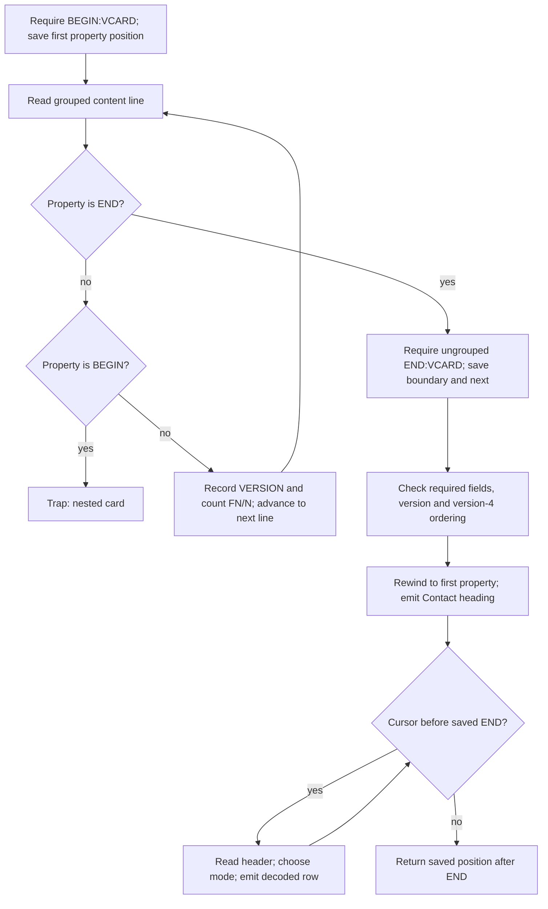
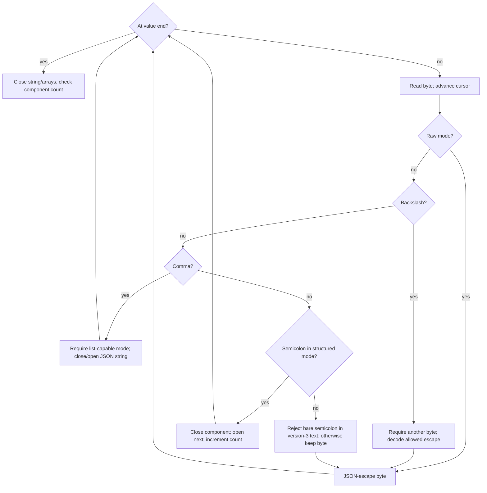

# vCard to a Markdown contact outline

`run(length)` reads one `vcard` fence in the first memory page and writes
an outline at `0x10000`, returning its length. Multiple cards become separate
`## Contact` sections. Repeated fields and their order are retained; the
heading is deliberately not derived from FN, which could contain Markdown.

Rows contain a JSON-quoted original header, a mode, and a JSON value:

- `raw`: preserve the value spelling, including URI and binary content.
- `text`: decode vCard backslash escapes into one string.
- `text-list`: an array of comma-separated decoded strings.
- `structured`: an array of components, each itself an array of strings.

Names and addresses retain multiple values within components. Organization
components each contain one string. Empty components and values survive.
Parameters, group prefixes, spelling and quotes remain in the header.
Nothing fetches a URI or renders embedded content.

The reader follows the content-line and value rules in
[vCard 4.0, RFC 6350](https://www.rfc-editor.org/rfc/rfc6350.html) and
[vCard 3.0, RFC 2426](https://www.rfc-editor.org/rfc/rfc2426.html).
Version 4 requires VERSION first and five/seven components for N/ADR;
version 3 accepts shorter structures and VERSION later. Each card requires
one VERSION and at least one FN; version 3 also requires N. Duplicate N is
rejected. This is not a complete property-cardinality or URI/date validator.

Only UTF-8 input is supported. Physical folds are removed before validating
UTF-8, using the [content-line helper](00-calendar-lines.md). LF is accepted
alongside CRLF for editing, and blank lines may separate cards. VERSION 2.1,
non-UTF-8 CHARSET and encodings other than version-3 ENCODING=b are rejected.
Encoded binary remains raw rather than being decoded. Unknown fields also
remain raw unless VALUE explicitly selects text. No information is silently
dropped just because the field is unfamiliar.

## Inside card: discover the version before interpreting values

One pass finds the closing boundary, VERSION, FN and N. It validates header
syntax but does not choose value types. This matters for a version-3 UID
before VERSION: UID is text in version 3 but defaults to a URI in version 4.
The second pass rewinds to the first property and emits rows using the
already known version. Both passes move only cursors; there is no card tree.

| State in card | First pass | Second pass |
| --- | --- | --- |
| First property, local 2 | Saved after BEGIN | Rewind point, never overwritten |
| Cursor, local 3 | Advances through every property | Advances again while emitting |
| Property start, local 4 | Excludes optional group | Used for type lookup, not header output |
| Version, local 10 | Set exactly once | Determines defaults and structure rules |
| END position, local 12 | Stops discovery | Exclusive bound for emitted rows |
| After-END position, local 13 | Saved by boundary validation | Returned to the outer card loop |

`grouped` asks `nameEnd` for the first token. If followed by a dot, that
token is a group, and `line` starts after the dot. A second dot cannot be
part of the property token and is rejected. The original start is still
available to emit `item1.EMAIL;TYPE=home` intact. Grouping does not turn
`item1.END` into an ordinary field: it is recognized, then rejected as an
invalid boundary. The END return position belongs to the caller, not to
the second emitting pass.

## Inside value: escape handling comes before separators

Each iteration consumes one byte. A backslash consumes a second byte and
converts an allowed escape; that result goes straight to JSON escaping.
It cannot fall through into the comma or semicolon decisions. An unescaped
comma starts a new list member only for a list or a name/address component.
An unescaped semicolon starts a new component only in structured mode.

For `N:Doe;Jane,Janet;;Dr.;`, semicolons produce five components; the comma
produces two strings only in the second component. `Jane\,Janet` instead
produces one string containing a comma. For ORG, each component is scalar:
an unescaped comma is rejected, not treated as an additional organization.
The closing quote is emitted even for empty values, so a final semicolon
creates a real final empty component rather than disappearing at end.

The `kind` table stores mode, version mask and a length-prefixed name.
Its parameter pass can override the default through VALUE. Duplicate VALUE,
CHARSET or ENCODING is rejected; quoted parameter values are compared without
their enclosing quotes but the original header is untouched. ENCODING=b
forces raw output regardless of parameter order. Unknown VALUE types remain
raw. The table is data, not an alternate implementation in the host.

## Bounds, framing and integration

Input is at most 64 KiB and output at most 128 KiB. The unfolded copy is moved
back to the source page before output starts, so no output can overwrite
unread input. A leading UTF-8 BOM is accepted. Source mutation is private to
the Wasm copy; the editable browser input is unchanged. Output overflow traps
before writing into literals at `0x30800` or the descriptor table at `0x30900`.

The fence scanner follows the calendar reader's bounded framing pattern,
with a five-byte label. It checks for an earlier closing-fence line before
unfolding, so a Markdown fold cannot disguise a second document. The number
of opening backticks is retained separately from source/output positions.

Imports: unfold 0, line 1, parameter 2, nameEnd 3. Functions: run 4,
emit 5, literal 6, same 7, value 8, jsonByte 9, kind 10, grouped 11,
card 12, fence 13, fenceLines 14, blank 15, boundary 16.
Only the output cursor is global. ASCII comparisons reuse the explicit
A–Z folding pattern from the calendar reader, not an unconditional OR.

`[microwasm]`

- vc-header: `0061736d 01000000`
- vc-type-section: `01 {{size:vc-types}}`
  - vc-types: `0b 60 02 7f 7f 01 7f 60 02 7f 7f 05 7f 7f 7f 7f 7f 60 02 7f 7f 03 7f 7f 7f 60 01 7f 01 7f 60 01 7f 00 60 03 7f 7f 7f 01 7f 60 04 7f 7f 7f 7f 00 60 04 7f 7f 7f 7f 01 7f 60 02 7f 7f 06 7f 7f 7f 7f 7f 7f 60 01 7f 02 7f 7f 60 03 7f 7f 7f 00`
- vc-import-section: `02 {{size:vc-imports}}`
  - vc-imports: `05 01 63 06 756e666f6c64 00 00 01 63 04 6c696e65 00 01 01 63 09 706172616d65746572 00 02 01 63 07 6e616d65456e64 00 00 01 63 06 6d656d6f7279 02 01 04 04`
- vc-function-section: `03 {{size:vc-functions}}`
  - vc-functions: `0d 03 04 04 05 06 04 07 08 00 09 0a 00 05`
- vc-global-section: `06 {{size:vc-globals}}`
  - vc-globals: `01 7f 01 41 00 0b`
- vc-export-section: `07 {{size:vc-exports}}`
  - vc-exports: `02 03 72756e 00 04 06 6d656d6f7279 02 00`
- vc-code-section: `0a {{size:vc-code}}`
  - vc-code: `0d`
    - vc-run-record: `{{size:vc-run-body}}`
      - vc-run-body: `01 03 7f 20 00 10 0d 10 00 21 01 41 00 41 808004 20 01 fc 0a 00 00 41 808004 24 00 41 86900c 10 06`
        - vc-run-bom: `20 01 41 03 4f 04 40 41 00 2d 00 00 41 ef01 46 41 01 2d 00 00 41 bb01 46 71 41 02 2d 00 00 41 bf01 46 71 04 40 41 03 21 02 0b 0b`
        - vc-run-cards: `02 40 03 40 20 02 20 01 10 0f 21 02 20 02 20 01 4f 0d 01 20 02 20 01 10 0c 21 02 20 03 41 01 6a 21 03 0c 00 0b 0b 20 03 45 04 40 00 0b 23 00 41 808004 6b 0b`
    - vc-emit-record: `{{size:vc-emit-body}}`
      - vc-emit-body: `00 23 00 41 80800c 4f 04 40 00 0b 23 00 20 00 3a 00 00 23 00 41 01 6a 24 00 0b`
    - vc-literal-record: `{{size:vc-literal-body}}`
      - vc-literal-body: `01 01 7f 20 00 20 00 2d 00 00 6a 41 01 6a 21 01 20 00 41 01 6a 21 00 02 40 03 40 20 00 20 01 4f 0d 01 20 00 2d 00 00 10 05 20 00 41 01 6a 21 00 0c 00 0b 0b 0b`
    - vc-same-record: `{{size:vc-same-body}}`
      - vc-same-body: `01 02 7f 20 01 20 00 6b 20 02 2d 00 00 47 04 40 41 00 0f 0b 20 02 41 01 6a 21 02 02 40 03 40 20 00 20 01 4f 0d 01`
        - vc-same-bytes: `20 00 2d 00 00 21 03 20 02 2d 00 00 21 04`
        - vc-same-left-case: `20 03 41 c100 6b 41 19 4d 04 40 20 03 41 20 6a 21 03 0b`
        - vc-same-right-case: `20 04 41 c100 6b 41 19 4d 04 40 20 04 41 20 6a 21 04 0b`
        - vc-same-compare: `20 03 20 04 47 04 40 41 00 0f 0b 20 00 41 01 6a 21 00 20 02 41 01 6a 21 02 0c 00 0b 0b 41 01 0b`
    - vc-value-record: `{{size:vc-value-body}}`
      - vc-value-body: `01 02 7f 41 01 21 05 20 02 41 02 4f 04 40 41 db00 10 05 0b 20 02 41 03 4f 04 40 41 db00 10 05 0b 41 22 10 05 02 40 03 40 20 00 20 01 4f 0d 01 20 00 2d 00 00 21 04 20 00 41 01 6a 21 00`
        - vc-value-text: `20 02 04 40 20 04 41 dc00 46 04 40 20 00 20 01 4f 04 40 00 0b 20 00 2d 00 00 21 04 20 00 41 01 6a 21 00`
          - vc-value-newline: `20 04 41 20 72 41 ee00 46 04 40 41 0a 21 04`
          - vc-value-escape: `05 20 04 41 dc00 46 20 04 41 3b 46 72 20 04 41 2c 46 72 45 04 40 00 0b 0b`
          - vc-value-comma: `05 20 04 41 2c 46 04 40 20 02 41 01 46 20 02 41 05 46 72 04 40 00 0b 41 22 10 05 41 2c 10 05 41 22 10 05 0c 03 0b`
          - vc-value-semicolon: `20 04 41 3b 46 04 40 20 02 41 03 4f 04 40 41 22 10 05 41 dd00 10 05 41 2c 10 05 41 db00 10 05 41 22 10 05 20 05 41 01 6a 21 05 0c 04 0b 20 03 41 03 46 04 40 00 0b 0b 0b 0b`
        - vc-value-byte: `20 04 10 09 0c 00 0b 0b 41 22 10 05 20 02 41 03 4f 04 40 41 dd00 10 05 0b 20 02 41 02 4f 04 40 41 dd00 10 05 0b`
        - vc-value-components: `20 02 41 03 46 20 02 41 04 46 72 04 40 20 02 41 02 6c 41 01 6b 21 04 20 05 20 04 4b 20 03 41 04 46 20 05 20 04 47 71 72 04 40 00 0b 0b 0b`
    - vc-json-byte-record: `{{size:vc-json-byte-body}}`
      - vc-json-byte-body: `01 01 7f 20 00 41 09 46 04 40 41 f400 21 01 0b 20 00 41 0a 46 04 40 41 ee00 21 01 0b 20 00 41 0d 46 04 40 41 f200 21 01 0b 20 01 04 40 41 dc00 10 05 20 01 10 05 0f 0b 20 00 41 22 46 20 00 41 dc00 46 72 04 40 41 dc00 10 05 0b 20 00 10 05 0b`
    - vc-kind-record: `{{size:vc-kind-body}}`
      - vc-kind-body: `01 08 7f 41 80920c 21 05 02 40 03 40 20 05 2d 00 00 45 0d 01`
        - vc-kind-mask: `20 05 2d 00 01 41 01 20 03 41 03 6b 74 71 04 40 20 00 20 01 20 05 41 02 6a 10 07 04 40 20 05 2d 00 00 21 04 0c 03 0b 0b`
        - vc-kind-table-next: `20 05 20 05 2d 00 02 6a 41 03 6a 21 05 0c 00 0b 0b 20 01 21 06`
        - vc-kind-parameters: `02 40 03 40 20 06 20 02 4f 0d 01 20 06 41 01 6a 21 06 20 06 20 02 10 02 21 09 21 08 21 07 20 09 21 0a`
          - vc-kind-unquote: `20 08 20 09 49 04 40 20 08 2d 00 00 41 22 46 04 40 20 08 41 01 6a 21 08 20 09 41 01 6b 21 0a 0b 0b`
          - vc-kind-value: `20 06 20 07 41 eb900c 10 07 04 40 20 0b 41 01 71 04 40 00 0b 20 0b 41 01 72 21 0b 20 08 20 0a 10 03 20 0a 47 04 40 00 0b`
            - vc-kind-override: `20 08 20 0a 41 f1900c 10 07 20 03 41 03 46 20 08 20 0a 41 f6900c 10 07 71 72 04 40 20 04 45 04 40 41 01 21 04 0b 05 41 00 21 04 0b 0b`
          - vc-kind-charset: `20 06 20 07 41 fc900c 10 07 04 40 20 0b 41 02 71 20 08 20 0a 41 84910c 10 07 45 72 04 40 00 0b 20 0b 41 02 72 21 0b 0b`
          - vc-kind-encoding: `20 06 20 07 41 8a910c 10 07 04 40 20 0b 41 04 71 20 03 41 03 47 72 20 08 20 0a 41 93910c 10 07 45 72 04 40 00 0b 20 0b 41 04 72 21 0b 0b`
          - vc-kind-next: `20 09 21 06 0c 00 0b 0b 20 0b 41 04 71 04 7f 41 00 05 20 04 0b 0b`
    - vc-grouped-record: `{{size:vc-grouped-body}}`
      - vc-grouped-body: `01 01 7f 20 00 20 01 10 03 21 02 20 02 20 01 49 04 40 20 02 2d 00 00 41 2e 46 04 40 20 02 41 01 6a 21 00 0b 0b 20 00 20 00 20 01 10 01 0b`
    - vc-card-record: `{{size:vc-card-body}}`
      - vc-card-body: `01 0f 7f 20 00 20 01 41 a0900c 10 10 22 02 21 03 02 40 03 40 20 03 20 01 4f 04 40 00 0b 20 03 20 01 10 0b 21 09 21 08 21 07 21 06 21 05 21 04`
        - vc-card-end: `20 04 20 05 41 a6900c 10 07 04 40 20 03 20 01 41 a6900c 10 10 21 0d 20 03 21 0c 0c 02 0b`
        - vc-card-nested: `20 04 20 05 41 a0900c 10 07 04 40 00 0b`
        - vc-card-version: `20 04 20 05 41 b0900c 10 07 04 40 20 0a 20 04 20 03 47 72 04 40 00 0b 20 07 20 08 41 b8900c 10 07 04 40 41 03 21 0a 05 20 07 20 08 41 bc900c 10 07 04 40 41 04 21 0a 05 00 0b 0b 20 03 21 0b 0b`
        - vc-card-fn: `20 04 20 05 41 c0900c 10 07 04 40 20 0e 41 01 6a 21 0e 0b`
        - vc-card-n: `20 04 20 05 41 c3900c 10 07 04 40 20 0f 41 01 6a 21 0f 0b`
        - vc-card-discover-next: `20 09 21 03 0c 00 0b 0b`
        - vc-card-required: `20 0a 45 20 0e 45 72 20 0f 41 01 4b 72 20 0a 41 03 46 20 0f 45 71 72 20 0a 41 04 46 20 0b 20 02 47 71 72 04 40 00 0b`
        - vc-card-rewind: `41 92900c 10 06 20 02 21 03 02 40 03 40 20 03 20 0c 4f 0d 01 20 03 20 0c 10 0b 21 09 21 08 21 07 21 06 21 05 21 04`
        - vc-card-mode: `20 04 20 05 20 06 20 0a 10 0a 21 10 41 2d 10 05 41 20 10 05 20 03 20 06 41 00 20 0a 10 08`
        - vc-card-mode-label: `20 10 45 04 7f 41 c5900c 05 20 10 41 01 46 04 7f 41 cb900c 05 20 10 41 02 46 04 7f 41 d2900c 05 41 de900c 0b 0b 0b 10 06`
        - vc-card-row: `20 07 20 08 20 10 20 0a 10 08 41 0a 10 05 20 09 21 03 0c 00 0b 0b 20 0d 0b`
    - vc-fence-record: `{{size:vc-fence-body}}`
      - vc-fence-body: `01 06 7f 20 00 41 0c 49 20 00 41 808004 4b 72 04 40 00 0b 02 40 03 40 20 01 20 00 4f 0d 01 20 01 2d 00 00 41 e000 47 0d 01 20 01 41 01 6a 21 01 0c 00 0b 0b 20 01 41 03 49 04 40 00 0b`
        - vc-fence-label: `20 01 20 01 41 05 6a 41 80900c 10 07 45 04 40 00 0b 20 01 41 05 6a 21 06 20 06 20 00 49 04 40 20 06 2d 00 00 41 0d 46 04 40 20 06 41 01 6a 21 06 0b 0b 20 06 20 00 4f 04 40 00 0b 20 06 2d 00 00 41 0a 47 04 40 00 0b 20 06 41 01 6a 21 02 20 00 21 03`
        - vc-fence-trim: `02 40 03 40 20 03 20 02 4d 0d 01 20 03 41 01 6b 2d 00 00 21 05 20 05 41 20 46 20 05 41 09 46 72 20 05 41 0a 46 72 20 05 41 0d 46 72 45 0d 01 20 03 41 01 6b 21 03 0c 00 0b 0b`
        - vc-fence-close: `02 40 03 40 20 03 20 02 4d 0d 01 20 03 41 01 6b 2d 00 00 41 e000 47 0d 01 20 03 41 01 6b 21 03 20 04 41 01 6a 21 04 0c 00 0b 0b 20 04 20 01 49 04 40 00 0b`
        - vc-fence-newline: `20 03 20 02 4d 04 40 00 0b 20 03 41 01 6b 22 03 2d 00 00 41 0a 47 04 40 00 0b 20 03 20 02 4b 04 40 20 03 41 01 6b 2d 00 00 41 0d 46 04 40 20 03 41 01 6b 21 03 0b 0b`
        - vc-fence-checked: `20 02 20 03 20 01 10 0e 20 02 20 03 0b`
    - vc-fence-lines-record: `{{size:vc-fence-lines-body}}`
      - vc-fence-lines-body: `01 04 7f 02 40 03 40 20 00 20 01 4f 0d 01 20 00 21 03 41 00 21 04 02 40 03 40 20 03 20 01 4f 0d 01 20 04 41 03 4f 0d 01 20 03 2d 00 00 41 20 47 0d 01 20 03 41 01 6a 21 03 20 04 41 01 6a 21 04 0c 00 0b 0b 41 00 21 05`
        - vc-fence-lines-ticks: `02 40 03 40 20 03 20 01 4f 0d 01 20 03 2d 00 00 41 e000 47 0d 01 20 03 41 01 6a 21 03 20 05 41 01 6a 21 05 0c 00 0b 0b`
        - vc-fence-lines-tail: `20 05 20 02 4f 04 40 02 40 03 40 20 03 20 01 4f 04 40 00 0b 20 03 2d 00 00 21 06 20 06 41 0a 46 04 40 00 0b 20 06 41 20 46 20 06 41 09 46 72 20 06 41 0d 46 72 45 0d 01 20 03 41 01 6a 21 03 0c 00 0b 0b 0b`
        - vc-fence-lines-next: `02 40 03 40 20 00 20 01 4f 0d 01 20 00 2d 00 00 21 06 20 00 41 01 6a 21 00 20 06 41 0a 46 0d 01 0c 00 0b 0b 0c 00 0b 0b 0b`
    - vc-blank-record: `{{size:vc-blank-body}}`
      - vc-blank-body: `00 02 40 03 40 20 00 20 01 4f 0d 01 20 00 2d 00 00 41 0a 47 0d 01 20 00 41 01 6a 21 00 0c 00 0b 0b 20 00 0b`
    - vc-boundary-record: `{{size:vc-boundary-body}}`
      - vc-boundary-body: `01 05 7f 20 00 20 01 10 01 21 07 21 06 21 05 21 04 21 03 20 03 20 04 47 20 00 20 03 20 02 10 07 45 72 20 05 20 06 41 aa900c 10 07 45 72 04 40 00 0b 20 07 0b`
- vc-data-section: `0b {{size:vc-data}}`
  - vc-data: `02`
    - vc-literal-segment: `00 41 80900c 0b {{size:vc-literals}}`
      - vc-literals:
        - vc-label-vcard: `057663617264`
        - vc-label-title: `0b2320436f6e74616374730a`
        - vc-label-contact: `0d0a232320436f6e746163740a0a`
        - vc-label-begin: `05424547494e`
        - vc-label-end: `03454e44`
        - vc-label-card: `055643415244`
        - vc-label-version: `0756455253494f4e`
        - vc-label-three: `03332e30`
        - vc-label-four: `03342e30`
        - vc-label-fn: `02464e`
        - vc-label-n: `014e`
        - vc-label-raw: `052072617720`
        - vc-label-text: `06207465787420`
        - vc-label-list: `0b20746578742d6c69737420`
        - vc-label-structured: `0c207374727563747572656420`
        - vc-label-value: `0556414c5545`
        - vc-label-text-type: `0454455854`
        - vc-label-ptext: `055054455854`
        - vc-label-charset: `0743484152534554`
        - vc-label-utf8: `055554462d38`
        - vc-label-encoding: `08454e434f44494e47`
        - vc-label-binary: `0162`
    - vc-table-segment: `00 41 80920c 0b {{size:vc-table}}`
      - vc-table:
        - vc-property-version: `01030756455253494f4e`
        - vc-property-fn: `010302464e`
        - vc-property-email: `010305454d41494c`
        - vc-property-title: `0103055449544c45`
        - vc-property-role: `010304524f4c45`
        - vc-property-note: `0103044e4f5445`
        - vc-property-prodid: `01030650524f444944`
        - vc-property-nickname: `0203084e49434b4e414d45`
        - vc-property-categories: `02030a43415445474f52494553`
        - vc-property-n: `0303014e`
        - vc-property-adr: `040303414452`
        - vc-property-org: `0503034f5247`
        - vc-property-kind: `0102044b494e44`
        - vc-property-xml: `010203584d4c`
        - vc-property-tz: `010202545a`
        - vc-property-uid: `010103554944`
        - vc-property-key: `0101034b4559`
        - vc-property-label: `0101054c4142454c`
        - vc-property-mailer: `0101064d41494c4552`
        - vc-property-sort: `01010b534f52542d535452494e47`
        - vc-property-class: `010105434c415353`
        - vc-property-name: `0101044e414d45`
        - vc-property-profile: `01010750524f46494c45`
        - vc-table-end: `00`
