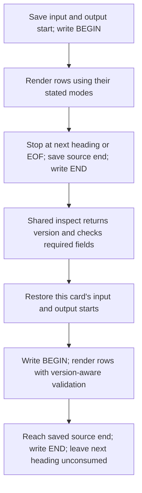
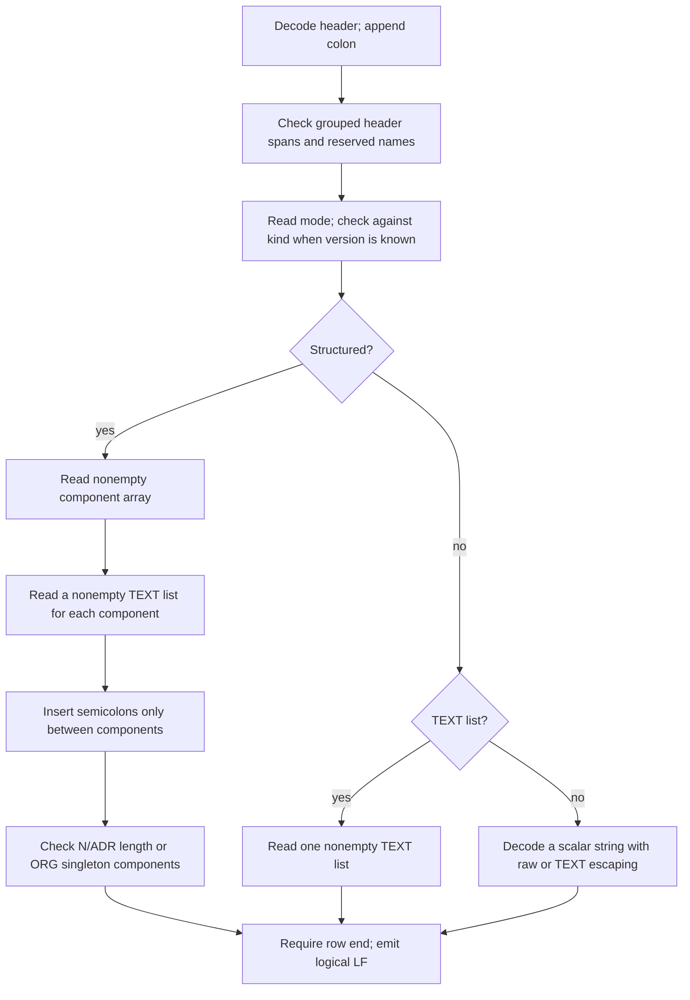

# Markdown contact outline to vCard

Tool 37 writes the [contact reader's](36-vcard-to-contacts.md) rows back to
a `vcard` fenced block. Contact headings separate cards; properties are flat
rows within each contact, not nested under an extra object marker.
The top `# Contacts` heading is optional. Multiple contacts retain their order.

```text
## Contact

- "VERSION" text "4.0"
- "FN" text "Jane Doe"
- "N" structured [["Doe"],["Jane","Janet"],[""],["Dr."],[""]]
- "item1.EMAIL;TYPE=home" text "jane@example.com"
- "ORG" structured [["Example, Inc."],["Research"]]
- "NICKNAME" text-list ["Jane","JJ"]
```

Each row has a JSON-quoted header, a mode, and its JSON value. The header's
spelling, group, parameter quotes and caret escapes survive. Mode labels and
headings are case-insensitive. An optional title must be followed by a line
ending; contact headings are exactly `## Contact`, apart from case and
trailing spaces/tabs. Blank lines are allowed, but rows cannot be indented
or split over physical lines. JSON escapes represent newlines in values.

## Values, delimiters and version rules

The modes describe the data, not permission to bypass the property's rules:

- `raw` takes one string. Backslashes, commas and semicolons remain literal;
  physical LF/CR is rejected.
- `text` takes one string. Backslash, comma and semicolon are escaped; LF
  becomes backslash plus n. Escaping semicolons is also safe in version 4,
  where they may sometimes be written bare.
- `text-list` takes a nonempty array of strings. The writer escapes each
  member before inserting the commas that separate them.
- `structured` takes a nonempty array of nonempty string arrays. It inserts
  semicolons between components and commas between values within a component.
  N and ADR allow multiple values in a component; ORG permits only one.

There is no representation-preserving serialization for an empty list:
`[]` would read back as `[""]`. Use the latter explicitly. N has at most
five components and ADR seven; version 4 requires the exact count, while
version 3 accepts shorter structures. Empty final components are retained.

The reader's shared field-type decision checks each mode against the default
or explicit VALUE parameter. Version 3 can place VERSION after earlier
properties; version 4 requires it first. The same required-field and boundary
checks apply in both directions. Unsupported legacy encodings and malformed
headers fail, rather than being silently removed. This is not a complete
property-cardinality, URI or date validator. External destinations remain data.

JSON strings decode through the existing code-unit iterator. A small scalar
helper combines surrogate pairs before UTF-8 encoding; lone surrogates and
forbidden controls fail. TAB is allowed; CR and DEL are rejected. No host
JSON parser, vCard library, environment or network operation runs the tool.

These conventions follow [RFC 6350](https://www.rfc-editor.org/rfc/rfc6350.html)
and [RFC 2426](https://www.rfc-editor.org/rfc/rfc2426.html). Output uses CRLF
content lines, folded at 75 octets including continuation whitespace, never
inside a UTF-8 character. The outer Markdown fence is longer than any
backtick run. HTML textareas normalize CRLF to LF; the actual Wasm bytes
retain CRLF, and both forms can be read back.

## Inside card: discover once, rewind only this card

The first pass renders logical lines from the row modes without selecting a
version. Its decoded VERSION can therefore be found even when it uses JSON
escapes or occurs after UID. `inspect`, shared with the reader, checks the
result's boundaries and required fields and returns the version.

The second pass resets this card's output cursor, not the whole document,
and rereads the same immutable source with that version. Now every property
mode and component count can be checked against the shared rules. The first
pass is never published separately.



| Card local | Kept across the rewind | Why |
| --- | --- | --- |
| 0, source start | First row/blank line after the heading | No decoded row tree needed |
| 1, output start | Position before this card's BEGIN | Earlier cards are untouched |
| 2, source end | Next heading or EOF | The second pass cannot consume another card |
| 3, version | 3 or 4 from the shared inspector | Header defaults and component counts |

This trades a second linear pass for a constant-space implementation. It
does not store a table of row modes, copied strings or JSON objects. The
reader's `same`, `kind`, `grouped` and `inspect` exports do not write memory.

## Inside property: validate the decoded header

First write the decoded header and an explicit colon. The shared grouped
content-line scanner must find that exact colon: its header end must match
the saved end, and its value start and next position must match the current
output cursor. An injected colon outside quoted parameters fails this check.
BEGIN and END, including grouped spellings, are reserved for the headings.

The row mode then chooses a scalar, a list, or a list of components. During
the checked pass the shared kind maps N, ADR and ORG to distinct internal
kinds, all represented by the single `structured` label in Markdown.



A data comma is emitted by the JSON decoder as backslash-comma. A separator
comma is emitted only by `list`, after consuming the JSON comma between two
strings. Similarly, only the outer structured loop writes an unescaped
semicolon. An array with a trailing comma tries to consume another string
and fails; it cannot silently create an empty value.

## Pattern: scalar decoding and backward folding

The JSON scalar, UTF-8, whitespace and folding helpers are visibly copied
from [the calendar writer](35-agenda-to-ical.md). The function indices stay
aligned so their instruction bytes can be compared directly. The contact
writer changes the framing label and its length, not the folding algorithm.

Logical output occupies `0x10000..0x30000`. Input remains unchanged in the
first page. The reader's literals/table occupy part of the fourth page; this
writer's length-prefixed literals start at `0x30c00`. Fold offsets start at
`0x31000`, with at most 4096 entries. The final folded and fenced output must
still fit 128 KiB. All writes are bounded; a failed run publishes nothing.

The folding pass records only fold offsets. It counts ordinary LF bytes
without recording them, measures UTF-8 character widths and the longest
backtick run, then checks the entire expanded size before moving bytes.
Backward copying safely adds CR before every LF and CRLF-space at recorded
folds. The framing overhead is twice the fence length plus eight bytes:
five for `vcard` and three LFs. See the calendar writer's state table and
backward-expansion walkthrough for the shared algorithm.

## Module

Imports: JSON next 0; reader grouped 1, inspect 2, same 3, kind 4.
Definitions: run 5, emit 6, literal 7, scalar 8, UTF-8 9, JSON string 10,
take 11, spaces 12, lineEnd 13, heading 14, card 15, property 16,
list 17, frame 18, blank 19.
Globals: output cursor 0, input cursor 1, input end 2.

`[microwasm]`

- vw-header: `0061736d 01000000`
- vw-type-section: `01 {{size:vw-types}}`
  - vw-types: `09 60 03 7f 7f 7f 03 7f 7f 7f 60 02 7f 7f 06 7f 7f 7f 7f 7f 7f 60 02 7f 7f 04 7f 7f 7f 7f 60 03 7f 7f 7f 01 7f 60 01 7f 01 7f 60 01 7f 00 60 02 7f 7f 02 7f 7f 60 00 00 60 04 7f 7f 7f 7f 01 7f`
- vw-import-section: `02 {{size:vw-imports}}`
  - vw-imports: `06 01 6b 04 6e657874 00 00 01 76 07 67726f75706564 00 01 01 76 07 696e7370656374 00 02 01 76 04 73616d65 00 03 01 76 04 6b696e64 00 08 01 76 06 6d656d6f7279 02 01 04 04`
- vw-function-section: `03 {{size:vw-functions}}`
  - vw-functions: `0f 04 05 05 06 05 05 05 07 07 07 07 05 04 07 07`
- vw-global-section: `06 {{size:vw-globals}}`
  - vw-globals: `03 7f 01 41 00 0b 7f 01 41 00 0b 7f 01 41 00 0b`
- vw-export-section: `07 {{size:vw-exports}}`
  - vw-exports: `02 03 72756e 00 05 06 6d656d6f7279 02 00`
- vw-code-section: `0a {{size:vw-code}}`
  - vw-code: `0f`
    - vw-run-record: `{{size:vw-run-body}}`
      - vw-run-body: `01 01 7f 20 00 41 808004 4b 04 40 00 0b 20 00 24 02 41 00 24 01 41 808004 24 00 10 13`
        - vw-run-title: `23 02 23 01 6b 41 0a 4f 04 40 23 01 23 01 41 0a 6a 41 80980c 10 03 04 40 23 01 41 0a 6a 24 01 10 0d 10 13 0b 0b`
        - vw-run-cards: `02 40 03 40 23 01 23 02 4f 0d 01 10 0e 10 0f 20 01 41 01 6a 21 01 10 13 0c 00 0b 0b 20 01 45 04 40 00 0b 10 12 23 00 41 808004 6b 0b`
    - vw-emit-record: `{{size:vw-emit-body}}`
      - vw-emit-body: `00 23 00 41 80800c 4f 04 40 00 0b 23 00 20 00 3a 00 00 23 00 41 01 6a 24 00 0b`
    - vw-literal-record: `{{size:vw-literal-body}}`
      - vw-literal-body: `01 01 7f 20 00 20 00 2d 00 00 6a 41 01 6a 21 01 20 00 41 01 6a 21 00 02 40 03 40 20 00 20 01 4f 0d 01 20 00 2d 00 00 10 06 20 00 41 01 6a 21 00 0c 00 0b 0b 0b`
    - vw-scalar-record: `{{size:vw-scalar-body}}`
      - vw-scalar-body: `01 04 7f`
        - vw-scalar-first: `20 00 20 01 41 00 10 00 21 02 21 04 21 03`
        - vw-scalar-end: `20 03 41 7f 46 04 40 00 0b`
        - vw-scalar-high: `20 03 41 80b003 6b 41 ff07 4d 04 40`
          - vw-scalar-second: `20 04 20 01 20 02 10 00 21 02 21 04 21 05`
          - vw-scalar-low: `20 05 41 80b803 6b 41 ff07 4b 04 40 00 0b`
          - vw-scalar-pair: `20 03 41 80b003 6b 41 0a 74 20 05 41 80b803 6b 6a 41 808004 6a 21 03 0b`
        - vw-scalar-lone: `20 03 41 80b003 6b 41 ff0f 4d 04 40 00 0b 20 03 20 04 0b`
    - vw-utf8-record: `{{size:vw-utf8-body}}`
      - vw-utf8-body: `00`
        - vw-utf8-ascii: `20 00 41 8001 49 04 40 20 00 10 06 0f 0b`
        - vw-utf8-two: `20 00 41 8010 49 04 40 20 00 41 06 76 41 c001 72 10 06`
          - vw-utf8-more: `05 20 00 41 808004 49 04 40 20 00 41 0c 76 41 e001 72 10 06`
            - vw-utf8-four: `05 20 00 41 12 76 41 f001 72 10 06 20 00 41 0c 76 41 3f 71 41 8001 72 10 06 0b`
          - vw-utf8-middle: `20 00 41 06 76 41 3f 71 41 8001 72 10 06 0b`
        - vw-utf8-last: `20 00 41 3f 71 41 8001 72 10 06 0b`
    - vw-json-record: `{{size:vw-json-body}}`
      - vw-json-body: `01 02 7f 41 22 10 0b 03 40`
        - vw-json-bound: `23 01 23 02 4f 04 40 00 0b`
        - vw-json-close: `23 01 2d 00 00 41 22 46 04 40 23 01 41 01 6a 24 01 0f 0b`
        - vw-json-scalar: `23 01 23 02 10 08 24 01 21 01`
        - vw-json-controls: `20 01 41 20 49 20 01 41 09 47 71 20 01 41 0a 47 71 20 01 41 ff00 46 72 04 40 00 0b`
        - vw-json-newline: `20 01 41 0a 46 04 40 20 00 45 04 40 00 0b 41 dc00 10 06 41 ee00 10 06 0c 01 0b`
        - vw-json-escape: `20 00 20 01 41 dc00 46 20 01 41 2c 46 72 20 01 41 3b 46 72 71 04 40 41 dc00 10 06 0b`
        - vw-json-emit: `20 01 10 09 0c 00 0b 00 0b`
    - vw-take-record: `{{size:vw-take-body}}`
      - vw-take-body: `00 23 01 23 02 4f 04 40 00 0b 23 01 2d 00 00 20 00 47 04 40 00 0b 23 01 41 01 6a 24 01 0b`
    - vw-spaces-record: `{{size:vw-spaces-body}}`
      - vw-spaces-body: `01 01 7f 02 40 03 40 23 01 23 02 4f 0d 01 23 01 2d 00 00 21 00 20 00 41 20 46 20 00 41 09 46 72 45 0d 01 23 01 41 01 6a 24 01 0c 00 0b 0b 0b`
    - vw-line-end-record: `{{size:vw-line-end-body}}`
      - vw-line-end-body: `00 10 0c 23 01 23 02 46 04 40 0f 0b 23 01 2d 00 00 41 0d 46 04 40 23 01 41 01 6a 24 01 0b 41 0a 10 0b 0b`
    - vw-heading-record: `{{size:vw-heading-body}}`
      - vw-heading-body: `00 23 02 23 01 6b 41 0a 49 04 40 00 0b 23 01 23 01 41 0a 6a 41 8b980c 10 03 45 04 40 00 0b 23 01 41 0a 6a 24 01 10 0d 0b`
    - vw-card-record: `{{size:vw-card-body}}`
      - vw-card-body: `01 04 7f 23 01 21 00 23 00 21 01 41 96980c 10 07`
        - vw-card-discover: `02 40 03 40 10 13 23 01 23 02 4f 0d 01 23 01 2d 00 00 41 23 46 0d 01 41 00 10 10 0c 00 0b 0b`
        - vw-card-inspect: `23 01 21 02 41 a3980c 10 07 20 01 23 00 10 02 21 03 23 00 47 04 40 00 0b 1a 1a`
        - vw-card-rewind: `20 00 24 01 20 01 24 00 41 96980c 10 07`
        - vw-card-checked: `02 40 03 40 10 13 23 01 20 02 4f 0d 01 20 03 10 10 0c 00 0b 0b 41 a3980c 10 07 0b`
    - vw-property-record: `{{size:vw-property-body}}`
      - vw-property-body: `01 0e 7f 41 2d 10 0b 41 20 10 0b 23 00 21 01 41 00 10 0a 23 00 21 02 41 3a 10 06`
        - vw-property-header: `20 01 23 00 10 01 21 08 21 07 21 06 21 05 21 04 21 03`
        - vw-property-bound: `20 05 20 02 47 20 06 23 00 47 72 20 08 23 00 47 72 04 40 00 0b`
        - vw-property-reserved: `20 03 20 04 41 cc980c 10 03 20 03 20 04 41 d2980c 10 03 72 04 40 00 0b`
        - vw-property-mode-start: `41 20 10 0b 23 01 21 09 02 40 03 40 23 01 23 02 4f 0d 01 23 01 2d 00 00 41 20 46 0d 01 23 01 41 01 6a 24 01 0c 00 0b 0b`
        - vw-property-mode: `20 09 23 01 41 ae980c 10 03 04 7f 41 00 05 20 09 23 01 41 b2980c 10 03 04 7f 41 01 05 20 09 23 01 41 b7980c 10 03 04 7f 41 02 05 20 09 23 01 41 c1980c 10 03 45 04 40 00 0b 41 03 0b 0b 0b 21 0a`
        - vw-property-kind: `20 00 04 40 20 03 20 04 20 05 20 00 10 04 22 0b 41 03 4f 04 7f 41 03 05 20 0b 0b 20 0a 47 04 40 00 0b 0b 41 20 10 0b 10 0c`
        - vw-property-structured: `20 0a 41 03 46 04 40 41 db00 10 0b 10 0c 02 40 03 40 20 0b 41 05 46 10 11 1a 20 0c 41 01 6a 21 0c 10 0c`
          - vw-property-structure-end: `23 01 23 02 4f 04 40 00 0b 23 01 2d 00 00 41 dd00 46 0d 01`
          - vw-property-structure-next: `41 2c 10 0b 10 0c 41 3b 10 06 0c 00 0b 0b 41 dd00 10 0b`
          - vw-property-count: `20 0b 41 03 46 20 0b 41 04 46 72 04 40 20 0b 41 02 6c 41 01 6b 21 0e 20 0c 20 0e 4b 20 00 41 04 46 20 0c 20 0e 47 71 72 04 40 00 0b 0b`
        - vw-property-list: `05 20 0a 41 02 46 04 40 41 00 10 11 1a`
        - vw-property-scalar: `05 20 0a 10 0a 0b 0b 10 0d 41 0a 10 06 0b`
    - vw-list-record: `{{size:vw-list-body}}`
      - vw-list-body: `01 01 7f 41 db00 10 0b 10 0c 02 40 03 40 41 01 10 0a 20 01 41 01 6a 21 01 10 0c`
        - vw-list-end: `23 01 23 02 4f 04 40 00 0b 23 01 2d 00 00 41 dd00 46 0d 01`
        - vw-list-next: `20 00 04 40 00 0b 41 2c 10 0b 10 0c 41 2c 10 06 0c 00 0b 0b 41 dd00 10 0b 20 01 0b`
    - vw-frame-record: `{{size:vw-frame-body}}`
      - vw-frame-body: `01 0c 7f 23 00 41 808004 6b 21 06 41 808004 21 00 02 40 03 40 20 00 23 00 4f 0d 01 20 00 2d 00 00 21 07`
        - vw-frame-newline: `20 07 41 0a 46 04 40 20 04 41 01 6a 21 04 41 00 21 01 41 00 21 02 20 00 41 01 6a 21 00 0c 01 0b`
        - vw-frame-ticks: `20 07 41 e000 46 04 40 20 02 41 01 6a 21 02 20 02 20 03 4b 04 40 20 02 21 03 0b 05 41 00 21 02 0b`
        - vw-frame-width: `41 01 21 08 20 07 41 c001 4f 04 40 41 02 21 08 20 07 41 e001 4f 04 40 41 03 21 08 0b 20 07 41 f001 4f 04 40 41 04 21 08 0b 0b`
        - vw-frame-fold: `20 01 20 08 6a 41 cb00 4b 04 40 20 05 41 8020 4f 04 40 00 0b 41 80a00c 20 05 41 02 74 6a 20 00 36 02 00 20 05 41 01 6a 21 05 41 01 21 01 0b`
        - vw-frame-next: `20 01 20 08 6a 21 01 20 00 20 08 6a 21 00 0c 00 0b 0b`
        - vw-frame-fence-size: `20 03 41 01 6a 21 03 20 03 41 03 49 04 40 41 03 21 03 0b`
        - vw-frame-size: `41 808004 20 03 6a 41 06 6a 20 06 6a 20 04 6a 20 05 41 03 6c 6a 21 0a 20 0a 20 03 6a 41 02 6a 41 80800c 4b 04 40 00 0b`
        - vw-frame-back-start: `20 0a 21 09 41 808004 20 06 6a 21 00 02 40 03 40 20 00 41 808004 4d 0d 01`
          - vw-frame-back-fold: `20 05 04 40 41 80a00c 20 05 41 01 6b 41 02 74 6a 28 02 00 20 00 46 04 40`
            - vw-frame-back-space: `20 09 41 01 6b 22 09 41 20 3a 00 00`
            - vw-frame-back-lf: `20 09 41 01 6b 22 09 41 0a 3a 00 00`
            - vw-frame-back-cr: `20 09 41 01 6b 22 09 41 0d 3a 00 00 20 05 41 01 6b 21 05 0b 0b`
          - vw-frame-back-byte: `20 00 41 01 6b 22 00 2d 00 00 21 07 20 09 41 01 6b 22 09 20 07 3a 00 00`
          - vw-frame-back-newline: `20 07 41 0a 46 04 40 20 09 41 01 6b 22 09 41 0d 3a 00 00 0b 0c 00 0b 0b`
        - vw-frame-back-check: `20 05 20 09 41 808004 20 03 6a 41 06 6a 47 72 04 40 00 0b`
        - vw-frame-prefix: `41 808004 24 00 03 40 41 e000 10 06 20 0b 41 01 6a 22 0b 20 03 49 0d 00 0b 41 d6980c 10 07`
        - vw-frame-suffix: `20 0a 24 00 41 0a 10 06 41 00 21 0b 03 40 41 e000 10 06 20 0b 41 01 6a 22 0b 20 03 49 0d 00 0b 41 0a 10 06 0b`
    - vw-blank-record: `{{size:vw-blank-body}}`
      - vw-blank-body: `01 01 7f 03 40 23 01 21 00 10 0c 23 01 23 02 46 04 40 0f 0b 23 01 2d 00 00 41 0a 46 23 01 2d 00 00 41 0d 46 72 04 40 10 0d 0c 01 0b 20 00 24 01 0b 0b`
- vw-data-section: `0b {{size:vw-data}}`
  - vw-data: `01 00 41 80980c 0b {{size:vw-literals}}`
    - vw-literals:
      - vw-title: `0a2320436f6e7461637473`
      - vw-heading: `0a232320436f6e74616374`
      - vw-begin-line: `0c424547494e3a56434152440a`
      - vw-end-line: `0a454e443a56434152440a`
      - vw-raw: `03726177`
      - vw-text: `0474657874`
      - vw-text-list: `09746578742d6c697374`
      - vw-structured: `0a73747275637475726564`
      - vw-begin: `05424547494e`
      - vw-end: `03454e44`
      - vw-fence: `0676636172640a`
