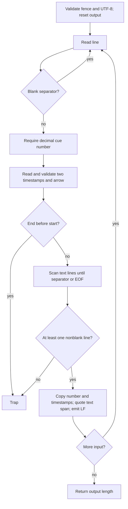
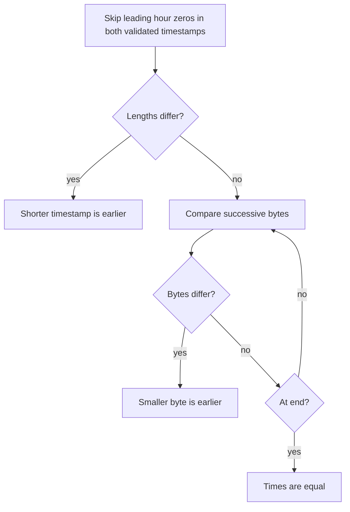

# SubRip subtitles to a Markdown cue list

Tool 38 reads one `srt` fenced block and emits a flat list: cue number,
start timestamp, arrow, end timestamp, then JSON-quoted text. There is no
root marker, extra heading or child object for each cue.

```srt
1
00:00:01,000 --> 00:00:03,250
Hello, world!
Second line.

2
00:00:03,000 --> 00:00:05,000
<i>Overlapping subtitles</i>
```

becomes:

```text
- 1 00:00:01,000 --> 00:00:03,250 "Hello, world!\nSecond line."
- 2 00:00:03,000 --> 00:00:05,000 "<i>Overlapping subtitles</i>"
```

The layout follows the numbered timestamp/text blocks described by
[Matroska](https://www.matroska.org/technical/subtitles.html#srt-subtitles)
and the [Library of Congress](https://www.loc.gov/preservation/digital/formats/fdd/fdd000569.shtml).
SubRip has no single encoding standard. This tool accepts UTF-8, optionally
with a BOM at the beginning of the fenced data; it does not guess a legacy
encoding. LF, CRLF and bare CR line endings normalize to LF inside the quoted
text. Malformed UTF-8 and controls other than TAB and line endings fail.

## What survives, and what is deliberately not interpreted

Cue numbers are nonempty decimal digit strings, including zero and leading
zeros. They are not renumbered or required to be unique. Hours have at least
two digits and no numeric-size limit beyond the input bound. Minutes/seconds
have two digits in 00..59; milliseconds have exactly three digits after the
comma. The source spelling of each number and timestamp is retained.

Spaces or tabs may surround cue numbers and the timestamp line, and at least
one separates each timestamp from `-->`. Surrounding timing whitespace is
normalized. The end cannot precede its start, but equal times, overlaps and
out-of-order cues are preserved. No floating-point or millisecond conversion
is needed to compare timestamps.

Each cue must have at least one nonblank text line. Empty or space/tab-only
lines separate cues. Nonblank text lines retain their leading/trailing spaces
and tabs; only their physical line endings normalize. Multiple separators
are ignored. An empty fenced document becomes empty Markdown. Unsupported
timing suffixes, including coordinate extensions, fail instead of disappearing.
Formatting tags, entities, backslashes, URLs and timestamp-looking text remain
literal cue text. Nothing plays media, interprets tags, fetches or navigates.

The opening fence is at least three backticks followed by `srt`, without
indentation or extra metadata. A closing fence at column zero has at least
as many backticks. The fence may be longer to surround literal backtick
lines in cue text. An earlier line that would close the fence in a generic
Markdown renderer is rejected, even with up to three leading spaces.

## Inside run: header spans and a text span instead of a cue object

The outer loop skips separators, reads a number line, then a timing line.
The text loop stops before the next separator. It retains only the beginning
of the text and the end of the last nonblank line, not a list of text lines.
The outer loop consumes that separator on its next iteration.



| Run locals | Meaning | Retained while scanning text |
| --- | --- | --- |
| 1 / 2 | Input cursor / body end | Cursor advances, end stays fixed |
| 3 / 4 | Number start / end | Both stay fixed |
| 5 / 6 | Start timestamp span | Both stay fixed |
| 7 / 8 | End timestamp span | Both stay fixed |
| 9 / 10 | Text start / last content end | Only the end grows |
| 11 / 12 | Current line end / next line | Reused for each physical line |
| 13 | Number of nonblank text lines | Distinguishes missing text from empty input |

The `line` helper returns two positions: content end and the next line's
start. They differ by one for LF or CR, and by two for CRLF. An unterminated
last line ends at the supplied bound. That distinction keeps the final
line ending out of the text without losing line endings between text lines.

## Inside timestamp: syntax first, then exact ordering

`digits` scans the hours without accumulation. The timestamp helper requires
two or more hour digits, checks the three delimiters, and walks the seven
remaining digits. The minute and second tens positions have a tighter bound
of five. It returns immediately after the third millisecond digit; its caller
is responsible for what may follow.

`notAfter` skips leading hour zeros, compares the remaining span lengths,
then compares equal-length spans byte by byte. Everything after the hours
has fixed width and identical delimiter positions, so lexical order is time
order. Even hours longer than an i64 remain exact.



For `0000:59:59,999` and `01:00:00,000`, normalization leaves
`:59:59,999` and `1:00:00,000`; the shorter span is earlier. For equal hours,
the first differing minute, second or millisecond digit decides. Original
spans remain unchanged and are the spans written to Markdown.

## Quoting and bounds

The whole body is UTF-8-validated by the shared read-only helper before the
cue scan. `line` rejects forbidden controls. Consequently the JSON writer
can copy ordinary bytes without re-decoding each Unicode scalar. It escapes
quotes, backslashes and TAB, and writes one backslash-n for any physical line
ending. CRLF is consumed together, not turned into two newlines.

Input is at most 64 KiB; output occupies `0x10000..0x30000`, at most 128 KiB.
No scratch writes, data segment, tree or host parser is needed. Every output
byte passes through the bounded emitter. A failed run may have written a
prefix but does not return success; the UI retains its previous output.
Calling again resets the output cursor. The original input remains unchanged.

The exported read-only span helpers are reusable by the reverse writer:
`line(start,end) -> (contentEnd,next)`, `timestamp(start,end) -> next`,
`digits(start,end) -> next`, `notAfter(aStart,aEnd,bStart,bEnd) -> bool`, and
`spaces(start,end) -> next`. Timestamp comparison expects already validated
timestamp spans. Span checks permit the source/output region through `0x30000`.

## Module

Import: UTF-8 validation 0 and four-page memory from `c`.
Functions: run 1, emit 2, copy 3, JSON text 4, line 5, timestamp 6,
digits 7, notAfter 8, fence 9, fenceLines 10, spaces 11, bounds 12.
The only global is the output cursor.

`[microwasm]`

- sr-header: `0061736d 01000000`
- sr-type-section: `01 {{size:sr-types}}`
  - sr-types: `08 60 02 7f 7f 00 60 01 7f 01 7f 60 01 7f 00 60 02 7f 7f 02 7f 7f 60 02 7f 7f 01 7f 60 04 7f 7f 7f 7f 01 7f 60 01 7f 02 7f 7f 60 03 7f 7f 7f 00`
- sr-import-section: `02 {{size:sr-imports}}`
  - sr-imports: `02 01 63 04 75746638 00 00 01 63 06 6d656d6f7279 02 01 04 04`
- sr-function-section: `03 {{size:sr-functions}}`
  - sr-functions: `0c 01 02 00 00 03 04 04 05 06 07 04 00`
- sr-global-section: `06 {{size:sr-globals}}`
  - sr-globals: `01 7f 01 41 00 0b`
- sr-export-section: `07 {{size:sr-exports}}`
  - sr-exports: `07 03 72756e 00 01 06 6d656d6f7279 02 00 04 6c696e65 00 05 09 74696d657374616d70 00 06 06 646967697473 00 07 08 6e6f744166746572 00 08 06 737061636573 00 0b`
- sr-code-section: `0a {{size:sr-code}}`
  - sr-code: `0c`
    - sr-run-record: `{{size:sr-run-body}}`
      - sr-run-body: `01 0d 7f 20 00 10 09 21 02 21 01 20 01 20 02 10 00 41 808004 24 00`
        - sr-run-bom: `20 02 20 01 6b 41 03 4f 04 40 20 01 2d 00 00 41 ef01 46 20 01 2d 00 01 41 bb01 46 71 20 01 2d 00 02 41 bf01 46 71 04 40 20 01 41 03 6a 21 01 0b 0b`
        - sr-run-loop: `02 40 03 40 20 01 20 02 4f 0d 01 20 01 20 02 10 05 21 0c 21 0b 20 01 20 0b 10 0b 21 03`
          - sr-run-separator: `20 03 20 0b 46 04 40 20 0c 21 01 0c 01 0b`
          - sr-run-number: `20 03 20 0b 10 07 22 04 20 0b 10 0b 20 0b 47 04 40 00 0b 20 0c 21 01`
          - sr-run-timing: `20 01 20 02 10 05 21 0c 21 0b 20 01 20 0b 10 0b 22 05 20 0b 10 06 21 06 20 06 20 0b 10 0b 22 01 20 06 46 04 40 00 0b`
          - sr-run-arrow: `20 0b 20 01 6b 41 03 49 04 40 00 0b 20 01 2d 00 00 41 2d 47 20 01 2d 00 01 41 2d 47 72 20 01 2d 00 02 41 3e 47 72 04 40 00 0b 20 01 41 03 6a 21 01`
          - sr-run-end-time: `20 01 20 0b 10 0b 22 07 20 01 46 04 40 00 0b 20 07 20 0b 10 06 22 08 20 0b 10 0b 20 0b 47 04 40 00 0b`
          - sr-run-order: `20 05 20 06 20 07 20 08 10 08 45 04 40 00 0b 20 0c 22 01 22 09 21 0a 41 00 21 0d`
          - sr-run-text: `02 40 03 40 20 01 20 02 4f 0d 01 20 01 20 02 10 05 21 0c 21 0b 20 01 20 0b 10 0b 20 0b 46 0d 01 20 0b 21 0a 20 0c 21 01 20 0d 41 01 6a 21 0d 0c 00 0b 0b 20 0d 45 04 40 00 0b`
          - sr-run-row: `41 2d 10 02 41 20 10 02 20 03 20 04 10 03 41 20 10 02 20 05 20 06 10 03 41 20 10 02 41 2d 10 02 41 2d 10 02 41 3e 10 02 41 20 10 02 20 07 20 08 10 03 41 20 10 02 20 09 20 0a 10 04 41 0a 10 02 0c 00 0b 0b 23 00 41 808004 6b 0b`
    - sr-emit-record: `{{size:sr-emit-body}}`
      - sr-emit-body: `00 23 00 41 80800c 4f 04 40 00 0b 23 00 20 00 3a 00 00 23 00 41 01 6a 24 00 0b`
    - sr-copy-record: `{{size:sr-copy-body}}`
      - sr-copy-body: `00 02 40 03 40 20 00 20 01 4f 0d 01 20 00 2d 00 00 10 02 20 00 41 01 6a 21 00 0c 00 0b 0b 0b`
    - sr-json-record: `{{size:sr-json-body}}`
      - sr-json-body: `01 01 7f 41 22 10 02 02 40 03 40 20 00 20 01 4f 0d 01 20 00 2d 00 00 21 02 20 00 41 01 6a 21 00`
        - sr-json-cr: `20 02 41 0d 46 04 40 20 00 20 01 49 04 40 20 00 2d 00 00 41 0a 46 04 40 20 00 41 01 6a 21 00 0b 0b 41 0a 21 02 0b`
        - sr-json-line: `20 02 41 0a 46 04 40 41 dc00 10 02 41 ee00 10 02 0c 01 0b`
        - sr-json-tab: `20 02 41 09 46 04 40 41 dc00 10 02 41 f400 10 02 0c 01 0b`
        - sr-json-escape: `20 02 41 22 46 20 02 41 dc00 46 72 04 40 41 dc00 10 02 0b 20 02 10 02 0c 00 0b 0b 41 22 10 02 0b`
    - sr-line-record: `{{size:sr-line-body}}`
      - sr-line-body: `01 02 7f 20 00 20 01 10 0c 20 00 21 02 02 40 03 40 20 02 20 01 4f 0d 01 20 02 2d 00 00 21 03`
        - sr-line-lf: `20 03 41 0a 46 04 40 20 02 20 02 41 01 6a 0f 0b`
        - sr-line-cr: `20 03 41 0d 46 04 40 20 02 41 01 6a 21 03 20 03 20 01 49 04 40 20 03 2d 00 00 41 0a 46 04 40 20 03 41 01 6a 21 03 0b 0b 20 02 20 03 0f 0b`
        - sr-line-controls: `20 03 41 20 49 20 03 41 09 47 71 20 03 41 ff00 46 72 04 40 00 0b 20 02 41 01 6a 21 02 0c 00 0b 0b 20 01 20 01 0b`
    - sr-timestamp-record: `{{size:sr-timestamp-body}}`
      - sr-timestamp-body: `01 03 7f 20 00 20 01 10 07 21 02 20 02 20 00 6b 41 02 49 20 01 20 02 6b 41 0a 49 72 04 40 00 0b`
        - sr-time-delimiters: `20 02 2d 00 00 41 3a 47 20 02 2d 00 03 41 3a 47 72 20 02 2d 00 06 41 2c 47 72 04 40 00 0b 41 01 21 03`
        - sr-time-digits: `02 40 03 40 20 03 41 0a 4f 0d 01 20 03 41 03 46 20 03 41 06 46 72 04 40 05 20 02 20 03 6a 2d 00 00 41 30 6b 21 04 20 04 41 09 4b 04 40 00 0b`
          - sr-time-tens: `20 03 41 01 46 20 03 41 04 46 72 20 04 41 05 4b 71 04 40 00 0b 0b 20 03 41 01 6a 21 03 0c 00 0b 0b 20 02 41 0a 6a 0b`
    - sr-digits-record: `{{size:sr-digits-body}}`
      - sr-digits-body: `01 01 7f 20 00 20 01 10 0c 20 00 21 02 02 40 03 40 20 00 20 01 4f 0d 01 20 00 2d 00 00 41 30 6b 41 09 4b 0d 01 20 00 41 01 6a 21 00 0c 00 0b 0b 20 00 20 02 46 04 40 00 0b 20 00 0b`
    - sr-not-after-record: `{{size:sr-not-after-body}}`
      - sr-not-after-body: `01 02 7f 20 00 20 01 10 0c 20 02 20 03 10 0c`
        - sr-order-left: `02 40 03 40 20 00 20 01 4f 0d 01 20 00 2d 00 00 41 30 47 0d 01 20 00 41 01 6a 21 00 0c 00 0b 0b`
        - sr-order-right: `02 40 03 40 20 02 20 03 4f 0d 01 20 02 2d 00 00 41 30 47 0d 01 20 02 41 01 6a 21 02 0c 00 0b 0b`
        - sr-order-length: `20 01 20 00 6b 20 03 20 02 6b 47 04 40 20 01 20 00 6b 20 03 20 02 6b 49 0f 0b`
        - sr-order-bytes: `02 40 03 40 20 00 20 01 4f 0d 01 20 00 2d 00 00 21 04 20 02 2d 00 00 21 05 20 04 20 05 47 04 40 20 04 20 05 49 0f 0b 20 00 41 01 6a 21 00 20 02 41 01 6a 21 02 0c 00 0b 0b 41 01 0b`
    - sr-fence-record: `{{size:sr-fence-body}}`
      - sr-fence-body: `01 06 7f 20 00 41 0a 49 20 00 41 808004 4b 72 04 40 00 0b 02 40 03 40 20 01 20 00 4f 0d 01 20 01 2d 00 00 41 e000 47 0d 01 20 01 41 01 6a 21 01 0c 00 0b 0b 20 01 41 03 49 20 00 20 01 6b 41 03 49 72 04 40 00 0b`
        - sr-fence-label: `20 01 2d 00 00 41 20 72 41 f300 47 20 01 2d 00 01 41 20 72 41 f200 47 72 20 01 2d 00 02 41 20 72 41 f400 47 72 04 40 00 0b 41 00 20 00 10 05 21 02 20 01 41 03 6a 47 04 40 00 0b 20 00 21 03`
        - sr-fence-trim: `02 40 03 40 20 03 20 02 4d 0d 01 20 03 41 01 6b 2d 00 00 21 05 20 05 41 20 46 20 05 41 09 46 72 20 05 41 0a 46 72 20 05 41 0d 46 72 45 0d 01 20 03 41 01 6b 21 03 0c 00 0b 0b`
        - sr-fence-ticks: `02 40 03 40 20 03 20 02 4d 0d 01 20 03 41 01 6b 2d 00 00 41 e000 47 0d 01 20 03 41 01 6b 21 03 20 04 41 01 6a 21 04 0c 00 0b 0b 20 04 20 01 49 04 40 00 0b`
        - sr-fence-line-break: `20 03 20 02 4b 04 40 20 03 41 01 6b 22 03 2d 00 00 21 05 20 05 41 0a 46 04 40 20 03 20 02 4b 04 40 20 03 41 01 6b 2d 00 00 41 0d 46 04 40 20 03 41 01 6b 21 03 0b 0b 05 20 05 41 0d 47 04 40 00 0b 0b 0b`
        - sr-fence-check: `20 02 20 03 20 01 10 0a 20 02 20 03 0b`
    - sr-fence-lines-record: `{{size:sr-fence-lines-body}}`
      - sr-fence-lines-body: `01 05 7f 02 40 03 40 20 00 20 01 4f 0d 01 20 00 20 01 10 05 21 04 21 03 20 00 21 05 41 00 21 06 02 40 03 40 20 05 20 03 4f 0d 01 20 06 41 03 4f 0d 01 20 05 2d 00 00 41 20 47 0d 01 20 05 41 01 6a 21 05 20 06 41 01 6a 21 06 0c 00 0b 0b 41 00 21 07`
        - sr-fence-lines-ticks: `02 40 03 40 20 05 20 03 4f 0d 01 20 05 2d 00 00 41 e000 47 0d 01 20 05 41 01 6a 21 05 20 07 41 01 6a 21 07 0c 00 0b 0b`
        - sr-fence-lines-close: `20 07 20 02 4f 04 40 20 05 20 03 10 0b 20 03 46 04 40 00 0b 0b 20 04 21 00 0c 00 0b 0b 0b`
    - sr-spaces-record: `{{size:sr-spaces-body}}`
      - sr-spaces-body: `00 20 00 20 01 10 0c 02 40 03 40 20 00 20 01 4f 0d 01 20 00 2d 00 00 41 20 46 20 00 2d 00 00 41 09 46 72 45 0d 01 20 00 41 01 6a 21 00 0c 00 0b 0b 20 00 0b`
    - sr-bounds-record: `{{size:sr-bounds-body}}`
      - sr-bounds-body: `00 20 00 20 01 4b 20 01 41 80800c 4b 72 04 40 00 0b 0b`
