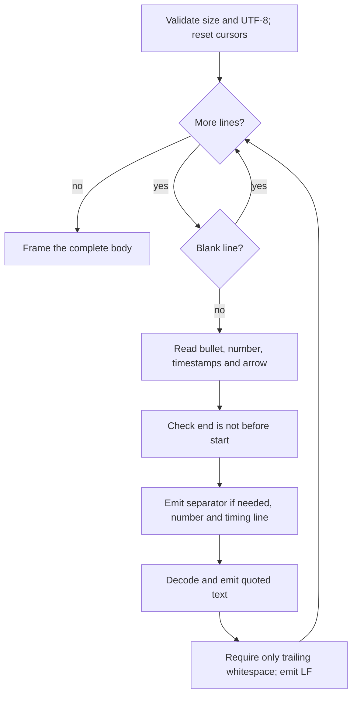
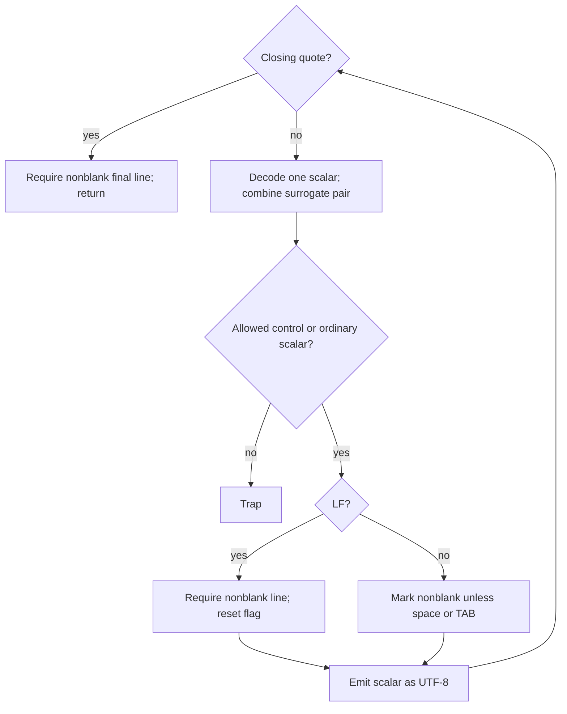

# Markdown cue list to SubRip subtitles

Tool 39 reverses the [SubRip reader](38-srt-to-cues.md). Each flat list item
contains the original cue number, two timestamps separated by `-->`, and a
JSON-quoted text string. No heading or root item is needed.

```text
- 1 00:00:01,000 --> 00:00:03,250 "Hello, world!\nSecond line."
- 2 00:00:03,000 --> 00:00:05,000 "<i>Overlapping subtitles</i>"
```

becomes:

```srt
1
00:00:01,000 --> 00:00:03,250
Hello, world!
Second line.

2
00:00:03,000 --> 00:00:05,000
<i>Overlapping subtitles</i>
```

## Row contract

Rows start with `- ` at column zero. Blank lines and additional spaces/tabs
between fields are allowed. Cue numbers are nonempty decimal digit strings;
timestamps use at least two hour digits, two minute/second digits in 00..59
and three millisecond digits after a comma. Whitespace is required around
the arrow and before the quoted text. Trailing spaces/tabs are allowed.
There is no implicit renumbering, sorting or removal of duplicate numbers.
End-before-start is invalid; equal times and overlaps are valid.

Text uses JSON string escaping, including Unicode escapes and surrogate pairs.
Raw Unicode and escaped Unicode become the same UTF-8 bytes. Lone surrogates,
malformed UTF-8, raw controls, invalid escapes and trailing tokens fail.
The only permitted decoded controls are TAB and LF. In particular, a decoded
CR is rejected: this representation already uses LF for subtitle line breaks.
Leading/trailing spaces on nonblank lines are preserved. An empty string,
a leading/trailing LF, or a space/tab-only text line is rejected because it
would be confused with a cue separator when read back. HTML-looking text,
entities and URLs stay literal; no resource is fetched or markup activated.

The output uses UTF-8 and LF, one empty line between cues, and a final LF
before the closing fence. Empty Markdown produces an empty `srt` fence.
The fence has at least three backticks and is longer than every contiguous
backtick run in the decoded body, including runs created by Unicode escapes.
This deliberately simple rule is conservative even for inline backticks.

## Inside run: keep the header, stream the text

Only the header spans survive while reading a row. The same helpers that
validated imported subtitles validate the number and timestamps here. A
separate required-space helper distinguishes an absent separator from an
optional sequence of spaces. The output cursor is independent of the input
cursor, so rendering a line cannot move the parser into the next row.



| State | Location | Lifetime |
| --- | --- | --- |
| Output byte cursor | Global 0 | Reset for each run; advanced only by emit/frame |
| Input row cursor / row end | Globals 1 / 2 | Replaced at each physical line |
| Next physical line | Run local 2 | Kept while the row cursor walks fields |
| Number / start / end spans | Run locals 3..8 | Kept until the header is copied |
| Earlier cue exists | Run local 9 | Adds one separator, never renumbers |
| Current text line has nonblank content | Text local 1 | Reset at each decoded LF |

## Inside text: Unicode and separator ownership

The scalar helper uses the shared JSON iterator. A raw four-byte UTF-8 scalar
arrives as two UTF-16 units, just like an escaped surrogate pair. It combines
the pair before UTF-8 emission. No decoded string or cue object is allocated.

An unescaped quote ends the text. Escaped quotes are consumed by the iterator,
not by that closing-quote check. Before emitting LF, require a nonblank current
line and reset the flag. At the closing quote, require it again: that catches
an empty string and a trailing blank line without trimming valid text.



## Inside frame: one scan, one overlapping move

Scan the finished body for the longest backtick run. Let `f` be the larger
of three and that run plus one. The prefix needs `f + 4` bytes (backticks,
`srt`, LF); the suffix needs `f + 1`. Check the complete size before moving
anything. `memory.copy` shifts the body forward safely even though the source
and destination overlap. Write the prefix, skip the already moved body, then
write the suffix. There is no second body buffer or per-byte relocation loop.

Input occupies at most 64 KiB. Output is bounded to `0x10000..0x30000` (128 KiB).
The input and fourth memory page remain unchanged. Very long backtick runs
can make the framed output exceed the limit even when the body fits; this
traps rather than producing a fence that would close early. Failed runs may
leave partial output but never return success, and a later run resets state.

## Module

Imports: JSON iterator 0; line 1, timestamp 2, digits 3, comparison 4,
spaces 5 from the subtitle reader; UTF-8 validation 6 from the calendar helper.
Memory is the reader's shared four-page memory. Functions: run 7, emit 8,
copy 9, take 10, required space 11, text 12, scalar 13, UTF-8 14, frame 15.

`[microwasm]`

- sw-header: `0061736d 01000000`
- sw-type-section: `01 {{size:sw-types}}`
  - sw-types: `09 60 03 7f 7f 7f 03 7f 7f 7f 60 02 7f 7f 02 7f 7f 60 02 7f 7f 01 7f 60 04 7f 7f 7f 7f 01 7f 60 02 7f 7f 00 60 01 7f 01 7f 60 01 7f 00 60 00 00 60 00 01 7f`
- sw-import-section: `02 {{size:sw-imports}}`
  - sw-imports: `08`
    - sw-import-next: `01 6b 04 6e657874 00 00`
    - sw-import-line: `01 72 04 6c696e65 00 01`
    - sw-import-time: `01 72 09 74696d657374616d70 00 02`
    - sw-import-digits: `01 72 06 646967697473 00 02`
    - sw-import-order: `01 72 08 6e6f744166746572 00 03`
    - sw-import-spaces: `01 72 06 737061636573 00 02`
    - sw-import-utf8: `01 63 04 75746638 00 04`
    - sw-import-memory: `01 72 06 6d656d6f7279 02 01 04 04`
- sw-function-section: `03 {{size:sw-functions}}`
  - sw-functions: `09 05 06 04 06 07 07 01 06 08`
- sw-global-section: `06 {{size:sw-globals}}`
  - sw-globals: `03 7f 01 41 00 0b 7f 01 41 00 0b 7f 01 41 00 0b`
- sw-export-section: `07 {{size:sw-exports}}`
  - sw-exports: `02 03 72756e 00 07 06 6d656d6f7279 02 00`
- sw-code-section: `0a {{size:sw-code}}`
  - sw-code: `09`
    - sw-run-record: `{{size:sw-run-body}}`
      - sw-run-body: `01 09 7f 20 00 41 808004 4b 04 40 00 0b 41 00 20 00 10 06 41 808004 24 00 41 00 24 01`
        - sw-run-loop: `02 40 03 40 23 01 20 00 4f 0d 01 23 01 20 00 10 01 21 02 22 01 24 02`
          - sw-run-blank: `23 01 23 02 10 05 23 02 46 04 40 20 02 24 01 0c 01 0b`
          - sw-run-bullet: `41 2d 10 0a 41 20 10 0a 23 01 23 02 10 05 24 01`
          - sw-run-number: `23 01 22 03 23 02 10 03 22 04 24 01 10 0b`
          - sw-run-start: `23 01 22 05 23 02 10 02 22 06 24 01 10 0b`
          - sw-run-arrow: `41 2d 10 0a 41 2d 10 0a 41 3e 10 0a 10 0b`
          - sw-run-end: `23 01 22 07 23 02 10 02 22 08 24 01 10 0b 20 05 20 06 20 07 20 08 10 04 45 04 40 00 0b`
          - sw-run-separator: `20 09 04 40 41 0a 10 08 0b 41 01 21 09`
          - sw-run-header: `20 03 20 04 10 09 41 0a 10 08 20 05 20 06 10 09 41 20 10 08 41 2d 10 08 41 2d 10 08 41 3e 10 08 41 20 10 08 20 07 20 08 10 09 41 0a 10 08`
          - sw-run-text: `10 0c 23 01 23 02 10 05 23 02 47 04 40 00 0b 41 0a 10 08 20 02 24 01 0c 00 0b 0b 10 0f 0b`
    - sw-emit-record: `{{size:sw-emit-body}}`
      - sw-emit-body: `00 23 00 41 80800c 4f 04 40 00 0b 23 00 20 00 3a 00 00 23 00 41 01 6a 24 00 0b`
    - sw-copy-record: `{{size:sw-copy-body}}`
      - sw-copy-body: `00 02 40 03 40 20 00 20 01 4f 0d 01 20 00 2d 00 00 10 08 20 00 41 01 6a 21 00 0c 00 0b 0b 0b`
    - sw-take-record: `{{size:sw-take-body}}`
      - sw-take-body: `00 23 01 23 02 4f 04 40 00 0b 23 01 2d 00 00 20 00 47 04 40 00 0b 23 01 41 01 6a 24 01 0b`
    - sw-space-record: `{{size:sw-space-body}}`
      - sw-space-body: `01 01 7f 23 01 23 02 10 05 22 00 23 01 46 04 40 00 0b 20 00 24 01 0b`
    - sw-text-record: `{{size:sw-text-body}}`
      - sw-text-body: `01 02 7f 41 22 10 0a 03 40 23 01 23 02 4f 04 40 00 0b`
        - sw-text-end: `23 01 2d 00 00 41 22 46 04 40 20 01 45 04 40 00 0b 23 01 41 01 6a 24 01 0f 0b`
        - sw-text-scalar: `23 01 23 02 10 0d 24 01 21 00`
        - sw-text-controls: `20 00 41 20 49 20 00 41 09 47 71 20 00 41 0a 47 71 20 00 41 ff00 46 72 04 40 00 0b`
        - sw-text-newline: `20 00 41 0a 46 04 40 20 01 45 04 40 00 0b 41 00 21 01`
          - sw-text-content: `05 20 00 41 20 47 20 00 41 09 47 71 04 40 41 01 21 01 0b 0b`
        - sw-text-emit: `20 00 10 0e 0c 00 0b 00 0b`
    - sw-scalar-record: `{{size:sw-scalar-body}}`
      - sw-scalar-body: `01 04 7f 20 00 20 01 41 00 10 00 21 02 21 04 21 03 20 03 41 7f 46 04 40 00 0b`
        - sw-scalar-high: `20 03 41 80b003 6b 41 ff07 4d 04 40 20 04 20 01 20 02 10 00 21 02 21 04 21 05 20 05 41 80b803 6b 41 ff07 4b 04 40 00 0b`
          - sw-scalar-pair: `20 03 41 80b003 6b 41 0a 74 20 05 41 80b803 6b 6a 41 808004 6a 21 03 0b`
        - sw-scalar-lone: `20 03 41 80b003 6b 41 ff0f 4d 04 40 00 0b 20 03 20 04 0b`
    - sw-utf8-record: `{{size:sw-utf8-body}}`
      - sw-utf8-body: `00 20 00 41 8001 49 04 40 20 00 10 08 0f 0b`
        - sw-utf8-two: `20 00 41 8010 49 04 40 20 00 41 06 76 41 c001 72 10 08`
          - sw-utf8-more: `05 20 00 41 808004 49 04 40 20 00 41 0c 76 41 e001 72 10 08`
            - sw-utf8-four: `05 20 00 41 12 76 41 f001 72 10 08 20 00 41 0c 76 41 3f 71 41 8001 72 10 08 0b`
          - sw-utf8-middle: `20 00 41 06 76 41 3f 71 41 8001 72 10 08 0b`
        - sw-utf8-last: `20 00 41 3f 71 41 8001 72 10 08 0b`
    - sw-frame-record: `{{size:sw-frame-body}}`
      - sw-frame-body: `01 05 7f 23 00 41 808004 6b 21 03 41 808004 21 00 41 02 21 02 02 40 03 40 20 00 23 00 4f 0d 01`
        - sw-frame-run: `20 00 2d 00 00 41 e000 46 04 40 20 01 41 01 6a 21 01 20 01 20 02 4b 04 40 20 01 21 02 0b 05 41 00 21 01 0b 20 00 41 01 6a 21 00 0c 00 0b 0b 20 02 41 01 6a 21 02`
        - sw-frame-limit: `20 03 20 02 41 02 6c 6a 41 05 6a 41 808008 4b 04 40 00 0b`
        - sw-frame-move: `41 808004 20 02 6a 41 04 6a 41 808004 20 03 fc 0a 00 00 41 808004 24 00`
        - sw-frame-prefix: `03 40 41 e000 10 08 20 04 41 01 6a 22 04 20 02 49 0d 00 0b 41 f300 10 08 41 f200 10 08 41 f400 10 08 41 0a 10 08`
        - sw-frame-suffix: `23 00 20 03 6a 24 00 41 00 21 04 03 40 41 e000 10 08 20 04 41 01 6a 22 04 20 02 49 0d 00 0b 41 0a 10 08 23 00 41 808004 6b 0b`
