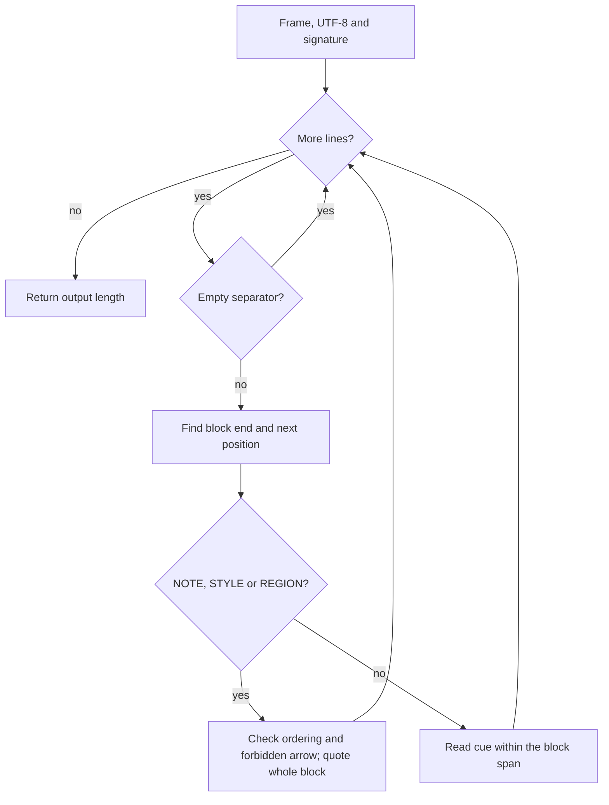

# WebVTT to Markdown cues and ordered blocks

Tool 40 reads a `vtt` fence. Ordinary cue-only documents become flat cue rows;
there is no mandatory root marker or header. Optional identifiers and settings
are named fields after the quoted payload. Non-cue blocks remain ordered data.

```vtt
WEBVTT Interview

NOTE Opening remarks

STYLE
::cue { color: lime; }

opening
00:01.000 --> 00:03.250 align:start
<v Jane>Hello!
Second line.

00:03.000 --> 00:05.000
An overlapping cue.
```

becomes:

```text
- header "Interview"
- block "NOTE Opening remarks"
- block "STYLE\n::cue { color: lime; }"
- cue 00:01.000 --> 00:03.250 "<v Jane>Hello!\nSecond line." id "opening" settings "align:start"
- cue 00:03.000 --> 00:05.000 "An overlapping cue."
```

## Preserved data and validation boundary

The structural rules follow the [WebVTT draft](https://www.w3.org/TR/2026/CRD-webvtt1-20260520/#file-structure).
UTF-8, optional initial BOM, LF/CRLF/bare-CR line endings, omitted hours,
identifiers and settings are supported. Cue end must be strictly after start;
starts must be nondecreasing, but overlaps are valid. Hour values are compared
exactly as digit spans. Original timestamp spellings remain unchanged.

Header text excludes `WEBVTT` and its first separating space or TAB. A plain
signature or whitespace-only suffix needs no header record. A blank physical line separates the header
from blocks; EOF directly after the signature is accepted for an empty file.
Blocks are separated by empty physical lines, not by lines containing spaces.
Payloads may be empty. Their spaces and tabs are retained, and physical line
endings normalize to LF. Raw controls other than TAB and line endings fail.

NOTE blocks can occur between cues. STYLE and REGION blocks must precede cues.
Each `block` string retains its keyword and all remaining lines, rather than
inventing a second grammar for CSS or region definitions. The same applies
to cue payload markup and the settings string. This is a structural converter,
not a CSS, cue-markup or settings conformance checker. Duplicate identifiers
are preserved rather than silently removed; their authoring uniqueness rule
is not enforced here. Nothing is played, styled, fetched or navigated.

An arrow inside a non-cue block, identifier or payload is rejected instead of
misinterpreting it as another timing line. Missing blank separators therefore
cannot silently swallow subsequent cues. Leading/trailing timing whitespace
is normalized; the settings string retains its contents after the separating
whitespace, including trailing whitespace. Absent fields are omitted.

The outer fence uses at least three backticks and the label `vtt`, without
indentation. Longer fences permit literal backtick lines. An earlier generic
Markdown closing fence is rejected, including up to three leading spaces.

## Inside run: find the block once, then classify it

The block scanner retains only its last content end and the next block's start.
The classifier checks keyword boundaries: `NOTEBOOK` is an identifier, not a
comment. Once classified, a non-cue block is quoted whole. A cue receives its
own bounded span and cannot consume a neighboring block.



| State | Location | Why it survives |
| --- | --- | --- |
| Output cursor | Global 0 | Every emitted byte shares one bound |
| Input cursor / body end | Globals 1 / 2 | Outer block traversal |
| Previous start timestamp span | Globals 3 / 4 | Checks ordering without converting to a number |
| Any cue seen | Global 5 | Disallows later STYLE/REGION blocks |
| Block end / next block | Run locals 4 / 5 | Cue parsing cannot advance the outer cursor |
| Identifier span | Cue locals 4 / 5 | Optional; does not require an allocated string |
| Settings / payload starts | Cue locals 10 / 11 | Separate the timing line from following text |

## Inside cue: optional identifier, mandatory timing

If the first line has no arrow it is the identifier, and the second line must
contain timing. Otherwise the first line is timing. Parse two timestamps with
the shared helper and require whitespace around the arrow. Compare their
spans, then compare this start with the previous start. Only after success
does this cue replace the retained previous span.

The remaining timing-line suffix is settings; subsequent lines are payload.
Neither is interpreted as active content. JSON quoting escapes quotation marks,
backslashes, TAB and normalized LF while retaining UTF-8 bytes directly.

## Memory and shared work

Input is at most 64 KiB and stays unchanged. Output occupies
`0x10000..0x30000`, at most 128 KiB. The fourth page holds a small read-only
literal table. No decoded strings, cue array or second document copy is built.
Failed runs can leave a partial output prefix but never return success;
another call resets the output and ordering state.

The line and whitespace helpers come from the SubRip reader; timestamps use
the [WebVTT span helper](00-webvtt-time.md). The local quoting and fence scans
use the same algorithms as the SubRip reader, with the `vtt` label.

## Module

Imports: line 0, spaces 1, timestamp 2, compare 3, UTF-8 validation 4.
Functions: run 5, emit 6, copy 7, JSON 8, fence 9, fence-lines 10,
arrow 11, block 12, word 13, literal 14, cue 15, required-space 16, kind 17.

`[microwasm]`

- vr-header: `0061736d 01000000`
- vr-type-section: `01 {{size:vr-types}}`
  - vr-types: `09 60 02 7f 7f 02 7f 7f 60 02 7f 7f 01 7f 60 04 7f 7f 7f 7f 01 7f 60 02 7f 7f 00 60 01 7f 01 7f 60 01 7f 00 60 01 7f 02 7f 7f 60 03 7f 7f 7f 00 60 03 7f 7f 7f 01 7f`
- vr-import-section: `02 {{size:vr-imports}}`
  - vr-imports: `06 01 72 04 6c696e65 00 00 01 72 06 737061636573 00 01 01 76 09 74696d657374616d70 00 01 01 76 07 636f6d70617265 00 02 01 63 04 75746638 00 03 01 72 06 6d656d6f7279 02 01 04 04`
- vr-function-section: `03 {{size:vr-functions}}`
  - vr-functions: `0d 04 05 03 03 06 07 01 00 08 05 03 01 01`
- vr-global-section: `06 {{size:vr-globals}}`
  - vr-globals: `06 7f 01 41 00 0b 7f 01 41 00 0b 7f 01 41 00 0b 7f 01 41 00 0b 7f 01 41 00 0b 7f 01 41 00 0b`
- vr-export-section: `07 {{size:vr-exports}}`
  - vr-exports: `02 03 72756e 00 05 06 6d656d6f7279 02 00`
- vr-code-section: `0a {{size:vr-code}}`
  - vr-code: `0d`
    - vr-run-record: `{{size:vr-run-body}}`
      - vr-run-body: `01 06 7f 20 00 10 09 24 02 24 01 23 01 23 02 10 04 41 808004 24 00 41 00 24 05`
        - vr-run-bom: `23 02 23 01 6b 41 03 4f 04 40 23 01 2d 00 00 41 ef01 46 23 01 2d 00 01 41 bb01 46 71 23 01 2d 00 02 41 bf01 46 71 04 40 23 01 41 03 6a 24 01 0b 0b`
        - vr-run-signature: `23 01 23 02 10 00 21 02 21 01 23 01 20 01 41 80800c 10 0d 22 03 45 04 40 00 0b`
        - vr-run-header: `20 03 20 01 49 04 40 20 03 2d 00 00 41 20 47 20 03 2d 00 00 41 09 47 71 04 40 00 0b 20 03 20 01 10 01 20 01 49 04 40 41 99800c 10 0e 20 03 41 01 6a 20 01 10 08 41 0a 10 06 0b 0b 20 02 24 01`
        - vr-run-header-gap: `23 01 23 02 49 04 40 23 01 23 02 10 00 21 02 23 01 47 04 40 00 0b 20 02 24 01 0b`
        - vr-run-loop: `02 40 03 40 23 01 23 02 4f 0d 01 23 01 23 02 10 00 21 02 21 01 20 01 23 01 46 04 40 20 02 24 01 0c 01 0b`
          - vr-run-block: `23 01 23 02 10 0c 21 05 21 04 23 01 20 01 10 11 21 06`
          - vr-run-noncue: `20 06 04 40 20 06 41 01 4b 23 05 71 04 40 00 0b 23 01 20 04 10 0b 20 04 47 04 40 00 0b 41 a3800c 10 0e 23 01 20 04 10 08 41 0a 10 06`
          - vr-run-cue: `05 23 01 20 04 10 0f 0b 20 05 24 01 0c 00 0b 0b 23 00 41 808004 6b 0b`
    - vr-emit-record: `{{size:vr-emit-body}}`
      - vr-emit-body: `00 23 00 41 80800c 4f 04 40 00 0b 23 00 20 00 3a 00 00 23 00 41 01 6a 24 00 0b`
    - vr-copy-record: `{{size:vr-copy-body}}`
      - vr-copy-body: `00 02 40 03 40 20 00 20 01 4f 0d 01 20 00 2d 00 00 10 06 20 00 41 01 6a 21 00 0c 00 0b 0b 0b`
    - vr-json-record: `{{size:vr-json-body}}`
      - vr-json-body: `01 01 7f 41 22 10 06 02 40 03 40 20 00 20 01 4f 0d 01 20 00 2d 00 00 21 02 20 00 41 01 6a 21 00`
        - vr-json-cr: `20 02 41 0d 46 04 40 20 00 20 01 49 04 40 20 00 2d 00 00 41 0a 46 04 40 20 00 41 01 6a 21 00 0b 0b 41 0a 21 02 0b`
        - vr-json-line: `20 02 41 0a 46 04 40 41 dc00 10 06 41 ee00 10 06 0c 01 0b`
        - vr-json-tab: `20 02 41 09 46 04 40 41 dc00 10 06 41 f400 10 06 0c 01 0b`
        - vr-json-escape: `20 02 41 22 46 20 02 41 dc00 46 72 04 40 41 dc00 10 06 0b 20 02 10 06 0c 00 0b 0b 41 22 10 06 0b`
    - vr-fence-record: `{{size:vr-fence-body}}`
      - vr-fence-body: `01 06 7f 20 00 41 0a 49 20 00 41 808004 4b 72 04 40 00 0b 02 40 03 40 20 01 20 00 4f 0d 01 20 01 2d 00 00 41 e000 47 0d 01 20 01 41 01 6a 21 01 0c 00 0b 0b 20 01 41 03 49 20 00 20 01 6b 41 03 49 72 04 40 00 0b`
        - vr-fence-label: `20 01 2d 00 00 41 20 72 41 f600 47 20 01 2d 00 01 41 20 72 41 f400 47 72 20 01 2d 00 02 41 20 72 41 f400 47 72 04 40 00 0b 41 00 20 00 10 00 21 02 20 01 41 03 6a 47 04 40 00 0b 20 00 21 03`
        - vr-fence-trim: `02 40 03 40 20 03 20 02 4d 0d 01 20 03 41 01 6b 2d 00 00 21 05 20 05 41 20 46 20 05 41 09 46 72 20 05 41 0a 46 72 20 05 41 0d 46 72 45 0d 01 20 03 41 01 6b 21 03 0c 00 0b 0b`
        - vr-fence-ticks: `02 40 03 40 20 03 20 02 4d 0d 01 20 03 41 01 6b 2d 00 00 41 e000 47 0d 01 20 03 41 01 6b 21 03 20 04 41 01 6a 21 04 0c 00 0b 0b 20 04 20 01 49 04 40 00 0b`
        - vr-fence-line-break: `20 03 20 02 4b 04 40 20 03 41 01 6b 22 03 2d 00 00 21 05 20 05 41 0a 46 04 40 20 03 20 02 4b 04 40 20 03 41 01 6b 2d 00 00 41 0d 46 04 40 20 03 41 01 6b 21 03 0b 0b 05 20 05 41 0d 47 04 40 00 0b 0b 0b`
        - vr-fence-check: `20 02 20 03 20 01 10 0a 20 02 20 03 0b`
    - vr-fence-lines-record: `{{size:vr-fence-lines-body}}`
      - vr-fence-lines-body: `01 05 7f 02 40 03 40 20 00 20 01 4f 0d 01 20 00 20 01 10 00 21 04 21 03 20 00 21 05 41 00 21 06 02 40 03 40 20 05 20 03 4f 0d 01 20 06 41 03 4f 0d 01 20 05 2d 00 00 41 20 47 0d 01 20 05 41 01 6a 21 05 20 06 41 01 6a 21 06 0c 00 0b 0b 41 00 21 07`
        - vr-fence-lines-ticks: `02 40 03 40 20 05 20 03 4f 0d 01 20 05 2d 00 00 41 e000 47 0d 01 20 05 41 01 6a 21 05 20 07 41 01 6a 21 07 0c 00 0b 0b`
        - vr-fence-lines-close: `20 07 20 02 4f 04 40 20 05 20 03 10 01 20 03 46 04 40 00 0b 0b 20 04 21 00 0c 00 0b 0b 0b`
    - vr-arrow-record: `{{size:vr-arrow-body}}`
      - vr-arrow-body: `00 02 40 03 40 20 01 20 00 6b 41 03 49 0d 01 20 00 2d 00 00 41 2d 46 20 00 2d 00 01 41 2d 46 71 20 00 2d 00 02 41 3e 46 71 04 40 20 00 0f 0b 20 00 41 01 6a 21 00 0c 00 0b 0b 20 01 0b`
    - vr-block-record: `{{size:vr-block-body}}`
      - vr-block-body: `01 03 7f 20 00 21 04 02 40 03 40 20 00 20 01 4f 0d 01 20 00 20 01 10 00 21 03 21 02 20 02 20 00 46 04 40 20 04 20 03 0f 0b 20 02 21 04 20 03 21 00 0c 00 0b 0b 20 04 20 00 0b`
    - vr-word-record: `{{size:vr-word-body}}`
      - vr-word-body: `01 02 7f 20 02 2d 00 00 21 03 20 01 20 00 6b 20 03 49 04 40 41 00 0f 0b 20 02 41 01 6a 21 02 02 40 03 40 20 04 20 03 4f 0d 01 20 00 20 04 6a 2d 00 00 20 02 20 04 6a 2d 00 00 47 04 40 41 00 0f 0b 20 04 41 01 6a 21 04 0c 00 0b 0b 20 00 20 03 6a 0b`
    - vr-literal-record: `{{size:vr-literal-body}}`
      - vr-literal-body: `00 20 00 41 01 6a 20 00 20 00 2d 00 00 6a 41 01 6a 10 07 0b`
    - vr-cue-record: `{{size:vr-cue-body}}`
      - vr-cue-body: `01 0b 7f 20 00 20 01 10 00 21 03 21 02 20 00 20 02 10 0b 20 02 46 04 40 20 00 21 04 20 02 21 05 20 03 21 00 20 00 20 01 10 00 21 03 21 02 0b`
        - vr-cue-start: `20 00 20 02 10 01 22 06 20 02 10 02 22 07 20 02 10 10 21 0c`
        - vr-cue-arrow: `20 02 20 0c 6b 41 03 49 04 40 00 0b 20 0c 20 0c 41 03 6a 10 0b 20 0c 47 04 40 00 0b 20 0c 41 03 6a 20 02 10 10 21 08`
        - vr-cue-end: `20 08 20 02 10 02 22 09 21 0a 20 09 20 02 49 04 40 20 09 20 02 10 10 21 0a 0b`
        - vr-cue-duration: `20 06 20 07 20 08 20 09 10 03 41 00 4e 04 40 00 0b`
        - vr-cue-order: `23 05 04 40 23 03 23 04 20 06 20 07 10 03 41 00 4a 04 40 00 0b 0b`
        - vr-cue-payload: `20 03 21 0b 20 0b 20 01 4b 04 40 20 01 21 0b 0b 20 0b 20 01 10 0b 20 01 47 20 0a 20 02 10 0b 20 02 47 72 04 40 00 0b`
        - vr-cue-emit: `41 ac800c 10 0e 20 06 20 07 10 07 41 20 10 06 41 2d 10 06 41 2d 10 06 41 3e 10 06 41 20 10 06 20 08 20 09 10 07 41 20 10 06 20 0b 20 01 10 08`
        - vr-cue-id: `20 04 20 05 47 04 40 41 b3800c 10 0e 20 04 20 05 10 08 0b`
        - vr-cue-settings: `20 0a 20 02 49 04 40 41 b8800c 10 0e 20 0a 20 02 10 08 0b 41 0a 10 06 20 06 24 03 20 07 24 04 41 01 24 05 0b`
    - vr-space-record: `{{size:vr-space-body}}`
      - vr-space-body: `01 01 7f 20 00 20 01 10 01 22 02 20 00 46 04 40 00 0b 20 02 0b`
    - vr-kind-record: `{{size:vr-kind-body}}`
      - vr-kind-body: `01 01 7f 20 00 20 01 41 87800c 10 0d 22 02 04 40 20 02 20 01 46 04 40 41 01 0f 0b 20 02 2d 00 00 41 20 46 20 02 2d 00 00 41 09 46 72 04 40 41 01 0f 0b 0b`
        - vr-kind-style: `20 00 20 01 41 8c800c 10 0d 22 02 04 40 20 02 20 01 10 01 20 01 46 04 40 41 02 0f 0b 0b`
        - vr-kind-region: `20 00 20 01 41 92800c 10 0d 22 02 04 40 20 02 20 01 10 01 20 01 46 04 40 41 03 0f 0b 0b 41 00 0b`
- vr-data-section: `0b {{size:vr-data}}`
  - vr-data: `01 00 41 80800c 0b 43`
    - vr-words: `06 574542565454 04 4e4f5445 05 5354594c45 06 524547494f4e`
    - vr-prefixes: `09 2d2068656164657220 08 2d20626c6f636b20 06 2d2063756520 04 20696420 0a 2073657474696e677320`
