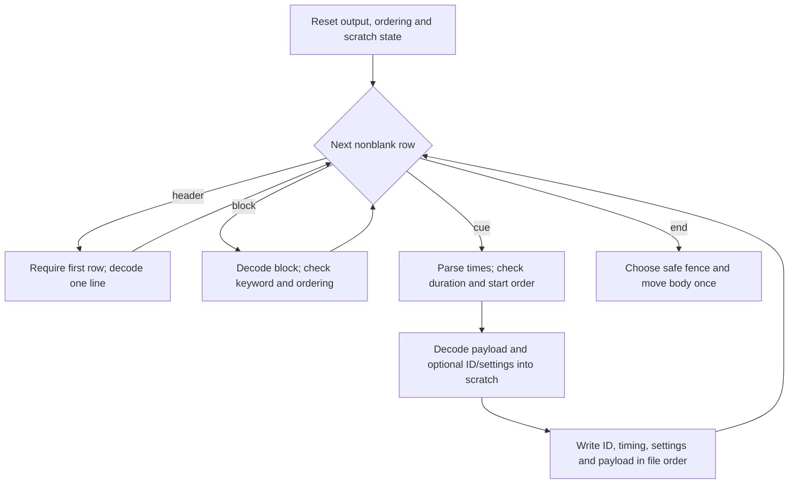

# Markdown cues and ordered blocks to WebVTT

Tool 41 reverses the [WebVTT reader](40-vtt-to-cues.md). Records stand on
their own; neither a root item nor a header record is required.

```text
- header "Interview"
- block "NOTE Opening remarks"
- block "STYLE\n::cue { color: lime; }"
- cue 00:01.000 --> 00:03.250 "<v Jane>Hello!\nSecond line." id "opening" settings "align:start"
- cue 00:03.000 --> 00:05.000 "An overlapping cue."
```

becomes:

```vtt
WEBVTT Interview

NOTE Opening remarks

STYLE
::cue { color: lime; }

opening
00:01.000 --> 00:03.250 align:start
<v Jane>Hello!
Second line.

00:03.000 --> 00:05.000
An overlapping cue.
```

## Records, not a second subtitle schema

Rows begin with `- ` at column zero. Blank lines are allowed. Fields use
spaces or tabs; quoted values use JSON string escaping, including surrogate
pairs. The output is UTF-8 with LF line endings. Timestamp spellings are
retained, including omitted hours and arbitrarily long hour digit strings.
End must be strictly after start and starts must not decrease. Overlaps and
duplicate identifiers are preserved. This is a structural converter, not a
cue-markup, settings, CSS or region-definition conformance checker.

The optional `header` must be first and unique. Empty or whitespace-only
header text is omitted, as in the reader. A `block` keeps its NOTE,
STYLE or REGION keyword and body in one string. STYLE and REGION must precede
all cues; NOTE may appear between them. Cue text may be empty; optional `id`
and `settings` must be nonempty, occur at most once each, and may be written
in either order. Settings cannot begin with whitespace, which WebVTT would
consume as the separator. Keyword-like identifiers must not be mistaken for
non-cue blocks. Header, identifier and settings cannot contain line breaks.

Decoded controls other than TAB and LF fail. A multiline value cannot start
or end with LF or contain two successive LFs: an empty physical line would
terminate its block. Lines containing spaces or tabs are content, not empty
lines. The substring `-->` is rejected inside strings so that a second cue
cannot be injected into a payload. URLs and HTML-like text remain inert data.

## Inside run: gather one row, then write it

The payload comes before optional fields in Markdown, but follows them in
WebVTT. Decode one row's strings into a reusable scratch page, retaining spans
rather than allocating objects or constructing a tree. Once all fields have
been checked, copy them to output in file order. Reset the scratch cursor for
the next row. Timestamp spans still point into the unchanged input page.



| Retained state | Purpose |
| --- | --- |
| Output cursor and its current limit | Same emitter, separate output/scratch bounds |
| Input cursor and physical row end | Every field stays inside its row |
| Scratch cursor | Decoded strings for this row only |
| File state: empty, header, blocks, cues | Header uniqueness and STYLE/REGION order |
| Previous start span | Exact chronological comparison, with no numeric overflow |
| Payload / ID / settings spans | Reorder fields without reparsing strings |

## String decoding and framing patterns

The scalar decoder, UTF-8 emitter and overlapping fence move follow the
[SubRip writer](39-cues-to-srt.md). String decoding temporarily switches the
emitter to the scratch page, then restores the output cursor and bound. It
returns two offsets, not a null-terminated string. The structural check is
separate: the same decoder handles single-line and multiline fields.

Input is at most 64 KiB, output at most 128 KiB, and scratch at most 64 KiB.
No input byte is modified. Failed calls trap; the next call resets every
persistent cursor and ordering flag. The backtick fence exceeds every run
in the decoded output, including backticks introduced by Unicode escapes.

## Inside string: borrow the emitter, then restore it

Save the output cursor in a local. Point the emitter at the next free scratch
byte, with the limit at the end of memory. Decode scalars until an unescaped
closing quote; the scalar iterator consumes escaped quotes itself. On success,
save the scratch end, restore the output cursor and its lower limit, then
return the scratch start/end pair. A trap skips restoration, but the next
`run` resets both cursor and limit before emitting the signature.

For payload `Hello`, ID `one` and settings `align:end`, the three successive
decoded spans are `[196608,196613)`, `[196613,196616)` and `[196616,196625)`.
They remain live together only until that cue is emitted. The next row can
overwrite all of them; the previous timestamp still points into input.

## Inside validation: line boundaries carry meaning

The decoder checks Unicode and controls. The span checker then walks the
decoded bytes once, looking for structural conflicts:

| Mode | Empty span | LF inside span |
| --- | --- | --- |
| 0: header, ID, settings | Allowed here; ID/settings separately require content | Rejected |
| 1: NOTE/STYLE/REGION block | Rejected | Allowed only between nonempty physical lines |
| 2: cue payload | Allowed | Same physical-line rule as blocks |

At each LF, check the span's start/end and preceding byte. This catches a
leading LF, trailing LF or empty intervening line, without trimming spaces.
Only inspect three bytes for `-->` when at least three bytes remain. That
check applies in every mode, including escaped arrows after decoding.

Block classification first checks enough bytes exist for each keyword. NOTE
needs only a word boundary (end, space, TAB or LF); the remainder may be its
comment. STYLE and REGION require the rest of their first line to be spaces
or tabs. Stop that suffix scan at LF or the span end. Thus `STYLE name` can
be a cue identifier, while `STYLE` cannot. The same classifier serves block
validation and ID ambiguity checking; no second list of reserved IDs exists.

## Module

Imports: JSON iterator 0, physical line 1, WebVTT timestamp 2 and comparison
3, spaces 4, UTF-8 validation 5. Functions: run 6, emit 7, copy 8, take 9,
required space 10, string 11, scalar 12, UTF-8 13, frame 14, finish row 15,
validate string span 16, classify block 17.

`[microwasm]`

- vw-header: `0061736d 01000000`
- vw-type-section: `01 {{size:vw-types}}`
  - vw-types: `0b 60 03 7f 7f 7f 03 7f 7f 7f 60 02 7f 7f 02 7f 7f 60 02 7f 7f 01 7f 60 04 7f 7f 7f 7f 01 7f 60 02 7f 7f 00 60 01 7f 01 7f 60 01 7f 00 60 00 00 60 00 01 7f 60 00 02 7f 7f 60 03 7f 7f 7f 00`
- vw-import-section: `02 {{size:vw-imports}}`
  - vw-imports: `07`
    - vw-import-next: `01 6b 04 6e657874 00 00`
    - vw-import-line: `01 72 04 6c696e65 00 01`
    - vw-import-time: `01 76 09 74696d657374616d70 00 02`
    - vw-import-order: `01 76 07 636f6d70617265 00 03`
    - vw-import-spaces: `01 72 06 737061636573 00 02`
    - vw-import-utf8: `01 63 04 75746638 00 04`
    - vw-import-memory: `01 72 06 6d656d6f7279 02 01 04 04`
- vw-function-section: `03 {{size:vw-functions}}`
  - vw-functions: `0c 05 06 04 06 07 09 01 06 08 07 0a 02`
- vw-global-section: `06 {{size:vw-globals}}`
  - vw-globals: `08 7f 01 41 00 0b 7f 01 41 00 0b 7f 01 41 00 0b 7f 01 41 00 0b 7f 01 41 00 0b 7f 01 41 00 0b 7f 01 41 00 0b 7f 01 41 00 0b`
- vw-export-section: `07 {{size:vw-exports}}`
  - vw-exports: `02 03 72756e 00 06 06 6d656d6f7279 02 00`
- vw-code-section: `0a {{size:vw-code}}`
  - vw-code: `0c`
    - vw-run-record: `{{size:vw-run-body}}`
      - vw-run-body: `01 0f 7f 20 00 41 808004 4b 04 40 00 0b 41 00 20 00 10 05 41 808004 24 00 41 00 24 01 41 80800c 24 03 41 00 24 05 41 00 24 06 41 00 24 07`
        - vw-signature: `41 d700 10 07 41 c500 10 07 41 c200 10 07 41 d600 10 07 41 d400 10 07 41 d400 10 07`
        - vw-run-loop: `02 40 03 40 23 01 20 00 4f 0d 01 23 01 20 00 10 01 21 02 22 01 24 02`
          - vw-run-blank: `23 01 23 02 10 04 23 02 46 04 40 20 02 24 01 0c 01 0b`
          - vw-run-bullet: `41 2d 10 09 41 20 10 09 23 01 23 02 10 04 24 01 23 01 23 02 4f 04 40 00 0b 41 80800c 24 04 23 01 2d 00 00 21 03`
          - vw-header-branch: `20 03 41 e800 46 04 40 23 05 04 40 00 0b 41 e800 10 09 41 e500 10 09 41 e100 10 09 41 e400 10 09 41 e500 10 09 41 f200 10 09 10 0a 10 0b 21 09 21 08 20 08 20 09 41 00 10 10 10 0f 20 08 21 0f`
            - vw-header-meaningful: `02 40 03 40 20 0f 20 09 4f 0d 01 20 0f 2d 00 00 41 20 47 20 0f 2d 00 00 41 09 47 71 0d 01 20 0f 41 01 6a 21 0f 0c 00 0b 0b`
            - vw-header-emit: `20 0f 20 09 49 04 40 41 20 10 07 20 08 20 09 10 08 0b 41 01 24 05 20 02 24 01 0c 01 0b`
          - vw-block-branch: `20 03 41 e200 46 04 40 41 e200 10 09 41 ec00 10 09 41 ef00 10 09 41 e300 10 09 41 eb00 10 09 10 0a 10 0b 21 09 21 08 20 08 20 09 41 01 10 10 10 0f 20 08 20 09 10 11 22 03 45 04 40 00 0b 20 03 41 01 4b 23 05 41 03 46 71 04 40 00 0b 41 0a 10 07 41 0a 10 07 20 08 20 09 10 08 23 05 41 02 49 04 40 41 02 24 05 0b 20 02 24 01 0c 01 0b`
          - vw-cue-keyword: `41 e300 10 09 41 f500 10 09 41 e500 10 09 10 0a`
          - vw-cue-start: `23 01 22 04 23 02 10 02 22 05 24 01 10 0a 41 2d 10 09 41 2d 10 09 41 3e 10 09 10 0a`
          - vw-cue-end: `23 01 22 06 23 02 10 02 22 07 24 01 10 0a 20 04 20 05 20 06 20 07 10 03 41 00 4e 04 40 00 0b`
          - vw-cue-order: `23 05 41 03 46 04 40 23 06 23 07 20 04 20 05 10 03 41 00 4a 04 40 00 0b 0b 20 04 24 06 20 05 24 07`
          - vw-cue-payload: `10 0b 21 09 21 08 20 08 20 09 41 02 10 10 41 00 21 0e 41 00 21 0a 41 00 21 0b 41 00 21 0c 41 00 21 0d`
          - vw-cue-options: `02 40 03 40 23 01 23 02 46 0d 01 10 0a 23 01 23 02 46 0d 01 23 01 2d 00 00 41 e900 46 04 40`
            - vw-cue-id: `20 0e 41 01 71 04 40 00 0b 20 0e 41 01 72 21 0e 41 e900 10 09 41 e400 10 09 10 0a 10 0b 21 0b 21 0a 20 0a 20 0b 46 04 40 00 0b 20 0a 20 0b 41 00 10 10 20 0a 20 0b 10 11 04 40 00 0b`
            - vw-cue-settings: `05 20 0e 41 02 71 04 40 00 0b 20 0e 41 02 72 21 0e 41 f300 10 09 41 e500 10 09 41 f400 10 09 41 f400 10 09 41 e900 10 09 41 ee00 10 09 41 e700 10 09 41 f300 10 09 10 0a 10 0b 21 0d 21 0c 20 0c 20 0d 46 04 40 00 0b 20 0c 20 0d 41 00 10 10 20 0c 2d 00 00 41 20 46 20 0c 2d 00 00 41 09 46 72 04 40 00 0b 0b 0c 00 0b 0b`
          - vw-cue-emit-id: `41 0a 10 07 41 0a 10 07 20 0e 41 01 71 04 40 20 0a 20 0b 10 08 41 0a 10 07 0b`
          - vw-cue-emit-timing: `20 04 20 05 10 08 41 20 10 07 41 2d 10 07 41 2d 10 07 41 3e 10 07 41 20 10 07 20 06 20 07 10 08`
          - vw-cue-emit-settings: `20 0e 41 02 71 04 40 41 20 10 07 20 0c 20 0d 10 08 0b 41 0a 10 07 20 08 20 09 10 08 41 03 24 05 20 02 24 01 0c 00 0b 0b`
        - vw-run-frame: `41 0a 10 07 23 05 41 02 49 04 40 41 0a 10 07 0b 10 0e 0b`
    - vw-emit-record: `{{size:vw-emit-body}}`
      - vw-emit-body: `00 23 00 23 03 4f 04 40 00 0b 23 00 20 00 3a 00 00 23 00 41 01 6a 24 00 0b`
    - vw-copy-record: `{{size:vw-copy-body}}`
      - vw-copy-body: `00 02 40 03 40 20 00 20 01 4f 0d 01 20 00 2d 00 00 10 07 20 00 41 01 6a 21 00 0c 00 0b 0b 0b`
    - vw-take-record: `{{size:vw-take-body}}`
      - vw-take-body: `00 23 01 23 02 4f 04 40 00 0b 23 01 2d 00 00 20 00 47 04 40 00 0b 23 01 41 01 6a 24 01 0b`
    - vw-space-record: `{{size:vw-space-body}}`
      - vw-space-body: `01 01 7f 23 01 23 02 10 04 22 00 23 01 46 04 40 00 0b 20 00 24 01 0b`
    - vw-string-record: `{{size:vw-string-body}}`
      - vw-string-body: `01 03 7f 23 00 21 01 23 04 22 02 24 00 41 808010 24 03 41 22 10 09 03 40 23 01 23 02 4f 04 40 00 0b`
        - vw-string-end: `23 01 2d 00 00 41 22 46 04 40 23 01 41 01 6a 24 01 23 00 24 04 20 01 24 00 41 80800c 24 03 20 02 23 04 0f 0b`
        - vw-string-scalar: `23 01 23 02 10 0c 24 01 21 00 20 00 41 20 49 20 00 41 09 47 71 20 00 41 0a 47 71 20 00 41 ff00 46 72 04 40 00 0b 20 00 10 0d 0c 00 0b 00 0b`
    - vw-scalar-record: `{{size:vw-scalar-body}}`
      - vw-scalar-body: `01 04 7f 20 00 20 01 41 00 10 00 21 02 21 04 21 03 20 03 41 7f 46 04 40 00 0b`
        - vw-scalar-high: `20 03 41 80b003 6b 41 ff07 4d 04 40 20 04 20 01 20 02 10 00 21 02 21 04 21 05 20 05 41 80b803 6b 41 ff07 4b 04 40 00 0b`
          - vw-scalar-pair: `20 03 41 80b003 6b 41 0a 74 20 05 41 80b803 6b 6a 41 808004 6a 21 03 0b`
        - vw-scalar-lone: `20 03 41 80b003 6b 41 ff0f 4d 04 40 00 0b 20 03 20 04 0b`
    - vw-utf8-record: `{{size:vw-utf8-body}}`
      - vw-utf8-body: `00 20 00 41 8001 49 04 40 20 00 10 07 0f 0b`
        - vw-utf8-two: `20 00 41 8010 49 04 40 20 00 41 06 76 41 c001 72 10 07`
          - vw-utf8-more: `05 20 00 41 808004 49 04 40 20 00 41 0c 76 41 e001 72 10 07`
            - vw-utf8-four: `05 20 00 41 12 76 41 f001 72 10 07 20 00 41 0c 76 41 3f 71 41 8001 72 10 07 0b`
          - vw-utf8-middle: `20 00 41 06 76 41 3f 71 41 8001 72 10 07 0b`
        - vw-utf8-last: `20 00 41 3f 71 41 8001 72 10 07 0b`
    - vw-frame-record: `{{size:vw-frame-body}}`
      - vw-frame-body: `01 05 7f 23 00 41 808004 6b 21 03 41 808004 21 00 41 02 21 02 02 40 03 40 20 00 23 00 4f 0d 01`
        - vw-frame-run: `20 00 2d 00 00 41 e000 46 04 40 20 01 41 01 6a 21 01 20 01 20 02 4b 04 40 20 01 21 02 0b 05 41 00 21 01 0b 20 00 41 01 6a 21 00 0c 00 0b 0b 20 02 41 01 6a 21 02`
        - vw-frame-limit: `20 03 20 02 41 02 6c 6a 41 05 6a 41 808008 4b 04 40 00 0b`
        - vw-frame-move: `41 808004 20 02 6a 41 04 6a 41 808004 20 03 fc 0a 00 00 41 808004 24 00`
        - vw-frame-prefix: `03 40 41 e000 10 07 20 04 41 01 6a 22 04 20 02 49 0d 00 0b 41 f600 10 07 41 f400 10 07 41 f400 10 07 41 0a 10 07`
        - vw-frame-suffix: `23 00 20 03 6a 24 00 41 00 21 04 03 40 41 e000 10 07 20 04 41 01 6a 22 04 20 02 49 0d 00 0b 41 0a 10 07 23 00 41 808004 6b 0b`
    - vw-finish-record: `{{size:vw-finish-body}}`
      - vw-finish-body: `00 23 01 23 02 10 04 23 02 47 04 40 00 0b 0b`
    - vw-safe-record: `{{size:vw-safe-body}}`
      - vw-safe-body: `01 02 7f 20 00 21 03 20 00 20 01 46 04 40 20 02 41 01 46 04 40 00 0b 0f 0b 02 40 03 40 20 03 20 01 4f 0d 01 20 03 2d 00 00 21 04`
        - vw-safe-lf: `20 04 41 0a 46 04 40 20 02 45 20 03 20 00 46 72 20 03 41 01 6a 20 01 46 72 04 40 00 0b 20 03 41 01 6b 2d 00 00 41 0a 46 04 40 00 0b 0b`
        - vw-safe-arrow: `20 01 20 03 6b 41 03 4f 04 40 20 04 41 2d 46 20 03 2d 00 01 41 2d 46 71 20 03 2d 00 02 41 3e 46 71 04 40 00 0b 0b 20 03 41 01 6a 21 03 0c 00 0b 0b 0b`
    - vw-kind-record: `{{size:vw-kind-body}}`
      - vw-kind-body: `01 03 7f 20 01 20 00 6b 41 04 49 04 40 41 00 0f 0b`
        - vw-kind-note: `20 00 2d 00 00 41 ce00 46 20 00 2d 00 01 41 cf00 46 71 20 00 2d 00 02 41 d400 46 71 20 00 2d 00 03 41 c500 46 71 04 40 20 00 41 04 6a 22 02 20 01 46 04 40 41 01 0f 0b 20 02 2d 00 00 22 04 41 20 46 20 04 41 09 46 72 20 04 41 0a 46 72 04 40 41 01 0f 0b 41 00 0f 0b`
        - vw-kind-style-size: `20 01 20 00 6b 41 05 4f 04 40`
          - vw-kind-style: `20 00 2d 00 00 41 d300 46 20 00 2d 00 01 41 d400 46 71 20 00 2d 00 02 41 d900 46 71 20 00 2d 00 03 41 cc00 46 71 20 00 2d 00 04 41 c500 46 71 04 40 20 00 41 05 6a 21 02 41 02 21 03 0b 0b`
        - vw-kind-region-size: `20 01 20 00 6b 41 06 4f 04 40`
          - vw-kind-region: `20 00 2d 00 00 41 d200 46 20 00 2d 00 01 41 c500 46 71 20 00 2d 00 02 41 c700 46 71 20 00 2d 00 03 41 c900 46 71 20 00 2d 00 04 41 cf00 46 71 20 00 2d 00 05 41 ce00 46 71 04 40 20 00 41 06 6a 21 02 41 03 21 03 0b 0b`
        - vw-kind-unknown: `20 03 45 04 40 41 00 0f 0b 02 40 03 40 20 02 20 01 4f 0d 01 20 02 2d 00 00 22 04 41 0a 46 0d 01 20 04 41 20 47 20 04 41 09 47 71 04 40 41 00 0f 0b 20 02 41 01 6a 21 02 0c 00 0b 0b 20 03 0b`
