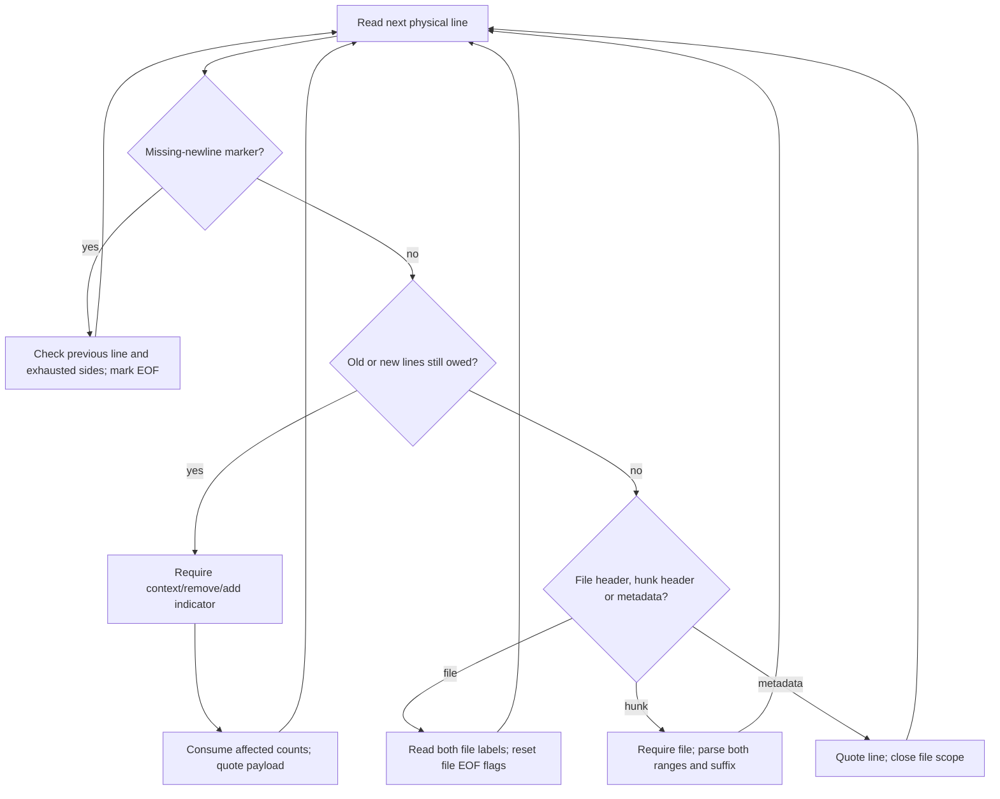

# Unified diff to Markdown file, hunk and change records

Tool 42 reads a `diff` fence. The records are flat and ordered: a file starts
a new scope, a hunk declares its ranges, and change records follow it. There
is no root item. File labels include their original timestamps or quoting.

```diff
diff --git a/message.txt b/message.txt
--- a/message.txt
+++ b/message.txt
@@ -1,2 +1,3 @@ greeting
 Hello
-old
+new
+last
\ No newline at end of file
```

becomes:

```text
- meta "diff --git a/message.txt b/message.txt"
- file "a/message.txt" "b/message.txt"
- hunk -1,2 +1,3 " greeting"
- context "Hello"
- remove "old"
- add "new"
- add "last"
- no-newline
```

## Preserve the patch, not an interpretation of its paths

The format follows [GNU unified output](https://www.gnu.org/software/diffutils/manual/diffutils.html#Detailed-Unified)
and [Git's patch headers](https://git-scm.com/docs/diff-format#_generating_patch_text_with_p).
Header labels, range spellings, section suffixes and changed text stay intact.
File labels are not split at spaces, tabs or quotes; no path is opened. Added,
removed and context lines become JSON-quoted strings without their indicator.

Physical LF separates lines. CR, TAB, NUL and other control bytes inside a
line are retained through escapes. Input must be UTF-8. This matters for a
patch of CRLF files: a payload's trailing CR is not disposable whitespace.
An outer Markdown fence must be longer than any otherwise-closing backtick
line, including context lines beginning with one space. Empty input inside
a fence produces no records. A final physical LF is not represented as data;
the explicit missing-newline marker describes the source file's final line.

The reader validates old/new hunk counts independently. Omitted counts mean
one; explicit zero counts allow empty sides. Start positions remain decimal
spans, so large line numbers do not overflow. This is not an application check:
it does not compare hunk context with a target file or resolve overlapping
positions across hunks. The [range helper](00-patch-lines.md) explains the
input-derived count bound and zero-line rule.

Nonstructural lines outside hunks become `meta` records, retaining Git index,
mode, rename and copy headers, and ordinary preambles. Such a line closes the
current file scope; another hunk requires another file-header pair. Header-only
and metadata-only changes are retained. Git binary patch bodies and combined
multi-parent hunks are rejected, not silently interpreted as text hunks.

## Inside run: counts decide whether a header is content

While either remaining count is nonzero, a line beginning `---` is a removal
whose text begins `--`, not the start of another file. The same applies to
`+++` and additions. Only after both counts reach zero can a new header or
hunk begin. Metadata cannot hide an incomplete hunk.



| Line kind | Old count consumed | New count consumed | Last-line mask |
| --- | ---: | ---: | ---: |
| Context | 1 | 1 | 3 |
| Removal | 1 | 0 | 1 |
| Addition | 0 | 1 | 2 |
| Missing-newline marker | 0 | 0 | Cleared after use |

The mask records which file sides the preceding line belongs to. Before each
decrement, require a positive count. At EOF, both counters must be zero.
The output cursor is separate from the input cursor and hunk counters.

## Inside the marker branch: a line can be final on only one side

The exact English `\ No newline at end of file` marker must immediately
follow a content line. The [GNU manual](https://www.gnu.org/software/diffutils/manual/html_node/Incomplete-Lines.html)
notes that its diagnostic text can be localized; localized variants are not
accepted by this version. A second marker for the same line fails.

For a removed incomplete line followed by several added lines, only the old
count must have reached zero. Mark that side as ended; additions may continue.
A context marker ends both sides. Later content or hunks cannot consume a
side already marked ended. A new file resets those flags. This prevents a
marker from being preserved in a structurally impossible position.

## String and memory patterns

The quoting loop handles each byte once. Ordinary UTF-8 bytes pass through;
quotation marks and backslashes gain an escape. TAB/CR/backspace/form-feed use
their short escapes, other bytes below 0x20 use `\u00` and two hex digits.
No decoded string or patch tree is created. Metadata is data even when it
looks like HTML or contains a URL.

Input occupies at most 64 KiB and stays unchanged. Output is bounded to
`0x10000..0x30000` (128 KiB). A small read-only length-prefixed literal table
is in the fourth page. Long collections of short lines can exceed output
capacity; the emitter traps rather than returning a truncated result.
Every run resets the counters, file scope and marker state, including after
a previous trap. Framing and generic Markdown closing-fence checks reuse the
patterns documented by the [subtitle reader](38-srt-to-cues.md), but retain
LF inside the diff body and never normalize CR in its content.

## Module

Imports: LF line 0, spaces 1, range 2, UTF-8 validation 3. Defined functions:
run 4, emit 5, copy 6, quote 7, fence 8, fence-lines 9, take 10, literal 11,
word 12, hex digit 13. All addresses are offsets in one shared memory.

`[microwasm]`

- dr-header: `0061736d 01000000`
- dr-type-section: `01 {{size:dr-types}}`
  - dr-types: `08 60 02 7f 7f 02 7f 7f 60 02 7f 7f 01 7f 60 02 7f 7f 00 60 01 7f 01 7f 60 01 7f 00 60 01 7f 02 7f 7f 60 03 7f 7f 7f 00 60 03 7f 7f 7f 01 7f`
- dr-import-section: `02 {{size:dr-imports}}`
  - dr-imports: `05 01 70 04 6c696e65 00 00 01 72 06 737061636573 00 01 01 70 05 72616e6765 00 00 01 63 04 75746638 00 02 01 70 06 6d656d6f7279 02 01 04 04`
- dr-function-section: `03 {{size:dr-functions}}`
  - dr-functions: `0a 03 04 02 02 05 06 04 04 07 04`
- dr-global-section: `06 {{size:dr-globals}}`
  - dr-globals: `09 7f 01 41 00 0b 7f 01 41 00 0b 7f 01 41 00 0b 7f 01 41 00 0b 7f 01 41 00 0b 7f 01 41 00 0b 7f 01 41 00 0b 7f 01 41 00 0b 7f 01 41 00 0b`
- dr-export-section: `07 {{size:dr-exports}}`
  - dr-exports: `02 03 72756e 00 04 06 6d656d6f7279 02 00`
- dr-code-section: `0a {{size:dr-code}}`
  - dr-code: `0a`
    - dr-run-record: `{{size:dr-run-body}}`
      - dr-run-body: `01 0b 7f 20 00 10 08 24 02 24 01 23 01 23 02 10 03 41 808004 24 00 41 00 24 04 41 00 24 05 41 00 24 06 41 00 24 07 41 00 24 08`
        - dr-run-loop: `02 40 03 40 23 01 23 02 4f 0d 01 23 01 23 02 10 00 21 02 22 01 24 03 41 00 21 03 23 01 20 01 49 04 40 23 01 2d 00 00 21 03 0b`
          - dr-marker: `20 03 41 dc00 46 04 40 23 07 45 04 40 00 0b 23 01 20 01 41 c2800c 10 0c 20 01 47 04 40 00 0b 23 07 41 01 71 23 04 41 00 47 71 23 07 41 02 71 41 00 47 23 05 41 00 47 71 72 04 40 00 0b 23 08 23 07 72 24 08 41 00 24 07 41 b4800c 10 0b 20 02 24 01 0c 01 0b`
          - dr-content: `23 04 23 05 72 04 40 20 03 41 20 46 04 7f 41 03 05 20 03 41 2d 46 04 7f 41 01 05 20 03 41 2b 46 04 7f 41 02 05 00 0b 0b 0b 21 0b`
            - dr-content-ended: `20 0b 23 08 71 04 40 00 0b`
            - dr-content-old: `20 0b 41 01 71 04 40 23 04 45 04 40 00 0b 23 04 41 01 6b 24 04 0b`
            - dr-content-new: `20 0b 41 02 71 04 40 23 05 45 04 40 00 0b 23 05 41 01 6b 24 05 0b 20 0b 24 07`
            - dr-content-prefix: `20 0b 41 03 46 04 7f 41 98800c 05 20 0b 41 01 46 04 7f 41 a3800c 05 41 ad800c 0b 0b 10 0b`
            - dr-content-emit: `23 01 41 01 6a 20 01 10 07 41 0a 10 05 20 02 24 01 0c 01 0b 41 00 24 07`
          - dr-file: `20 03 41 2d 46 04 40 41 2d 10 0a 41 2d 10 0a 41 2d 10 0a 41 20 10 0a 23 01 20 01 46 04 40 00 0b 41 88800c 10 0b 23 01 20 01 10 07 41 20 10 05 20 02 24 01 23 01 23 02 10 00 21 02 22 01 24 03 41 2b 10 0a 41 2b 10 0a 41 2b 10 0a 41 20 10 0a 23 01 20 01 46 04 40 00 0b 23 01 20 01 10 07 41 0a 10 05 41 01 24 06 41 00 24 08 20 02 24 01 0c 01 0b`
          - dr-hunk: `20 03 41 c000 46 04 40 23 06 45 04 40 00 0b 41 c000 10 0a 41 c000 10 0a 41 20 10 0a 23 01 21 04 41 2d 10 0a`
            - dr-hunk-old: `23 01 20 01 10 02 21 09 22 05 24 01 41 20 10 0a 23 01 21 06 41 2b 10 0a`
            - dr-hunk-new: `23 01 20 01 10 02 21 0a 22 07 24 01 41 20 10 0a 41 c000 10 0a 41 c000 10 0a 23 01 21 08`
            - dr-hunk-eof: `23 08 41 01 71 20 09 41 00 47 71 23 08 41 02 71 41 00 47 20 0a 41 00 47 71 72 04 40 00 0b 20 09 24 04 20 0a 24 05`
            - dr-hunk-emit: `41 90800c 10 0b 20 04 20 05 10 06 41 20 10 05 20 06 20 07 10 06 41 20 10 05 20 08 20 01 10 07 41 0a 10 05 20 02 24 01 0c 01 0b`
          - dr-meta: `20 03 41 20 46 20 03 41 2b 46 72 04 40 00 0b 23 01 20 01 41 de800c 10 0c 20 01 46 04 40 00 0b 41 80800c 10 0b 23 01 20 01 10 07 41 0a 10 05 41 00 24 06 41 00 24 08 20 02 24 01 0c 00 0b 0b`
        - dr-run-complete: `23 04 23 05 72 04 40 00 0b 23 00 41 808004 6b 0b`
    - dr-emit-record: `{{size:dr-emit-body}}`
      - dr-emit-body: `00 23 00 41 80800c 4f 04 40 00 0b 23 00 20 00 3a 00 00 23 00 41 01 6a 24 00 0b`
    - dr-copy-record: `{{size:dr-copy-body}}`
      - dr-copy-body: `00 02 40 03 40 20 00 20 01 4f 0d 01 20 00 2d 00 00 10 05 20 00 41 01 6a 21 00 0c 00 0b 0b 0b`
    - dr-quote-record: `{{size:dr-quote-body}}`
      - dr-quote-body: `01 01 7f 41 22 10 05 02 40 03 40 20 00 20 01 4f 0d 01 20 00 2d 00 00 21 02 20 00 41 01 6a 21 00`
        - dr-quote-short: `20 02 41 09 46 04 40 41 dc00 10 05 41 f400 10 05 0c 01 0b 20 02 41 0d 46 04 40 41 dc00 10 05 41 f200 10 05 0c 01 0b 20 02 41 08 46 04 40 41 dc00 10 05 41 e200 10 05 0c 01 0b 20 02 41 0c 46 04 40 41 dc00 10 05 41 e600 10 05 0c 01 0b`
        - dr-quote-control: `20 02 41 20 49 04 40 41 dc00 10 05 41 f500 10 05 41 30 10 05 41 30 10 05 20 02 41 04 76 10 0d 20 02 41 0f 71 10 0d 0c 01 0b`
        - dr-quote-escape: `20 02 41 22 46 20 02 41 dc00 46 72 04 40 41 dc00 10 05 0b 20 02 10 05 0c 00 0b 0b 41 22 10 05 0b`
    - dr-fence-record: `{{size:dr-fence-body}}`
      - dr-fence-body: `01 06 7f 20 00 41 0b 49 20 00 41 808004 4b 72 04 40 00 0b 02 40 03 40 20 01 20 00 4f 0d 01 20 01 2d 00 00 41 e000 47 0d 01 20 01 41 01 6a 21 01 0c 00 0b 0b 20 01 41 03 49 20 00 20 01 6b 41 05 49 72 04 40 00 0b`
        - dr-fence-label: `20 01 2d 00 00 41 20 72 41 e400 47 20 01 2d 00 01 41 20 72 41 e900 47 72 20 01 2d 00 02 41 20 72 41 e600 47 72 20 01 2d 00 03 41 20 72 41 e600 47 72 20 01 2d 00 04 41 0a 47 72 04 40 00 0b 20 01 41 05 6a 21 02 20 00 21 03`
        - dr-fence-trim: `02 40 03 40 20 03 20 02 4d 0d 01 20 03 41 01 6b 2d 00 00 21 05 20 05 41 20 46 20 05 41 09 46 72 20 05 41 0a 46 72 20 05 41 0d 46 72 45 0d 01 20 03 41 01 6b 21 03 0c 00 0b 0b`
        - dr-fence-ticks: `02 40 03 40 20 03 20 02 4d 0d 01 20 03 41 01 6b 2d 00 00 41 e000 47 0d 01 20 03 41 01 6b 21 03 20 04 41 01 6a 21 04 0c 00 0b 0b 20 04 20 01 49 04 40 00 0b`
        - dr-fence-separator: `20 03 20 02 4b 04 40 20 03 41 01 6b 2d 00 00 41 0a 47 04 40 00 0b 0b 20 02 20 03 20 01 10 09 20 02 20 03 0b`
    - dr-fence-lines-record: `{{size:dr-fence-lines-body}}`
      - dr-fence-lines-body: `01 05 7f 02 40 03 40 20 00 20 01 4f 0d 01 20 00 20 01 10 00 21 04 21 03 20 03 20 00 4b 04 40 20 03 41 01 6b 2d 00 00 41 0d 46 04 40 20 03 41 01 6b 21 03 0b 0b 20 00 21 05 41 00 21 06 02 40 03 40 20 05 20 03 4f 0d 01 20 06 41 03 4f 0d 01 20 05 2d 00 00 41 20 47 0d 01 20 05 41 01 6a 21 05 20 06 41 01 6a 21 06 0c 00 0b 0b 41 00 21 07`
        - dr-fence-lines-ticks: `02 40 03 40 20 05 20 03 4f 0d 01 20 05 2d 00 00 41 e000 47 0d 01 20 05 41 01 6a 21 05 20 07 41 01 6a 21 07 0c 00 0b 0b`
        - dr-fence-lines-close: `20 07 20 02 4f 04 40 20 05 20 03 10 01 20 03 46 04 40 00 0b 0b 20 04 21 00 0c 00 0b 0b 0b`
    - dr-take-record: `{{size:dr-take-body}}`
      - dr-take-body: `00 23 01 23 03 4f 04 40 00 0b 23 01 2d 00 00 20 00 47 04 40 00 0b 23 01 41 01 6a 24 01 0b`
    - dr-literal-record: `{{size:dr-literal-body}}`
      - dr-literal-body: `00 20 00 41 01 6a 20 00 20 00 2d 00 00 6a 41 01 6a 10 06 0b`
    - dr-word-record: `{{size:dr-word-body}}`
      - dr-word-body: `01 02 7f 20 02 2d 00 00 21 03 20 01 20 00 6b 20 03 49 04 40 41 00 0f 0b 20 02 41 01 6a 21 02 02 40 03 40 20 04 20 03 4f 0d 01 20 00 20 04 6a 2d 00 00 20 02 20 04 6a 2d 00 00 47 04 40 41 00 0f 0b 20 04 41 01 6a 21 04 0c 00 0b 0b 20 00 20 03 6a 0b`
    - dr-hex-record: `{{size:dr-hex-body}}`
      - dr-hex-body: `00 20 00 20 00 41 0a 49 04 7f 41 30 05 41 d700 0b 6a 10 05 0b`
- dr-data-section: `0b {{size:dr-data}}`
  - dr-data: `01 00 41 80800c 0b 6f`
    - dr-prefixes: `07 2d206d65746120 07 2d2066696c6520 07 2d2068756e6b20 0a 2d20636f6e7465787420 09 2d2072656d6f766520 06 2d2061646420 0d 2d206e6f2d6e65776c696e650a`
    - dr-markers: `1b 5c204e6f206e65776c696e6520617420656e64206f662066696c65 10 4749542062696e617279207061746368`
