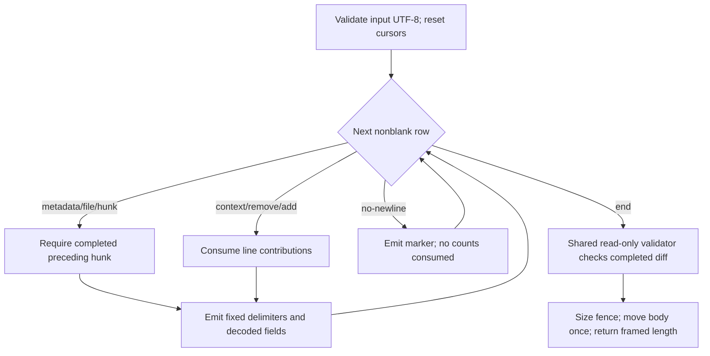

# Markdown file, hunk and change records to unified diff

Tool 43 reverses the [diff reader](42-diff-to-changes.md). Flat records keep
their order, without a mandatory root. The output is a literal `diff` fence;
the transformation never opens paths or applies a patch.

```text
- meta "diff --git a/message.txt b/message.txt"
- file "a/message.txt" "b/message.txt"
- hunk -1,2 +1,3 " greeting"
- context "Hello"
- remove "old"
- add "new"
- add "last"
- no-newline
```

becomes:

```diff
diff --git a/message.txt b/message.txt
--- a/message.txt
+++ b/message.txt
@@ -1,2 +1,3 @@ greeting
 Hello
-old
+new
+last
\ No newline at end of file
```

## Row contract

Rows start with `- ` at column zero. Blank rows and additional spaces/tabs
between fields are permitted. Quoted strings use JSON escaping; no decoded
LF is allowed in a single-line value. CR, TAB, NUL and other control bytes
are allowed through escapes and preserved in the patch. Raw Unicode and
surrogate-pair escapes produce the same UTF-8 bytes. Invalid UTF-8, raw
controls in strings, invalid escapes and lone surrogates fail.

- `meta` has one string. It cannot begin with a space, `-`, `+`, `@` or `\`:
  those would be interpreted as structural lines rather than metadata.
  Empty metadata preserves an empty physical line.
- `file` has two nonempty strings. Each is the complete label after its
  header indicator, including any timestamp, tabs or filename quoting.
- `hunk` has its old range (including `-`), new range (including `+`) and
  one quoted suffix. Empty suffix is `""`; a section name normally includes
  its leading space. Range spelling, including omitted counts, is retained.
- `context`, `remove` and `add` each have one string. Empty text represents
  an empty source line. Header-looking strings remain changed text.
- `no-newline` has no fields and writes the English incomplete-line marker.

Metadata, file and hunk records cannot interrupt an unfinished hunk. File
scope, side-specific count consumption and incomplete-line placement follow
the reader's checks. Git binary patch bodies and combined hunks remain out
of scope. This is structural validation, not proof that a patch applies to
a target file. Nothing is fetched, styled or executed from the patch data.

## Inside run: stream first, validate the actual bytes

Each row writes its line prefix and decoded strings directly to the output
region. No string scratch page or record tree is needed. After parsing all
rows, invoke the reader's `validate(start, end)` on the completed bare diff.
It does not render a temporary Markdown document or write to the patch.
Only a successful validation is followed by framing and a returned length.



## Boundary bookkeeping is not a second patch validator

One per-run counter tracks **old count + new count** for the current hunk.
Context consumes two contributions; removal or addition consumes one. A new
structural record requires zero. This prevents a `file` record emitted inside
a hunk from being reinterpreted as two changed lines. It also prevents changed
records outside a hunk from accidentally becoming file headers.

That sum cannot prove the two sides agree. For example, two removals consume
two contributions but cannot satisfy a hunk declaring one old and one new
line. The shared validator rejects it. Its separate old/new counters and
side-specific EOF flags remain the single authority for patch validity.

| Check | Owner | Why |
| --- | --- | --- |
| Markdown keywords and JSON strings | Writer | They are not part of diff syntax |
| Structural record at a hunk boundary | Writer contribution counter | Prevents a record from changing kind |
| Old and new sides each satisfied | Shared validator | Sum alone is insufficient |
| Missing-newline ownership and file scope | Shared validator | Same rules as the reader |
| Output fence cannot close early | Writer frame | Checks decoded bytes, not input spelling |

## String and frame patterns

The [WebVTT writer](41-cues-to-vtt.md) documents the scalar iterator and UTF-8
emission used here. This string routine is simpler: it emits directly, rejects
decoded LF and returns the emitted start/end span. File labels use that span
to reject emptiness; metadata checks its first byte. A JSON escape cannot
smuggle in a line break or change a metadata record into a file/hunk record.

The completed body is scanned for its longest backtick run. Choose at least
three backticks and one more than that run. The `diff` label means the prefix
is `f + 5` bytes and the suffix is `f + 1`. Check their combined size before
the overlapping `memory.copy`; then write the wrapper without recopying the
body byte by byte. Even a long run introduced through Unicode escapes is safe.

Input occupies at most 64 KiB and remains unchanged. Output is at most 128 KiB
at `0x10000..0x30000`. Both modules' small literal tables live in the fourth
page and are read-only. Failure may leave partial output, but returns no length.
A later invocation resets writer state and the validator resets its own state.

## Module

Imports: JSON iterator 0, physical line 1, range 2, diff validation 3,
spaces 4, UTF-8 validation 5. Functions: run 6, emit 7, copy 8, take 9,
required space 10, string 11, scalar 12, UTF-8 13, frame 14, word 15,
finish row 16, literal 17, metadata prefix 18, boundary 19.

`[microwasm]`

- dw-header: `0061736d 01000000`
- dw-type-section: `01 {{size:dw-types}}`
  - dw-types: `09 60 03 7f 7f 7f 03 7f 7f 7f 60 02 7f 7f 02 7f 7f 60 02 7f 7f 01 7f 60 02 7f 7f 00 60 01 7f 01 7f 60 01 7f 00 60 00 00 60 00 02 7f 7f 60 00 01 7f`
- dw-import-section: `02 {{size:dw-imports}}`
  - dw-imports: `07 01 6b 04 6e657874 00 00 01 72 04 6c696e65 00 01 01 70 05 72616e6765 00 01 01 64 08 76616c6964617465 00 03 01 72 06 737061636573 00 02 01 63 04 75746638 00 03 01 64 06 6d656d6f7279 02 01 04 04`
- dw-function-section: `03 {{size:dw-functions}}`
  - dw-functions: `0e 04 05 03 05 06 07 01 05 08 05 06 05 03 06`
- dw-global-section: `06 {{size:dw-globals}}`
  - dw-globals: `04 7f 01 41 00 0b 7f 01 41 00 0b 7f 01 41 00 0b 7f 01 41 00 0b`
- dw-export-section: `07 {{size:dw-exports}}`
  - dw-exports: `02 03 72756e 00 06 06 6d656d6f7279 02 00`
- dw-code-section: `0a {{size:dw-code}}`
  - dw-code: `0e`
    - dw-run-record: `{{size:dw-run-body}}`
      - dw-run-body: `01 07 7f 20 00 41 808004 4b 04 40 00 0b 41 00 20 00 10 05 41 808004 24 00 41 00 24 01 41 00 24 03`
        - dw-run-loop: `02 40 03 40 23 01 20 00 4f 0d 01 23 01 20 00 10 01 21 02 22 01 24 02`
          - dw-run-blank: `23 01 23 02 10 04 23 02 46 04 40 20 02 24 01 0c 01 0b`
          - dw-run-bullet: `41 2d 10 09 41 20 10 09 23 01 23 02 10 04 24 01 23 01 23 02 4f 04 40 00 0b 23 01 2d 00 00 21 03`
          - dw-meta: `20 03 41 ed00 46 04 40 10 13 41 80820c 10 0f 10 0a 10 0b 10 12 10 10 41 0a 10 07 20 02 24 01 0c 01 0b`
          - dw-file: `20 03 41 e600 46 04 40 10 13 41 85820c 10 0f 10 0a 41 2d 10 07 41 2d 10 07 41 2d 10 07 41 20 10 07 10 0b 46 04 40 00 0b 10 0a 41 0a 10 07 41 2b 10 07 41 2b 10 07 41 2b 10 07 41 20 10 07 10 0b 46 04 40 00 0b 10 10 41 0a 10 07 20 02 24 01 0c 01 0b`
          - dw-hunk: `20 03 41 e800 46 04 40 10 13 41 8a820c 10 0f 10 0a 41 c000 10 07 41 c000 10 07 41 20 10 07 23 01 21 07 41 2d 10 09`
            - dw-hunk-old: `23 01 23 02 10 02 24 03 24 01 20 07 23 01 10 08 10 0a 41 20 10 07 23 01 21 07 41 2b 10 09`
            - dw-hunk-new: `23 01 23 02 10 02 23 03 6a 24 03 24 01 20 07 23 01 10 08 10 0a 41 20 10 07 41 c000 10 07 41 c000 10 07 10 0b 1a 1a 10 10 41 0a 10 07 20 02 24 01 0c 01 0b`
          - dw-no-newline: `20 03 41 ee00 46 04 40 41 a2820c 10 0f 10 10 41 ad820c 10 11 41 0a 10 07 20 02 24 01 0c 01 0b`
          - dw-context: `41 01 21 06 20 03 41 e300 46 04 40 41 8f820c 10 0f 41 20 10 07 41 02 21 06`
            - dw-remove: `05 20 03 41 f200 46 04 40 41 97820c 10 0f 41 2d 10 07`
            - dw-add: `05 41 9e820c 10 0f 41 2b 10 07 0b 0b 10 0a`
          - dw-contributions: `23 03 20 06 49 04 40 00 0b 23 03 20 06 6b 24 03 10 0b 1a 1a 10 10 41 0a 10 07 20 02 24 01 0c 00 0b 0b`
        - dw-run-validate-frame: `41 808004 23 00 10 03 10 0e 0b`
    - dw-emit-record: `{{size:dw-emit-body}}`
      - dw-emit-body: `00 23 00 41 80800c 4f 04 40 00 0b 23 00 20 00 3a 00 00 23 00 41 01 6a 24 00 0b`
    - dw-copy-record: `{{size:dw-copy-body}}`
      - dw-copy-body: `00 02 40 03 40 20 00 20 01 4f 0d 01 20 00 2d 00 00 10 07 20 00 41 01 6a 21 00 0c 00 0b 0b 0b`
    - dw-take-record: `{{size:dw-take-body}}`
      - dw-take-body: `00 23 01 23 02 4f 04 40 00 0b 23 01 2d 00 00 20 00 47 04 40 00 0b 23 01 41 01 6a 24 01 0b`
    - dw-space-record: `{{size:dw-space-body}}`
      - dw-space-body: `01 01 7f 23 01 23 02 10 04 22 00 23 01 46 04 40 00 0b 20 00 24 01 0b`
    - dw-string-record: `{{size:dw-string-body}}`
      - dw-string-body: `01 02 7f 23 00 21 01 41 22 10 09 03 40 23 01 23 02 4f 04 40 00 0b`
        - dw-string-close: `23 01 2d 00 00 41 22 46 04 40 23 01 41 01 6a 24 01 20 01 23 00 0f 0b`
        - dw-string-scalar: `23 01 23 02 10 0c 24 01 21 00 20 00 41 0a 46 04 40 00 0b 20 00 10 0d 0c 00 0b 00 0b`
    - dw-scalar-record: `{{size:dw-scalar-body}}`
      - dw-scalar-body: `01 04 7f 20 00 20 01 41 00 10 00 21 02 21 04 21 03 20 03 41 7f 46 04 40 00 0b`
        - dw-scalar-high: `20 03 41 80b003 6b 41 ff07 4d 04 40 20 04 20 01 20 02 10 00 21 02 21 04 21 05 20 05 41 80b803 6b 41 ff07 4b 04 40 00 0b`
          - dw-scalar-pair: `20 03 41 80b003 6b 41 0a 74 20 05 41 80b803 6b 6a 41 808004 6a 21 03 0b`
        - dw-scalar-lone: `20 03 41 80b003 6b 41 ff0f 4d 04 40 00 0b 20 03 20 04 0b`
    - dw-utf8-record: `{{size:dw-utf8-body}}`
      - dw-utf8-body: `00 20 00 41 8001 49 04 40 20 00 10 07 0f 0b`
        - dw-utf8-two: `20 00 41 8010 49 04 40 20 00 41 06 76 41 c001 72 10 07`
          - dw-utf8-more: `05 20 00 41 808004 49 04 40 20 00 41 0c 76 41 e001 72 10 07`
            - dw-utf8-four: `05 20 00 41 12 76 41 f001 72 10 07 20 00 41 0c 76 41 3f 71 41 8001 72 10 07 0b`
          - dw-utf8-middle: `20 00 41 06 76 41 3f 71 41 8001 72 10 07 0b`
        - dw-utf8-last: `20 00 41 3f 71 41 8001 72 10 07 0b`
    - dw-frame-record: `{{size:dw-frame-body}}`
      - dw-frame-body: `01 05 7f 23 00 41 808004 6b 21 03 41 808004 21 00 41 02 21 02 02 40 03 40 20 00 23 00 4f 0d 01`
        - dw-frame-run: `20 00 2d 00 00 41 e000 46 04 40 20 01 41 01 6a 21 01 20 01 20 02 4b 04 40 20 01 21 02 0b 05 41 00 21 01 0b 20 00 41 01 6a 21 00 0c 00 0b 0b 20 02 41 01 6a 21 02`
        - dw-frame-limit: `20 03 20 02 41 02 6c 6a 41 06 6a 41 808008 4b 04 40 00 0b`
        - dw-frame-move: `41 808004 20 02 6a 41 05 6a 41 808004 20 03 fc 0a 00 00 41 808004 24 00`
        - dw-frame-prefix: `03 40 41 e000 10 07 20 04 41 01 6a 22 04 20 02 49 0d 00 0b 41 e400 10 07 41 e900 10 07 41 e600 10 07 41 e600 10 07 41 0a 10 07`
        - dw-frame-suffix: `23 00 20 03 6a 24 00 41 00 21 04 03 40 41 e000 10 07 20 04 41 01 6a 22 04 20 02 49 0d 00 0b 41 0a 10 07 23 00 41 808004 6b 0b`
    - dw-word-record: `{{size:dw-word-body}}`
      - dw-word-body: `01 02 7f 20 00 2d 00 00 21 01 20 00 41 01 6a 21 00 02 40 03 40 20 02 20 01 4f 0d 01 20 00 20 02 6a 2d 00 00 10 09 20 02 41 01 6a 21 02 0c 00 0b 0b 0b`
    - dw-finish-record: `{{size:dw-finish-body}}`
      - dw-finish-body: `00 23 01 23 02 10 04 23 02 47 04 40 00 0b 0b`
    - dw-literal-record: `{{size:dw-literal-body}}`
      - dw-literal-body: `00 20 00 41 01 6a 20 00 20 00 2d 00 00 6a 41 01 6a 10 08 0b`
    - dw-meta-record: `{{size:dw-meta-body}}`
      - dw-meta-body: `01 01 7f 20 00 20 01 46 04 40 0f 0b 20 00 2d 00 00 21 02 20 02 41 20 46 20 02 41 2d 46 72 20 02 41 2b 46 72 20 02 41 c000 46 72 20 02 41 dc00 46 72 04 40 00 0b 0b`
    - dw-boundary-record: `{{size:dw-boundary-body}}`
      - dw-boundary-body: `00 23 03 04 40 00 0b 0b`
- dw-data-section: `0b {{size:dw-data}}`
  - dw-data: `01 00 41 80820c 0b 49`
    - dw-words: `04 6d657461 04 66696c65 04 68756e6b 07 636f6e74657874 06 72656d6f7665 03 616464 0a 6e6f2d6e65776c696e65`
    - dw-marker: `1b 5c204e6f206e65776c696e6520617420656e64206f662066696c65`
