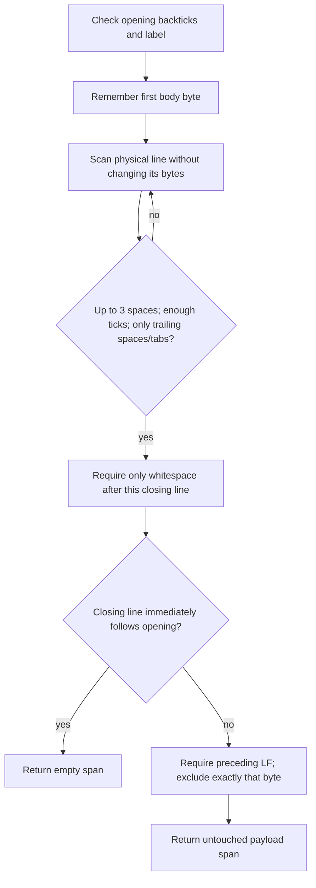

# Hexadecimal bytes to a UTF-8 text fence

Tool 44 decodes byte pairs, validates the resulting UTF-8, and encloses the
text in a safe Markdown fence. It does not guess an encoding or replace bad
bytes with a replacement character. The [reverse tool](45-text-to-hex.md)
uses the same module's `encode` export.

```hex
48 65 6c 6c 6f 2c 20 e4 b8 96 e7 95 8c 21
```

becomes:

```text
Hello, 世界!
```

## Bytes, not inferred lines

The newline immediately before the closing fence is framing, not payload.
Consequently `hello` followed by that newline represents five bytes, while
`hello` followed by two newlines represents six. An immediate closing fence
and a single empty body line both represent empty input. The writer always
uses one framing LF, including for empty text. No extra root or header block
is needed to distinguish a final newline.

These are tool-specific payload conventions inside ordinary
[CommonMark fences](https://spec.commonmark.org/0.31.2/#fenced-code-blocks).
A generic Markdown renderer displays the text but does not interpret which
newline is framing. The source remains authoritative for byte conversion.

Hexadecimal input consists of complete pairs of `0–9`, `a–f` or `A–F`.
Adjacent pairs need no separator. Space, TAB, LF and CR are permitted between
pairs, never between their two digits. There are no offsets, ASCII sidebars,
comments, `0x` prefixes or inferred missing nibbles. Empty input is valid.

The decoded bytes must satisfy [UTF-8](https://www.rfc-editor.org/rfc/rfc3629#section-4).
Overlong encodings, surrogate code points, truncated sequences and values
above U+10FFFF fail. BOM, NUL, CR and all other valid encoded scalars remain
data: neither direction normalizes them. Browser textareas normalize line
endings, and generic Markdown renderers can normalize controls; use code or
the direct Wasm interface when exact bytes matter.

## Framing without losing a last byte

Opening fences start at byte zero, have at least three backticks and the
exact lowercase label `hex` or `text`, then LF or CRLF. A closing fence has
at least that many backticks, at most three leading spaces and only spaces
or tabs afterward. Only whitespace may follow it. The first actual closing
line ends the body; an earlier close cannot be disguised by a later one.

Physical CR, LF and CRLF boundaries all participate in detecting closing
lines, as in CommonMark. The separator before a nonempty closing line must
end in LF. Remove only that LF, never a preceding CR: a CR just before it is
payload. This deliberately avoids guessing whether a terminal CR belongs
to a CRLF data sequence or to a document formatting convention.



The output chooses one more backtick than the longest run anywhere in the
decoded text, with a minimum of three. Counting decoded bytes is important:
`60 60 60` creates three backticks that were not present in the hex source.
The whole prefix/body/suffix size is checked before one overlapping
`memory.copy`; `memory.fill` writes the two tick runs. There is no temporary
string, JavaScript decoder or DOM-dependent conversion.

## Two small conversion loops

The decoder keeps one pending high nibble, using `-1` for none. A separator
is legal only in that empty state. On the second nibble it emits
`high * 16 + low` and returns to empty. End of input also requires empty.
Validate the completed byte span before framing it. This is why `c3 a9`
works across a line break between pairs, while `c 3` and `c3` fail for
different reasons.

The encoder reads one UTF-8 byte at a time. Before every byte except the
first, it emits a space, or LF when the byte index is a multiple of sixteen.
Then it emits the high and low nibble as lowercase digits. No trailing
separator is emitted by this loop; the fence supplies its own LF.

| State | Decoder | Encoder |
| --- | --- | --- |
| Input cursor | One hex digit or separator per step | One UTF-8 byte per step |
| Pending data | None, or one high nibble | None |
| Output cursor | Advances after two digits | Advances by two digits and usually one separator |
| Final check | No pending nibble; valid UTF-8 | Input was already validated by fence reader |

## Memory and module

Input is read-only at `0..65536`; output is at `0x10000..0x30000`, at most
128 KiB. Hex expansion can exceed that bound even when the source fits.
Each emitted byte and the final frame are checked. A trap publishes no
length; a later call resets the cursor. Literal labels occupy the fourth
page and never overlap output. There is no memory growth.

Instantiate the existing number memory as `n`, the calendar span helper as
`c`, and this module with `c`. Only its read-only UTF-8 checker and memory
are imported, not calendar semantics. Functions: UTF-8 import 0, decode 1,
encode 2, read fence 3, write fence 4, nibble 5, emit 6, hex digit 7, label
length 8. Global 0 is the output cursor. Label lengths are single bytes.

The Base64 pair also imports `fence(length, label)` and `frame(end, label)`.
`label` points to a length-prefixed literal in the fourth page, supplied by
the calling module, not by the user's document. `fence` returns a read-only
`(start, end)` payload span; `frame` encloses bytes already at `0x10000` and
returns their framed length. The caller validates those bytes as appropriate
before framing. These exports share the same routines, not copies.

`[microwasm]`

- hx-header: `0061736d 01000000`
- hx-type-section: `01 {{size:hx-types}}`
  - hx-types: `05 60 02 7f 7f 00 60 01 7f 01 7f 60 02 7f 7f 02 7f 7f 60 02 7f 7f 01 7f 60 01 7f 00`
- hx-import-section: `02 {{size:hx-imports}}`
  - hx-imports: `02 01 63 04 75746638 00 00 01 63 06 6d656d6f7279 02 01 04 04`
- hx-function-section: `03 {{size:hx-functions}}`
  - hx-functions: `08 01 01 02 03 01 04 04 01`
- hx-global-section: `06 {{size:hx-globals}}`
  - hx-globals: `01 7f 01 41 00 0b`
- hx-export-section: `07 {{size:hx-exports}}`
  - hx-exports: `05 03 72756e 00 01 06 656e636f6465 00 02 06 6d656d6f7279 02 00 05 66656e6365 00 03 05 6672616d65 00 04`
- hx-code-section: `0a {{size:hx-code}}`
  - hx-code: `08`
    - hx-decode-record: `{{size:hx-decode-body}}`
      - hx-decode-body: `01 04 7f 20 00 41 80840c 10 03 21 01 21 02 41 808004 24 00 41 7f 21 04`
        - hx-decode-loop: `02 40 03 40 20 02 20 01 4f 0d 01 20 02 2d 00 00 21 03 20 02 41 01 6a 21 02`
        - hx-decode-space: `20 03 41 20 46 20 03 41 09 46 72 20 03 41 0a 46 72 20 03 41 0d 46 72 04 40 20 04 41 7f 47 04 40 00 0b 0c 01 0b`
        - hx-decode-pair: `20 03 10 05 21 03 20 04 41 7f 46 04 40 20 03 21 04 05 20 04 41 04 74 20 03 72 10 06 41 7f 21 04 0b 0c 00 0b 0b`
        - hx-decode-finish: `20 04 41 7f 47 04 40 00 0b 41 808004 23 00 10 00 23 00 41 84840c 10 04 0b`
    - hx-encode-record: `{{size:hx-encode-body}}`
      - hx-encode-body: `01 04 7f 20 00 41 84840c 10 03 21 01 21 02 41 808004 24 00`
        - hx-encode-loop: `02 40 03 40 20 02 20 01 4f 0d 01 20 03 04 40 20 03 41 0f 71 45 04 7f 41 0a 05 41 20 0b 10 06 0b`
        - hx-encode-byte: `20 02 2d 00 00 21 04 20 04 41 04 76 10 07 20 04 41 0f 71 10 07 20 02 41 01 6a 21 02 20 03 41 01 6a 21 03 0c 00 0b 0b 23 00 41 80840c 10 04 0b`
    - hx-read-record: `{{size:hx-read-body}}`
      - hx-read-body: `01 09 7f 20 00 41 808004 4b 04 40 00 0b 41 00 20 00 10 00 20 01 10 08 21 0a`
        - hx-read-ticks: `02 40 03 40 20 02 20 00 4f 0d 01 20 02 2d 00 00 41 e000 47 0d 01 20 02 41 01 6a 21 02 0c 00 0b 0b 20 02 41 03 49 04 40 00 0b 20 02 21 03`
        - hx-read-label-room: `20 00 20 03 6b 20 0a 41 01 6a 49 04 40 00 0b`
        - hx-read-label: `02 40 03 40 20 07 20 0a 4f 0d 01 20 03 20 07 6a 2d 00 00 20 01 20 07 6a 2d 00 01 47 04 40 00 0b 20 07 41 01 6a 21 07 0c 00 0b 0b 20 03 20 0a 6a 21 03`
        - hx-read-opening-cr: `20 03 2d 00 00 41 0d 46 04 40 20 03 41 01 6a 21 03 0b 20 03 20 00 4f 04 40 00 0b 20 03 2d 00 00 41 0a 47 04 40 00 0b 20 03 41 01 6a 22 03 21 04`
        - hx-read-lines: `03 40 20 03 20 00 4f 04 40 00 0b 20 03 21 05`
          - hx-read-line-end: `02 40 03 40 20 05 20 00 4f 0d 01 20 05 2d 00 00 22 09 41 0a 46 20 09 41 0d 46 72 0d 01 20 05 41 01 6a 21 05 0c 00 0b 0b 20 05 21 06`
          - hx-read-next: `20 06 20 00 49 04 40 20 06 41 01 6a 21 06 20 09 41 0d 46 20 06 20 00 49 71 04 40 20 06 2d 00 00 41 0a 46 04 40 20 06 41 01 6a 21 06 0b 0b 0b`
          - hx-read-indent: `20 03 21 07 02 40 03 40 20 07 20 05 4f 0d 01 20 07 20 03 6b 41 03 4f 0d 01 20 07 2d 00 00 41 20 47 0d 01 20 07 41 01 6a 21 07 0c 00 0b 0b 41 00 21 08`
          - hx-read-close-ticks: `02 40 03 40 20 07 20 05 4f 0d 01 20 07 2d 00 00 41 e000 47 0d 01 20 07 41 01 6a 21 07 20 08 41 01 6a 21 08 0c 00 0b 0b`
          - hx-read-close-test: `20 08 20 02 4f 04 40 02 40 03 40 20 07 20 05 4f 0d 01 20 07 2d 00 00 22 09 41 20 46 20 09 41 09 46 72 45 0d 01 20 07 41 01 6a 21 07 0c 00 0b 0b 20 07 20 05 46 04 40`
            - hx-read-tail: `02 40 03 40 20 06 20 00 4f 0d 01 20 06 2d 00 00 22 09 41 20 46 20 09 41 09 46 72 20 09 41 0a 46 72 20 09 41 0d 46 72 45 04 40 00 0b 20 06 41 01 6a 21 06 0c 00 0b 0b`
            - hx-read-separator: `20 03 20 04 4b 04 40 20 03 41 01 6b 2d 00 00 41 0a 47 04 40 00 0b 20 03 41 01 6b 21 03 0b 20 04 20 03 0f 0b 0b 20 06 21 03 0c 00 0b 00 0b`
    - hx-frame-record: `{{size:hx-frame-body}}`
      - hx-frame-body: `01 09 7f 20 00 41 808004 49 20 00 41 80800c 4b 72 04 40 00 0b 20 01 10 08 21 07 20 00 41 808004 6b 21 03 41 808004 21 04 41 03 21 06`
        - hx-frame-scan: `02 40 03 40 20 04 20 00 4f 0d 01 20 04 2d 00 00 41 e000 46 04 40 20 05 41 01 6a 21 05 20 05 20 06 4f 04 40 20 05 41 01 6a 21 06 0b 05 41 00 21 05 0b 20 04 41 01 6a 21 04 0c 00 0b 0b`
        - hx-frame-size: `20 06 20 07 6a 41 01 6a 21 08 20 03 20 06 41 02 6c 6a 20 07 6a 41 03 6a 22 09 41 808008 4b 04 40 00 0b`
        - hx-frame-move: `41 808004 20 08 6a 41 808004 20 03 fc 0a 00 00 41 808004 41 e000 20 06 fc 0b 00`
        - hx-frame-label: `41 808004 20 06 6a 20 01 41 01 6a 20 07 fc 0a 00 00 41 808004 20 08 6a 41 01 6b 41 0a 3a 00 00`
        - hx-frame-close: `41 808004 20 08 6a 20 03 6a 22 0a 41 0a 3a 00 00 20 0a 41 01 6a 41 e000 20 06 fc 0b 00 20 0a 41 01 6a 20 06 6a 41 0a 3a 00 00 20 09 0b`
    - hx-nibble-record: `{{size:hx-nibble-body}}`
      - hx-nibble-body: `00 20 00 41 30 6b 41 09 4d 04 40 20 00 41 30 6b 0f 0b 20 00 41 20 72 41 e100 6b 22 00 41 05 4d 04 40 20 00 41 0a 6a 0f 0b 00 0b`
    - hx-emit-record: `{{size:hx-emit-body}}`
      - hx-emit-body: `00 23 00 41 80800c 4f 04 40 00 0b 23 00 20 00 3a 00 00 23 00 41 01 6a 24 00 0b`
    - hx-hex-record: `{{size:hx-hex-body}}`
      - hx-hex-body: `00 20 00 20 00 41 0a 49 04 7f 41 30 05 41 d700 0b 6a 10 06 0b`
    - hx-label-record: `{{size:hx-label-body}}`
      - hx-label-body: `01 01 7f 20 00 41 80800c 49 20 00 41 808010 4f 72 04 40 00 0b 20 00 2d 00 00 21 01 20 00 20 01 6a 41 01 6a 41 808010 4b 04 40 00 0b 20 01 0b`
- hx-data-section: `0b {{size:hx-data}}`
  - hx-data: `01 00 41 80840c 0b 09 03 686578 04 74657874`
