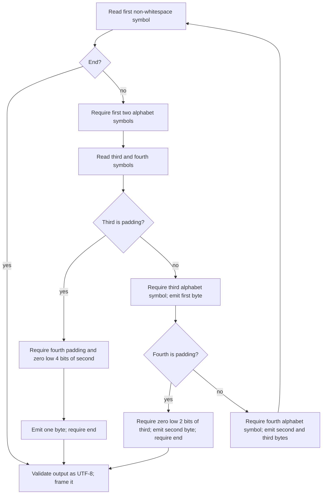

# Base64 bytes to a UTF-8 text fence

Tool 46 reads standard Base64, decodes bytes, validates UTF-8 and returns a
literal text fence. The [reverse tool](47-text-to-base64.md) uses this module's
`encode` export. Neither direction calls a JavaScript codec.

```base64
SGVsbG8sIHdvcmxkIQ==
```

becomes:

```text
Hello, world!
```

## Quartet boundaries and canonical padding

Use the standard alphabet and padding from
[RFC 4648](https://www.rfc-editor.org/rfc/rfc4648.html#section-4).
As an explicit editing convenience, this tool ignores space, TAB, CR and LF
anywhere in the Base64 body, including between padding characters. No other
non-alphabet characters are ignored. Base64url, missing padding, extra `=`,
nonzero unused pad bits, comments and data-URL prefixes fail.

Read four symbols at a time. The first two must be alphabet symbols. There
are exactly three valid shapes; only a complete unpadded quartet can be
followed by another quartet. Empty input is valid.

| Quartet | Bytes emitted | Required unused bits | What may follow |
| --- | --- | --- | --- |
| `abcd` | `a<<2 \| b>>4`, `b<<4 \| c>>2`, `c<<6 \| d` | None | Another quartet or end |
| `abc=` | First two bytes | Low two bits of `c` are zero | Whitespace and end |
| `ab==` | First byte | Low four bits of `b` are zero | Whitespace and end |

The byte store retains the low eight bits of each combined value. Alphabet
values are six bits; padding is a distinct sentinel, 64, and end is -1.
Unsigned comparisons reject either sentinel wherever a real symbol is needed.



Checking unused bits makes the accepted compact spelling canonical. For
example, `Zg==` represents `f`; `Zh==` has the same meaningful eight bits
but is rejected rather than quietly accepted as a second spelling.

## Text, framing and memory

The [hex pair's fence reader and writer](44-hex-to-text.md) are shared by
direct Wasm imports. Exactly one LF before the closing fence is framing,
not payload. A second LF is text. BOM, CR, NUL and Unicode normalization are
preserved; invalid UTF-8 traps instead of being repaired. Decoded backticks
determine the output fence width. Generic Markdown renderers and textareas
can normalize line endings or controls; these conventions describe source
bytes, not a promise of identical rendered glyphs.

The encoder consumes one to three bytes per pass and indexes the literal
alphabet with six-bit groups. A short final group emits one or two `=` signs,
never an invented zero byte. Output is one unwrapped Base64 line, with no
whitespace except the surrounding Markdown frame.

Input is read-only and at most 64 KiB. Output is checked against 128 KiB at
`0x10000..0x30000`. A long decoded backtick run can make the framing overflow
even though decoding itself shrinks the input. Failure returns no result,
and the next call resets all three cursors. Labels and alphabet live in the
fourth page, separately from the hex module's labels. No scratch allocation
or memory growth is needed.

Instantiate `n`, `c`, the hex module as `h`, then this module using `h` and `c`.
Imports: read fence 0, write fence 1, UTF-8 check 2. Functions: decode 3,
encode 4, emit 5, next symbol 6, alphabet output 7, next byte 8. Globals:
output cursor 0, input cursor 1, input end 2. `next symbol` skips only the
four documented whitespace bytes, returns alphabet values or sentinels, and
traps on anything else. `next byte` checks the cursor before every load.

`[microwasm]`

- b6-header: `0061736d 01000000`
- b6-type-section: `01 {{size:b6-types}}`
  - b6-types: `06 60 02 7f 7f 02 7f 7f 60 02 7f 7f 01 7f 60 02 7f 7f 00 60 01 7f 01 7f 60 01 7f 00 60 00 01 7f`
- b6-import-section: `02 {{size:b6-imports}}`
  - b6-imports: `04 01 68 05 66656e6365 00 00 01 68 05 6672616d65 00 01 01 63 04 75746638 00 02 01 68 06 6d656d6f7279 02 01 04 04`
- b6-function-section: `03 {{size:b6-functions}}`
  - b6-functions: `06 03 03 04 05 04 05`
- b6-global-section: `06 {{size:b6-globals}}`
  - b6-globals: `03 7f 01 41 00 0b 7f 01 41 00 0b 7f 01 41 00 0b`
- b6-export-section: `07 {{size:b6-exports}}`
  - b6-exports: `03 03 72756e 00 03 06 656e636f6465 00 04 06 6d656d6f7279 02 00`
- b6-code-section: `0a {{size:b6-code}}`
  - b6-code: `06`
    - b6-decode-record: `{{size:b6-decode-body}}`
      - b6-decode-body: `01 04 7f 20 00 41 80880c 10 00 24 02 24 01 41 808004 24 00`
        - b6-decode-loop: `02 40 03 40 10 06 22 01 41 7f 46 0d 01 10 06 21 02 20 01 41 3f 4b 20 02 41 3f 4b 72 04 40 00 0b 10 06 21 03 10 06 21 04`
        - b6-decode-one: `20 03 41 c000 46 04 40 20 04 41 c000 47 20 02 41 0f 71 72 04 40 00 0b 20 01 41 02 74 20 02 41 04 76 72 10 05 10 06 41 7f 47 04 40 00 0b 0c 02 0b`
        - b6-decode-third: `20 03 41 3f 4b 04 40 00 0b 20 01 41 02 74 20 02 41 04 76 72 10 05`
        - b6-decode-two: `20 04 41 c000 46 04 40 20 03 41 03 71 04 40 00 0b 20 02 41 04 74 20 03 41 02 76 72 10 05 10 06 41 7f 47 04 40 00 0b 0c 02 0b`
        - b6-decode-three: `20 04 41 3f 4b 04 40 00 0b 20 02 41 04 74 20 03 41 02 76 72 10 05 20 03 41 06 74 20 04 72 10 05 0c 00 0b 0b`
        - b6-decode-finish: `41 808004 23 00 10 02 23 00 41 87880c 10 01 0b`
    - b6-encode-record: `{{size:b6-encode-body}}`
      - b6-encode-body: `01 03 7f 20 00 41 87880c 10 00 24 02 24 01 41 808004 24 00`
        - b6-encode-loop: `02 40 03 40 23 01 23 02 4f 0d 01 10 08 21 01 20 01 41 02 76 10 07`
        - b6-encode-one: `23 01 23 02 46 04 40 20 01 41 03 71 41 04 74 10 07 41 3d 10 05 41 3d 10 05 0c 02 0b 10 08 21 02 20 01 41 03 71 41 04 74 20 02 41 04 76 72 10 07`
        - b6-encode-two: `23 01 23 02 46 04 40 20 02 41 0f 71 41 02 74 10 07 41 3d 10 05 0c 02 0b 10 08 21 03`
        - b6-encode-three: `20 02 41 0f 71 41 02 74 20 03 41 06 76 72 10 07 20 03 41 3f 71 10 07 0c 00 0b 0b 23 00 41 80880c 10 01 0b`
    - b6-emit-record: `{{size:b6-emit-body}}`
      - b6-emit-body: `00 23 00 41 80800c 4f 04 40 00 0b 23 00 20 00 3a 00 00 23 00 41 01 6a 24 00 0b`
    - b6-next-record: `{{size:b6-next-body}}`
      - b6-next-body: `01 01 7f 03 40 23 01 23 02 4f 04 40 41 7f 0f 0b 10 08 21 00`
        - b6-next-space: `20 00 41 20 46 20 00 41 09 46 72 20 00 41 0a 46 72 20 00 41 0d 46 72 0d 00`
        - b6-next-upper: `20 00 41 c100 6b 41 19 4d 04 40 20 00 41 c100 6b 0f 0b`
        - b6-next-lower: `20 00 41 e100 6b 41 19 4d 04 40 20 00 41 e100 6b 41 1a 6a 0f 0b`
        - b6-next-digit: `20 00 41 30 6b 41 09 4d 04 40 20 00 41 04 6a 0f 0b`
        - b6-next-special: `20 00 41 2b 46 04 40 41 3e 0f 0b 20 00 41 2f 46 04 40 41 3f 0f 0b 20 00 41 3d 46 04 40 41 c000 0f 0b 00 0b 00 0b`
    - b6-symbol-record: `{{size:b6-symbol-body}}`
      - b6-symbol-body: `00 20 00 41 8c880c 6a 2d 00 00 10 05 0b`
    - b6-byte-record: `{{size:b6-byte-body}}`
      - b6-byte-body: `01 01 7f 23 01 23 02 4f 04 40 00 0b 23 01 2d 00 00 21 00 23 01 41 01 6a 24 01 20 00 0b`
- b6-data-section: `0b {{size:b6-data}}`
  - b6-data: `01 00 41 80880c 0b 4c`
    - b6-labels: `06 626173653634 04 74657874`
    - b6-alphabet: `4142434445464748494a4b4c4d4e4f505152535455565758595a 6162636465666768696a6b6c6d6e6f707172737475767778797a 30313233343536373839 2b2f`
