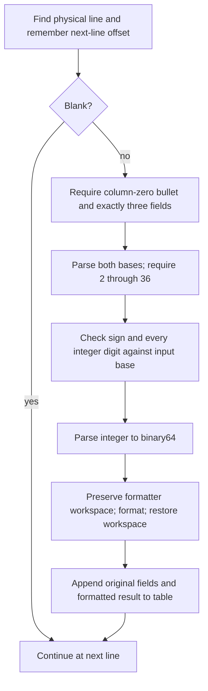

# Integer and radix rows to a conversion table

Tool 48 connects the numeric primitives to an editable Markdown document.
Each flat row contains an integer token, its input base and its output base.
There is no required root item. Bases are decimal integers from 2 through 36.

```text
- ff 16 2
- -42 10 16
- 1z 36 10
- 9007199254740993 10 10
- -0 10 10
```

becomes:

| Input | From base | To base | Result |
| --- | --- | --- | --- |
| ff | 16 | 2 | 11111111 |
| -42 | 10 | 16 | -2a |
| 1z | 36 | 10 | 71 |
| 9007199254740993 | 10 | 10 | 9007199254740992 |
| -0 | 10 | 10 | 0 |

## The conversion is binary64, not arbitrary-precision arithmetic

The integer is accumulated exactly, then rounded once to JavaScript's Number
representation by the [integer parser](../numbers/07-parse-integer.md).
The [radix formatter](../numbers/09-radix-format.md) writes the result in the
selected base. Its documented shortest-representation rules apply, including
radix-ten exponent notation, lowercase digits and `0` for negative zero.
Overflow becomes `Infinity` or `-Infinity`, not a wrapped integer.

This is intentionally not an exact BigInt converter: the fourth example
demonstrates rounding. For large odd-radix inputs, exact accumulation followed
by one rounding can differ from native `parseInt` implementations permitted
to approximate. The shared numeric docs explain those distinctions and the
independent tests of their rounding intervals.

Rows begin with `- ` at column zero. Fields are separated by one or more
spaces/tabs. Blank lines and trailing spaces/tabs are allowed; physical line
endings can be LF, CRLF or CR. Input tokens have an optional sign and at least
one ASCII digit valid in the input base. Case and leading zeros are retained
in the table's input column. Radix field spelling is retained too.

Unlike raw `parseInt`, this document parser requires the whole integer token
to be valid. Decimal points, separators, invalid trailing digits and radix
prefixes are not silently consumed or ignored. `0xff` fails in base 16 because
`x` is not a hexadecimal digit; in base 36, `0xff` is an ordinary valid numeral.
There are no quoted fields, inferred bases, fractional input or expressions.

## Inside a row: validate its boundaries before numeric work



`token` returns byte spans, not copied strings. The required-space function
must advance the cursor; otherwise adjacent fields would be ambiguous.
`radix` checks its accumulated value against 36 after each decimal digit, so
arbitrarily many leading zeros cannot overflow into a valid base. The integer
validator folds only ASCII letter digits and checks their value before the
shared parser is called. All emitted fields therefore contain no Markdown
table delimiters or active markup.

## Preserve a small workspace, not a whole document

Decimal formatting constructs candidate number strings at memory zero. Those
candidates use at most 23 bytes: 17 significant digits, a possible carry digit,
`e`, a possible exponent sign and at most three exponent digits. Four i64
locals preserve the first 32 bytes around each formatter call. The formatter
receives only validated bases and numeric values; its ordinary return path
restores those bytes before any later row or output-field copy reads them.
This relies on the documented candidate bound and is tested across decimal
boundary values. An unexpected internal numeric trap is not catchable here;
it would require the caller to reload its source buffer before another run.

Table bytes accumulate at `0x11000..0x20000`, away from the formatter's result
at `0x10000` and its scratch at `0x20000` and above. After the last row, one
overlapping `memory.copy` moves the completed table to the standard output
address, `0x10000`. The numeric scratch remains available between rows.

| Region | Owner | Lifetime |
| --- | --- | --- |
| First 64 KiB | Input document | Preserved across ordinary numeric calls |
| First 32 bytes, temporarily | Decimal candidate builder | Saved in four i64 locals; restored immediately |
| `0x10000..0x10435` | Numeric result workspace | Copied into table before next conversion |
| `0x11000..0x20000` | Accumulating table | Survives every numeric call |
| `0x20000` and above | Numeric scratch and literal tables | Existing numeric contracts apply |

Input is at most 64 KiB. The accumulating table is at most 60 KiB; every
emitted byte is bounded before writing. Ordinary input and capacity errors
return no length, leaving the caller's previous display unchanged. A new run
resets its cursors. Empty input produces the header and no rows. Literal
table fragments live at `0x33800`, beyond the numeric modules' work areas.

## Module

Instantiate `n`, multiword `b`, JSON binary64 `f`, exact decimal `d`, shortest
decimal `s`, integer parser `p` and radix formatter `r` as in the numeric docs.
This module imports only `p.parse`, `r.format` and their shared memory.
No JavaScript parsing or formatting callback implements the conversion.

Functions: parser import 0, formatter import 1, run 2, emit 3, copy span 4,
literal 5, take 6, required space 7, token 8, radix 9, validate integer 10,
preserved format 11, physical line 12, skip spaces 13. Globals: output 0,
input cursor 1, current line end 2.

`[microwasm]`

- rt-header: `0061736d 01000000`
- rt-type-section: `01 {{size:rt-types}}`
  - rt-types: `0a 60 03 7f 7f 7f 01 7c 60 02 7c 7f 01 7f 60 01 7f 01 7f 60 01 7f 00 60 02 7f 7f 00 60 00 00 60 00 02 7f 7f 60 02 7f 7f 02 7f 7f 60 02 7f 7f 01 7f 60 03 7f 7f 7f 00`
- rt-import-section: `02 {{size:rt-imports}}`
  - rt-imports: `03 01 70 05 7061727365 00 00 01 72 06 666f726d6174 00 01 01 70 06 6d656d6f7279 02 01 04 04`
- rt-function-section: `03 {{size:rt-functions}}`
  - rt-functions: `0c 02 03 04 03 03 05 06 08 09 01 07 05`
- rt-global-section: `06 {{size:rt-globals}}`
  - rt-globals: `03 7f 01 41 00 0b 7f 01 41 00 0b 7f 01 41 00 0b`
- rt-export-section: `07 {{size:rt-exports}}`
  - rt-exports: `02 03 72756e 00 02 06 6d656d6f7279 02 00`
- rt-code-section: `0a {{size:rt-code}}`
  - rt-code: `0c`
    - rt-run-record: `{{size:rt-run-body}}`
      - rt-run-body: `01 0c 7f 20 00 41 808004 4b 04 40 00 0b 41 80a004 24 00 41 00 24 01 41 80f00c 10 05`
        - rt-run-loop: `02 40 03 40 23 01 20 00 4f 0d 01 23 01 21 0c 23 01 20 00 10 0c 21 02 22 01 24 02 10 0d`
        - rt-run-blank: `23 01 23 02 46 04 40 20 02 24 01 0c 01 0b 23 01 20 0c 47 04 40 00 0b 41 2d 10 06 41 20 10 06 10 0d`
        - rt-run-fields: `10 08 21 04 21 03 10 07 10 08 21 06 21 05 10 07 10 08 21 08 21 07 10 0d 23 01 23 02 47 04 40 00 0b`
        - rt-run-numbers: `20 05 20 06 10 09 21 09 20 07 20 08 10 09 21 0a 20 03 20 04 20 09 10 0a 20 03 20 04 20 09 10 00 20 0a 10 0b 21 0b`
        - rt-run-row: `41 fc00 10 03 41 20 10 03 20 03 20 04 10 04 41 c4f00c 10 05 20 05 20 06 10 04 41 c4f00c 10 05 20 07 20 08 10 04 41 c4f00c 10 05 41 808004 41 808004 20 0b 6a 10 04 41 c8f00c 10 05 20 02 24 01 0c 00 0b 0b`
        - rt-run-move: `23 00 41 80a004 6b 21 0b 41 808004 41 80a004 20 0b fc 0a 00 00 20 0b 0b`
    - rt-emit-record: `{{size:rt-emit-body}}`
      - rt-emit-body: `00 23 00 41 808008 4f 04 40 00 0b 23 00 20 00 3a 00 00 23 00 41 01 6a 24 00 0b`
    - rt-copy-record: `{{size:rt-copy-body}}`
      - rt-copy-body: `00 02 40 03 40 20 00 20 01 4f 0d 01 20 00 2d 00 00 10 03 20 00 41 01 6a 21 00 0c 00 0b 0b 0b`
    - rt-literal-record: `{{size:rt-literal-body}}`
      - rt-literal-body: `00 20 00 41 01 6a 20 00 20 00 2d 00 00 6a 41 01 6a 10 04 0b`
    - rt-take-record: `{{size:rt-take-body}}`
      - rt-take-body: `00 23 01 23 02 4f 04 40 00 0b 23 01 2d 00 00 20 00 47 04 40 00 0b 23 01 41 01 6a 24 01 0b`
    - rt-space-record: `{{size:rt-space-body}}`
      - rt-space-body: `01 01 7f 23 01 21 00 10 0d 23 01 20 00 46 04 40 00 0b 0b`
    - rt-token-record: `{{size:rt-token-body}}`
      - rt-token-body: `01 02 7f 23 01 21 00 02 40 03 40 23 01 23 02 4f 0d 01 23 01 2d 00 00 22 01 41 20 46 20 01 41 09 46 72 0d 01 23 01 41 01 6a 24 01 0c 00 0b 0b 20 00 23 01 46 04 40 00 0b 20 00 23 01 0b`
    - rt-radix-record: `{{size:rt-radix-body}}`
      - rt-radix-body: `01 02 7f 20 00 20 01 4f 04 40 00 0b 03 40 20 00 2d 00 00 41 30 6b 22 03 41 09 4b 04 40 00 0b 20 02 41 0a 6c 20 03 6a 22 02 41 24 4b 04 40 00 0b 20 00 41 01 6a 22 00 20 01 49 0d 00 0b 20 02 41 02 49 04 40 00 0b 20 02 0b`
    - rt-valid-record: `{{size:rt-valid-body}}`
      - rt-valid-body: `01 01 7f 20 00 20 01 4f 04 40 00 0b 20 00 2d 00 00 22 03 41 2b 46 20 03 41 2d 46 72 04 40 20 00 41 01 6a 21 00 0b 20 00 20 01 4f 04 40 00 0b`
        - rt-valid-loop: `03 40 20 00 2d 00 00 21 03 20 03 41 30 6b 41 09 4d 04 40 20 03 41 30 6b 21 03 05 20 03 41 20 72 41 e100 6b 22 03 41 19 4b 04 40 00 0b 20 03 41 0a 6a 21 03 0b 20 03 20 02 4f 04 40 00 0b 20 00 41 01 6a 22 00 20 01 49 0d 00 0b 0b`
    - rt-format-record: `{{size:rt-format-body}}`
      - rt-format-body: `02 04 7e 01 7f 41 00 29 03 00 21 02 41 08 29 03 00 21 03 41 10 29 03 00 21 04 41 18 29 03 00 21 05 20 00 20 01 10 01 21 06 41 00 20 02 37 03 00 41 08 20 03 37 03 00 41 10 20 04 37 03 00 41 18 20 05 37 03 00 20 06 0b`
    - rt-line-record: `{{size:rt-line-body}}`
      - rt-line-body: `01 02 7f 20 00 21 02 02 40 03 40 20 02 20 01 4f 0d 01 20 02 2d 00 00 22 03 41 0a 46 20 03 41 0d 46 72 0d 01 20 02 41 01 6a 21 02 0c 00 0b 0b 20 02 21 00 20 00 20 01 49 04 40 20 00 41 01 6a 21 00 20 03 41 0d 46 20 00 20 01 49 71 04 40 20 00 2d 00 00 41 0a 46 04 40 20 00 41 01 6a 21 00 0b 0b 0b 20 02 20 00 0b`
    - rt-skip-record: `{{size:rt-skip-body}}`
      - rt-skip-body: `01 01 7f 02 40 03 40 23 01 23 02 4f 0d 01 23 01 2d 00 00 22 00 41 20 46 20 00 41 09 46 72 45 0d 01 23 01 41 01 6a 24 01 0c 00 0b 0b 0b`
- rt-data-section: `0b {{size:rt-data}}`
  - rt-data: `01 00 41 80f00c 0b 4c`
    - rt-heading: `43 7c20496e707574207c2046726f6d2062617365207c20546f2062617365207c20526573756c74207c0a7c202d2d2d207c202d2d2d207c202d2d2d207c202d2d2d207c0a`
    - rt-separators: `03 207c20 03 207c0a`
