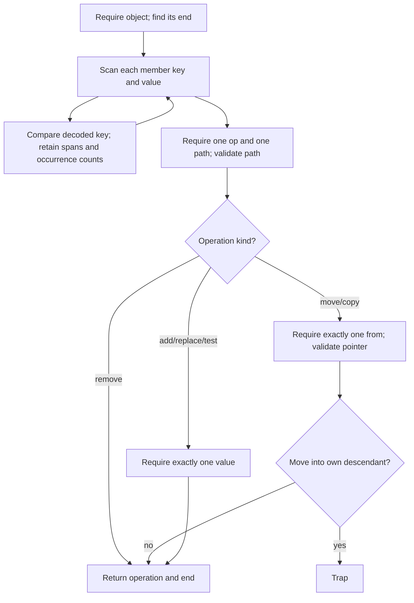

# JSON Patch to operation records

Convert a fenced JSON Patch array to a Markdown list. Each operation is one
top-level item; its remaining members are nested code spans containing a
JSON-quoted key followed by its compact JSON value. No extra root item is
needed. Code spans keep markup inside paths and values literal when rendered.

```json
[{"op":"add","path":"/pets/-","value":{"name":"Milo"}},
 {"op":"move","from":"/old","path":"/new","note":"retain me"}]
```

becomes:

- add
  - `"path" "/pets/-"`
  - `"value" {"name":"Milo"}`
- move
  - `"from" "/old"`
  - `"path" "/new"`
  - `"note" "retain me"`

Operation order and member order are retained, except that `op` becomes the
item label. Its spelling is normalized to the operation name. Other keys,
string escapes, number tokens, nested values and additional members retain
their compact JSON spelling. Duplicate additional members are not discarded.
Empty input array produces empty Markdown.

## What is validated

The [JSON Patch rules](https://www.rfc-editor.org/rfc/rfc6902.html#section-4)
are checked after the shared parser validates the JSON and its UTF-8. Every
operation needs exactly one decoded `op` and `path` key. Operation names are
case-sensitive. Required operands depend on the operation:

| Operation | Required additional member | Extra check |
| --- | --- | --- |
| add, replace, test | Exactly one value, of any JSON type | None |
| remove | None | None |
| move, copy | Exactly one from string | Valid JSON Pointer |
| move | Same from requirement | Path must not be a descendant of from |

The [pointer helper](00-json-pointer.md) checks path syntax and decoded token
boundaries. Target existence, array bounds and the result of `test` depend
on a target document: this converter does not apply patches. Members not
defined for an operation are retained but do not affect its validation.
For example, a remove operation may contain an irrelevant `value` or `from`.
Repeated required operands are rejected rather than choosing a duplicate.

## Pattern: validate JSON once, retain byte spans

The shared parser compacts the JSON into its output page. Copy that body to
the fourth page, after the parser's twelve literal bytes. A bounded cursor
then visits operations without allocating a JSON object graph. Member names
compare by decoded code units: `"path"` and `"\u0070ath"` are the same key.

`scan` only locates the end of a value in already validated compact JSON.
It tracks nesting and quoted strings; an escaped byte cannot close a string.
At depth zero a comma, colon or container close belongs to the caller, not
the value. EOF is legal only outside a string and with zero nesting depth.
This scanner is not a second JSON syntax validator.

### Inside operation: collect first, then select the required operands



The `op` member may appear last. Counts for `value` and `from` therefore do
not reject duplicates during collection: an otherwise irrelevant member must
remain irrelevant. Counts for `op` and `path` reject duplicates immediately.
After the operation kind is known, only its required operands are checked.

### Inside render: code-span fences are chosen from actual bytes

Render the normalized operation label, then scan its members again and emit
every member except `op`. For each key/value pair, find the longest run of
backticks in either span and use one more backtick for both delimiters.
The separating space breaks runs between the two spans. The content begins
with a JSON quote and ends with a JSON value's final byte, never a backtick
or space, so CommonMark's edge-space trimming does not change the data.
JSON strings cannot contain literal newlines after validation.

## Memory and shared entry points

Four fixed pages hold input at `0..0x10000`, output at
`0x10000..0x2f000`, lookup literals at `0x2f000`, parser literals at
`0x30000`, and compact JSON at `0x3000c..0x40000`. Source is at most 64 KiB;
the compact body is at most 65,524 bytes and the output at most 124 KiB.
The JSON parser limits nesting to 128 containers. Output is published only
after success. A new call resets the output cursor after any failed edit.

`validateCompact(start, end)` is a read-only semantic check for a complete,
already syntax-validated compact JSON Patch array anywhere in shared memory.
It uses the same operation walk without emitting output. `scan` is exported
for the reverse writer's already-validated values. Neither API substitutes
for JSON syntax validation; callers must preserve that prerequisite.

## Module

Imports: compact 0, equal 1, pointer 2, descendant 3, UTF-8 check 4.
Defined functions: run 5, emit 6, copy 7, scan 8, field 9, opcode 10,
operation 11, render 12, code span 13, walk 14, validateCompact 15, ticks 16.
Only the output cursor is global. Lookup tables contain length-prefixed JSON
strings, not host values: four field slots of eight bytes, then six operation
slots of sixteen bytes.

`[microwasm]`

- pr-header: `0061736d 01000000`
- pr-type-section: `01 {{size:pr-types}}`
  - pr-types: `08 60 01 7f 01 7f 60 04 7f 7f 7f 7f 01 7f 60 02 7f 7f 00 60 01 7f 00 60 02 7f 7f 01 7f 60 02 7f 7f 02 7f 7f 60 04 7f 7f 7f 7f 00 60 03 7f 7f 7f 00`
- pr-import-section: `02 {{size:pr-imports}}`
  - pr-imports: `06 01 70 07 636f6d70616374 00 00 01 6b 05 657175616c 00 01 01 71 07 706f696e746572 00 02 01 71 0a 64657363656e64616e74 00 01 01 63 04 75746638 00 02 01 70 06 6d656d6f7279 02 01 04 04`
- pr-function-section: `03 {{size:pr-functions}}`
  - pr-functions: `0c 00 03 02 04 04 04 05 04 06 07 02 04`
- pr-global-section: `06 {{size:pr-globals}}`
  - pr-globals: `01 7f 01 41 00 0b`
- pr-export-section: `07 {{size:pr-exports}}`
  - pr-exports: `04 03 72756e 00 05 0f 76616c6964617465436f6d70616374 00 0f 04 7363616e 00 08 06 6d656d6f7279 02 00`
- pr-code-section: `0a {{size:pr-code}}`
  - pr-code: `0c`
    - pr-run-record: `{{size:pr-run-body}}`
      - pr-run-body: `01 01 7f 20 00 41 808004 4b 04 40 00 0b 41 00 20 00 10 04 20 00 10 00 41 0d 6b 22 01 41 f4ff03 4b 04 40 00 0b`
        - pr-run-copy: `41 8c800c 41 888004 20 01 fc 0a 00 00 41 808004 24 00 41 8c800c 41 8c800c 20 01 6a 41 01 10 0e 23 00 41 808004 6b 0b`
    - pr-emit-record: `{{size:pr-emit-body}}`
      - pr-emit-body: `00 23 00 41 80e00b 4f 04 40 00 0b 23 00 20 00 3a 00 00 23 00 41 01 6a 24 00 0b`
    - pr-copy-record: `{{size:pr-copy-body}}`
      - pr-copy-body: `00 02 40 03 40 20 00 20 01 4f 0d 01 20 00 2d 00 00 10 06 20 00 41 01 6a 21 00 0c 00 0b 0b 0b`
    - pr-scan-record: `{{size:pr-scan-body}}`
      - pr-scan-body: `01 04 7f 20 00 20 01 4f 20 01 41 808010 4b 72 04 40 00 0b 20 00 21 02`
        - pr-scan-loop: `03 40 20 02 20 01 4f 04 40 20 03 20 04 72 04 40 00 0b 20 02 0f 0b 20 02 2d 00 00 21 05`
        - pr-scan-string: `20 04 04 40 20 05 41 dc00 46 04 40 20 02 41 01 6a 21 02 05 20 05 41 22 46 04 40 41 00 21 04 0b 0b 05`
        - pr-scan-outside: `20 05 41 22 46 04 40 41 01 21 04 05 20 03 45 20 05 41 2c 46 20 05 41 dd00 46 72 20 05 41 fd00 46 72 20 05 41 3a 46 72 71 04 40 20 02 0f 0b`
        - pr-scan-depth: `20 05 41 db00 46 20 05 41 fb00 46 72 04 40 20 03 41 01 6a 21 03 0b 20 05 41 dd00 46 20 05 41 fd00 46 72 04 40 20 03 41 01 6b 21 03 0b 0b 0b 20 02 41 01 6a 21 02 0c 00 0b 00 0b`
    - pr-field-record: `{{size:pr-field-body}}`
      - pr-field-body: `01 02 7f 41 01 21 02 03 40 41 80e00b 20 02 41 01 6b 41 03 74 6a 21 03 20 00 20 01 20 03 41 01 6a 20 03 41 01 6a 20 03 2d 00 00 6a 10 01 04 40 20 02 0f 0b 20 02 41 01 6a 22 02 41 04 4d 0d 00 0b 41 00 0b`
    - pr-opcode-record: `{{size:pr-opcode-body}}`
      - pr-opcode-body: `01 02 7f 41 01 21 02 03 40 41 a0e00b 20 02 41 01 6b 41 04 74 6a 21 03 20 00 20 01 20 03 41 01 6a 20 03 41 01 6a 20 03 2d 00 00 6a 10 01 04 40 20 02 0f 0b 20 02 41 01 6a 22 02 41 06 4d 0d 00 0b 00 0b`
    - pr-operation-record: `{{size:pr-operation-body}}`
      - pr-operation-body: `01 11 7f 20 00 2d 00 00 41 fb00 47 04 40 00 0b 20 00 20 01 10 08 21 12 20 00 41 01 6a 21 02`
        - pr-member-loop: `02 40 03 40 20 02 20 12 41 01 6b 4f 0d 01 20 02 20 12 10 08 21 03 20 03 41 01 6a 21 04 20 04 20 12 10 08 21 05 20 02 20 03 10 09 21 06`
        - pr-member-op: `20 06 41 01 46 04 40 20 08 41 01 6a 22 08 41 01 4b 04 40 00 0b 20 04 20 05 10 0a 21 07 0b`
        - pr-member-path: `20 06 41 02 46 04 40 20 09 41 01 6a 22 09 41 01 4b 04 40 00 0b 20 04 21 0c 20 05 21 0d 0b`
        - pr-member-value: `20 06 41 03 46 04 40 20 0a 41 01 6a 21 0a 20 04 21 0e 20 05 21 0f 0b`
        - pr-member-from: `20 06 41 04 46 04 40 20 0b 41 01 6a 21 0b 20 04 21 10 20 05 21 11 0b 20 05 41 01 6a 21 02 0c 00 0b 0b`
        - pr-required: `20 08 41 01 47 20 09 41 01 47 72 04 40 00 0b 20 0c 20 0d 10 02`
        - pr-value-required: `20 07 41 01 46 20 07 41 03 46 72 20 07 41 06 46 72 04 40 20 0a 41 01 47 04 40 00 0b 0b`
        - pr-from-required: `20 07 41 04 46 20 07 41 05 46 72 04 40 20 0b 41 01 47 04 40 00 0b 20 10 20 11 10 02 20 07 41 04 46 04 40 20 10 20 11 20 0c 20 0d 10 03 04 40 00 0b 0b 0b 20 07 20 12 0b`
    - pr-render-record: `{{size:pr-render-body}}`
      - pr-render-body: `01 06 7f 20 00 20 01 10 0b 21 02 21 03 41 a0e00b 20 03 41 01 6b 41 04 74 6a 21 03 41 2d 10 06 41 20 10 06 20 03 41 02 6a 20 03 20 03 2d 00 00 6a 10 07 41 0a 10 06 20 00 41 01 6a 21 04`
        - pr-render-loop: `02 40 03 40 20 04 20 02 41 01 6b 4f 0d 01 20 04 20 02 10 08 21 05 20 05 41 01 6a 21 06 20 06 20 02 10 08 21 07 20 04 20 05 10 09 41 01 47 04 40 20 04 20 05 20 06 20 07 10 0d 0b 20 07 41 01 6a 21 04 0c 00 0b 0b 20 02 0b`
    - pr-span-record: `{{size:pr-span-body}}`
      - pr-span-body: `01 03 7f 20 00 20 01 10 10 21 04 20 02 20 03 10 10 21 05 20 05 20 04 4b 04 40 20 05 21 04 0b 41 20 10 06 41 20 10 06 41 2d 10 06 41 20 10 06 20 04 21 06`
        - pr-span-open: `03 40 41 e000 10 06 20 06 41 01 6b 22 06 0d 00 0b 20 00 20 01 10 07 41 20 10 06 20 02 20 03 10 07 20 04 21 06`
        - pr-span-close: `03 40 41 e000 10 06 20 06 41 01 6b 22 06 0d 00 0b 41 0a 10 06 0b`
    - pr-walk-record: `{{size:pr-walk-body}}`
      - pr-walk-body: `00 20 00 20 01 4b 20 01 41 808010 4b 72 04 40 00 0b 20 01 20 00 6b 41 02 49 04 40 00 0b 20 00 2d 00 00 41 db00 47 20 01 41 01 6b 2d 00 00 41 dd00 47 72 04 40 00 0b 20 00 41 01 6a 21 00 20 01 41 01 6b 21 01`
        - pr-walk-loop: `02 40 03 40 20 00 20 01 4f 0d 01 20 02 04 40 20 00 20 01 10 0c 21 00 05 20 00 20 01 10 0b 21 00 1a 0b 20 00 20 01 46 0d 01 20 00 2d 00 00 41 2c 47 04 40 00 0b 20 00 41 01 6a 21 00 0c 00 0b 0b 0b`
    - pr-validate-record: `{{size:pr-validate-body}}`
      - pr-validate-body: `00 20 00 20 01 41 00 10 0e 0b`
    - pr-ticks-record: `{{size:pr-ticks-body}}`
      - pr-ticks-body: `01 02 7f 02 40 03 40 20 00 20 01 4f 0d 01 20 00 2d 00 00 41 e000 46 04 40 20 02 41 01 6a 22 02 20 03 4b 04 40 20 02 21 03 0b 05 41 00 21 02 0b 20 00 41 01 6a 21 00 0c 00 0b 0b 20 03 41 01 6a 0b`
- pr-data-section: `0b {{size:pr-data}}`
  - pr-data: `01 00 41 80e00b 0b 8001`
    - pr-field-literals: `04 226f7022 000000 06 227061746822 00 07 2276616c756522 06 2266726f6d22 00`
    - pr-add: `05 2261646422 00000000000000000000`
    - pr-remove: `08 2272656d6f766522 00000000000000`
    - pr-replace: `09 227265706c61636522 000000000000`
    - pr-move: `06 226d6f766522 000000000000000000`
    - pr-copy: `06 22636f707922 000000000000000000`
    - pr-test: `06 227465737422 000000000000000000`
