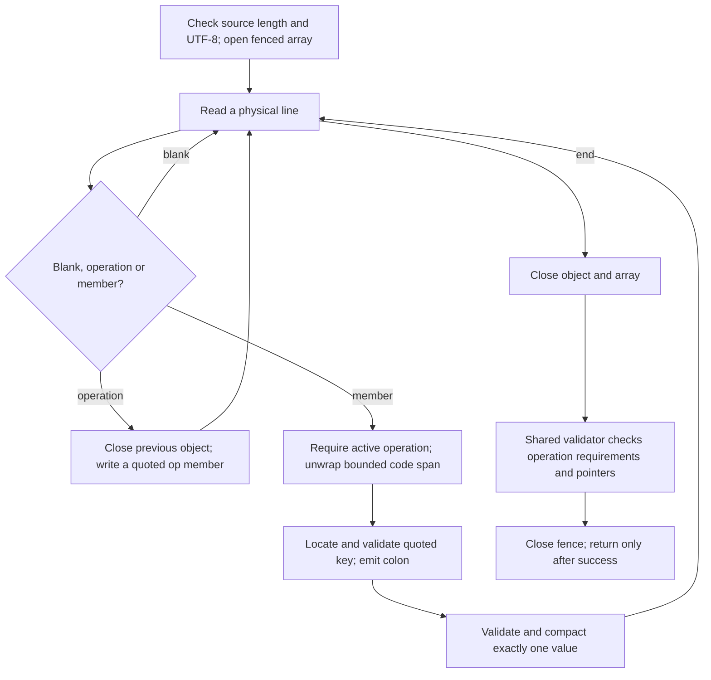

# Operation records to JSON Patch

Reverse the [JSON Patch reader](49-json-patch-to-list.md). Operation labels
become `op` members; nested code spans supply the remaining JSON key/value
pairs. The result is a fenced compact JSON array, not an applied patch.

- add
  - `"path" "/pets/-"`
  - `"value" {"name":"Milo"}`
- move
  - `"from" "/old"`
  - `"path" "/new"`
  - `"note" "retain me"`

becomes:

```json
[{"op":"add","path":"/pets/-","value":{"name":"Milo"}},{"op":"move","from":"/old","path":"/new","note":"retain me"}]
```

## Record grammar

Each operation begins with `- ` at column zero and a lowercase name. Each
member begins with two spaces, `- `, and a code span. Inside the span is a
JSON string key, at least one space or tab, and one complete JSON value.
Values may contain nested objects or arrays, but each member occupies one
physical line. JSON escapes represent newlines within strings.

The code delimiter must have more backticks than any run inside it. Its
closing run must have the same width. This is the reader's canonical form;
it makes the data visible in an ordinary Markdown renderer too. Blank lines,
trailing spaces/tabs and CRLF are accepted. No surrounding array marker is
required. Empty Markdown becomes an empty JSON array.

Keys, numbers and string escapes retain their spelling; whitespace outside
JSON strings is compacted. Unknown members and irrelevant duplicate members
are retained. Required-member duplicates, invalid paths and move ancestry
are checked by the reader's existing validator. A nested `op` member would
duplicate the operation label and is rejected, including escaped spellings.

## Pattern: construct syntax, then validate meaning

The writer owns Markdown structure. It emits JSON delimiters itself, validates
each quoted key and value with `compactSpan`, then asks `validateCompact` to
check the completed array. Raw member text never becomes unchecked JSON
punctuation: a value followed by injected members is not one complete value.
The shared parser receives depth two, reserving the array and operation object
within the same limit of 128 nested containers.



### Inside the code-span reader

Count the opening backtick run and the trailing run independently. They must
be equal and leave nonempty content. Walk the interior once, resetting the
run counter on each non-backtick byte. A run as wide as the delimiter traps:
it would close the span early in Markdown. Return the content's start and
end as two Wasm results; no temporary string is created.

### Inside the member reader

The quote scanner finds a candidate end, skipping the byte after a backslash.
It does not validate escapes. The shared JSON parser does that before the
key's bytes are published. The source must then contain whitespace and a
value. Two independent parser calls append to the same output cursor, while
the writer retains its own state outside the parser's globals.

| State | Owner | Lifetime |
| --- | --- | --- |
| Current line and next line | run locals | One line; returned together |
| Whether an operation is open | run local | Whole conversion |
| Code content start/end | member locals | One member |
| JSON parser cursor/depth | Shared parser | One key or value |
| Output cursor | Writer global | Reset on every run |

## Bounds and failure

The four-page memory is shared with the JSON Patch reader. Input is at zero,
at most 64 KiB. Output begins at `0x10000` and ends before `0x2f000`, so it
cannot overwrite the reader's lookup table or the JSON parser's literals.
Before calling the parser, require room for the uncompressed source span:
compacting JSON cannot grow that span. The parser therefore cannot cross the
writer's tighter boundary. Input and both literal regions remain unchanged.

Output is published only after complete validation. A trap leaves private
partial output; the next run starts over. This validates the document, not
whether it applies to a particular target. No path is opened or fetched.

## Module

Imports are compactSpan 0, validateCompact 1 and UTF-8 validation 2.
Functions: run 3, emit 4, copy 5, line 6, member 7, compact value 8,
quoted-key end 9, code-span bounds 10. Only the output cursor is global.

`[microwasm]`

- pw-header: `0061736d 01000000`
- pw-type-section: `01 {{size:pw-types}}`
  - pw-types: `06 60 04 7f 7f 7f 7f 01 7f 60 02 7f 7f 00 60 01 7f 01 7f 60 01 7f 00 60 02 7f 7f 02 7f 7f 60 02 7f 7f 01 7f`
- pw-import-section: `02 {{size:pw-imports}}`
  - pw-imports: `04 01 70 0b 636f6d706163745370616e 00 00 01 72 0f 76616c6964617465436f6d70616374 00 01 01 63 04 75746638 00 01 01 70 06 6d656d6f7279 02 01 04 04`
- pw-function-section: `03 {{size:pw-functions}}`
  - pw-functions: `08 02 03 01 04 01 01 05 04`
- pw-global-section: `06 {{size:pw-globals}}`
  - pw-globals: `01 7f 01 41 00 0b`
- pw-export-section: `07 {{size:pw-exports}}`
  - pw-exports: `02 03 72756e 00 03 06 6d656d6f7279 02 00`
- pw-code-section: `0a {{size:pw-code}}`
  - pw-code: `08`
    - pw-run-record: `{{size:pw-run-body}}`
      - pw-run-body: `01 06 7f`
        - pw-run-init: `20 00 41 808004 4b 04 40 00 0b 41 00 20 00 10 02 41 808004 24 00 41 81800c 41 88800c 10 05 41 0a 10 04 41 db00 10 04`
        - pw-run-lines: `02 40 03 40 20 01 20 00 4f 0d 01 20 01 20 00 10 06 21 03 21 02`
        - pw-run-empty: `20 01 20 02 46 04 40 20 03 21 01 0c 01 0b`
        - pw-run-top: `20 01 2d 00 00 41 2d 46 04 40`
          - pw-run-label-room: `20 02 20 01 6b 41 03 49 04 40 00 0b 20 01 2d 00 01 41 20 47 04 40 00 0b`
          - pw-run-close-previous: `20 04 04 40 41 fd00 10 04 41 2c 10 04 0b 41 01 21 04`
          - pw-run-object-op: `41 fb00 10 04 41 22 10 04 41 ef00 10 04 41 f000 10 04 41 22 10 04 41 3a 10 04 41 22 10 04`
          - pw-run-label-start: `20 01 41 02 6a 21 05`
          - pw-run-label-loop: `02 40 03 40 20 05 20 02 4f 0d 01 20 05 2d 00 00 22 06 41 e100 6b 41 19 4b 04 40 00 0b 20 06 10 04 20 05 41 01 6a 21 05 0c 00 0b 0b 41 22 10 04`
        - pw-run-member: `05 20 04 45 04 40 00 0b 20 02 20 01 6b 41 07 49 04 40 00 0b 20 01 28 00 00 41 a0c0b48102 47 04 40 00 0b 20 01 41 04 6a 20 02 10 07 0b`
        - pw-run-next: `20 03 21 01 0c 00 0b 0b`
        - pw-run-finish: `20 04 04 40 41 fd00 10 04 0b 41 dd00 10 04 41 888004 23 00 10 01 41 0a 10 04 41 89800c 41 8c800c 10 05 41 0a 10 04 23 00 41 808004 6b 0b`
    - pw-emit-record: `{{size:pw-emit-body}}`
      - pw-emit-body: `00 23 00 41 80e00b 4f 04 40 00 0b 23 00 20 00 3a 00 00 23 00 41 01 6a 24 00 0b`
    - pw-copy-record: `{{size:pw-copy-body}}`
      - pw-copy-body: `00 02 40 03 40 20 00 20 01 4f 0d 01 20 00 2d 00 00 10 04 20 00 41 01 6a 21 00 0c 00 0b 0b 0b`
    - pw-line-record: `{{size:pw-line-body}}`
      - pw-line-body: `01 03 7f 20 00 21 02`
        - pw-line-scan: `02 40 03 40 20 02 20 01 4f 0d 01 20 02 2d 00 00 41 0a 46 0d 01 20 02 41 01 6a 21 02 0c 00 0b 0b`
        - pw-line-next: `20 02 20 02 20 01 49 6a 21 03`
        - pw-line-cr: `20 02 20 00 4b 04 40 20 02 41 01 6b 2d 00 00 41 0d 46 04 40 20 02 41 01 6b 21 02 0b 0b`
        - pw-line-trim: `02 40 03 40 20 02 20 00 4d 0d 01 20 02 41 01 6b 2d 00 00 21 04 20 04 41 20 46 20 04 41 09 46 72 45 0d 01 20 02 41 01 6b 21 02 0c 00 0b 0b 20 02 20 03 0b`
    - pw-member-record: `{{size:pw-member-body}}`
      - pw-member-body: `01 02 7f 20 00 20 01 10 0a 21 01 21 00 20 00 20 01 10 09 22 02 21 03`
        - pw-member-separator: `20 03 20 01 4f 04 40 00 0b 20 03 2d 00 00 41 20 46 20 03 2d 00 00 41 09 46 72 45 04 40 00 0b`
        - pw-member-spaces: `02 40 03 40 20 03 20 01 4f 0d 01 20 03 2d 00 00 41 20 46 20 03 2d 00 00 41 09 46 72 45 0d 01 20 03 41 01 6a 21 03 0c 00 0b 0b`
        - pw-member-write: `41 2c 10 04 20 00 20 02 10 08 41 3a 10 04 20 03 20 01 10 08 0b`
    - pw-value-record: `{{size:pw-value-body}}`
      - pw-value-body: `00 23 00 20 01 20 00 6b 6a 41 80e00b 4b 04 40 00 0b 20 00 20 01 23 00 41 02 10 00 23 00 6a 24 00 0b`
    - pw-key-record: `{{size:pw-key-body}}`
      - pw-key-body: `00 20 00 20 01 4f 04 40 00 0b 20 00 2d 00 00 41 22 47 04 40 00 0b 20 00 41 01 6a 21 00`
        - pw-key-loop: `03 40 20 00 20 01 4f 04 40 00 0b 20 00 2d 00 00 41 22 46 04 40 20 00 41 01 6a 0f 0b 20 00 2d 00 00 41 dc00 46 04 40 20 00 41 01 6a 21 00 0b 20 00 41 01 6a 21 00 0c 00 0b 00 0b`
    - pw-span-record: `{{size:pw-span-body}}`
      - pw-span-body: `01 05 7f 20 00 21 02`
        - pw-span-open: `02 40 03 40 20 02 20 01 4f 0d 01 20 02 2d 00 00 41 e000 47 0d 01 20 02 41 01 6a 21 02 0c 00 0b 0b 20 02 20 00 6b 22 04 45 04 40 00 0b 20 01 21 03`
        - pw-span-close: `02 40 03 40 20 03 20 02 4d 0d 01 20 03 41 01 6b 2d 00 00 41 e000 47 0d 01 20 03 41 01 6b 21 03 0c 00 0b 0b 20 01 20 03 6b 20 04 47 20 02 20 03 4f 72 04 40 00 0b 20 02 21 05`
        - pw-span-interior: `02 40 03 40 20 05 20 03 4f 0d 01 20 05 2d 00 00 41 e000 46 04 40 20 06 41 01 6a 22 06 20 04 4f 04 40 00 0b 05 41 00 21 06 0b 20 05 41 01 6a 21 05 0c 00 0b 0b 20 02 20 03 0b`
