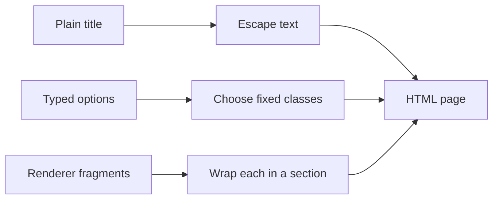

# Layout from scratch

Layout composes already-rendered fragments. It never accepts a template, raw CSS,
or an arbitrary HTML string. This is the only stage that writes a whole document.

Customization:

- Light or dark theme, both with local system fonts.
- One reading column or two responsive columns.
- Narrow or wide maximum width, comfortable or compact spacing.
- Two, four, or eight spaces per visual tab stop.
- A plain-text title, escaped independently in the title and heading.

At small widths the two-column choice becomes a single column. Long code lines
scroll inside their own block rather than widening the whole page. This version
does not load fonts or icons, and uses no script for layout or customization.

## Rendering boundary



Pseudocode: write the fixed head and local stylesheet; write the escaped title;
choose classes from enums; append each fragment within a section; close the page.

Annotations: CSS cannot contain an attacker-supplied value because there are no
string-valued CSS options. Colors, widths, and spacing are literal stylesheet
rules. CSP is additional containment, not the mechanism that makes links inert.
The browser tests deliberately remove CSP in a second pass.

`src/layout.rs`

```rust
use alloc::string::String;
use crate::{escape_into, Fragment};

#[derive(Clone, Copy)]
pub enum Theme { Light, Dark }
pub enum Columns { One, Two }
pub enum Width { Narrow, Wide }
pub enum Spacing { Comfortable, Compact }
pub enum Tabs { Two, Four, Eight }

pub struct Options {
    pub theme: Theme,
    pub columns: Columns,
    pub width: Width,
    pub spacing: Spacing,
    pub tabs: Tabs,
}

impl Default for Options {
    fn default() -> Self {
        Self { theme: Theme::Light, columns: Columns::One, width: Width::Wide,
            spacing: Spacing::Comfortable, tabs: Tabs::Four }
    }
}

const CSS: &str = r#"
* { box-sizing: border-box; }
body {
  --ground: #eaf0f7;
  --panel: #f7f9fc;
  --ink: #21334a;
  --muted: #51637b;
  --border: #c9d5e3;
  --keyword: #6836a1;
  --string: #256742;
  --number: #995315;
  margin: 0;
  background: var(--ground);
  color: var(--ink);
  font: 16px/1.65 system-ui, sans-serif;
}
body.dark {
  --ground: #142031;
  --panel: #1c2a3d;
  --ink: #e0e8f4;
  --muted: #a1b3cb;
  --border: #364963;
  --keyword: #d3a5ff;
  --string: #94d7ae;
  --number: #efbd83;
  color-scheme: dark;
}
header, main { width: min(100% - 32px, 1120px); margin: 0 auto; }
header { padding: 36px 0 16px; }
main { display: grid; gap: 24px; padding-bottom: 40px; }
body.narrow header, body.narrow main { max-width: 760px; }
section {
  min-width: 0;
  padding: 28px;
  border: 1px solid var(--border);
  border-radius: 12px;
  background: var(--panel);
  overflow-wrap: anywhere;
}
.compact section { padding: 16px; }
h1, h2, h3, h4, h5, h6 { line-height: 1.25; margin: 1.2em 0 0.6em; }
header h1, section > :first-child { margin-top: 0; }
p { margin: 0.8em 0; }
li { margin: 0.35em 0; }
pre {
  overflow: auto;
  padding: 16px;
  border: 1px solid var(--border);
  border-radius: 8px;
  background: var(--ground);
  line-height: 1.55;
  tab-size: 4;
}
code { font: 0.875em/1.55 ui-monospace, monospace; }
pre code { font-size: 13px; white-space: pre; }
.tabs-2 pre { tab-size: 2; }
.tabs-8 pre { tab-size: 8; }
.keyword { color: var(--keyword); font-weight: 600; }
.string { color: var(--string); }
.number { color: var(--number); }
.comment { color: var(--muted); }
.link-text { text-decoration: underline dotted; text-underline-offset: 3px; }
@media (min-width: 900px) { .two main { grid-template-columns: 3fr 2fr; } }
@media (max-width: 600px) { section { padding: 16px; } }
"#;

pub fn render(title: &str, fragments: &[Fragment], options: &Options) -> String {
    let mut out = String::from("<!DOCTYPE html>\n<html lang=\"en\">\n<head>\n<meta charset=\"utf-8\">\n");
    out.push_str("<meta http-equiv=\"Content-Security-Policy\" content=\"default-src 'none'; style-src 'unsafe-inline'; base-uri 'none'; form-action 'none'\">\n");
    out.push_str("<meta name=\"viewport\" content=\"width=device-width, initial-scale=1\">\n<title>");
    escape_into(&mut out, title);
    out.push_str("</title>\n<style>"); out.push_str(CSS); out.push_str("</style>\n</head>\n<body class=\"");
    out.push_str(match options.theme { Theme::Light => "light", Theme::Dark => "dark" });
    if matches!(options.columns, Columns::Two) { out.push_str(" two"); }
    if matches!(options.width, Width::Narrow) { out.push_str(" narrow"); }
    if matches!(options.spacing, Spacing::Compact) { out.push_str(" compact"); }
    match options.tabs { Tabs::Two => out.push_str(" tabs-2"), Tabs::Eight => out.push_str(" tabs-8"), _ => {} }
    out.push_str("\">\n<header><h1>"); escape_into(&mut out, title); out.push_str("</h1></header>\n<main>\n");
    for fragment in fragments {
        out.push_str("<section>\n"); out.push_str(fragment.as_str()); out.push_str("</section>\n");
    }
    out.push_str("</main>\n</body>\n</html>\n");
    out
}

#[no_mangle]
pub extern "C" fn test_layout() -> u32 {
    let fragment = crate::markdown::render("# Test", &crate::markdown::Options::default());
    let page = render("</title><script>bad()</script>", &[fragment], &Options {
        theme: Theme::Dark, columns: Columns::Two, width: Width::Narrow,
        spacing: Spacing::Compact, tabs: Tabs::Eight,
    });
    assert!(page.contains("class=\"dark two narrow compact tabs-8\""));
    assert!(page.contains("&lt;/title&gt;&lt;script&gt;"));
    assert_eq!(page.matches("<title>").count(), 1);
    assert_eq!(page.matches("<style>").count(), 1);
    assert!(!page.contains("<script>"));
    assert!(!CSS.contains("url("));
    assert!(!CSS.contains("@import"));
    let empty = render("Empty", &[], &Options::default());
    assert!(empty.contains("<main>\n</main>"));
    8
}
```
