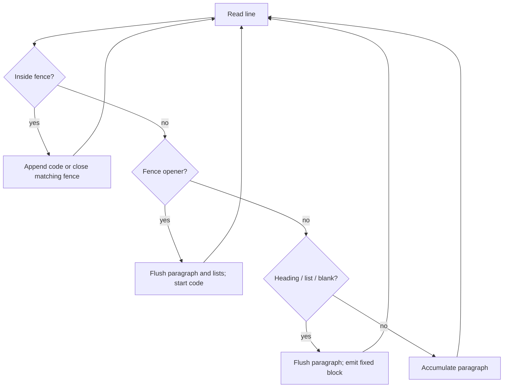

# Markdown from scratch

This subset is chosen to render these source documents, including their filename
markers, nested lists, source blocks, explanatory prose, and diagrams as source.
It is not a claim of CommonMark compatibility. Unsupported syntax stays text.

- ATX headings with one to six hashes and a space.
- Paragraphs, blank lines, unordered lists, and decimal ordered lists.
- Indented nested lists (two-space levels; other indentation rounds down).
- Backtick or tilde fences of at least three characters; longer fences can wrap
  source containing shorter fences. Rust, JS, and TS are highlighted.
- Inline code spans, emphasis, strong emphasis, and inert link labels.
- Mermaid and unknown-language blocks remain escaped source code.
- HTML, image syntax, entities, and unsupported block forms remain escaped text.

Customization: shift headings by a bounded amount, disable inline emphasis, or
disable syntax highlighting. No option accepts HTML, CSS, URLs, or event code.
Heading overflow clamps to `h6`. Inline code retains its own whitespace; paragraph
line endings become spaces. Fenced code retains content and line endings as read
by Rust's `lines` iterator (CRLF is normalized to LF).

## Block state



Pseudocode: keep one pending paragraph, one optional fence, and a stack of list
types. Only a block boundary emits accumulated prose. Inline scanning consumes a
delimiter plus its matching close, or emits the current character literally.
Unclosed fences are still code; unclosed inline constructs are text.

Annotations: there is no raw-HTML pass-through and no string replacement that can
accidentally unescape markup. Link destinations are discarded, not repaired into
URLs. Emphasis contents are escaped rather than recursively parsed; this keeps
nesting rules small and explicit. Lists do not support continuation paragraphs.

`src/markdown.rs`

```rust
use alloc::{string::String, vec::Vec};
use crate::{escape_into, rust, Fragment};

pub struct Options {
    pub heading_offset: u8,
    pub emphasis: bool,
    pub highlight: bool,
}

impl Default for Options {
    fn default() -> Self { Self { heading_offset: 0, emphasis: true, highlight: true } }
}

fn inline(out: &mut String, text: &str, options: &Options) {
    let mut i = 0;
    while i < text.len() {
        let tail = &text[i..];
        let code_ticks = tail.bytes().take_while(|&b| b == b'`').count();
        let (delimiter, tag) = if code_ticks > 0 { (&tail[..code_ticks], "code") }
            else if options.emphasis && tail.starts_with("**") { ("**", "strong") }
            else if options.emphasis && tail.starts_with('*') { ("*", "em") }
            else { ("", "") };
        if !delimiter.is_empty() {
            if let Some(end) = tail[delimiter.len()..].find(delimiter) {
                out.push('<'); out.push_str(tag); out.push('>');
                escape_into(out, &tail[delimiter.len()..delimiter.len() + end]);
                out.push_str("</"); out.push_str(tag); out.push('>');
                i += delimiter.len() * 2 + end;
                continue;
            }
            // Consume an unmatched run as a unit, not one quadratic retry per tick.
            escape_into(out, delimiter);
            i += delimiter.len();
            continue;
        }
        if tail.starts_with('[') {
            if let Some(label_end) = tail.find("](") {
                if let Some(url_end) = tail[label_end + 2..].find(')') {
                    out.push_str("<span class=\"link-text\">");
                    escape_into(out, &tail[1..label_end]);
                    out.push_str("</span>");
                    i += label_end + 3 + url_end;
                    continue;
                }
            }
            // An unmatched '[' is plain text. The block size is bounded by input.
        }
        let ch = tail.chars().next().unwrap();
        escape_into(out, &tail[..ch.len_utf8()]);
        i += ch.len_utf8();
    }
}

fn paragraph(out: &mut String, pending: &mut String, options: &Options) {
    if pending.is_empty() { return; }
    out.push_str("<p>"); inline(out, pending, options); out.push_str("</p>\n");
    pending.clear();
}

fn close_lists(out: &mut String, lists: &mut Vec<bool>, depth: usize) {
    while lists.len() > depth {
        out.push_str(if lists.pop().unwrap() { "</li></ol>\n" } else { "</li></ul>\n" });
    }
}

fn list_item(line: &str) -> Option<(usize, bool, &str)> {
    let spaces = line.bytes().take_while(|&b| b == b' ').count();
    let body = &line[spaces..];
    if body.starts_with("- ") || body.starts_with("* ") {
        return Some((spaces / 2, false, &body[2..]));
    }
    let digits = body.bytes().take_while(|b| b.is_ascii_digit()).count();
    if digits > 0 && body[digits..].starts_with(". ") {
        return Some((spaces / 2, true, &body[digits + 2..]));
    }
    None
}

fn code(out: &mut String, source: &str, language: &str, options: &Options) {
    if options.highlight && matches!(language, "rust" | "js" | "javascript" | "ts" | "typescript") {
        let language = if language == "rust" { rust::Language::Rust } else { rust::Language::JavaScript };
        out.push_str(rust::render(source, &rust::Options { language, ..rust::Options::default() }).as_str());
    } else {
        out.push_str("<pre><code>"); escape_into(out, source); out.push_str("</code></pre>\n");
    }
}

pub fn render(source: &str, options: &Options) -> Fragment {
    let mut out = String::new();
    let mut pending = String::new();
    let mut lists: Vec<bool> = Vec::new();
    let mut fence: Option<(u8, usize, &str)> = None;
    let mut fenced = String::new();
    for line in source.lines() {
        if let Some((marker, width, language)) = fence {
            let count = line.bytes().take_while(|&b| b == marker).count();
            if count >= width && line[count..].trim().is_empty() {
                code(&mut out, &fenced, language, options);
                fenced.clear(); fence = None;
            } else { fenced.push_str(line); fenced.push('\n'); }
            continue;
        }
        let marker = line.as_bytes().first().copied().unwrap_or(0);
        let width = line.bytes().take_while(|&b| b == marker).count();
        if (marker == b'`' || marker == b'~') && width >= 3 {
            paragraph(&mut out, &mut pending, options);
            close_lists(&mut out, &mut lists, 0);
            fence = Some((marker, width, line[width..].trim()));
            continue;
        }
        if let Some((depth, ordered, body)) = list_item(line) {
            paragraph(&mut out, &mut pending, options);
            let wanted = (depth + 1).min(lists.len() + 1);
            close_lists(&mut out, &mut lists, wanted);
            if lists.len() == wanted && lists.last() != Some(&ordered) {
                close_lists(&mut out, &mut lists, wanted - 1);
            }
            if lists.len() < wanted {
                out.push_str(if ordered { "<ol><li>" } else { "<ul><li>" });
                lists.push(ordered);
            } else { out.push_str("</li><li>"); }
            inline(&mut out, body, options);
            continue;
        }
        close_lists(&mut out, &mut lists, 0);
        let hashes = line.bytes().take_while(|&b| b == b'#').count();
        if (1..=6).contains(&hashes) && line[hashes..].starts_with(' ') {
            paragraph(&mut out, &mut pending, options);
            let level = (hashes + options.heading_offset as usize).min(6) as u8 + b'0';
            out.push_str("<h"); out.push(level as char); out.push('>');
            inline(&mut out, line[hashes + 1..].trim(), options);
            out.push_str("</h"); out.push(level as char); out.push_str(">\n");
        } else if line.trim().is_empty() { paragraph(&mut out, &mut pending, options); }
        else {
            if !pending.is_empty() { pending.push(' '); }
            pending.push_str(line.trim());
        }
    }
    if let Some((_, _, language)) = fence { code(&mut out, &fenced, language, options); }
    paragraph(&mut out, &mut pending, options);
    close_lists(&mut out, &mut lists, 0);
    Fragment(out)
}

#[no_mangle]
pub extern "C" fn test_markdown() -> u32 {
    let options = Options::default();
    let cases = [
        ("# Heading", "<h1>Heading</h1>\n"),
        ("one\ntwo", "<p>one two</p>\n"),
        ("**bold** and *soft*", "<p><strong>bold</strong> and <em>soft</em></p>\n"),
        ("`<x>`", "<p><code>&lt;x&gt;</code></p>\n"),
        ("[label](https://evil.test)", "<p><span class=\"link-text\">label</span></p>\n"),
        ("", "<p>&lt;img src=x&gt;</p>\n"),
        ("- a\n- b", "<ul><li>a</li><li>b</li></ul>\n"),
        ("1. a\n2. b", "<ol><li>a</li><li>b</li></ol>\n"),
        ("- a\n  - b\n- c", "<ul><li>a<ul><li>b</li></ul>\n</li><li>c</li></ul>\n"),
        ("~~~mermaid\na --> b\n~~~", "<pre><code>a --&gt; b\n</code></pre>\n"),
        ("~~~\nunfinished", "<pre><code>unfinished\n</code></pre>\n"),
    ];
    for (input, expected) in cases { assert_eq!(render(input, &options).as_str(), expected); }
    assert_eq!(render("# H", &Options { heading_offset: 255, ..Options::default() }).as_str(), "<h6>H</h6>\n");
    assert!(render("~~~rust\nfn main() {}\n~~~", &options).as_str().contains("class=\"keyword\""));
    assert!(!render("~~~rust\nfn main() {}\n~~~", &Options { highlight: false, ..options }).as_str().contains("<span"));
    cases.len() as u32 + 3
}
```
