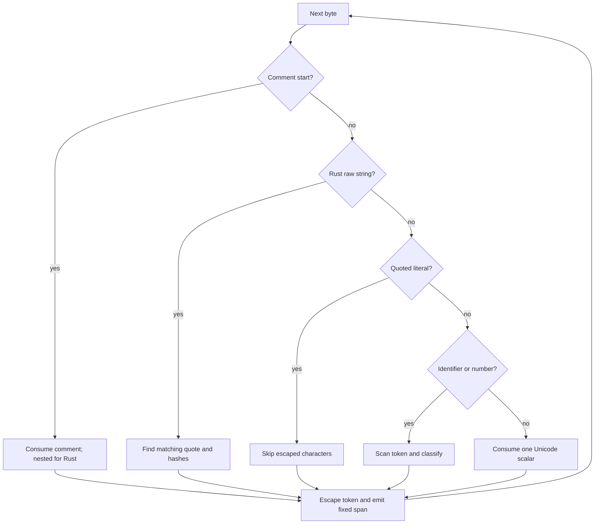

# Syntax highlighting from scratch

This is a small lexical highlighter for Rust and JavaScript/TypeScript, not a
parser. Its input is always text. It produces only `pre`, `code`, and fixed-class
`span` elements, escaping every source character. No language service, grammar
package, regular expression engine, or external stylesheet is used.

Customization: select a language; disable keyword or number coloring independently.
Layout owns the colors. Turning coloring off never changes the source text.

Later, consider an external intermediate Markdown representation: one list item
per source line, nested token structure, tokens in inline code spans. That format
is intentionally not implemented in this first scanner/renderer experiment.
The compact form could instead be consecutive `(token type, length)` pairs over
the original source, without duplicating token text. UTF-8 byte lengths match this
scanner; that is provisional until the external format is designed.

## Scanner



Pseudocode: examine the next token's prefix; consume at least one character;
escape the entire consumed slice; optionally surround it with a known class.
That last invariant prevents syntax errors in the input from becoming HTML errors.

Annotations: byte indices are advanced through ASCII token syntax or through
complete UTF-8 characters. Rust apostrophes are only strings when they form a
character literal; lifetimes remain text. Raw strings and nested block comments
are supported. JavaScript template literals are colored as a whole, without
parsing interpolations. JavaScript regex literals and semantic TypeScript types
are not distinguished. Malformed/unfinished input remains visible, including its
exact whitespace; highlighting is a hint, never a source transformation.

`src/rust.rs`

```rust
use alloc::string::String;
use crate::{escape_into, Fragment};

#[derive(Clone, Copy, PartialEq)]
pub enum Language { Rust, JavaScript }

pub struct Options {
    pub language: Language,
    pub keywords: bool,
    pub numbers: bool,
}

impl Default for Options {
    fn default() -> Self { Self { language: Language::Rust, keywords: true, numbers: true } }
}

fn quoted(bytes: &[u8], start: usize, quote: u8) -> usize {
    let mut i = start + 1;
    while i < bytes.len() {
        if bytes[i] == quote { return i + 1; }
        if bytes[i] == b'\\' && i + 1 < bytes.len() { i += 1; }
        i += 1;
    }
    bytes.len()
}

fn raw_string(bytes: &[u8], start: usize) -> Option<usize> {
    if bytes[start] != b'r' { return None; }
    let mut quote = start + 1;
    while bytes.get(quote) == Some(&b'#') { quote += 1; }
    if bytes.get(quote) != Some(&b'"') { return None; }
    let hashes = quote - start - 1;
    let mut i = quote + 1;
    while i < bytes.len() {
        if bytes[i] == b'"' && bytes.get(i + 1..i + 1 + hashes)
            .is_some_and(|tail| tail.iter().all(|&b| b == b'#')) {
            return Some(i + 1 + hashes);
        }
        i += 1;
    }
    Some(bytes.len())
}

fn character(source: &str, start: usize) -> Option<usize> {
    let bytes = source.as_bytes();
    let ch = source.get(start + 1..)?.chars().next()?;
    let mut end = start + 1 + ch.len_utf8();
    if ch == '\\' {
        if bytes.get(end) == Some(&b'u') && bytes.get(end + 1) == Some(&b'{') {
            end += 2;
            while bytes.get(end).is_some_and(|b| b.is_ascii_hexdigit() || *b == b'_') { end += 1; }
            if bytes.get(end) != Some(&b'}') { return None; }
            end += 1;
        } else if bytes.get(end) == Some(&b'x') {
            end += 3;
        } else { end += 1; }
    }
    (bytes.get(end) == Some(&b'\'')).then_some(end + 1)
}

fn keyword(word: &str, language: Language) -> bool {
    let words: &[&str] = match language {
        Language::Rust => &[
            "as", "async", "await", "break", "const", "continue", "crate", "dyn",
            "else", "enum", "extern", "false", "fn", "for", "if", "impl", "in",
            "let", "loop", "match", "mod", "move", "mut", "pub", "ref", "return",
            "self", "Self", "static", "struct", "super", "trait", "true", "type",
            "unsafe", "use", "where", "while",
        ],
        Language::JavaScript => &[
            "as", "async", "await", "break", "case", "catch", "class", "const",
            "continue", "default", "delete", "else", "export", "extends", "false",
            "finally", "for", "from", "function", "if", "import", "in", "instanceof",
            "interface", "let", "new", "null", "of", "return", "static", "switch",
            "throw", "true", "try", "type", "typeof", "undefined", "var", "void", "while",
        ],
    };
    words.contains(&word)
}

pub fn render(source: &str, options: &Options) -> Fragment {
    let bytes = source.as_bytes();
    let mut out = String::from("<pre><code>");
    let mut i = 0;
    while i < bytes.len() {
        let start = i;
        let mut class = "";
        if bytes[i..].starts_with(b"//") {
            while i < bytes.len() && bytes[i] != b'\n' { i += 1; }
            class = "comment";
        } else if bytes[i..].starts_with(b"/*") {
            let mut depth = 1;
            i += 2;
            while i < bytes.len() && depth > 0 {
                if bytes[i..].starts_with(b"*/") { depth -= 1; i += 2; }
                else if options.language == Language::Rust && bytes[i..].starts_with(b"/*") {
                    depth += 1; i += 2;
                } else { i += 1; }
            }
            class = "comment";
        } else if options.language == Language::Rust && raw_string(bytes, i).is_some() {
            i = raw_string(bytes, i).unwrap();
            class = "string";
        } else if bytes[i] == b'"' || (options.language == Language::JavaScript &&
            (bytes[i] == b'\'' || bytes[i] == b'`')) {
            i = quoted(bytes, i, bytes[i]);
            class = "string";
        } else if bytes[i] == b'\'' && character(source, i).is_some() {
            i = character(source, i).unwrap();
            class = "string";
        } else if bytes[i].is_ascii_digit() {
            i += 1;
            while i < bytes.len() && (bytes[i].is_ascii_alphanumeric() || bytes[i] == b'_' || bytes[i] == b'.') {
                i += 1;
            }
            if options.numbers { class = "number"; }
        } else if source[i..].chars().next().is_some_and(|c| c.is_alphabetic() || c == '_') {
            for ch in source[i..].chars() {
                if !(ch.is_alphanumeric() || ch == '_') { break; }
                i += ch.len_utf8();
            }
            if options.keywords && keyword(&source[start..i], options.language) { class = "keyword"; }
        } else { i += source[i..].chars().next().unwrap().len_utf8(); }
        if !class.is_empty() {
            out.push_str("<span class=\""); out.push_str(class); out.push_str("\">");
        }
        escape_into(&mut out, &source[start..i]);
        if !class.is_empty() { out.push_str("</span>"); }
    }
    out.push_str("</code></pre>\n");
    Fragment(out)
}

#[no_mangle]
pub extern "C" fn test_rust() -> u32 {
    let options = Options::default();
    for source in ["fn café() {}", "let x = 42;", "/* outer /* inner */ end */", "r##\"<script>\"##", "'λ'", "'a", "\"unfinished", "// </code>"] {
        let html = render(source, &options);
        assert!(!html.as_str().contains("<script>"));
        assert!(!html.as_str().contains("</pre>\n"));
    }
    assert!(render("fn main() {}", &options).as_str().contains("class=\"keyword\">fn"));
    assert!(!render("fn x() { 12; }", &Options { keywords: false, numbers: false, ..options }).as_str().contains("<span"));
    assert!(render("const x = `hello ${name}`;", &Options { language: Language::JavaScript, ..Options::default() })
        .as_str().contains("class=\"keyword\">const"));
    assert_eq!(raw_string(b"r##\"one\"#two\"##", 0), Some(15));
    12
}
```
