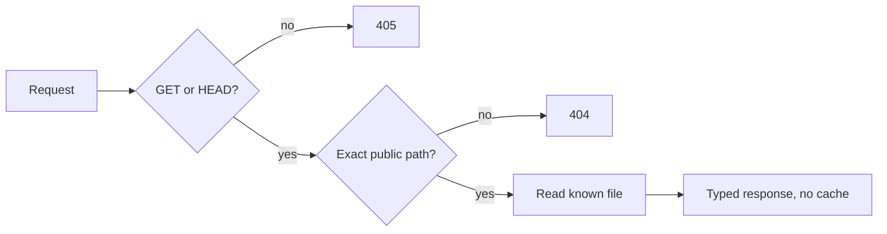

# Serving the complete demo with Deno

The server is authored here too. After extraction, it serves only a fixed map of
build artifacts, not arbitrary filesystem paths. No network proxy, uploads,
directory listings, request logging, remote dependencies, or dynamic evaluation.

Start it from this directory after the build:

```sh
deno run --allow-read=dist --allow-net=0.0.0.0:8787 build/server.ts
```

The default is `http://localhost:8787/`. The index is an all-inclusive reading
page: description, every renderer's source and tests, this server's source,
orchestration source, a verified sample, and limitations. `/dark.html` renders
the same documents with dark customization; `/sample.html` is the two-column
composition example. No navigation is added by the renderers. These pages are
directly addressable for testing; a later trusted host may add local navigation.

## Request flow



Pseudocode: reject unsupported methods, look up the decoded URL pathname without
joining it to the filesystem, read that single allowed artifact, and respond.
The host has filesystem and listen permissions; the rendering Wasm has neither.

`server.ts`

```ts
const artifacts = new Map([
  ["/", ["index.html", "text/html; charset=utf-8"]],
  ["/dark.html", ["dark.html", "text/html; charset=utf-8"]],
  ["/sample.html", ["sample.html", "text/html; charset=utf-8"]],
  ["/workflow.wasm", ["workflow.wasm", "application/wasm"]],
]);

Deno.serve({ hostname: "0.0.0.0", port: 8787 }, async (request) => {
  if (request.method !== "GET" && request.method !== "HEAD") {
    return new Response("Method not allowed", { status: 405, headers: { Allow: "GET, HEAD" } });
  }
  const artifact = artifacts.get(new URL(request.url).pathname);
  if (!artifact) return new Response("Not found", { status: 404 });
  try {
    const bytes = await Deno.readFile(`dist/${artifact[0]}`);
    return new Response(request.method === "HEAD" ? null : bytes, {
      headers: {
        "Content-Type": artifact[1],
        "Content-Length": String(bytes.length),
        "Cache-Control": "no-store",
        "X-Content-Type-Options": "nosniff",
        "Referrer-Policy": "no-referrer",
      },
    });
  } catch (error) {
    if (error instanceof Deno.errors.NotFound) return new Response("Build the demo first", { status: 503 });
    return new Response("Unable to read artifact", { status: 500 });
  }
});
```
