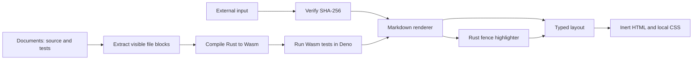

# A document-to-page workflow

This is executable documentation, not a generated description of a hidden source
tree. The filenames below are visible DSL markers. Tests are ordinary Rust
functions exported to Deno, where they run inside the same Wasm artifact.

## Composition



Pseudocode:

1. Read the declared documents and verify each external input's exact bytes.
2. Extract labelled source blocks; reject duplicate names and unsafe paths.
3. Compile one Wasm library, with no imports, dependencies, or native executable.
4. For each test group, reset its arena and call its exported function.
5. Reset the arena; copy Markdown bytes into memory; call the page operation.
6. Copy the returned UTF-8 output before resetting the arena again.

The three programs currently compose as Rust modules. No claim is made that they
are separately linked Wasm modules yet. A future Wasm-hosted linker can change the
packaging. Keep this experiment separate while exploring its relationship to
MicroWasm and future document transformations.

## External content

This input lives outside the document. The build reads it locally and verifies it
before compiling or rendering; it never treats the path as a network URL.

`input: inputs/article.md sha256:6a92d48e22ab09dcba3583b2a8de4654c6061640b9100f324d1ffefbf9e02ffa`

## Build profile

`Cargo.toml`

```toml
[package]
name = "document-workflow"
version = "0.0.0"
edition = "2021"
publish = false

[lib]
crate-type = ["cdylib"]

[workspace]

[profile.release]
opt-level = "z"
lto = true
codegen-units = 1
panic = "abort"
strip = true
```

## Memory, fragments, and the ABI

`core` and `alloc` are Rust's built-in libraries, not downloaded renderer or
allocator dependencies. The allocator below is a single-threaded arena. Each
operation discards all its temporary objects together. Individual drops do not
reclaim storage; `reset` does. This is suitable for bounded document transforms,
not a persistent JavaScript heap or general-purpose application allocator.

The host may call `reset` only when it holds no live output or input references.
Wasm memory grows in pages up to 16 MiB; resetting reuses those pages, it does not
shrink the memory. Bad UTF-8, oversized input, or allocation failure traps; the
host can discard/reset this pure renderer with no partially published DOM.

- `allocate(length)` reserves input bytes and returns their offset.
- `render(kind, offset, length, theme)` returns an `i64`: low 32 bits are output
  offset, high 32 bits are output length. There are no NUL-terminated strings.
- Kind 0 renders Markdown; 1 highlights Rust; 2 composes the two-column sample;
  3 renders an entire Markdown document in a single reading column.
- Theme 0 is light; 1 is dark; other operation/theme values trap.
- `reset()` invalidates all prior input/output offsets.
- Four `test_*` functions return their case count; failed assertions trap.

Annotations: input is read-only during rendering. Output is copied by Deno before
the arena is reset. The fragment constructor is private; callers outside this
crate cannot turn arbitrary HTML into a layout fragment.

`src/lib.rs`

```rust
#![no_std]

#[cfg(not(target_arch = "wasm32"))]
compile_error!("This prototype only targets wasm32-unknown-unknown");

extern crate alloc;
use alloc::{string::String, vec};
use core::alloc::{GlobalAlloc, Layout};
use core::ptr::addr_of;

pub mod markdown;
pub mod rust;
pub mod layout;

struct Arena;
static mut CURSOR: usize = 0;
extern "C" { static __heap_base: u8; }

unsafe impl GlobalAlloc for Arena {
    unsafe fn alloc(&self, layout: Layout) -> *mut u8 {
        let cursor = if CURSOR == 0 { addr_of!(__heap_base) as usize } else { CURSOR };
        let Some(aligned) = cursor.checked_add(layout.align() - 1) else {
            return core::ptr::null_mut();
        };
        let start = aligned & !(layout.align() - 1);
        let Some(end) = start.checked_add(layout.size().max(1)) else {
            return core::ptr::null_mut();
        };
        if end > 16 * 1024 * 1024 { return core::ptr::null_mut(); }
        let pages = core::arch::wasm32::memory_size::<0>();
        let needed = (end + 65535) / 65536;
        if needed > pages && core::arch::wasm32::memory_grow::<0>(needed - pages) == usize::MAX {
            return core::ptr::null_mut();
        }
        CURSOR = end;
        start as *mut u8
    }

    unsafe fn dealloc(&self, _pointer: *mut u8, _layout: Layout) {
        // All allocations belong to the current operation, not persistent state.
    }
}

#[global_allocator]
static ALLOCATOR: Arena = Arena;

#[panic_handler]
fn panic(_info: &core::panic::PanicInfo) -> ! {
    core::arch::wasm32::unreachable()
}

pub struct Fragment(String);
impl Fragment {
    pub fn as_str(&self) -> &str { &self.0 }
}

fn escape_into(out: &mut String, text: &str) {
    for ch in text.chars() {
        match ch {
            '&' => out.push_str("&amp;"),
            '<' => out.push_str("&lt;"),
            '>' => out.push_str("&gt;"),
            '"' => out.push_str("&quot;"),
            '\'' => out.push_str("&#39;"),
            '\0' => out.push('\u{fffd}'),
            _ => out.push(ch),
        }
    }
}

#[no_mangle]
pub unsafe extern "C" fn reset() { CURSOR = 0; }

#[no_mangle]
pub extern "C" fn allocate(length: usize) -> *mut u8 {
    assert!(length <= 512 * 1024);
    let bytes = vec![0; length].into_boxed_slice();
    alloc::boxed::Box::into_raw(bytes) as *mut u8
}

#[no_mangle]
pub unsafe extern "C" fn render(kind: u32, pointer: *const u8, length: usize, theme: u32) -> u64 {
    assert!(length <= 512 * 1024);
    let input = core::str::from_utf8(core::slice::from_raw_parts(pointer, length)).unwrap();
    let theme = match theme {
        0 => layout::Theme::Light,
        1 => layout::Theme::Dark,
        _ => panic!("invalid theme"),
    };
    let output = match kind {
        0 => markdown::render(input, &markdown::Options::default()).0,
        1 => rust::render(input, &rust::Options::default()).0,
        2 => {
            let prose = markdown::render(input, &markdown::Options::default());
            let code = rust::render("pub fn double(n: u32) -> u32 {\n    n * 2\n}\n", &rust::Options::default());
            layout::render("Document workflows", &[prose, code], &layout::Options {
                theme, columns: layout::Columns::Two, ..layout::Options::default()
            })
        }
        3 => {
            let prose = markdown::render(input, &markdown::Options::default());
            layout::render("Document-driven Rust workflows", &[prose], &layout::Options {
                theme, ..layout::Options::default()
            })
        }
        _ => panic!("invalid operation"),
    };
    let bytes = output.into_bytes().into_boxed_slice();
    let length = bytes.len() as u64;
    let pointer = alloc::boxed::Box::into_raw(bytes) as *mut u8 as u32;
    (length << 32) | pointer as u64
}

#[no_mangle]
pub extern "C" fn test_composition() -> u32 {
    let attacks = [
        "<script>fetch('https://example.com')</script>",
        "",
        "[go](javascript:alert(1))",
        "",
        "<meta http-equiv=refresh content='0;url=https://example.com'>",
        "<style>@import 'https://example.com';</style>",
        "</code></pre><iframe src='https://example.com'></iframe>",
        "[go](data:text/html,<script>alert(1)</script>)",
    ];
    for attack in attacks {
        let md = markdown::render(attack, &markdown::Options::default());
        let code = rust::render(attack, &rust::Options::default());
        let html = layout::render(attack, &[md, code], &layout::Options::default());
        for forbidden in ["<script", "@import"] {
            assert!(!html.contains(forbidden));
        }
        assert_eq!(html.matches("<style>").count(), 1);
    }
    attacks.len() as u32
}
```
